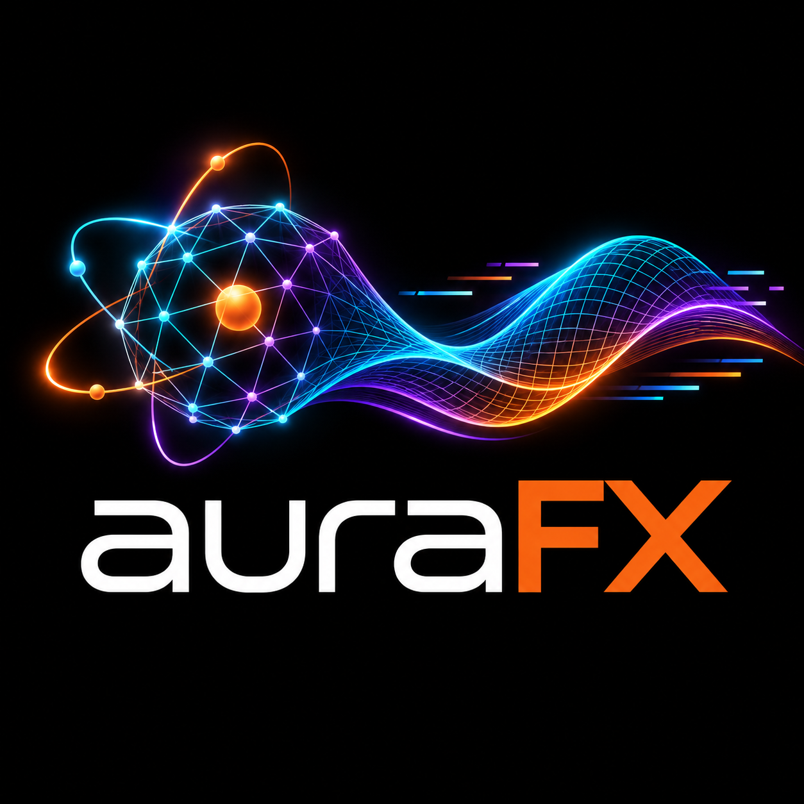
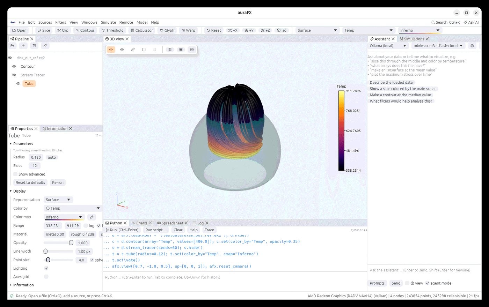

<p align="center">
  <picture>
    <source media="(prefers-color-scheme: light)" srcset="assets/branding/logo-wordmark-light.png">
    
  </picture>
</p>

<p align="center">
  <a href="LICENSE-MIT"></a>
  <a href="https://www.rust-lang.org"></a>
  <a href="https://www.python.org"></a>
</p>

**auraFX** is an open-source scientific visualization, analysis and simulation workbench
written in Rust. It reads the files your solvers write (Exodus II, VTK, LAMMPS dumps and
more), renders them on any GPU through Vulkan/Metal/DX12, and puts three things right next to the
3D view:

* an **AI assistant** (Claude, any OpenAI-compatible API, or local/cloud models through Ollama)
  that sees your pipeline and writes runnable Python for you,
* an **embedded Python** with a one-line-per-idea API (`afx.load(...).slice(...).color_by(...)`),
* a **simulation runner** that launches LAMMPS, MOOSE, OpenFOAM or your own Python pipeline
  locally, on a remote GPU box over SSH, or through Slurm, and opens the results when the run ends.

The same window also holds a **parametric CAD modeler** (sketches, a feature history, STEP in
and out), a **geometry and mesh generator** (hexahedral and tetrahedral meshes with named sets)
and a **grain workbench** for microstructures, so a part can go from a sketch to a mesh to a
solver run to pictures without leaving the app.

The goal is the breadth of a full visualization suite with a UI a new user can drive
without a manual. auraFX is inspired by ParaView, DREAM.3D and Cubit; it shares no code with
them. The full plan, with every reader, filter and view of the catalog mapped to a phase, is
in [ROADMAP.md](ROADMAP.md). The **user guide** is in [docs/userguide](docs/userguide/src/SUMMARY.md)
(also as a PDF, `docs/userguide/auraFX-user-guide.pdf`; build the online book with
`scripts/userguide/build.sh`).

<p align="center"></p>

---

## What works today

| Area | Status |
|---|---|
| **Readers** | Exodus II (NetCDF-3 and NetCDF-4/HDF5, time steps, nodal/element/global variables, blocks, displacements), VTK legacy and XML (`.vtk .vtu .vtp .vti .vtr .vts .vtt`, parallel, `.vtm`, `.pvd`), VTKHDF, OpenFOAM cases (ASCII/binary/gzip, decomposed, boundary patches), LAMMPS dumps and data files, XYZ / extended XYZ, EnSight Gold, CGNS (HDF5 and ADF), Xdmf 2/3, NetCDF (CF conventions, POP, CAM-SE with its connectivity file, MPAS), Tecplot (ASCII and binary), PLOT3D, molecules (PDB, XYZ, VASP, Gaussian cube, CML), images and image stacks as volumes, medical and microscopy volumes (DICOM, NRRD, MetaImage, MRC, OME-TIFF, NIfTI), point clouds (LAS/LAZ, H5Part, PTS), LS-DYNA d3plot, Fluent, Nastran, STEP/IGES/3MF, glTF, VRML, OFF, STL, PLY, OBJ, CSV; array units read from NetCDF files and shown in the legend; **AMR** (AMReX plotfiles, VTK `.vthb`, FLASH, Enzo, Chombo 1-D to 4-D, with their particles); **hyper tree grids** (`.htg`, with material interfaces); **cell grids** (`.dg`, discontinuous-Galerkin fields); **GIS** rasters (GeoTIFF, Esri ASCII grid, ERDAS Imagine) and vectors (Shapefile, GeoJSON, KML/KMZ, GeoPackage, FlatGeobuf, GML, MapInfo, Esri file geodatabases) — all without GDAL, and verified against reference readers |
| **Writers** | VTK XML (all types + multiblock), legacy VTK, VTKHDF, **Exodus II** (blocks, variables, all time steps), EnSight Gold, Xdmf, CGNS, hyper tree grids (`.htg`), cell grids (`.dg`), CSV, STL, PLY — all verified against reference readers |
| **Filters (80+, and 15 sources)** | Tessellate, Unstructured Cell Types, Programmable Filter, Python Calculator, Particle Tracer / Path / Streak Line, Temporal Interpolator, Temporal Shift Scale, Temporal Array Operator, Append Datasets, Append Attributes, Resample With Dataset (multi-input), Slice, Clip, Contour, Threshold, Calculator, Warp, Glyph, Stream Tracer, Tube, Plot Over Line, Probe, Resample To Image, Histogram, Descriptive Statistics, Integrate Variables, Gradient, Find Data, Extract Selection, Connectivity, Clean, Surface Normals, Smooth, Shrink, Reflect, Extract Block, Cell Size, Mesh Quality, Elevation, Triangulate, Tetrahedralize, Mask Points, Temporal Statistics, Extract Subset, OpenFOAM Boundary Patches, texture mapping, the AMR filters (Contour, Dual Grid, Resample, Level Ids), the hyper tree grid filters (Geometry, Feature Edges, Dual Grid, Depth Limiter, Generate Fields, Evaluate Coarse), the cell grid filters (To Unstructured Grid, Centers, Elevation, Transform, Warp, Probe, Compute Sides, Convert To Cell Grid), Compute Molecule Bonds and more |
| **Curved cells** | Lagrange and Bezier cells of any order (VTK types 68-80, rational weights, per-cell degrees) and quadratic cells drawn curved, with an adjustable subdivision level; Slice, Clip, Contour, Probe and Integrate Variables follow their nodes (verified against a reference implementation) |
| **Rendering** | wgpu (Vulkan / Metal / DX12 / GL), progressive path tracing, environment maps and metal/rough materials, Surface LIC, MSAA + FXAA, light kit and custom lights, shadows, ambient occlusion, tone mapping, order-independent transparency, Eye-Dome Lighting, crease-angle shading, surface / edges / wireframe / points / outline / molecules (ball-and-stick, van der Waals, liquorice) / **GPU volume rendering**, line widths, 18 color maps with previews plus a **color map editor** (histogram, drag markers, bands, reverse, your own presets, ParaView `.json` import/export), log scale, scalar bar, translucency, volumes depth-merged with surfaces, X-ray selection highlight, data axes grid, text and time annotations, headless rendering |
| **Interaction** | Several 3D views side by side or stacked with linked cameras; pick values on surfaces; rectangle selection of visible cells (or through); ruler; interactive slice/clip plane widget; camera presets; time player |
| **Finding your way** | A Welcome window; right-click an object (in the pipeline or the 3D view) for the filters that fit its data, with the reason, and cuts through the clicked point; filters that will not work say what they need; in the CAD environment a strip that says what to do next and a command search at the pointer; menus that write the geometry commands and the steps to a mesh |
| **UI** | Dark, light or system theme; Windows menu with panel toggles and layout presets; command palette (Ctrl+K); undo/redo; `.afx` session files and last-session restore; charts; spreadsheet; keyframe animation (camera and filter values on a timeline) and export (GIF, MP4, PNG) |
| **Python** | Embedded interpreter with the `afx` module, NumPy in and out, console with completion, `--script`, trace export; a **Notebook panel** (`.ipynb`) and a **Jupyter kernel** (`aurafx --install-jupyter-kernel`) that drives the window from JupyterLab |
| **Speed** | Slice, Contour, Clip, Threshold, Extract Surface, Stream Tracer, Gradient and Integrate Variables use every core, with the same results on any number of threads; 4M-cell slice in ~80 ms; watertight contours; thread limit in Settings |
| **Client/server** | File › Open on Server… reads and filters data on another machine through `aurafx-server` over SSH; only what you view comes back (its surface when big, or pictures drawn by the server's GPU when even that is too big); parallel servers spread data over many processes or machines (`processes=8`), started by the server itself, `mpirun`, `srun` or a command of your own; `afx.load(path, host="cluster")`; see [docs/client-server.md](docs/client-server.md) |
| **CAD modeling** | A parametric part modeler in the same window: constrained sketches, a feature timeline that rebuilds when a dimension changes, holes, patterns (also on a face), rounding and shelling, picked-edge fillets, draft and mirror about a face (chosen by a click in the 3D view), parts side by side as an assembly with a fit check; two kernels (exact B-rep and signed-distance fields) that name faces alike; STEP, IGES, 3MF and SolidCraft files in, STEP, IGES, 3MF, STL and OBJ out; a check of everything downstream before an edit is applied, with fixes (and an assistant's suggestion); parts mesh into hexahedra with their faces as named side sets (user guide: CAD modeling) |
| **Plugins** | Python plugins add filters, sources and readers with `@afx.filter`, `@afx.source`, `@afx.reader`, and panels of their own controls with `@afx.panel`; reload on save; **Rust plugins** as shared libraries built with the `aurafx-plugin` crate; Plugins window (Edit menu); see [docs/plugins.md](docs/plugins.md) |
| **AI** | Ollama (honours `OLLAMA_HOST`), Anthropic, OpenAI-compatible; streaming; pipeline-aware; **agent mode** runs code and iterates on results |
| **Simulations** | Local, SSH, Slurm, PBS and LSF jobs; templates for LAMMPS, MOOSE, OpenFOAM, SPPARKS, PINNACLE and Python pipelines, three of which write their input files from the pipeline's data (grain meshes, microstructures); results reopened for analysis; NVIDIA/AMD GPU selection; parameter sweeps; live logs; auto-open results; **live reload** of files a running solver writes; GPU monitor; remote file browser |

## Grains and meshes in the same window

auraFX is one place for a materials workflow: build a geometry and an all-hex (or
tetrahedral) mesh on it with a small command language, put a polycrystal on the mesh or build
a synthetic one from grain statistics, write and run the case in MOOSE, SPPARKS, PINNACLE or
LAMMPS locally or over SSH, and analyse the result or an EBSD scan with the grain filters
(segmentation, sizes, shapes, misorientations, KAM and GND, pole figures and ODFs, Schmid
and Taylor factors, SROD by build height) for FCC, BCC and HCP crystals. `.dream3d` files are
read and written with the pipeline that made them. The design is in
[docs/design/grains-and-meshing.md](docs/design/grains-and-meshing.md), tracked as sections
11 and 12 of the roadmap (both complete); the guide chapters are *Grains and crystals* and
*Geometry and meshing*.

## Examples and the project page

`examples/` holds runnable examples and tutorials (heat diffusion, spinodal decomposition and
Potts grain growth as Python pipelines; geometry-to-polycrystal and EBSD-analysis scripts),
described in the guide's *Tutorials and examples* chapter. The project page with short videos
of the application areas is `index.html` at the repository root
([aashiquear.github.io/auraFX](https://aashiquear.github.io/auraFX/)).

## Installing

Prebuilt packages are attached to each [release](https://github.com/aashiquear/auraFX/releases).
Desktop packages bundle their own Python 3.12 with NumPy, so the Python console works without
any setup.

| Platform | Package | One-line install |
|---|---|---|
| Linux (x86_64, aarch64) | `.tar.gz`, `.AppImage` | `curl -fsSL https://raw.githubusercontent.com/aashiquear/auraFX/main/scripts/install.sh \| sh` |
| macOS (Apple silicon, Intel) | `.dmg` | same command as Linux |
| Windows 10/11 (x64) | `-setup.exe` installer, portable `.zip` | `irm https://raw.githubusercontent.com/aashiquear/auraFX/main/scripts/install.ps1 \| iex` |
| Android 8+ | `.apk` (viewer build) | download and open the APK |
| iOS / iPadOS 15+ | unsigned `.ipa` (viewer build) | sign and install with Xcode, AltStore or Sideloadly |

The mobile builds are viewers: they open, filter, render and chart data, chat with the AI
assistant and submit jobs to remote machines, but they do not embed Python. Packages are built by
[`.github/workflows/package.yml`](.github/workflows/package.yml) using the scripts in
`scripts/package/`; you can run those scripts locally too.

## Building

Requirements: Rust 1.95+, Python 3.10+ with development headers (`python3-dev`), a GPU driver
with Vulkan (Linux/Windows) or Metal (macOS).

```bash
git clone https://github.com/aashiquear/auraFX
cd auraFX
cargo build --release
./target/release/aurafx                     # start the app
./target/release/aurafx run.e               # open a file
./target/release/aurafx --script setup.py   # run a Python script at startup
```

The embedded Python is the one PyO3 finds at build time (`PYO3_PYTHON=/path/to/python3` to
choose another, e.g. a conda env with SciPy/PyTorch). Install packages into that interpreter
with `pip` and they are available in the console.

On Linux, `scripts/install-desktop.sh` adds auraFX to your application menu with its icon.

## Python in thirty seconds

```python
m = afx.load("impact_run.e")                     # Exodus, VTK, LAMMPS, STL, CSV ...
s = m.slice(normal=[0, 1, 0]).color_by("stress", cmap="Inferno")
c = m.contour(values=[300.0])                    # any filter: node.<filter>(**params)
afx.over_time(m, "stress", stat="max")           # plots max stress for every time step
T = m.array("temperature")                       # NumPy array
m.add_array("T_celsius", T - 273.15)
afx.plot(range(len(T)), T, label="T")            # Charts panel
afx.view("iso"); afx.screenshot("slice.png")
afx.save_animation("run.gif")                    # every time step, or orbit=72 for a turntable
afx.ask("find where the plate yields and plot the max stress over time", agent=True)

# Run a simulation on a remote GPU machine and open the result when it finishes
afx.submit("lmp -sf gpu -pk gpu 1 -in in.melt", host="rocm-server", workdir="~/runs/melt",
           gpu="amd:0", outputs="dump.melt", auto_load=True)
```

`afx.filters()` lists every filter with its parameters; `afx.help_filter("clip")` explains one.
The Python panel's **Trace** button converts what you did with the mouse into this API.

## AI assistant

Pick a provider in the Assistant panel (or Settings):

* **Ollama**: local or cloud models; the server URL comes from `OLLAMA_HOST` or Settings.
* **Anthropic**: set `ANTHROPIC_API_KEY` or paste a key in Settings.
* **OpenAI-compatible**: OpenAI, OpenRouter, vLLM, LM Studio, Groq… set the base URL and key.

The assistant receives a text description of your pipeline (array names, ranges, bounds,
time steps), never the raw data. Code it writes runs only when you click **Run code**,
unless you enable auto-run.

## Architecture

```
crates/
  aurafx-data      data model: arrays, attributes, cells, image/rectilinear/structured/poly/unstructured grids, tables, multiblock, AMR, hyper tree grids, cell grids, time series
  aurafx-io        readers and writers (every format above, in pure Rust: own NetCDF-3, HDF5, ADF, SQLite, FlatBuffers and zip decoders)
  aurafx-filters   filters and sources with typed parameter schemas (one registry drives UI, Python and AI)
  aurafx-crystal   crystal orientations, symmetry and texture for the grain workbench
  aurafx-mesh      geometry kernel (signed distance fields), hexahedral and tetrahedral meshers
  aurafx-cad       parametric CAD document, sketch solver, two kernels (implicit and B-rep), STEP/IGES/3MF
  aurafx-gpu       GPU compute kernels that speed up filters (wgpu)
  aurafx-plugin    the crate Rust plugins are written against (and aurafx-plugin-example)
  aurafx-pipeline  pipeline graph, background execution, time, display properties, color maps
  aurafx-render    wgpu renderer, camera, tessellation, headless rendering
  aurafx-python    embedded CPython (PyO3) and the `aurafx` module
  aurafx-ai        streaming chat clients for Ollama, Anthropic and OpenAI-compatible APIs
  aurafx-jobs      job runner (local / SSH / Slurm), GPU discovery, solver templates
  aurafx-server    headless data (and rendering) server driven by the app over SSH; parallel workers
  aurafx-app       the egui desktop application
  aurafx-android   the Android viewer build
```

More detail in [docs/ARCHITECTURE.md](docs/ARCHITECTURE.md).

## Testing

```bash
cargo test --workspace
```

The tests (about 500) compare readers, writers and filters with reference outputs on the files in
`testdata/` (how each file and reference was made is in [testdata/README.md](testdata/README.md)
and [docs/reference/verification.md](docs/reference/verification.md));
the rendering tests draw on the GPU headless and check the pixels.

## Contributing

Contributions from the scientific computing, visualization and AI communities are welcome.
See [CONTRIBUTING.md](CONTRIBUTING.md). Pick an unchecked item in the roadmap, open an issue,
and send a pull request.

## License

auraFX is dual-licensed under either the [MIT License](LICENSE-MIT) or the
[Apache License, Version 2.0](LICENSE-APACHE), at your option. The bundled Phosphor icon font
is MIT-licensed (see `assets/fonts/`).

### Credits

Part of the CAD environment comes from two open-source projects, which can be found in full in
their own repositories: **SolidCraft** (the B-rep kernel's command engine and the STEP, IGES, 3MF
and design-file formats; MIT OR Apache-2.0, <https://github.com/tangency-labs/solidcraft>) and
**solidcore** (the geometry kernel under it; Apache-2.0,
<https://github.com/tangency-labs/solidcore>). The parts auraFX builds are carried in this
repository under `vendor/`, so the CAD environment works out of the box without fetching them;
auraFX's CAD module may diverge from them as it gains its own features, and developers take
upstream work when they choose ([vendor/README.md](vendor/README.md) says which version is
carried and how). The parametric part model, the sketch solver and the expression evaluator were
ported from the author's own EZ-YX-craft project (MIT OR Apache-2.0).

The licence of every crate auraFX builds in is in
[docs/reference/third-party.md](docs/reference/third-party.md); the notices and licence texts
they ask to be passed on are in [THIRD-PARTY-NOTICES.txt](THIRD-PARTY-NOTICES.txt), which the
packages ship and Help › About auraFX › Third-party licences shows.
