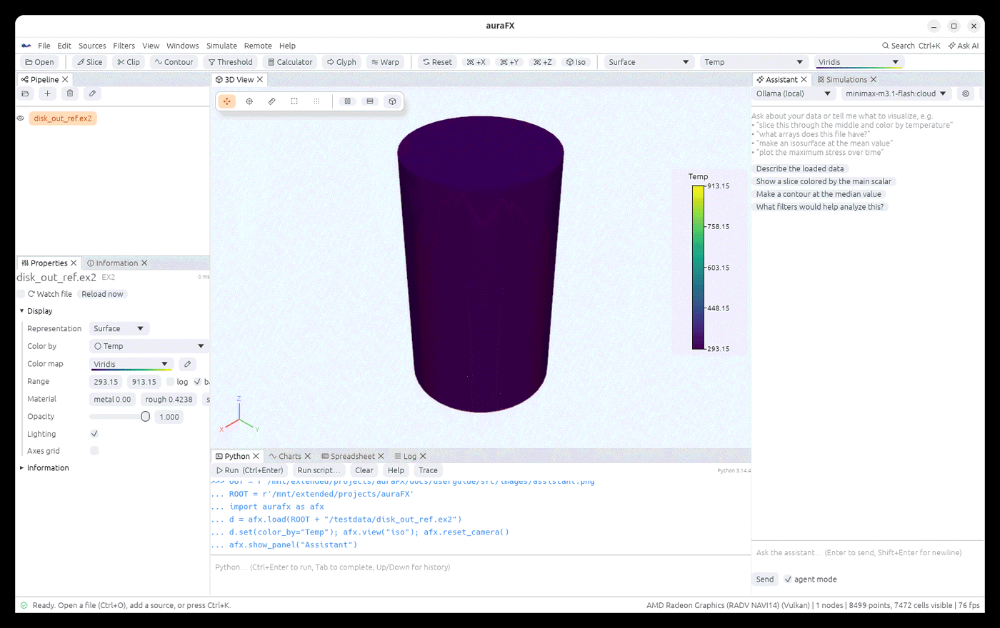
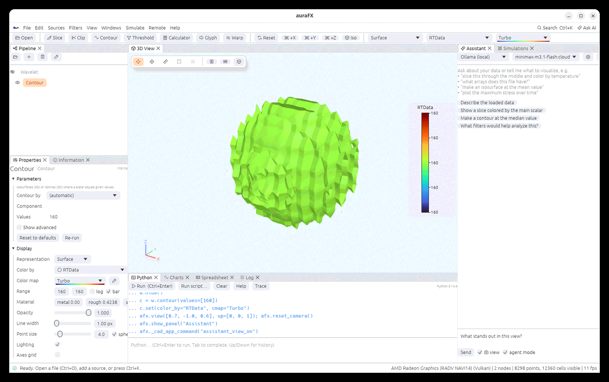

# AI assistant



The **Assistant** panel (right side; **Windows › Assistant**, or the **Ask AI** button) is a
chat with a language model that knows the app and your data. Ask in plain words: "slice this
through the middle and color by temperature", "what arrays does this file have?", "plot the
maximum stress over time", "why does my contour look cracked?". The assistant answers and,
when something should happen in the app, writes Python using the `afx` API.

## What the assistant sees

A text description of your pipeline: the objects, their filters and parameters, array names
with ranges, bounds, cell types and time steps, plus the last error. It never receives the
data itself. The description is rebuilt for every message.

## Running the code it writes

Code appears in a block with a **Run code** button; nothing runs until you press it, unless
**auto-run code** is ticked. With **agent mode** on (the default), the assistant runs its code itself, looks
at the result (values, errors, the pipeline) and keeps going until the task is done, so
"find where the plate yields and plot it" becomes several steps without you in between.

```python
afx.ask("make an isosurface at the mean temperature")
afx.ask("find where the plate yields and plot the max stress over time", agent=True)
```

**Showing it the view.** Tick the camera box next to **Send** and a picture of the 3D view goes with
the message, for models that see images (Claude, GPT-4o, and Ollama models such as llava, gemma or
qwen-vl): ask "what stands out in this picture?" or "is this mesh refined enough near the hole?".
From Python: `afx.ask("describe the view", view=True)`.



**Describe a filter.** **Filters › Describe a filter…** (also in the command palette) takes a
sentence about what you want to see in the selected object, such as "regions where the von Mises
stress is above 300 MPa" or "the vortex cores of the flow"; the assistant adds the filters that show
it (in agent mode, so it looks at the arrays and ranges first), and its steps appear in the
Assistant panel.

**Privacy.** In the assistant's settings: **Local only** sends nothing off your network (only an
Ollama server at a local or private address, and no cloud models; anything else is refused with the
reason), and **Hide file paths** replaces your home folder with `~` and full paths with file names
in what is sent. The data itself is never sent, only the pipeline's description (names, arrays,
ranges) and the results of code the assistant runs.

A script can wait for the assistant and read what it said: `afx.assistant_status()` returns
`{"busy", "agent", "messages", "last", "error"}` (an answer is arriving, agent mode is iterating,
the number of messages, the last answer, the last error).

## Modelling parts

The assistant knows the CAD modeler (see [CAD modeling](cad.md)). Ask it to **start** a part
("a base plate 60 by 40 by 8 mm; name the dimensions width, depth and thickness"), to **build**
it ("add a wall along the back edge, two 6 mm holes, round the corner"), and to **change** it
("make the plate 80 mm wide and the holes 8 mm"). It names dimensions, uses the part's faces by
name, checks the volume against numbers it worked out, and can open the part in the CAD
environment, edit the working copy, and apply it; when applying would break a node below the
part, it is asked for the fixes. It also places parts side by side (assemblies) and uses the
face operations (patterns on a face, draft, mirror).

## Providers

Choose the provider and model in the panel's drop-downs or in **Settings**:

| Provider | Setup |
|---|---|
| **Ollama** (local or cloud models) | the server URL from `OLLAMA_HOST` or Settings; the model list comes from the server |
| **Anthropic** | set `ANTHROPIC_API_KEY` or paste a key in Settings |
| **OpenAI-compatible** (OpenAI, OpenRouter, Groq, vLLM, LM Studio…) | the base URL and key in Settings |

No model is chosen at first: the model list beside the provider shows `<no model>` until you
pick one, and the choice is kept for the next start. With `<no model>`, messages are not sent:
pick a model first.

Answers stream as they are produced. The suggestion buttons under the welcome text are good
first questions for a new file.
