# CAD modeling

auraFX has a parametric part modeler. A part is a short list of **features** (a sketch
extruded, a hole cut, a boss added) with **named dimensions**. Change a dimension and the whole
part rebuilds, and everything built on it (meshes, grains, solver cases) can be re-run. The part
keeps **named faces**, so a later step can say "the wall of the bore" instead of a number that
changes when the part does.

It sits beside the command-based Geometry source of the previous chapter. Use Geometry for
quick specimens written as text; use a CAD model when the part has dimensions you want to
change, sketches, patterns and holes.

## The CAD Model source

Add one with **Sources › CAD Model** (or the command palette, `Ctrl+K`). It starts as a plate.
Its Properties show:

- **Dimensions**: the part's named dimensions. Type a new value or an expression such as
  `width / 2` and press **Enter**; the part and everything downstream update. The value the
  expression gives is shown next to it. **reset** returns to the value stored in the part.
  A dimension changed here belongs to this node and leaves the part untouched, so two nodes
  can show two sizes of one part.
- **Configuration**: shown when the part has configurations (named sets of dimensions such as
  *small* and *large*); pick one to build that variant.
- **Features**: the part's history in order. The checkbox suppresses a feature (the part is
  rebuilt without it).
- **Faces**: every face of the result with its number and name, its volume and area.
- **Resolution** and **Output**: cells along the longest side when the surface is drawn, and
  *Surface* or *Distance field* (the signed distance to the part, negative inside).

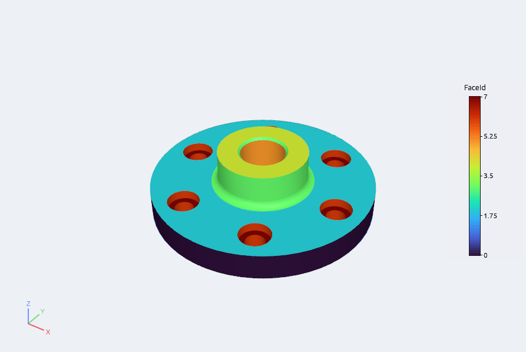

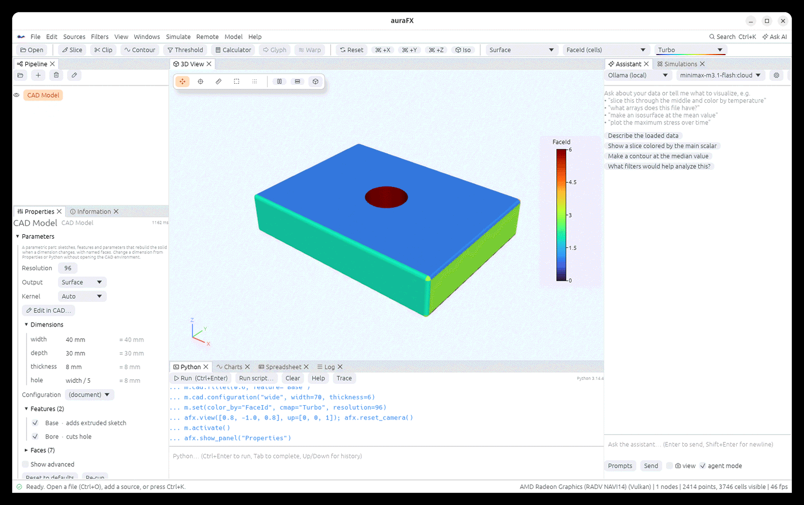

## Faces and their names

The surface has the cell arrays `BodyId` and `FaceId`, and the field arrays `FaceNames`
(indexed by face number), `BodyNames`, `Volume` and `SurfaceArea`: the same layout as the
Geometry source, so everything that works on a Geometry result works on a CAD model. Color by
`FaceId` to see the faces.

A face is named after the feature that made it and its place on that feature: a brick has
`x-`, `x+`, `y-`, `y+`, `z-` and `z+`; a cylinder or a hole has `side`, `bottom` and `top`; an
extruded sketch has `bottom`, `top` and one `side N` for each line, arc or circle of the
sketch (the sketch's own order). `Bore side` is the wall of a hole named *Bore*; `Base z+` is
the top of a brick named *Base*. Rename a feature and its faces are renamed with it, which the
later *downstream check* uses to follow them.

## The CAD environment

Editing happens in one mode of the same window. Open it from **Sources › CAD Model…** (which
adds a new part and opens it), from **Edit in CAD…** (right-click a CAD Model in the Pipeline,
or the button at the top of its Properties), or from Python with `part.edit_cad()`. While it
is open:

- the toolbar becomes the **ribbon** (every button with an icon and its name) with tabs *Sketch*, *Features*, *Modify*, *Inspect*,
  *Assemble* and *Files* (Alt+1 to Alt+6). Each button adds a feature with sensible sizes at
  the top of the part; you then set its numbers in the feature panel. *Inspect* reads the part
  (volume, surface, size, center, mass for a density, the area of a cross-section); *Assemble*
  places other parts (see below); *Files* starts from a template or opens and saves a document.
- the Pipeline panel becomes the **Model tree**: the part's dimensions, its features in
  order (the checkbox suppresses one; double-click renames; right-click for *Suppress*,
  *Roll back to here*, *Move up*, *Move down*, *Delete*), the modifiers on the whole part and
  the **configurations**: named sets of dimension values, variants of one part. Type a name and
  press *Save values* to keep the dimensions' present values under it (saving under an existing
  name replaces it), click a configuration to make it the active one, × removes it. The parts
  of an assembly are listed under *Components*: click one to move or turn it, double-click to
  rename it.
- the Properties panel becomes the **Feature panel**: every field of the selected feature.
  Each number accepts an expression of the dimensions: type `width / 2` instead of a number
  and the field follows the dimension (the value it gives is shown beside it). Choices (the
  end condition of an extrusion, the type of a hole, a mirror plane) are menus. With no
  feature selected it shows the part itself and its faces.
- the **timeline bar** at the bottom lists the features in order. The orange marker is the
  *rollback marker*: only the features before it are built, so you can look at the part as it
  was after the third feature, or insert a hole earlier in the history: a feature added while
  rolled back goes in at the marker. ◀ ▶ move it. Apply always hands over the whole part.
- the menu bar gains a **CAD** menu, and the part is built again after every edit, in the
  background (the timeline shows the time it took and the part's volume).
- **the pipeline is paused.** Other 3D views, charts and spreadsheets stay as they were and
  say so in a grey banner; nothing downstream re-runs on every edit.

### Finding your way

You do not need to know where a command is:

- **Next**, at the top of the model tree, follows what you are doing and offers the steps that
  make sense now as buttons: on an empty part *Sketch on the Top plane*, *Box* and *Start from a
  template*; in a sketch it says whether the outline is closed and how many degrees of freedom
  are left, and offers *Extrude*; when the part does not build it shows the reason and *Undo*.
  The same sentence is in the status bar at the bottom of the window.
- **Command search**: press **S** in the 3D view (or Ctrl+K, or the *Search* button beside the
  tabs). A small box opens at the pointer; type a few letters (`fil`, `hole`, `export`) and
  press Enter. Each result says which tab it is on, so you can find the button next time.
- **Right-click a face** of the part in the 3D view: its name, kind and area, and what can be
  done with it (*Sketch on this face*, *Fillet edges…*, *Shell*, *Pattern holes*, *Mirror*,
  *Select its feature*). Right-click a feature in the tree or the timeline for *Suppress*,
  *Roll back to here* and the rest.
- **Hover** over any button for what it does; a greyed button says why it cannot be used yet
  (*Apply* when the part does not build, a constraint without the right selection, *Extrude*
  without a closed outline).
- A feature that stops the part from building is **red with a warning sign** in the tree, and
  the reason stays at the top of the feature panel, with an *Undo the last change* button,
  until the part builds again. A feature marked **≈** is shown roughly by the kernel in use.
- **Keys**: Alt+1…6 the tabs, Ctrl+Enter Apply, Esc leave, Delete and F2 on the selected feature,
  Ctrl+Z / Ctrl+Shift+Z undo and redo (inside an open sketch they undo the sketch's own
  changes); in a sketch L line, R rectangle, C circle, A arc, P point.

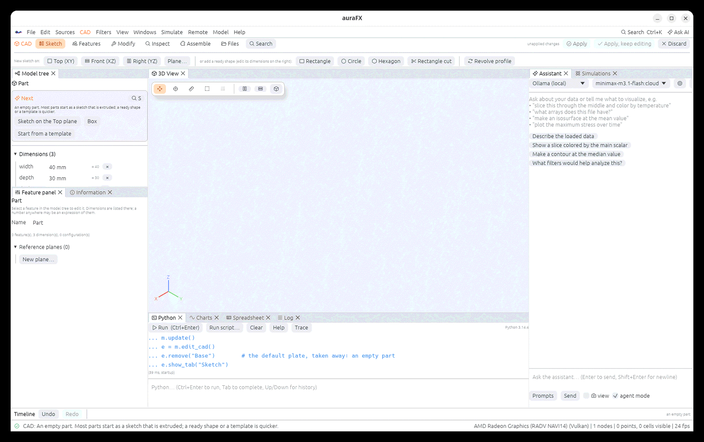

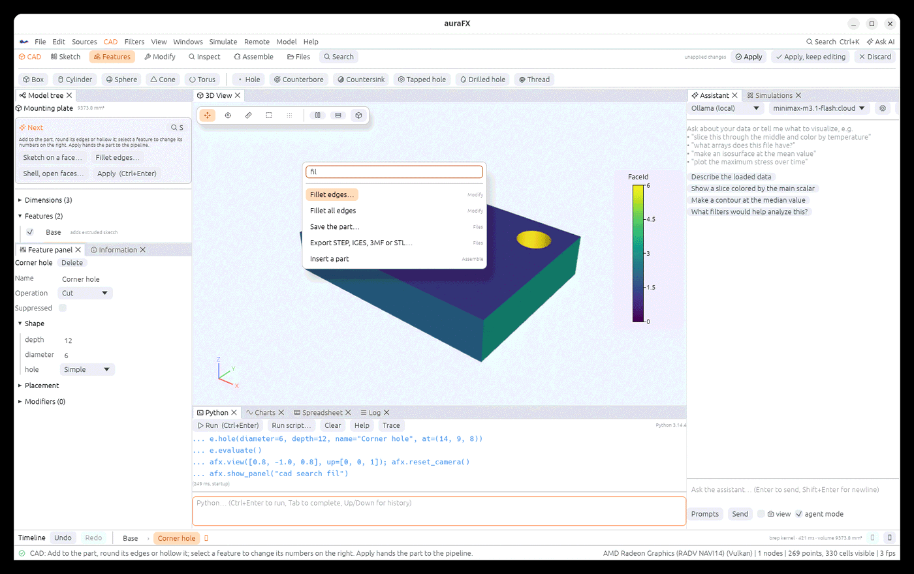

The part is shown as the node's **Kernel** setting builds it (*Auto*: the exact B-rep kernel
when it can build the part, else the distance-field one, with the features it could only
approximate marked ≈), so what you see is what the pipeline gets at Apply.

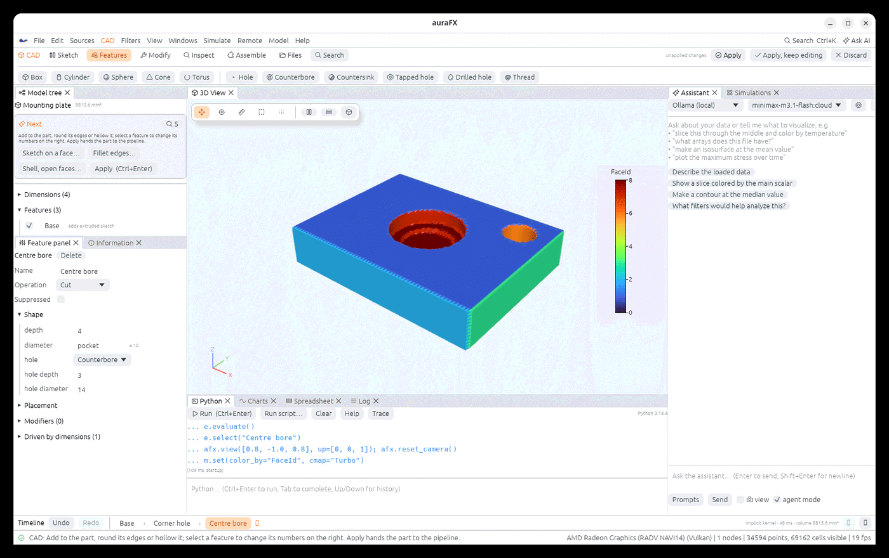

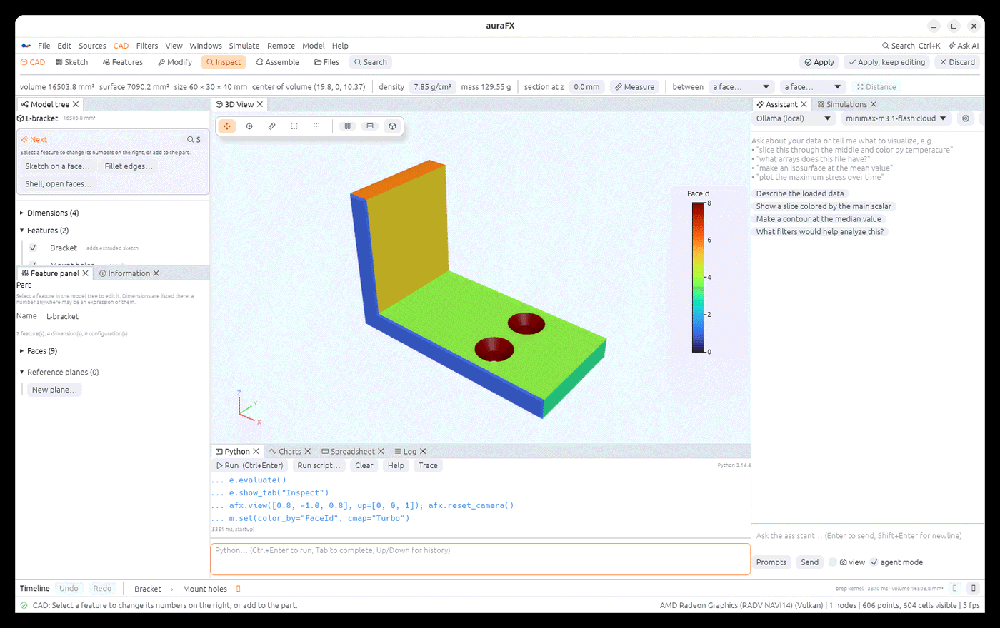

**Starter parts.** *Files › New from template* (or `afx.cad_model(template="flange")`) replaces the
part by one of six starters, all driven by named dimensions (the enclosure follows `width`,
`depth`, `height` and `wall`; the flange its diameter, bolt circle and number of holes):

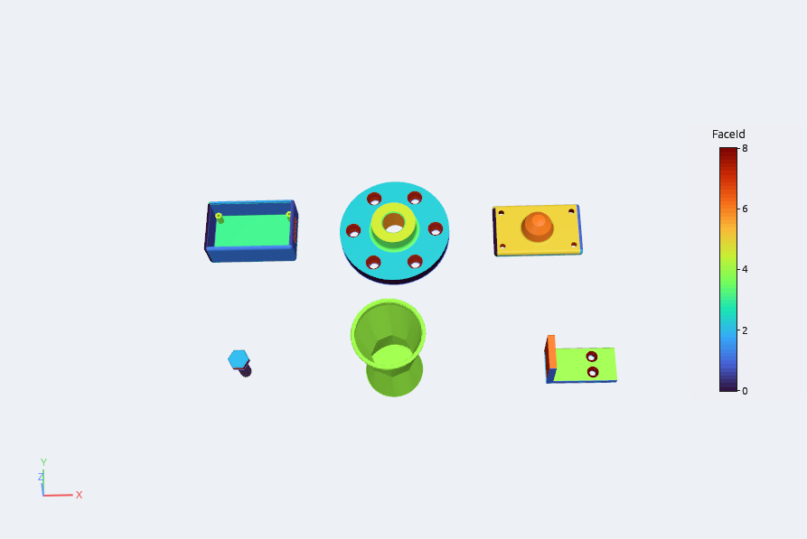

The right end of the ribbon leaves the environment:

- **Apply** hands the part to the CAD Model node and closes the environment; the nodes below
  it re-run. A part that does not build is refused, with the reason.
- **Apply, keep editing** does the same and stays.
- **Discard** (or `Esc`, which asks) closes it and leaves everything as it was.

All the edits of a session are **one undo step** in the main window (*Edit › Undo* after Apply
takes back the whole session). Inside the environment, *Undo* and *Redo* (`Ctrl+Z`,
`Ctrl+Y`, the timeline bar, the CAD menu) step through single edits.

The *Inspect* tab reads the part: volume, surface, size, center of volume, mass for a density,
and the area of a cross-section at a height. The *Files* tab starts from a template, opens an
`.afxcad` file, or saves the part as one.

From Python:

```python
e = part.edit_cad()            # open the environment; e is part.cad
e.box(size=(10, 10, 6), name="Boss", at=(0, 0, 11))
e.evaluate()                   # build it now (the window does this by itself)
e.rollback(1)                  # build only the first feature
e.undo(); e.redo()
e.apply()                      # or e.apply(keep_editing=True) / e.discard()
```

## What the nodes below depend on

Other nodes refer to a part by the names inside it: an Extract Set that names `Bore side`, a
mesh command that names a face, a clip plane placed inside the plate. Editing the part can
break these. So **Apply checks them first**. It compares the part as the nodes below were built
against with the part you made, finds what they refer to that changed, and opens a dialog:

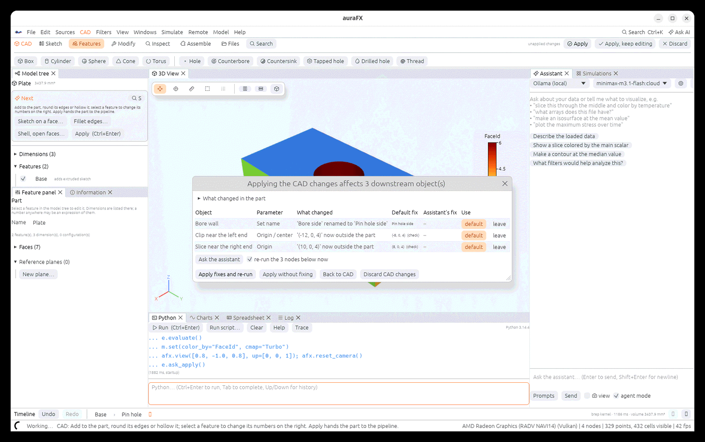

- **What changed in the part** lists faces that were renamed, replaced, removed or moved,
  dimensions added or removed, and the new bounds and volume.
- Each row is something below the part that refers to a changed thing: the object, its
  parameter, what happened to the thing it refers to (*renamed to…*, *removed*, *now outside
  the part*, *one of several*), the **default fix**, the **assistant's fix** when you asked for
  one, and a choice per row (*default*, *assistant*, *leave*).
- The default fixes are the safe ones. A renamed face is renamed where it is used, including
  inside command and expression text (whole names only: `Bore side` is not found inside `Bore
  sides`). A face that is gone but has one successor in the same place is replaced by it, and
  marked *(check)* because that is a guess. A position that fell outside the part is moved onto
  its nearest point. A face that is simply gone, or has several possible successors, has no
  default: you choose, or ask the assistant.
- **Ask the assistant** sends the changes, the conflicts and each affected node's filter and
  parameters to the assistant, which answers with a list of changes; they appear in the
  *Assistant's fix* column and the same chat shows its reasoning.
- **Apply fixes and re-run** applies the part and your choices, together, as one undo step;
  **Apply without fixing** applies the part and leaves the references (those nodes will show
  their own errors); **Back to CAD** returns; **Discard CAD changes** closes the environment
  as it was. The checkbox *re-run the nodes below now* postpones their re-run: they keep their
  old results, marked by a banner with **Run now**.

When nothing below is affected the dialog is only the question *Re-run N downstream filters?*
with **Run now**, **Later** and **Back to CAD**. A Python filter's code is searched for the
names as text: such rows say *(in code)* and have no default fix, because the name may not be
a reference.

From Python:

```python
e = part.edit_cad()
e.rename("Bore", "Pin hole")
report = e.check()             # {'diff': ..., 'conflicts': [...], 'downstream': [...], 'prompt': ...}
e.apply()                      # fix="default": applies the default fixes
e.apply(fix="none")            # leave what the check found as it is
e.apply(fix=answer_text)       # the text of an assistant's answer (a JSON list of fixes)
e.apply(run="later")           # the nodes below wait; part.cad.run_held() runs them
```

## Sketching

A sketch is a drawing on a plane that a feature extrudes or revolves. Start one from the
ribbon's **Sketch** tab:

- **Top (XY)**, **Front (XZ)** or **Right (YZ)**, or **Top of the part** (the plane of the
  highest face, to add a boss or cut a pocket).
- **A face…** opens the face picker: click any flat face of the part in the 3D view (or tick it
  in the list) and press **Apply**. Slanted faces work too: the sketch lies on the face, its x
  axis along the world's x (or y) laid flat on it. With no feature selected, *Faces* in the
  Feature panel also has **Sketch here** next to each flat face.
- A **reference plane** (each one has a button in the tab), made with **Plane…**.

To change an existing feature's sketch, right-click it in the model tree and choose **Edit
sketch…**, or press **Edit sketch…** in its properties.

### Reference planes

**Plane…** opens a form in the feature panel that makes a named plane, kept with the part:

- **From a plane**: Top, Front, Right or another reference plane, moved by an **Offset** along its
  normal and turned by an **Angle** about its own x or y axis.
- **From a face**: a flat face of the part, moved and turned the same way.
- **Through 3 points**: the normal follows the right-hand rule from point 1 to 2 to 3, and the
  sketch's x axis runs from point 1 to point 2.

The planes show as dashed squares with their names in the 3D view, and are listed under
*Reference planes* in the feature panel (no feature selected) with **Sketch** and **×**
(remove; sketches already drawn on a plane keep their place). A sketch on a plane 20 above the
top plane, turned 30° about its x axis, extrudes along the turned normal in both kernels.

```python
m.cad.plane(name="Tilted", from_plane="XY", offset=20, angle=30, about="x")
m.cad.plane(name="P", points=[(0, 0, 0), (10, 0, 0), (0, 10, 5)])
m.cad.extrude(m.cad.sketch(plane="Tilted").rectangle(20, 10), depth=5)
```

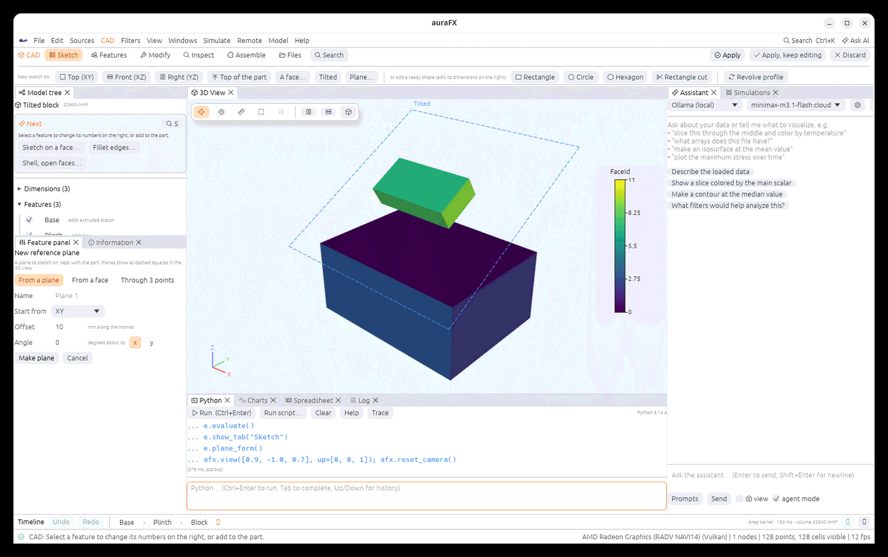

The canvas takes the place of the 3D view while a sketch is open:

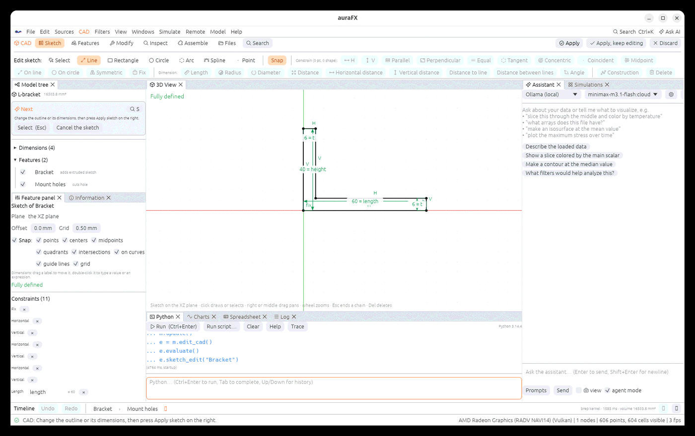

- **Draw** with the tools in the ribbon: *Line* (connected lines; right-click ends the chain),
  *Rectangle* (two corners), *Circle* (center, then a point on it), *Arc* (center, start,
  end), *Spline*, *Point*. A line drawn nearly horizontal or vertical becomes so.
- **Snap** (the ribbon's toggle) places new points on what is under the cursor, shown by an
  orange mark and its name: existing **points** (which joins shapes), **centers** of circles and
  arcs, **midpoints** of lines, **quadrants** of circles, **intersections**, the nearest point
  **on curves**, and the **grid**. While drawing, dashed **guide lines** show when the cursor
  lines up horizontally or vertically with a point, also one far away or the last point of the
  shape, and the point lands on that line. Each kind is switched on or off under *Snap* in the
  Feature panel, with the grid step; hold `Ctrl` to place a point freely. A point placed on a
  midpoint, a curve or an intersection is constrained there (midpoint, on line, on circle).
- **Select** shapes and points by clicking (Shift adds); drag a point to move it. Right or
  middle mouse drag pans, the wheel zooms, `Esc` ends a chain, `Del` deletes.
- **Constrain** the selection with the ribbon: horizontal, vertical, parallel, perpendicular,
  equal, tangent, concentric, coincident, midpoint, on line, on circle, symmetric, fix.
  **Dimension** it: *Length* of a line, *Radius*, *Diameter*, *Distance* between two points (also
  *Horizontal distance* and *Vertical distance*), *Distance to line* (a point and a line),
  *Distance between lines* (two parallel lines) and *Angle* between two lines.
- A dimension starts at the current size, with its value open for typing: type a number, or an
  expression of the part's dimensions (`width / 2`, `3 in`), and press `Enter`; the sketch follows
  the dimension from then on. Dimensions are drawn with extension lines and arrows (an arc for
  an angle, a leader for a radius or diameter). **Drag a label** to move it where it reads best,
  and **double-click** it to change the value. The **Constraints** list in the feature panel
  edits the same values.

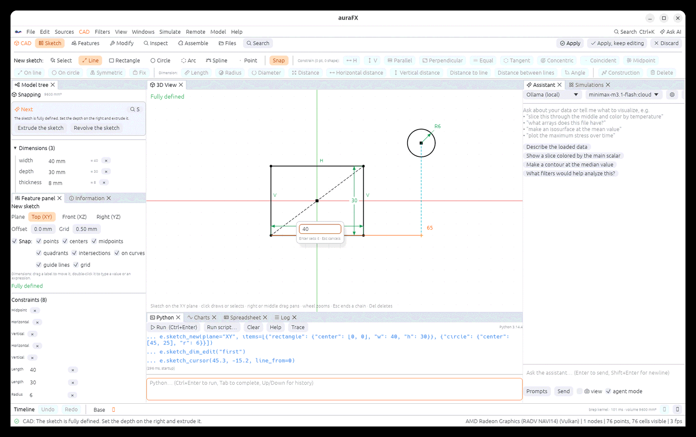
- The **solver runs after every change**. Shapes are **blue** while the sketch can still move
  (the status says how many degrees of freedom are left), **white or black** when it is fully
  defined, and **red** when constraints conflict (remove one). *Construction* turns the
  selected shapes into guides that are not part of the outline.

Finish from the feature panel: **Extrude** (or **Cut**, for a pocket) with a depth that may be
an expression, **reverse** to go against the plane's normal, **Revolve** about the plane's
vertical axis (draw on the Front plane with x as the radius), or **Apply sketch** when you
edited the sketch of an existing feature. The sketch then becomes a feature with named faces:
`side 1`, `side 2`… follow the order the shapes were drawn.

From Python, `e.sketch_new(plane="XY", items=[...])` and `e.sketch_edit("Bracket")` open the
canvas in the window, and `e.sketch(...)` with `e.extrude(...)` builds the same features
without it.

## Kernels, STEP and other files

A part is built by one of two kernels, chosen in the CAD Model's Properties (**Kernel**):

- **B-rep** builds *exact* solids with true faces and edges (a cylinder is a cylinder, a hole's
  wall is a real cylindrical face). It maps primitives, extruded and revolved sketches, lofts,
  holes, patterns (as copies), rounding and hollowing of a feature or of the whole part, the
  rounded junction a feature's *blend* makes with the part, drafts, mirrors about a face,
  combined parts, and cap chamfers. This is what **STEP** and **IGES** are written from, and it
  reads imported solids.
- **Implicit** describes the part as a distance field. It builds every feature, including
  threads, sweeps and a loft's shell, and never fails; edges are not exact. It leaves a picked
  fillet or a draft undone and says so.
- **Auto** (the default) uses B-rep when it can build the part and Implicit otherwise. The
  result carries a field `Kernel` (which one built it) and `KernelNotes` (why B-rep could not).

Both kernels name faces the same way (`Base z+`, `Bore side`), so everything built on the names
works on either. The CAD environment shows the part with the Implicit kernel while you edit (it
is quick), and the node builds it with the kernel you chose when you apply.

**Files.** *File › Open* (and `afx.load`) opens a **`.step` / `.stp`** (AP203, AP214, AP242),
**`.igs` / `.iges`**, **`.3mf`**, a SolidCraft **`.sc`** design, or an **`.afxcad`** document as
a **CAD Model**: the file's solid becomes the base feature of a part, with its bytes kept inside
the document, so you can add features to it (cut a hole through an imported bracket) and the
part still opens on another computer. STL and OBJ keep their ordinary readers; to edit one, add
it as a CAD Model from Python.

```python
m = afx.cad_model("bracket.step")                 # a solid from a STEP file as a CAD Model
m.cad.hole(diameter=6, depth=20, at=(10, 5, 8))   # cut into it
m.cad.save("bracket2.step")                       # exact STEP (faces and edges)
m.cad.save("bracket2.3mf"); m.cad.save("part.sc") # 3MF, a SolidCraft design (also .stl, .obj)
m.cad.save("bracket2.igs")                        # IGES, exact (the exact kernel only)
r = m.cad.save("lofted.step")                     # {"exact": False, "note": "faceted: ..."} when
                                                  # only the Implicit kernel builds the part
```

A part that only the Implicit kernel builds is written as STEP or STL from its tessellation: a
valid solid of triangles whose header says *faceted B-rep* and why. IGES is written only for a
part the exact kernel builds (its faces are true surfaces); for any other part the message says to
write STEP instead.

The files auraFX writes were checked with an independent CAD reader: the same number of faces
and the same volume, to a thousandth, for STEP and IGES (the checks are in the test suite and
need that reader installed to run).

## Edges, faces and measures

With the exact kernel the part has real edges, and you can work on them. In the **Modify** tab:

While one of these pickers is open you can also **click the part in the 3D view**: a click chooses
the face under the pointer, or, for an edge, the edge of that face the click is nearest to (click
again to un-choose). Chosen edges are drawn in orange and chosen faces are marked with a dot.

- **Fillet edges…** and **Chamfer edges…** open a picker in the feature panel that **lists the
  part's edges**, each with the two faces it lies between (`Base z+ × Bore side`), its length and
  whether it is curved. Tick the edges, set the size (a number or an expression of the
  dimensions) and press **Apply**: a *Fillet* or *Chamfer* feature is added after the features it
  modifies, so it follows them when you roll back or change a dimension.
- **Shell, open faces…** lists the faces; tick the ones to remove (none: a closed hollow body)
  and give the wall.
- **Draft faces…** lists the faces; tick the side faces to taper and give the angle. They stay
  fixed where the part meets the bottom plane and lean by that angle above it.
- **Pattern on a face…** lists the *flat* faces; pick one, choose **Holes** or **Bosses** and a
  **Row**, **Grid** or **Circle**, and give the size, the count, the spacing (or the radius of the
  circle). The first copy sits at the face's center and the row runs along the face's own x axis,
  so the pattern follows a face that is not horizontal. A pattern on a face is one feature: the
  count and the spacing can be changed afterwards, and a hole's copies share its face names
  (`Hole side`).
- **Mirror about a face…** lists the flat faces; the reflection of the part about the chosen face
  is joined to it. Model half a part, mirror it, and the halves stay in step when a dimension
  changes.

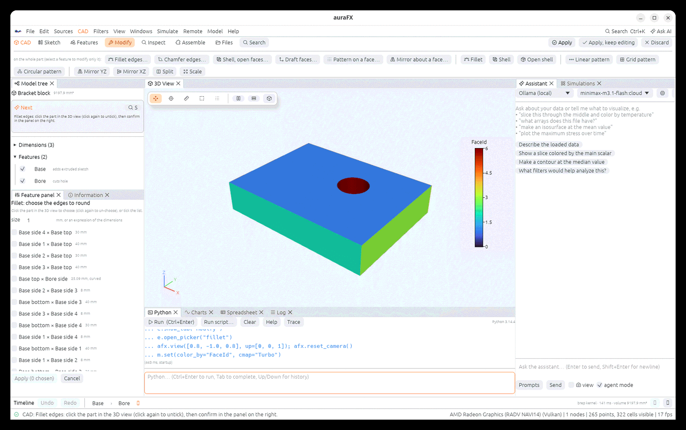

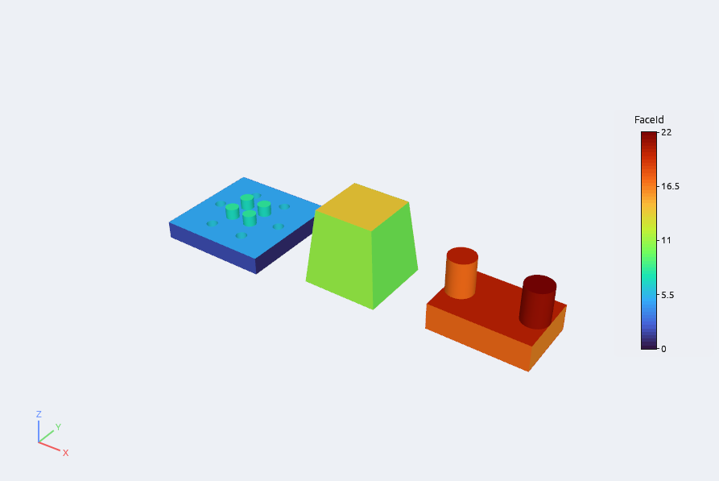

These features need the **B-rep** kernel for a fillet, a chamfer and a draft. On the Implicit
kernel a picked fillet or chamfer leaves the edges sharp and a draft leaves the faces vertical, and
the result says so (`KernelNotes`); a picked-face shell is approximated. Patterns on a face and
mirrors work on both kernels.
**Fillet** and **Chamfer** without a picker round every edge of the selected feature or of the
whole part.

The **Inspect** tab and Python read the part: mass (volume, surface, center, bounds, mass for a
density), the distance between two parallel flat faces and the angle between two faces (in the
tab: choose the two faces in the lists after *between* and press **Distance**), and the
volume two parts overlap when one is placed against the other. A sketch-extruded feature names
its faces `top`, `bottom` and `side 1`, `side 2`… in the order its outline was drawn (the
default plate: `Base side 1` at the front, then counter-clockwise); right-click a face in the
3D view to read its name.

```python
b = afx.cad_model()                                  # the default plate
b.cad.edges()                                        # [{'index': 0, 'point': [...], 'length': 30.0,
                                                     #   'faces': ['Base bottom', 'Base side 1'], ...}, ...]
b.cad.fillet_edges(("Base top", "Base side 2"), size=2)  # the edge between two named faces
b.cad.chamfer_edges([0, 3, 5], size=1)               # edges by index (or a point on each)
b.cad.shell_faces(["Base top"], thickness=2)         # an open box
b.cad.draft(["Base side 1"], angle=5)                # taper a face, fixed at the bottom plane
b.cad.mirror_about("Base side 4", (1, 0, 0))         # the reflection about that face (the one at x = -20)
b.cad.edit("face_pattern", face="Base top", layout="circular", count=6, radius=12, diameter=4, depth=6)
b.cad.edit("combine", template="flange", op="subtract", at=(0, 0, 4))   # cut another part from this one
b.cad.mass(7.85)                                     # steel
b.cad.measure_faces("Base side 4", "Base side 2")    # {'parallel': True, 'distance': 40.0, ...}
b.cad.interference(other, at=(12, 6, 0))             # overlap volume with another CAD Model placed there
```

## Assemblies

A CAD Model can hold **several parts side by side**. On the **Assemble** tab, **Insert part**
places another part: a template, a blank part, or a CAD file (`.afxcad`, STEP, IGES, 3MF, `.sc`).
The part keeps its own features and dimensions; the model shows all the parts together, as one
surface with one body per part, and a part's faces are named `Part/Face` (`Lid/Base z+`), so the
mesh tools and the downstream check refer to them as they do to any face.

In the feature tree a **Components** section lists the parts. Tick one off to leave it out, click
a name to see where it sits: three positions (mm) and three turns (degrees, about x, y and then
z), which you can drag or type; **×** removes it. **Check fit** lists the pairs of parts that
overlap, with the overlap volume in mm³ (the parts are compared two at a time, on the exact
solids when the exact kernel builds them), and says so when none do.

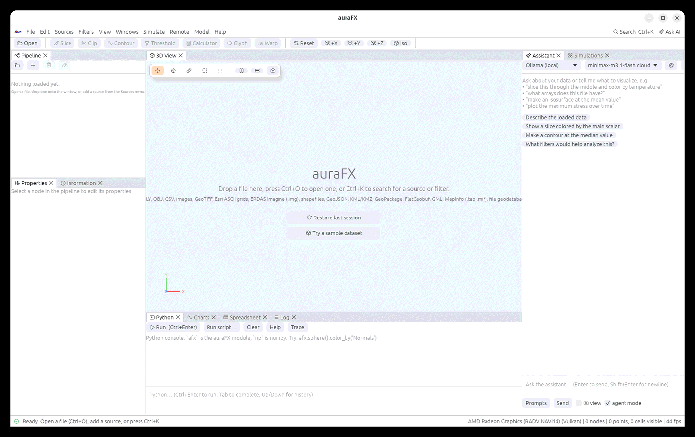

**Add part**, **Cut with part** and **Keep common part** (on the same tab) do something else: they
make another part a *feature* of this one, which joins it, removes its volume or keeps only the
common volume. Use components for parts that stay apart (a bolt in a bracket) and these for parts
that become one solid.

```python
m = afx.cad_model(name="Housing")
m.cad.component_add(name="Lid", template="bracket", at=(0, 0, 14))
m.cad.component_add(name="Bolt", file="bolt.step", at=(20, 0, 14), rotate=(0, 90, 0))
m.cad.component_op("Lid", "add", kind="cylinder", radius=3, height=6)   # edit a part in place
m.cad.component_move("Bolt", by=(0, 5, 0))
m.cad.component_interference()                        # [{'a': 'Lid', 'b': 'Bolt', 'volume': 120.4}]
m.cad.components()                                    # name, position, turn, visibility
```

## From a CAD part to a mesh and a solver case

A CAD Model feeds the meshing tools directly, and **its faces come along as named side sets**:

- **Overlay Mesh** of a CAD Model fills it with hexahedra; the mesh has one side set per CAD face
  (`Bore side`, `Base z+`, or `plate_with_hole face 3` for a solid read from a STEP file), so a
  boundary condition can name the wall of a hole. **Extract Set** shows one.
- In geometry commands, **`import 'part.step'`** (also `.stp`, `.igs`, `.3mf`, `.sc`, `.afxcad`)
  brings the part in as a body whose faces keep their names, and `mesh body 1 size 0.5 scheme
  overlay` meshes it; the Hex mesh output carries the same side sets.
- **Tet Mesh** keeps the names too: one side set per CAD face.
- Assign Grains and the solver cases follow as for any mesh: give the set to hold and the set to
  pull by name (`fixed='plate_with_hole face 1'`, `loaded='plate_with_hole face 2'`).

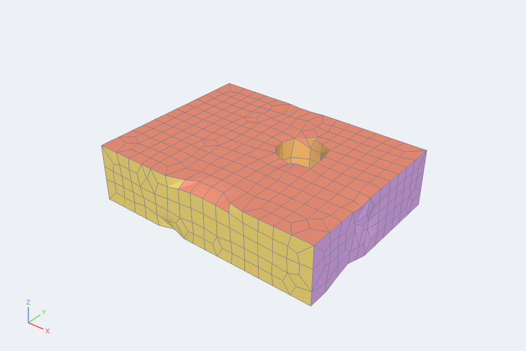

```python
part = afx.load("bracket.step")                # a CAD Model
mesh = part.overlay_mesh(cell=1.0)             # hexahedra; side sets named after the faces
grains = mesh.assign_grains(grains=40, blocks=True, boundaries=True)
afx.simulation_case(grains, "moose", "case", fixed="bracket face 1", loaded="bracket face 2")
```

## Python

```python
m = afx.cad_model()                                   # a plate; or afx.cad_model("part.afxcad"),
                                                      # afx.cad_model(template="flange")
m.cad.parameter("width", "60 mm")                     # a named dimension
m.cad.hole(diameter="width / 10", depth=20, name="Bore", at=(0, 0, 12))   # cuts down from z = 12
m.cad.fillet(0.8)                                     # round the whole part
print(m.cad.volume(), [f["name"] for f in m.cad.faces()])
m.set(width=80)                                       # a dimension, without editing the part
```

Any number may be an expression of the dimensions (`"width / 2"`): the field then follows the
dimension. The calls:

| Call | What it does |
|---|---|
| `m.cad.parameter(name, expr)` | names a dimension (units allowed: `"1.5 in"`) |
| `m.cad.box`, `sphere`, `cylinder`, `cone`, `torus` | add (`op="add"`), cut (`"cut"`) or intersect (`"intersect"`) a solid; `at=(x, y, z)` and `rotate=(rx, ry, rz)` place it |
| `m.cad.hole(diameter, depth, kind=...)` | a hole cut downward from `at`: `simple`, `drilled`, `counterbore`, `countersink`, `tapped` |
| `m.cad.thread(major_diameter, pitch, length)` | a helical thread |
| `s = m.cad.sketch(plane="XY")`, then `.rectangle(w, h, center=...)`, `.circle(r)`, `.polygon(points)`, `.regular(sides, r)` | a sketch with its dimensions |
| `m.cad.extrude(s, depth, end="blind")` | extrude a sketch (`"midplane"`, `"through_all"`; `draft`, `top={"fillet": 1}`) |
| `m.cad.revolve(s, angle=360)` | revolve a sketch about its vertical axis (x is the radius) |
| `m.cad.fillet(r)`, `shell(t)`, `linear_pattern`, `grid_pattern`, `circular_pattern`, `mirror`, `split`, `scale` | modifiers on a feature (`feature="Base"`) or the whole part |
| `m.cad.mirror_about(face_or_point, normal)`, `draft(faces, angle)`, `edit("face_pattern", ...)`, `edit("combine", ...)` | operations on faces and bodies |
| `m.cad.component_add(...)`, `component_move`, `component_op`, `component_visible`, `component_remove`, `components()`, `component_interference()` | assemblies |
| `m.cad.suppress(name)`, `remove`, `rename`, `move` | edit the history |
| `m.cad.configuration("small", width=20)`, `activate("small")` | named variants |
| `m.cad.faces()`, `volume()`, `features()`, `parameters()` | read the result |
| `m.cad.save("part.afxcad")`, `m.cad.load(path)` | files |

Every call is one undo step, and is recorded in the Python trace. A feature name can be used once
(faces are named after features): adding a second `Base` is refused with that reason, and
`m.cad.clear("Name")` empties a part to start from nothing.

## Files

A part is saved as an **`.afxcad`** file: readable JSON with a format version, so a later
auraFX opens an earlier file, and an earlier one says plainly that a file is from a newer
version. The state files (`.afx`) hold the part inside, so a session reopens with it.

## Meshing a part

A CAD model feeds the same tools as Geometry: **Overlay Mesh** turns its surface into
hexahedra, **Tet Mesh** into tetrahedra, **Assign Grains** and the solver cases follow.
Face names carry through: an extracted set or a boundary layer can name `Bore side`.

## Limits

- The Implicit kernel describes the part as a distance field. It never fails on a hard
  combination of features, but edges are not exact lines: the faces it reports are labelled
  regions of the surface. The B-rep kernel is exact but refuses a few things (a feature-level
  mirror of a shape that is not symmetric, a sweep): *Auto* then falls back and says so.
- A sketch on a face is placed where the face was when you picked it; it does not follow the
  face if an earlier feature later moves it. Deleting or adding a line of a sketch renumbers the
  `side N` faces after it.
- Sweeps and lofts exist in the document (the vase template uses one) but have no button yet.
- A dimension that makes a sketch impossible (constraints that contradict each other) is
  refused, and the part keeps its last valid state.
- Sketches start on the principal planes, on reference planes and on flat faces; a curved face
  cannot be sketched on.
- Components are placed rigidly, by position and turn; there are no mates or motion. A component
  is edited in place from Python (`component_op`); to model it with the sketch canvas, build it as
  its own CAD Model and insert the file.
- Check fit samples the two solids on a grid, so a thin overlap smaller than a cell is missed;
  the result is accurate to a few percent for overlaps that span several cells.
