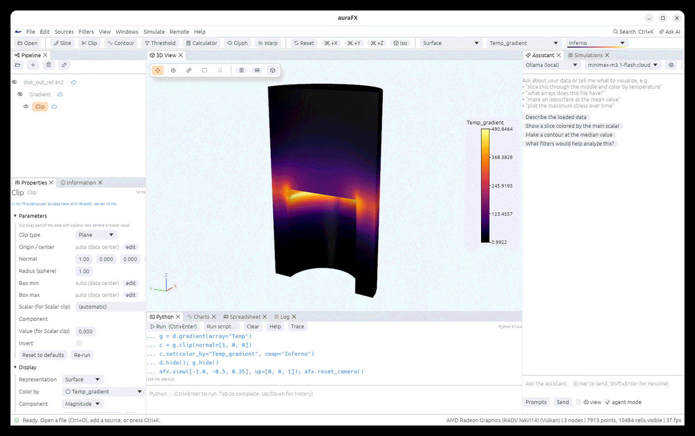
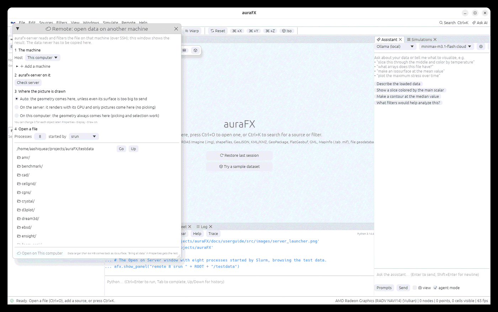
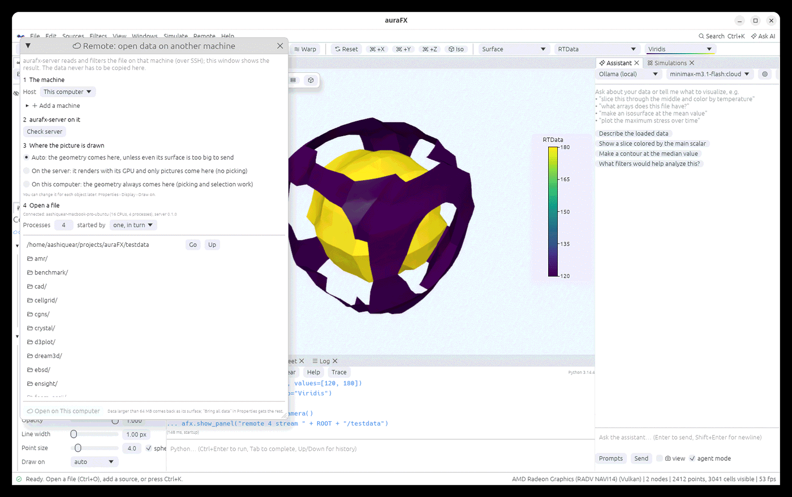

# Data on another machine

When the data lives on a cluster or a GPU box, auraFX can read and filter it **there** and
bring back only what you look at, with nothing to set up beyond SSH.

## How it works

`aurafx-server` is a small program without a window. The app starts it on the host over SSH
(`ssh host aurafx-server --stdio`) and talks to it through that connection, so keys, jump
hosts and `~/.ssh/config` work as usual and no port is opened. Files you open on the server
are read there; filters you add below them (Slice, Clip, Contour, Threshold, Stream Tracer,
temporal filters and so on) run there too. What comes back:

| Situation | What is transferred |
|---|---|
| Visible, output smaller than 64 MB | the whole output |
| Visible, larger | its outer surface (all arrays), which is what the 3D view draws |
| Hidden (for example a reader with a slice below it) | only its summary: arrays, ranges, bounds, time steps |
| **Bring all data** ticked in Properties, or a filter below it that runs here | the whole output |

The Information panel always describes the full data on the server. Python filters
(Programmable Filter, Python Calculator) and plugin filters run on this computer, on the data
brought over. The server keeps results, so changing one filter only re-runs that filter there.

## Setting up a host

Everything is in one window: **Remote › Open data on another machine…** (also **File › Open on
Server…**). It walks through four steps:

1. **The machine.** Pick it, or open **Add a machine** and type its SSH target (`user@machine`
   or an alias from `~/.ssh/config`; the aliases found there are offered as buttons), with a port,
   key file or jump host if needed. `ssh machine` must work without a password prompt. Machines
   added here are also the Simulations panel's, and the other way round. "This computer" runs the
   server locally, which is handy for trying it out.
2. **aurafx-server on it.** **Check server** shows its version and GPU; **Install server** copies
   the one shipped with the app to `~/.local/bin` (Linux hosts of the same architecture; the
   packages run on glibc 2.35 or newer). You can also build it there with
   `cargo build --release -p aurafx-server`, or point `AURAFX_SERVER` at it in the host's setup lines.
3. **Where the picture is drawn.** *Auto* brings the geometry here unless even its surface is too
   big to send; *On the server* renders it with the server's GPU and sends only pictures (the 3D
   view on this computer shows them, merged with local objects by depth; picking does not work on
   them); *On this computer* always brings the geometry. Each object keeps the choice, and
   **Properties › Display › Draw on** changes it later.
4. **Open a file.** Browse to it and double-click, or select it and press **Open on …**.


## Opening files

A cloud icon marks objects that run on a server; hover it, or look at the top of Properties, to
see what was transferred and how long the server took. From Python:

```python
d = afx.load("/scratch/run42/out.e", host="cluster")   # a Simulations host, ssh alias or user@machine
d = afx.load("ssh://cluster/scratch/run42/out.e")       # the same
s = d.slice(normal=(0, 0, 1))                            # runs on the server
s.set(all_data=True)                                     # bring the whole output over
afx.servers()                                            # connections and the machines' details
```

### Reader options on the server

Files on a server have the same **Reader options** as local ones (an MPAS file's vertical
level and layout, a NetCDF file's grid, a CAM-SE file's connectivity file…). The server looks
at the file and reports its options with its first answer, so they appear under Properties a
moment after the file opens. Changing one has the server read the file again with it; on a
parallel server, every process reads its piece with it. Paths in options, such as a CAM-SE
connectivity file, are paths on the server.

```python
d = afx.load("/scratch/ocean/output.nc", host="cluster")
d.set(vertical_level=10)          # read on the server
```

From Python, an option the file does not have is refused once the server has said which ones
it has; before that, the server ignores names it does not know. Saved states keep the options.


## Drawing on the server

Some outputs are too big even as a surface. Then the server draws the object with its own GPU
and sends pictures (a color and a depth image per view, compressed), which the 3D view blends
by depth with the local objects, so everything hides and is hidden correctly. While you move
the camera the last picture stays up until the next one arrives.

**Display › Draw on** in Properties picks per object: **auto** (drawn here unless the surface
is over 64 MB), **this computer**, or **the server** (`node.set(draw_on="server")`). Picking,
rulers and selections need the geometry here, so switch to "this computer" for those.
Translucent objects, volumes and Surface LIC are always drawn here. The view's lights and
shadows travel with each request; screen effects (ambient occlusion, Eye-Dome Lighting, FXAA,
tone mapping) are applied here to the whole picture.

## Parallel servers

Data too big for one process can be spread over several:
**Open on Server › Processes**, or `afx.load(path, host="cluster", processes=8)`, starts
eight worker processes on the host (`aurafx-server --workers node1:16,node2:16` spreads them
over machines sharing a file system). Partitioned VTK files are read piece by piece; other
files are read by every process and split. Cell-by-cell filters run on every piece with
automatic values taken from the whole data; the pieces come back appended, as a merged
surface, or as pictures composited by depth. Results match a single process exactly.

Filters that look at the cells around each point (**Gradient**, **Cell Data to Point Data**,
**Surface Normals**, **Curvature**, **Compute Derivatives**) also run on every piece: each
process first gets a layer of ghost cells, the neighbouring pieces' cells along its border, so
values on the borders between pieces are the same as with one process; the ghosts are
dropped before anything comes back. Other filters (connectivity, statistics, anything that
needs the whole data) run on the server's main process with the pieces put together.



### Starting the processes with MPI or Slurm

On a cluster, choose **started by** next to Processes: *mpirun* (MPI), *srun* (Slurm), or *a
command* with `{n}` for the number of processes and `{cmd}` for the worker command (for example
`mpiexec -n {n} -hostfile hosts {cmd}`). The server opens a port, runs the launcher, and each
rank (from `OMPI_COMM_WORLD_RANK`, `PMI_RANK`, `PMIX_RANK` or `SLURM_PROCID`) connects back with
a one-time token and holds its piece. The ranks must be able to reach the server's machine
(`AURAFX_CONNECT_HOST` sets the address they use, by default its host name); a launch that ends
early, or ranks that do not connect within 60 seconds, give an error naming the command.

```python
big = afx.load("/scratch/run/out.pvtu", host="cluster", processes=64, launcher="srun")
```

Results match a single process: three ranks from a launch give the same contour area as one
process to 1e-9.



## Files larger than memory

A file bigger than the memory of the machine can still be cut, contoured or sliced: choose
**started by › one process, one piece at a time** next to Processes (on *This computer* or any
host), or

```python
big = afx.load("/data/run/volume.vti", stream=16)       # on this computer
big.contour(array="T", values=[600]).set(color_by="T")
```

One server process then reads the file in 16 pieces, one after another: it reads a piece, runs
the filters on it, keeps what comes out (a surface, a slice, a contour, a table of numbers),
forgets the piece and goes on to the next, so it needs memory for one piece and the results
only. The same filters as on a parallel server work this way, including the ones that need
ghost cells; filters that need the whole data at once (connectivity, statistics) put the
pieces together and need the memory for all of them. Each change re-reads the file, so this is
slower than holding the data in memory.

Which files are read piece by piece:

- VTK XML image, rectilinear, structured and unstructured grids (`.vti`, `.vtr`, `.vts`,
  `.vtu`) with their data appended as raw or compressed binary, as auraFX and most programs
  write them: a piece is a slab of the grid (or a range of cells and the points they use), and
  only its bytes are read from the file (compressed data: only the blocks holding it are
  unpacked).
- Partitioned VTK files (`.pvtu`, `.pvti`, ...): each piece reads its share of the piece files.
- Other formats are read whole for every piece and then cut, which saves no memory: convert
  them to VTK XML first (File › Save Data).



Not yet: ghost cells, sharing one server between people, temporal filters on parallel servers.
