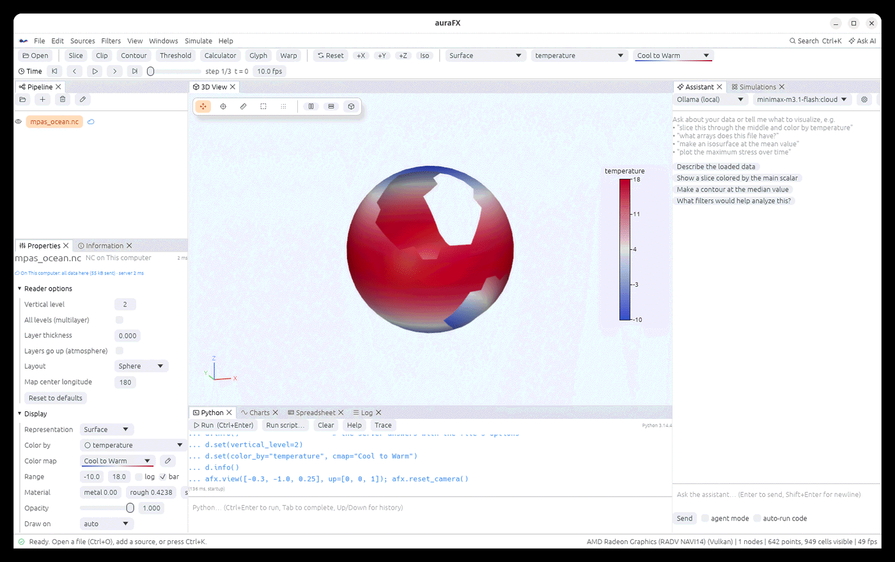

# Data on another machine

When the data lives on a cluster or a GPU box, auraFX can read and filter it **there** and
bring back only what you look at, like ParaView's `pvserver`, with nothing to set up beyond
SSH.

## How it works

`aurafx-server` is a small program without a window. The app starts it on the host over SSH
(`ssh host aurafx-server --stdio`) and talks to it through that connection, so keys, jump
hosts and `~/.ssh/config` work as usual and no port is opened. Files you open on the server
are read there; filters you add below them (Slice, Clip, Contour, Threshold, Stream Tracer,
temporal filters and so on) run there too. What comes back:

| Situation | What is transferred |
|---|---|
| Visible, output smaller than 64 MB | the whole output |
| Visible, larger | its outer surface (all arrays), which is what the 3D view draws |
| Hidden (for example a reader with a slice below it) | only its summary: arrays, ranges, bounds, time steps |
| **Bring all data** ticked in Properties, or a filter below it that runs here | the whole output |

The Information panel always describes the full data on the server. Python filters
(Programmable Filter, Python Calculator) and plugin filters run on this computer, on the data
brought over. The server keeps results, so changing one filter only re-runs that filter there.

## Setting up a host

1. Make sure `ssh yourhost` works without a password prompt.
2. Put `aurafx-server` on the host: **File › Open on Server… › Install server** copies the one
   shipped with the app to `~/.local/bin` (Linux hosts of the same architecture; the packages
   run on glibc 2.35 or newer), or build it there with `cargo build --release -p aurafx-server`,
   or point `AURAFX_SERVER` at it in the host's setup lines.
3. **Check server** shows its version and GPU.

Hosts come from the Simulations panel and from `~/.ssh/config`. "This computer" runs the
server locally, which is handy for trying it out.

## Opening files

**File › Open on Server…**: pick the host, browse to the file, double-click it. A cloud icon
marks objects that run on a server; hover it, or look at the top of Properties, to see what
was transferred and how long the server took.

```python
d = afx.load("/scratch/run42/out.e", host="cluster")   # a Simulations host, ssh alias or user@machine
d = afx.load("ssh://cluster/scratch/run42/out.e")       # the same
s = d.slice(normal=(0, 0, 1))                            # runs on the server
s.set(all_data=True)                                     # bring the whole output over
afx.servers()                                            # connections and the machines' details
```

### Reader options on the server

Files on a server have the same **Reader options** as local ones (an MPAS file's vertical
level and layout, a NetCDF file's grid, a CAM-SE file's connectivity file…). The server looks
at the file and reports its options with its first answer, so they appear under Properties a
moment after the file opens. Changing one has the server read the file again with it; on a
parallel server, every process reads its piece with it. Paths in options, such as a CAM-SE
connectivity file, are paths on the server.

```python
d = afx.load("/scratch/ocean/output.nc", host="cluster")
d.set(vertical_level=10)          # read on the server
```

From Python, an option the file does not have is refused once the server has said which ones
it has; before that, the server ignores names it does not know. Saved states keep the options.



## Drawing on the server

Some outputs are too big even as a surface. Then the server draws the object with its own GPU
and sends pictures (a color and a depth image per view, compressed), which the 3D view blends
by depth with the local objects, so everything hides and is hidden correctly. While you move
the camera the last picture stays up until the next one arrives.

**Display › Draw on** in Properties picks per object: **auto** (drawn here unless the surface
is over 64 MB), **this computer**, or **the server** (`node.set(draw_on="server")`). Picking,
rulers and selections need the geometry here, so switch to "this computer" for those.
Translucent objects, volumes and Surface LIC are always drawn here. The view's lights and
shadows travel with each request; screen effects (ambient occlusion, Eye-Dome Lighting, FXAA,
tone mapping) are applied here to the whole picture.

## Parallel servers

Data too big for one process can be spread over several, like `mpirun pvserver`:
**Open on Server › Processes**, or `afx.load(path, host="cluster", processes=8)`, starts
eight worker processes on the host (`aurafx-server --workers node1:16,node2:16` spreads them
over machines sharing a file system). Partitioned VTK files are read piece by piece; other
files are read by every process and split. Cell-by-cell filters run on every piece with
automatic values taken from the whole data; the pieces come back appended, as a merged
surface, or as pictures composited by depth. Results match a single process exactly.

Not yet: MPI launchers (`srun`) for the workers, ghost cells, sharing one server between
people, temporal filters on parallel servers.
