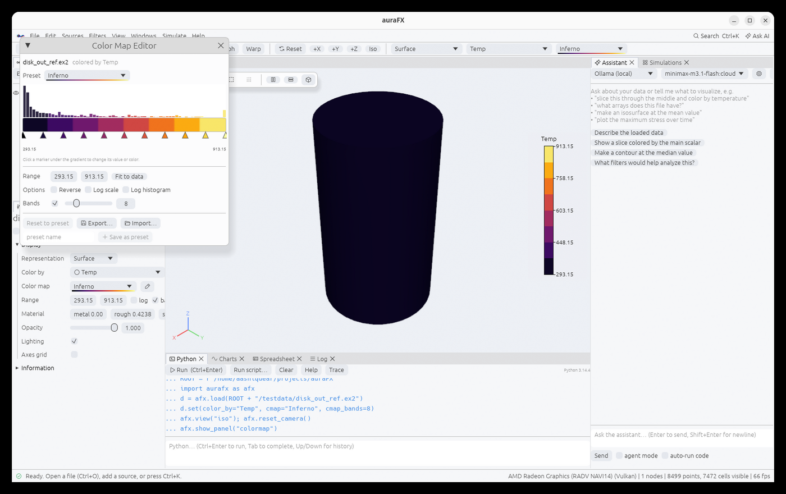

# Coloring and color maps

## Color by an array

The **Color by** box in Properties (and in the toolbar) lists every point and cell array of the
object. Vectors are colored by magnitude unless a **Component** is chosen. **Solid color**
uses one color for the whole object. New files are colored by their first array
automatically.

**Range** is taken from the data; type values to fix it (useful when comparing time steps or
objects), press **auto** to return to the data range, tick **log** for a logarithmic scale and
**bar** to show the legend in the view. Values that are not a number (NaN, fill values of
NetCDF files) are drawn grey.

```python
d.set(color_by="Temp", cmap="Inferno", range=(300, 900), log_scale=False)
d.set(color_by="V", component=0)        # x component of a vector
d.set(color_by=None, solid_color=(0.8, 0.2, 0.1))
```

## Color maps

Eighteen maps ship with the app (Viridis, Inferno, Magma, Plasma, Cool to Warm, Jet,
Rainbow, Grayscale, ColorBrewer sets and more); the **Color map** box shows each with a
preview and marks the ones safe for color-blind readers. **Reverse** flips a map and
**Bands** turns it into steps.

## The color map editor



**View › Color Map Editor…** (or the pencil next to the map) opens the editor for the selected
object:

- the histogram of the array behind the map shows where the values lie;
- drag the markers to move colors, double-click to change a color, right-click to delete one,
  click between markers to add one;
- **Bands**, **Reverse**, and the range fields as in Properties;
- **Save as preset** keeps your map under a name for other objects and sessions;
- **Import…** reads ParaView color map files (`.json`) as presets; **Export…** writes them.

```python
afx.colormaps()                                   # names
afx.define_colormap("hot steel", [[0, 0, 0, 0], [0.5, 1, 0.3, 0], [1, 1, 1, 1]])
afx.import_colormaps("paraview_maps.json")
d.set(cmap="hot steel", cmap_reverse=True, cmap_bands=8)
d.set(cmap_points=[[0, 0, 0, 1], [1, 1, 0, 0]])    # a one-off map on this object
```

## The legend

The legend (scalar bar) shows the map, its range and the array name for the selected object,
or for the first object with a legend when nothing is selected. Untick **bar** to hide it. It
is included in screenshots and animations, and drawn as real text in SVG exports.
