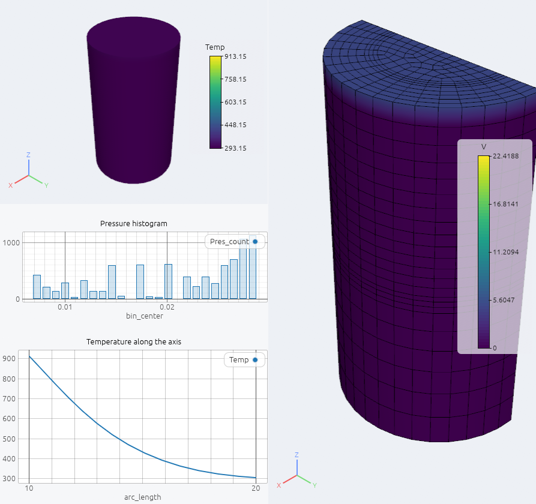
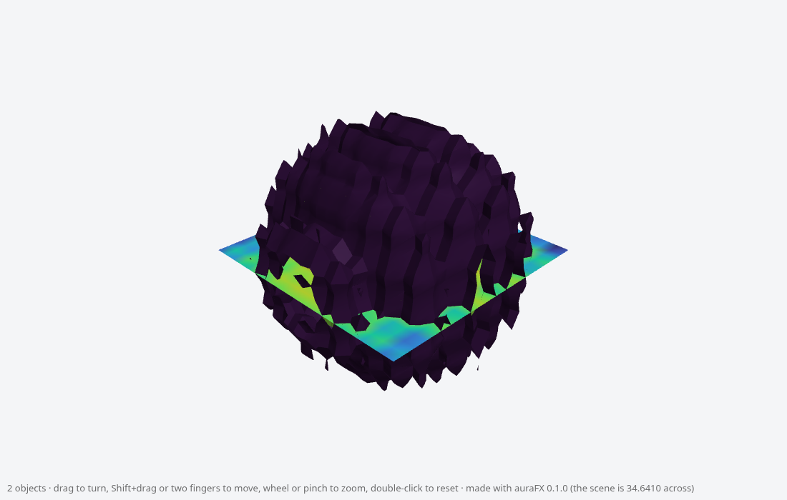

# Exporting pictures, scenes and animations

## Screenshots

**File › Save Screenshot…** (Ctrl+Shift+S) opens a small dialog:

- **Size**: the view's size, a multiple of it (2×, 4×), 1920×1080, 3840×2160, or any size;
  **keep the view's shape** ties width and height together. Point sizes and line widths are
  in pixels, so they look thinner in a larger picture.
- **Background › transparent** saves a PNG with an alpha channel, with clean edges.
- The file's extension chooses the format: **PNG** (the default), **JPEG** (smaller, no
  transparency), **BMP**, **TIFF**, or **SVG** for a vector picture.
- **Annotations** includes the legend, axes-grid labels, time label, text annotations and
  the orientation axes, laid out as on screen and scaled with the picture.
- **PNG** or **SVG**: an SVG holds the surfaces as shaded polygons sorted back to front, the
  lines and points, and the annotations as real text, for figures that scale without pixels
  (where surfaces cut through each other the boundary is jagged; convert to PDF with Inkscape
  if needed).

With ray tracing on, the picture is traced at the requested size first.

```python
afx.screenshot("fig.png")                               # the view as shown
afx.screenshot("fig.png", width=3840, transparent=True) # keeps the view's shape
afx.screenshot("fig.png", width=1600, height=900, annotations=False)
afx.screenshot("fig.jpg")                               # JPEG, BMP (.bmp) or TIFF (.tif) by the extension
afx.screenshot("fig.svg")
```

`afx.screenshot` returns only when the file is written, so a script can change the camera or
the data between pictures.

### All views in one picture

For a slide or a report with several views side by side, choose **Picture of › all views** in
the same dialog: every visible 3D view and chart view is saved in one PNG, each where it sits
in the window, with tab bars, panels and menus left out and the charts' controls hidden
(**keep the chart views' controls** keeps them). **chart views** saves only the charts. The
background between the views is the window's, or transparent. The picture has the window's
pixels, so a larger (or full-screen) window gives a larger picture. Only views whose tab is in
front are in the picture.

```python
afx.screenshot("slide.png", views="all")            # every visible view, as laid out
afx.screenshot("charts.png", views="charts")
afx.screenshot("chart2.png", views="chart 2")       # one chart view ("chart" is the Charts panel)
afx.screenshot("view2.png", views="view 2", transparent=True)
```



## Scenes for other programs

**File › Export Scene…** (`afx.export_scene("scene.glb")`) writes the visible objects, with
their colors, as:

| Format | Notes |
|---|---|
| **glTF binary** (`.glb`) | for Blender, three.js, PowerPoint, Windows 3D Viewer; vertex colors, normals, translucency, materials (metallic, roughness) |
| **OBJ** (`.obj`) | with vertex colors after the coordinates (Blender and MeshLab read them) |
| **X3D** (`.x3d`), **VRML** (`.wrl`) | absolute coordinates, vertex colors |
| **Web page** (`.html`) | one file that opens in any browser and shows the scene in 3D: drag to turn it, Shift+drag (or two fingers) to move, wheel or pinch to zoom, double-click to reset. Everything is inside the file (no server, nothing loaded from the network), so it can be mailed or put on a web site as it is. Surfaces, lines and points with their colors; simple lighting; the size grows with the number of triangles (about 55 bytes each vertex) |

Volumes are not exported (they are not geometry).



## Animations

**File › Animation…** records the time steps, a turntable or the keyframes as **GIF**, **MP4** or
**WebM** (VP9, for web pages; both are written by the video encoder ffmpeg, which the Animation window downloads on request when it is not installed; see [Time and animation](time-animation.md)) or a folder of PNG frames, of the active 3D view or of all views as laid
out (`afx.save_animation("all.mp4", views="all")`); see
[Time, charts and animation](time-animation.md).

## Saving data

Right-click an object › **Save data…**, or `node.save("out.vtu")`, writes its output; the
format follows the extension:

| Extension | Format |
|---|---|
| `.vtu .vtp .vti .vtr .vts .vtm` | VTK XML (appended binary); `.vtm` writes a folder of pieces |
| `.vtk` | legacy VTK |
| `.vtkhdf` | VTKHDF (HDF5); multiblocks as a collection with the block tree; `all_times=True` writes every time step into one file |
| `.exo` | Exodus II with blocks and variables; `all_times=True` writes every time step |
| `.case` | EnSight Gold (C binary): the case file plus a geometry file and one file per variable next to it; `all_times=True` writes every time step |
| `.xmf` | Xdmf 3: the description plus an `.h5` file with the arrays; `all_times=True` writes every time step |
| `.cgns` | CGNS (HDF5); `all_times=True` writes every time step when the cells stay the same (moving points are fine) |
| `.csv` | the point data or the table |
| `.stl .ply` | surfaces |

```python
d.save("slice.vtp")
d.save("run_all.exo", all_times=True)
d.save("run_all.vtkhdf", all_times=True)
d.save("run.case", all_times=True)      # run.case, run.geo, run.Temp0000, ...
d.save("run.xmf", all_times=True)       # run.xmf and run.h5
d.save("run.cgns", all_times=True)
```

When the data has several time steps and the chosen format holds them all (Exodus, VTKHDF,
EnSight, Xdmf, CGNS), the Save dialog writes every step.
