# File formats

Every reader was checked against a reference implementation: the same points, cells, bounds
and value ranges on the same files. The comparisons are listed in the verification notes
(`docs/reference/verification.md` in the source tree).

## Readers

| Format | Extensions | Notes |
|---|---|---|
| Exodus II | `.e .exo .ex2 .g .gen` | NetCDF-3 and NetCDF-4; blocks, side and node sets, nodal/element/global variables, time steps, displacements |
| VTK legacy | `.vtk` | ASCII and binary, all dataset types |
| VTK XML | `.vtu .vtp .vti .vtr .vts .vtt`, parallel `.pvtu …`, `.vtm`, `.pvd` | inline, appended, base64; zlib and LZ4; curved (Lagrange/Bezier) cells |
| AMR (adaptive mesh refinement) | VTK `.vthb .vth`, AMReX/BoxLib plotfiles (the folder, or its `Header`), FLASH and Chombo HDF5 files, Enzo (`.hierarchy`) | levels of boxes with cell data; coarse cells under finer boxes are left out; see below |
| Hyper tree grids | VTK `.htg` (XML version 2) | trees of refined cells; drawn as their leaves; see below |
| Cell grids (discontinuous Galerkin fields) | VTK `.dg` | cells whose fields are polynomials; drawn with the fields at the corners; see below |
| VTKHDF | `.vtkhdf .hdf` | image data, unstructured grids, poly data, partitioned collections with their assembly, time steps; chunked and gzip storage; no HDF5 library needed |
| OpenFOAM | `.foam` | ASCII/binary/gzip, decomposed and reconstructed cases, time directories, boundary patches |
| EnSight Gold | `.case .encas` | ASCII and C binary, all element types, structured blocks, time sets, wildcard file names |
| CGNS | `.cgns` | HDF5 and ADF storage; structured and unstructured zones, MIXED and NGON/NFACE sections, solutions, time steps |
| Xdmf 2/3 | `.xmf .xdmf` | inline, HDF5 and raw binary data; collections; `xi:include` and XPath references (FEniCS/Dolfinx); HyperSlab and JOIN items |
| NetCDF (CF) | `.nc .nc4 .cdf` | classic and NetCDF-4; lon/lat grids on a sphere with cell bounds, curvilinear grids with 2-D longitude/latitude (POP, CICE, ROMS), rectilinear otherwise; time steps; packing; fill values become NaN (grey); see below |
| CAM-SE | `.nc` + connectivity file (found from the contents) | CESM atmosphere on its cubed sphere: lon/lat map or sphere, surface, midpoint or interface variables, one level or all; see below |
| MPAS | `.nc` (found from the file's contents) | MPAS ocean, atmosphere and land-ice output: cell centers joined into triangles, any vertical level or all of them, sphere or lon/lat map, time steps; see below |
| Tecplot | `.dat .plt .tec .tp` | ASCII (ordered and FE zones, BLOCK/POINT, cell-centered variables) and binary `.plt`; `.szplt` is not read |
| PLOT3D | `.xyz .x .p3d .bin` + `.q` | layout detected from the file (Fortran/C binary, byte order, precision, multi-grid, 2-D/3-D, IBLANK), ASCII |
| LAMMPS | `.dump .lammpstrj .atom` (+`.gz`), `.data .lmp` | multi-frame dumps with any columns, triclinic boxes; data files with bonds |
| XYZ / extended XYZ | `.xyz .extxyz` | multi-frame; properties and lattice from the comment line |
| PDB | `.pdb .ent` | all atoms (hydrogens kept), MODELs as time steps, CONECT and distance bonds, residues and chains |
| Gaussian cube | `.cube` | the density as a volume in Å, plus the atoms with bonds |
| Chemical Markup Language | `.cml` | the atoms and the file's bonds with their orders (`bond_order`) |
| VASP | `POSCAR`, `CONTCAR`, `CHGCAR`, `LOCPOT`, `ELFCAR`, `PARCHG` (by name), `.vasp` | atoms with bonds and the lattice; volumes on the cell's axes (charge per ų) |
| Images | `.png .jpg .bmp .tif` | as image data; multi-page TIFFs and `img_*.png` wildcards as volumes |
| GIS rasters | GeoTIFF `.tif`, Esri ASCII grid `.asc` | at their map coordinates, a cell per pixel, every band; no-data values become NaN (grey); see below |
| GIS vectors | Shapefile `.shp`, GeoJSON `.geojson .json`, KML `.kml`, KMZ `.kmz`, GeoPackage `.gpkg`, FlatGeobuf `.fgb`, GML `.gml` | points, lines and polygon outlines (or filled areas) with their attributes as cell data, a block per layer; see below |
| EBSD maps and microstructures | TSL/EDAX `.ang`, Oxford `.ctf`, `.h5ebsd` stacks, EDAX and Bruker `.h5`, `.dream3d` | crystal orientations on a square grid with phases and quality columns; voxel volumes and meshes with feature and phase arrays; see [Grains and crystals](grains.md) |
| Surfaces | `.stl .ply .obj` | |
| CSV / TSV | `.csv .tsv .txt` | delimiter and header detection; tables with x, y, z columns become points |

Numbered files (`run_0001.vtu`…) open as a series when one of them is opened.

CGNS files come in two storage formats with the same `.cgns` extension: HDF5, the default
since CGNS 3.4, and ADF, which older solvers and older CGNS libraries write. auraFX looks at
the file and reads either one the same way, with **File › Open** or `afx.load("wing.cgns")`.
Both the 64-bit ADF layout and the older 32-bit one are read, in either byte order. Links
inside the file and links to other ADF files are followed. A link to an HDF5 file from an ADF
file is not.

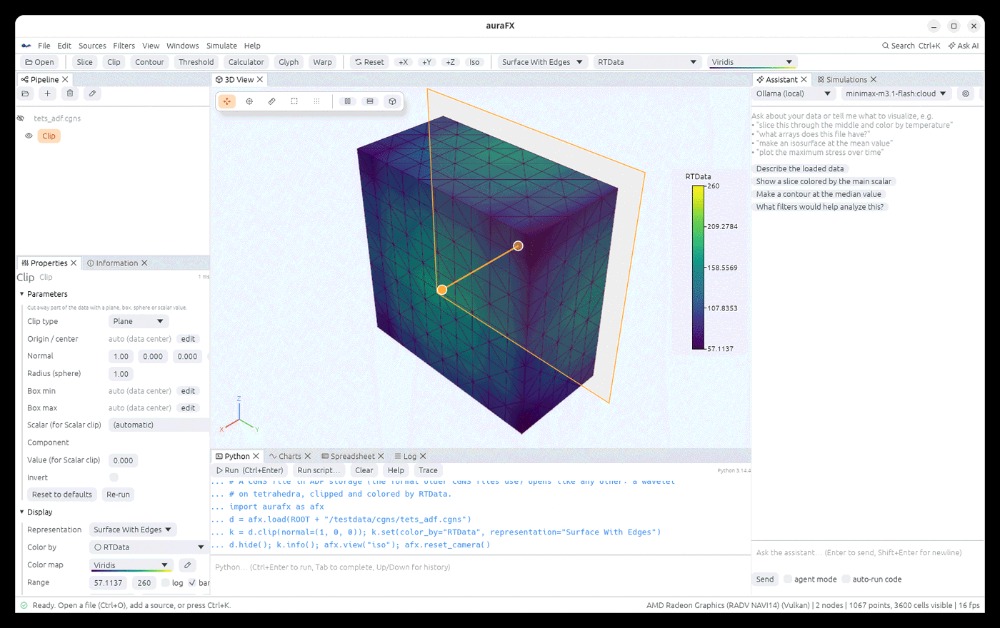

### NetCDF climate and ocean files

Files that follow the CF conventions are placed by their coordinates:

- Longitude and latitude axes put the grid on a sphere of radius 1. A third (vertical)
  axis becomes the radius. Depths marked `positive="down"` are turned around,
  and all levels are shifted so that none is below zero, so deeper levels lie further in
  (the deepest at the center).
- Ocean and sea-ice models such as POP (CESM's ocean), CICE and ROMS use index dimensions
  (`nlat`, `nlon`) and give each point's longitude and latitude in 2-D variables (`TLONG`,
  `TLAT`) named in the `coordinates` attribute. These become curvilinear grids on the
  sphere. The coordinate variables themselves are not shown as data.
- When the variables live on different grids (say `TEMP` on depth, latitude and longitude,
  and `SSH` on the surface only), **Reader options › Variables on** picks the grid. Python:
  `ds.set(variables="(nlat, nlon)")`. The grid with the most dimensions is read first.

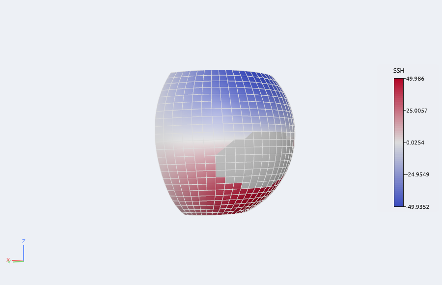

CAM-SE output (the spectral-element core of CESM's atmosphere model) comes as two files:
the data, with columns `ncol` at `lat`/`lon`, and a connectivity file whose
`element_corners` joins the columns into quads. Open the data file. auraFX finds the
connectivity file in the same folder, or you can name it under **Reader options ›
Connectivity file** (Python: `ds.set(connectivity="ne30np4_connectivity.nc")`). It draws
the grid on a flat lon/lat map:

- Quads that cross the 0/360° seam are moved to the side where they stick out least, on
  copies of their points, so the map runs a little past 0 and 360.
- **Variables** picks the surface variables `[time, ncol]`, or those on midpoint
  (`lev`) or interface (`ilev`) levels. With **All levels** on, the default, each quad
  becomes a column of hexahedra, the top level highest, and the `lev` (or `ilev`) array
  holds each point's level. With it off, **Level** chooses one level.
- **Layout › Sphere** puts the columns on a sphere instead. There is no seam on a sphere.
- A single level lies at height 0.

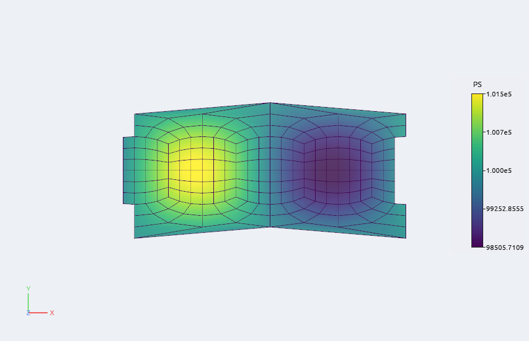

MPAS output (from the ocean, atmosphere or land-ice models of the Model for Prediction
Across Scales) is NetCDF too. When a `.nc` file has MPAS's mesh variables (`xCell`,
`cellsOnVertex`), auraFX reads it as MPAS instead of as a CF grid:

- Each MPAS cell center becomes a point, and the cells around each MPAS vertex are joined
  into a triangle (or a quad, on quad meshes). On a sphere, the points lie at the planet's
  radius in meters.
- Variables on cells (`temperature`, `ssh`…) become point data, and variables on vertices
  (`relativeVorticity`…) become cell data. Time steps are numbered 0, 1, 2…, and the date
  of each step (`xtime`) is kept with the data.
- For other dimensions than time and position, the first index is used, except the vertical
  levels, which you choose with the reader options below.

#### Reader options

Some readers have settings for the file they read. They appear under **Properties ›
Reader options** when the file is selected, and from Python they are set like any other
property, with `node.set(...)`. Changing one reads the file again; the choice is saved with
the state file. **Reset to defaults** goes back to the file as first opened.

An MPAS file offers:

| Option | Python | What it does |
|---|---|---|
| Vertical level | `vertical_level=2` | which level of 3-D variables is shown (0 is the top of the ocean, the bottom of the atmosphere) |
| All levels (multilayer) | `multilayer=True` | stacks every level: each triangle becomes a column of wedges, and points carry each level's values |
| Layer thickness | `layer_thickness=10000` | the distance between levels in the multilayer view, in meters on the sphere and degrees on the map; 0 picks one so that the whole stack is easy to see |
| Layers go up (atmosphere) | `atmosphere=True` | stacks levels outwards (or upwards on the map) instead of downwards |
| Layout | `layout="Lat/Lon map"` | `"Sphere"` (default) or a flat map with longitude and latitude in degrees |
| Map center longitude | `center_lon=0` | the longitude in the middle of the map (180 by default) |

```python
ocean = afx.load("output.nc")
ocean.set(vertical_level=10)                         # the 11th level down
ocean.set(layout="Lat/Lon map", multilayer=True)     # all levels, as a flat 3-D map
```

On the map, cells that cross its left or right edge are drawn on both sides, so the map
reaches a little beyond 360°.

- The triangles at a mesh boundary and, when the file has `maxLevelCell`, the triangles that
  touch land are left out, so land shows as holes. In the multilayer view, the levels below
  the sea floor are left out too, and each point carries its level's value.
- Reader options do not reach files opened on another machine through a server yet.

Verified against a reference implementation; the comparisons are listed in the
verification notes (`docs/reference/verification.md` in the source tree).

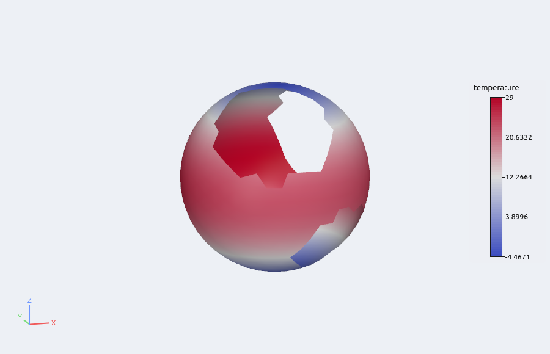

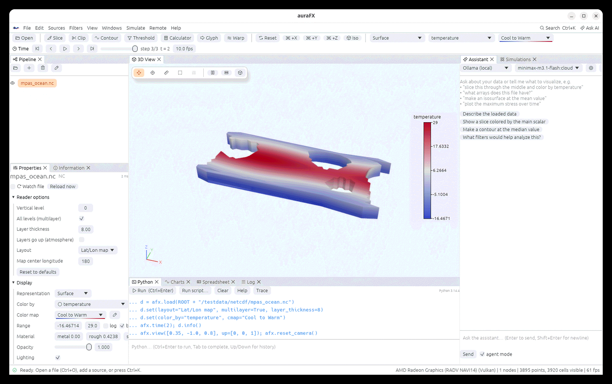

### GIS rasters

A GeoTIFF is a TIFF that also records where it lies on the map. auraFX notices these tags and
reads the file as a map raster instead of as a picture. Esri ASCII grids (`.asc`), a common
text format for elevation models, and ERDAS Imagine files (`.img`, common in remote sensing)
are read the same way. Open them with **File › Open** or
`afx.load("dem.tif")`.

- The raster becomes image data with one cell per pixel, placed at its map coordinates
  (meters for UTM, degrees for longitude/latitude), with north up.
- Values are cell data. A single band, such as an elevation model, is named `Elevation`.
  In a file with several bands, the first is `Elevation` and the others are
  `Band 2`, `Band 3`… An RGB(A) image becomes one `Elevation` array with 3 or 4 components.
- Pixels equal to the file's no-data value become NaN and are drawn grey (after Warp By
  Scalar they leave a hole, since a NaN height has no place).
- The field data holds `NO_DATA_VALUE` per band and `MAP_PROJECTION`. For a GeoTIFF that is
  the EPSG code (`EPSG:32633`). For an ASCII grid it is the text of the `.prj` file beside
  it.
- 8- to 64-bit integer and floating-point bands are read, compressed or not, in strips or
  tiles, with the bands stored together or one after another. A pixel-is-point GeoTIFF is
  moved half a pixel to its corner, as GDAL does.
- ERDAS Imagine: every layer of the same size is a band (1-, 2- and 4-bit, 8- to 32-bit
  integer and 32- and 64-bit floating-point layers, in tiles, plain or run-length
  compressed), placed by its map information as GDAL does. The no-data value is the layer's
  "non-initialized" value. `MAP_PROJECTION` is the EPSG code for UTM and longitude/latitude
  on WGS 84, and the projection's name otherwise. The layers are bands as above: an RGB
  `.img` gives `Elevation`, `Band 2` and `Band 3` (it does not say which layer is which
  color). Data kept in a separate `.ige` file (very large images) is not read.

To see an elevation model as terrain, move the values to the points with **Cell Data to
Point Data**, then raise them with **Warp By Scalar**:

```python
dem = afx.load("dem.tif")                    # or dem.img (ERDAS Imagine)
terrain = dem.cell_data_to_point_data().warp_by_scalar(array="Elevation", scale=1.0)
terrain.set(color_by="Elevation")
```

Verified against a reference implementation; the comparisons are listed in the
verification notes (`docs/reference/verification.md` in the source tree).

Other GDAL raster formats (NetCDF through GDAL, JPEG 2000…) are not read yet.

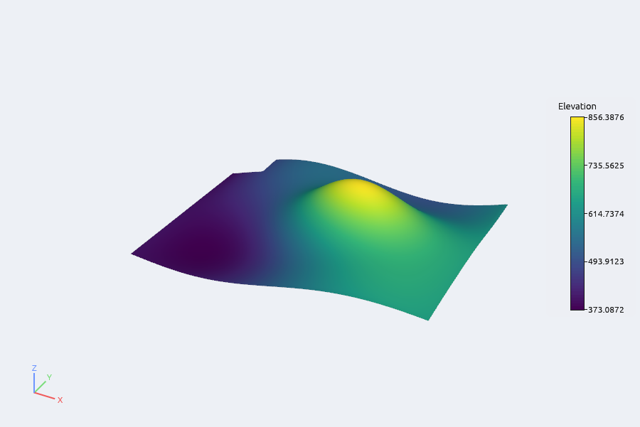

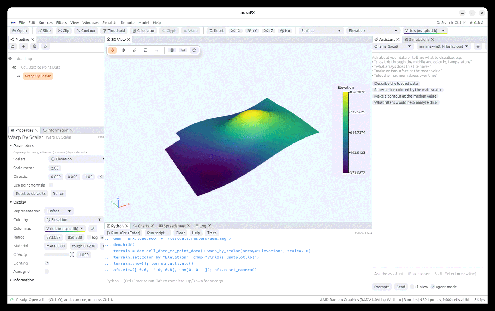

### GIS vectors

Maps of points, lines and areas, such as countries, roads, rivers, wells or survey sites, open
like any other file:

| Format | Files |
|---|---|
| ESRI Shapefile | `name.shp` with `name.dbf` (attributes) and `name.prj` (coordinate system) beside it; open the `.shp` |
| GeoJSON | `.geojson`, or a `.json` file that holds GeoJSON |
| KML (Google Earth) | `.kml`; each folder is a layer |
| KMZ | `.kmz`: a zipped KML (Google Earth's usual download); the KML document inside is read |
| GeoPackage | `.gpkg`; each feature table is a layer |
| FlatGeobuf | `.fgb`: a fast binary format for large vector data; one layer |
| GML | `.gml` (GML 2, 3 and 3.2, as GDAL and most web feature services write it); each feature type is a layer, typed by the `.xsd` schema beside the file when there is one |
| MapInfo table | `name.tab` with `name.map` (geometry), `name.id` (its index) and `name.dat` (attributes) beside it; open the `.tab` |
| MapInfo interchange | `name.mif` (geometry, in text) with `name.mid` (attributes) beside it; open the `.mif` |
| Esri file geodatabase | a `name.gdb` folder; open the folder (or any file in it). Each feature class and table is a layer |

What you get:
- The coordinates stay as stored: longitude and latitude in degrees for most GeoJSON and KML
  files, or meters for projected shapefiles. Heights (the third coordinate) are kept, so a
  file with heights in meters on a map in degrees looks very tall. Flatten it with
  **Transform** (scale z by 0) if that gets in the way.
- Points become vertices, lines become polylines, and polygon rings become closed lines.
- Each feature's attributes become cell data on its cells: whole numbers as integers,
  decimals as doubles, and anything else (names, dates) as text. 64-bit integers stay
  numbers.
- `MAP_PROJECTION` in the field data holds the coordinate system: the `.prj` text, the EPSG
  code of a GeoPackage, FlatGeobuf or GML layer, the coordinate system text of a file
  geodatabase layer, or `EPSG:4326` (longitude/latitude) for GeoJSON and KML.
- File geodatabases store coordinates on a fine grid and add `Shape_Length` and `Shape_Area`
  attributes to lines and areas; both come through as stored.
- MapInfo tables store coordinates as whole numbers on a grid set by the file (a millionth of
  a degree for longitude and latitude). auraFX converts them as GDAL does, rounding to that
  grid. A MapInfo region's rings are grouped into
  areas with holes: a `.tab` file says which rings are holes. In a `.mif` file, a ring inside
  a larger one is a hole, as GDAL decides it.
- GML in a geographic coordinate system named the long way (`urn:ogc:def:crs:EPSG::4326`)
  stores latitude first. auraFX swaps it back to longitude, latitude, as GDAL does, so GML
  lines up with the other formats.

**Reader options** (Properties › Reader options, or `node.set(...)`):

| Option | Choices |
|---|---|
| **Layer** (files with several layers) | **All** or one layer by name |
| **Blocks** | **One per layer** (default: one block per layer, a row of attributes per feature), or **One per feature**: one block per feature, slow for thousands of features |
| **Polygons** | **Outlines**, or **Filled**: triangles covering each area, with holes left open, to color areas by an attribute |
| **Feature ids** | adds the feature number as `_vtkPedigreeIds` |

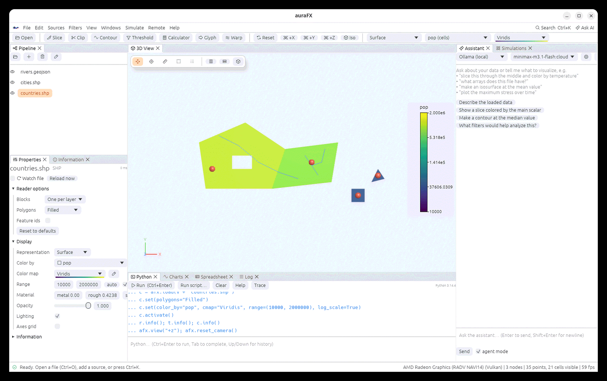

```python
countries = afx.load("countries.shp")
countries.set(polygons="Filled")
countries.set(color_by="pop", log_scale=True)
roads = afx.load("world.gpkg")
roads.set(layer="roads")                      # one layer of a GeoPackage
sites = afx.load("sites.fgb")                 # FlatGeobuf
rivers = afx.load("hydro.gml")                # GML, a block per feature type
places = afx.load("trip.kmz")                 # Google Earth KMZ
parcels = afx.load("parcels.tab")             # MapInfo (or parcels.mif)
lots = afx.load("city.gdb")                   # an Esri file geodatabase folder
lots.set(layer="lots", polygons="Filled")
```

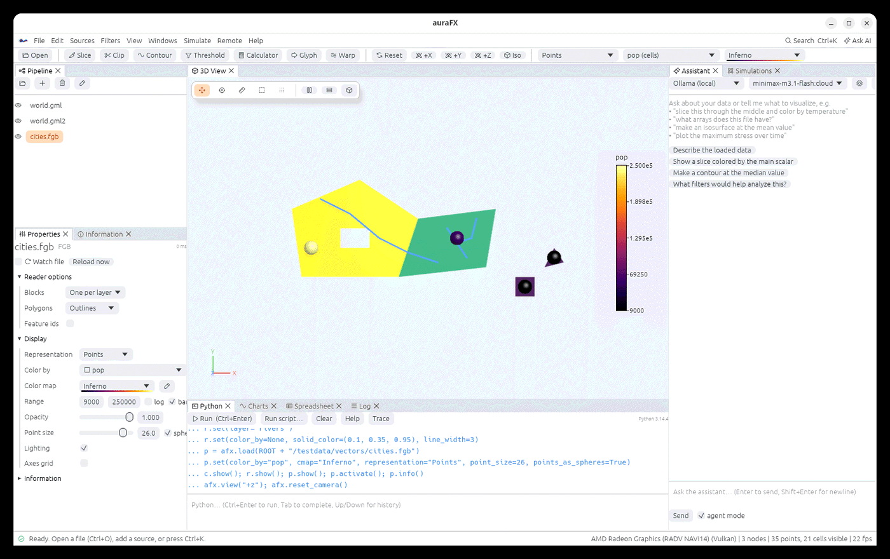

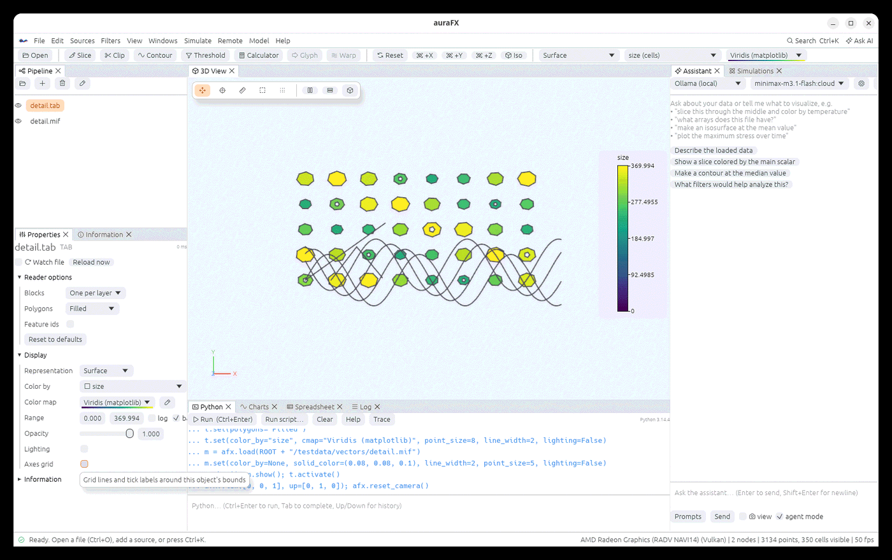

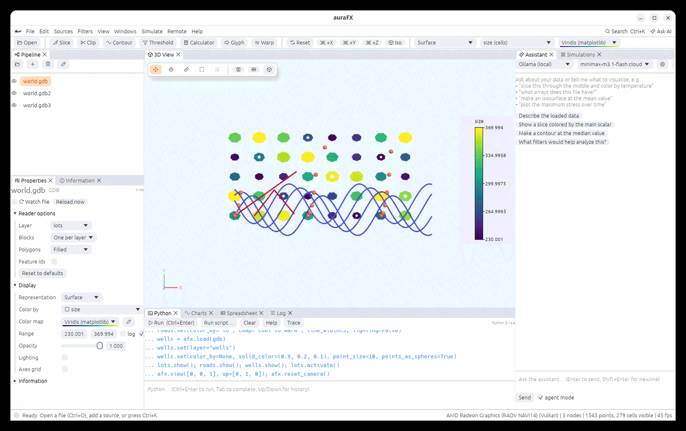

A feature without geometry gives an empty block. Any layer of a file can be picked on its
own, and by default all layers are read.

Verified against a reference implementation; the comparisons are listed in the
verification notes (`docs/reference/verification.md` in the source tree).

Not read yet: curved geometry (arcs; a file geodatabase's curves are read as straight lines
between their vertices) and file geodatabase rasters and multipatches. In MapInfo files, text,
arcs, rectangles, ellipses and collections are read without their geometry (their attributes
are kept). Shapefile multipatches (3-D surfaces) are skipped.

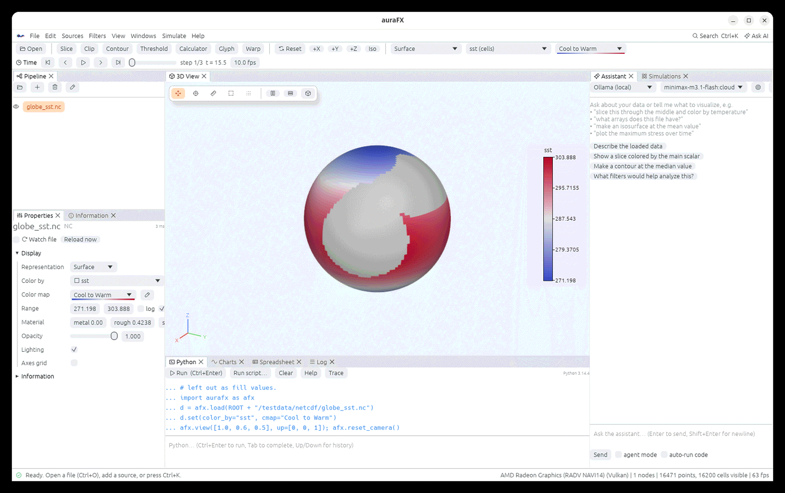

### AMR data (adaptive mesh refinement)

AMR simulations (AMReX, BoxLib, Castro, MAESTRO, Nyx, WarpX, FLASH, Enzo…) store their domain
as levels of boxes: a coarse level everywhere and finer boxes where more detail was needed.
auraFX reads:

- **AMReX / BoxLib plotfiles**: a folder like `plt00100` with a `Header` file. Open the
  `Header` file in **File › Open** (choose "All files"), drop the folder on the window, or
  `afx.load("plt00100")`.
- **VTK AMR files** (`.vthb`, `.vth`).
- **FLASH** plot and checkpoint files (`name_hdf5_plt_cnt_0007`, `name_hdf5_chk_0003`; HDF5,
  FLASH 2 to 4). They usually have no extension: open them in **File › Open** with "All
  files"; auraFX recognizes them by their contents. Every block of the PARAMESH tree becomes
  a box on its refinement level (FLASH's level 1 is auraFX's Level 0), with every variable in
  `unknown names` as cell data in double precision. 1-D, 2-D and 3-D files are read.
- **Enzo** output: open the `.hierarchy` file of a data dump (`DD0010/data0010.hierarchy`). The
  parameter file (`data0010`) and the grid files (`data0010.cpu0000`...) must be beside it.
  Each grid is a box on its level; fields keep their stored type (usually single precision).
  Reader option **Convert to CGS** multiplies each field by its `#DataCGSConversionFactor`
  from the parameter file. It is off by default.
- **Particles** in FLASH and Enzo files: when a file has them, the reader option **Data**
  switches between **Grid** (the AMR data) and **Particles**, a point for every particle with
  its properties as point data (FLASH's as doubles, Enzo's in their stored types). Open the
  file twice to see both, as in the picture below. Chombo files with a `particles` group get
  the same option (properties as doubles).
- **Chombo** files (`.hdf5`, `.h5`; 1-D to 3-D), as Chombo-based codes write them (`level_0`,
  `level_1`... groups with boxes). The component names become cell arrays, or point arrays in
  node-centered files. Ghost cells stored around each box are dropped, and the boxes are
  placed from `prob_lo` and the level's `dx` (or `vec_dx`).
- **4-D Chombo** files (two space axes and two velocity axes, as gyrokinetic codes such as
  COGENT write them, single level): a 2-D grid over the space axes,
  whose every cell holds each component as an array with one value per velocity cell
  (parallel velocity major, magnetic moment minor). `_vpar` and `_mu` hold those cells'
  velocity coordinates, and `<component>_sum` the sum over the velocity cells (leaving out
  velocity cells no box covers, which are NaN in the arrays).
  Color by a component of the array to see one velocity cell, or by the sum.

What you get:
- One block per level (**Level 0**, **Level 1**, ...), each holding that level's boxes as image
  data with the variables as cell data. The **Information** panel lists them.
- Coarse cells that a finer box covers are marked as hidden in `vtkGhostType`.
  Surfaces, slices, clips, contours, thresholds, Integrate Variables, Resample To Image and
  probing skip them, so every place is shown and counted once, at its finest level.
- AMReX vector variables written as `amrexvec_<name>_x`, `_y`, `_z` become one vector
  `<name>`. In 2-D files the missing z is 0.
- The time of the plotfile or dump is in the field data (`TimeValue`). Single- and
  double-precision files are read.
- **Outline** draws the outline of every box, which shows where the refinement is.
- Contours of cell data are stitched across levels (see below).

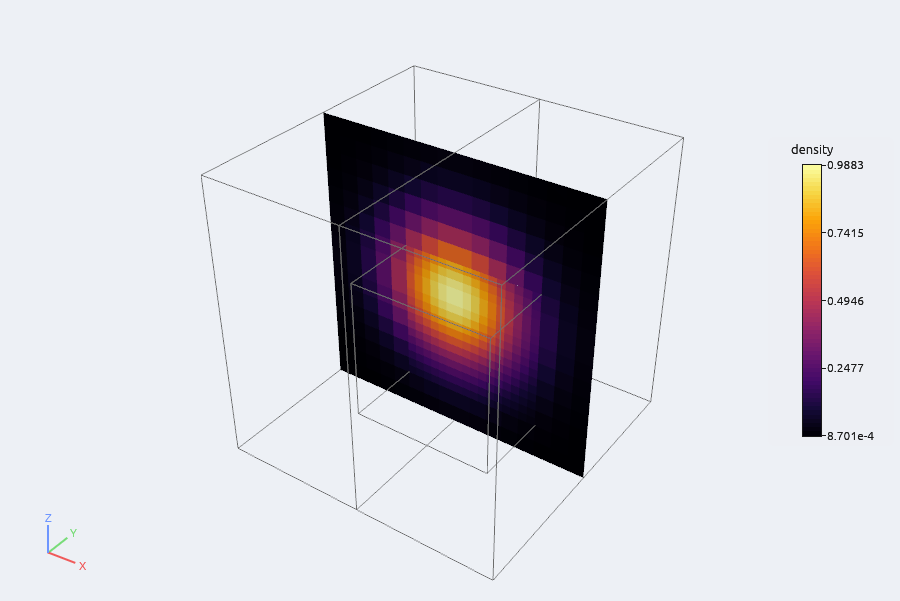

```python
amr = afx.load("plt00100")                 # the plotfile folder
amr.set(representation="Outline")          # where the refinement is
s = amr.slice(normal=(0, 0, 1))            # finest data on the cut
s.set(color_by="density")
lev = amr.overlapping_amr_level_ids()      # LevelIdScalars: each cell's level
flash = afx.load("sedov_hdf5_plt_cnt_0010")  # FLASH
enzo = afx.load("DD0010/data0010.hierarchy")  # Enzo
enzo.set(cgs=True)                         # fields in CGS units
chombo = afx.load("plot.0010.2d.hdf5")      # Chombo
stars = afx.load("DD0010/data0010.hierarchy")
stars.set(data="Particles")                # the particles instead of the grid
```

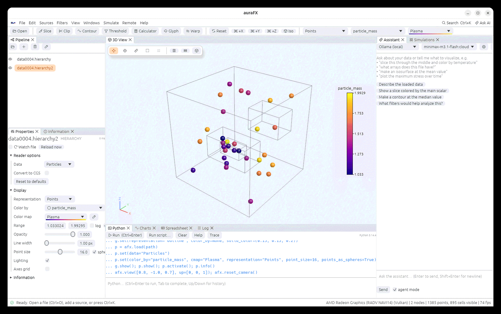

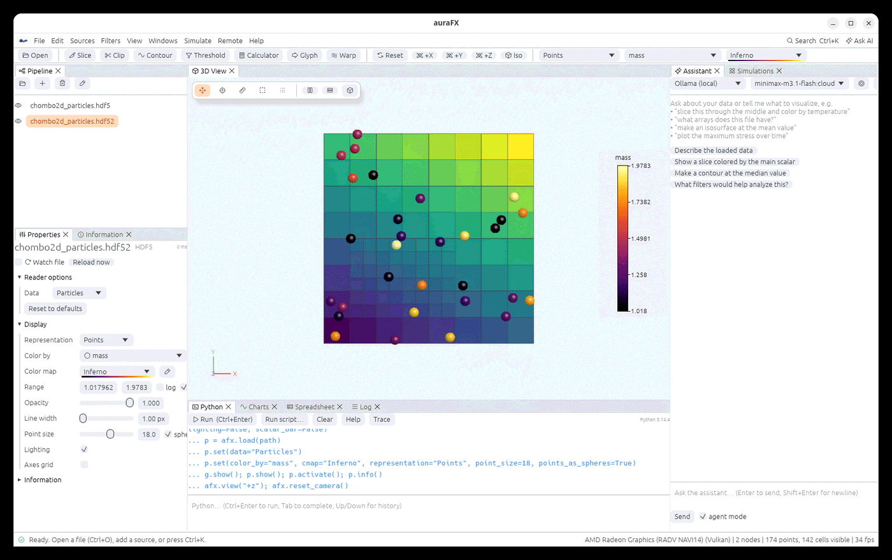

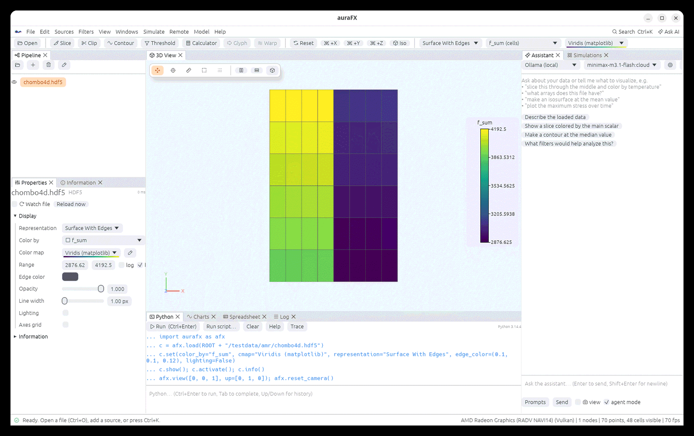

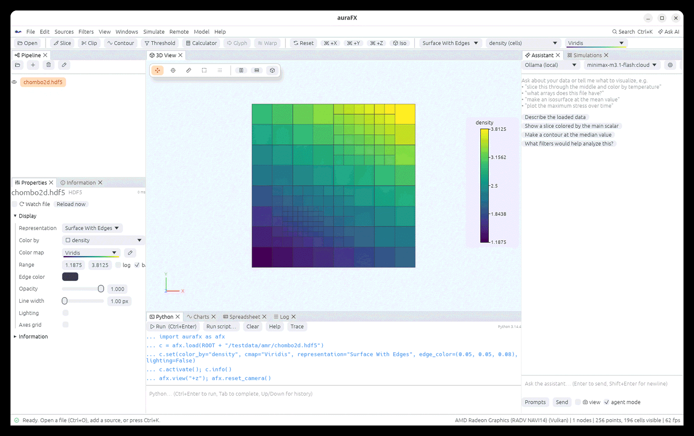

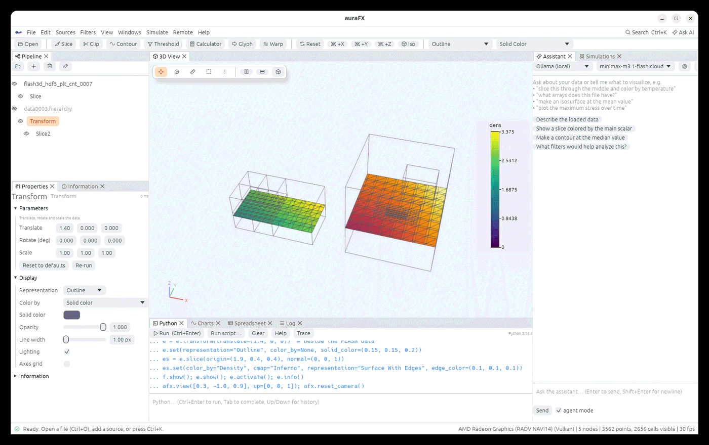

**Sources › AMR Gaussian Pulse** makes a small AMR test dataset: a coarse box and
two finer boxes holding a Gaussian pulse, in 2-D or 3-D. **Filters › Overlapping AMR Level
Ids** adds the cell array `LevelIdScalars` with each cell's level.

**Filters › Resample AMR** samples AMR data on one uniform grid, so tools that want a single
image can use it (volume rendering, image filters, export). **Number of samples** sets the
grid points per axis; with **Whole domain** off, **Min** and **Max** pick a box (clipped to the
data, dropping the samples that fall outside). Each point takes the values of
the finest cell holding it. With **Transfer to nodes** off, the values are taken at the
cell centers instead and become cell data. Points no box holds are marked hidden.

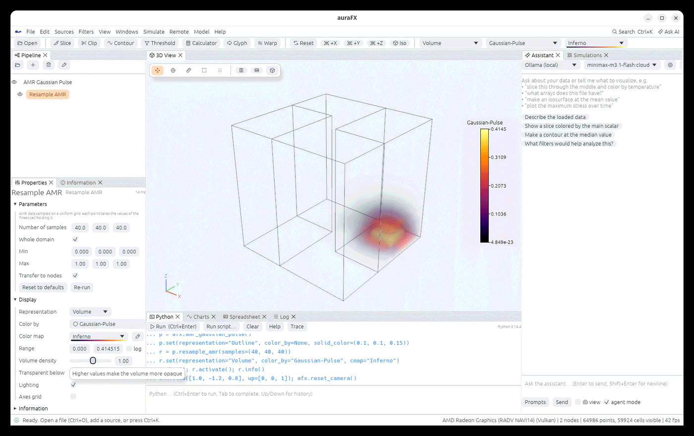

```python
grid = amr.resample_amr(samples=(64, 64, 64))
part = amr.resample_amr(samples=(32, 32, 16), whole_domain=False, min=(0, 0, 0), max=(1, 1, 0.5))
```

Resample AMR always uses every level of the data. 2-D FLASH files are read like 3-D ones.
Ghost cells stored in Chombo files are dropped on every level. FLASH particles are given once
each, with their own properties.

Verified against a reference implementation; the comparisons are listed in the
verification notes (`docs/reference/verification.md` in the source tree).

#### Contours of AMR data

Values of AMR data sit at cell centers, and cells change size where levels meet. Averaging
them to points box by box leaves gaps and overlaps along every level boundary. **Filters ›
AMR Contour** joins the cell centers of all levels into one mesh, the *dual grid*. Where a
finer box meets coarser cells, its border cells reach out to the coarse cell centers, so the
isosurface continues across the boundary without a crack. The other cell arrays are
interpolated onto the surface. **Contour** on a cell array of AMR data does the same
automatically. In 2-D data the result is closed isolines.

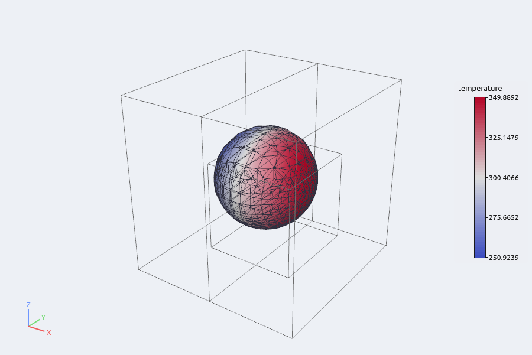

```python
c = amr.amr_contour(array="density", values=[0.3])
c = amr.contour(array="density", values=[0.3])     # the same, for AMR cell data
dual = amr.amr_dual_grid()                          # cell values on one stitched mesh
cut = dual.clip(type="Scalar", array="density", value=0.3)   # a crack-free "dual clip"
```

**Filters › AMR Dual Grid** gives that mesh itself: one point per cell center, carrying all the
cell arrays as point data. Clip, Slice, Stream Tracer and other filters that interpolate point
data work on it across levels without seams.

On a test plotfile whose density isosurface is a sphere crossing from the fine box into the
coarse ones, the contour is closed (every edge shared by exactly two triangles, the topology
of a sphere), its area is within 0.2 % of the sphere's, and its center is within 0.001 of the
sphere's center. The box-by-box contour had 346 open edges there. More in the verification
notes (`docs/reference/verification.md` in the source tree).

Not read yet: plotfiles without FAB headers (the "NoFabHeader" variants) and AMReX
particles. Not available yet: material-interface filters for CTH data (AMR
Fragments, Material Interface).

### Hyper tree grids

A *hyper tree grid* (HTG) starts from a grid of root cells. Each root cell is the top of a
tree: a refined cell splits into 2×2×2 children (3×3×3 with branch factor 3; 2×2 or 3×3 in
2-D), and so on down to the leaves. Every cell of every tree, coarse or leaf, can hold values.
A *mask* can hide cells. It is VTK's tree-based format for adaptive meshes. auraFX reads VTK's
`.htg` files (XML version 2).

What you get:
- The grid is drawn as its visible leaves. Every filter that works on cells (Slice, Clip,
  Threshold, Contour after Cell Data to Point Data, Cell Centers, Integrate Variables...) sees
  those leaves as voxels (pixels in 2-D) with their values.
- **Information** shows the dimension, branch factor, number of visible leaves and depth.
  The cell count is the number of all cells (coarse ones included).
- A grid with **material interfaces** is drawn cut to its material (see below). Other filters
  still see whole leaves.
- Saving as `.htg` keeps the grid: its trees, the mask and every cell's values (the
  version 2 files). Saving as any other format (`.vtu` and the rest) writes the
  visible leaves as an unstructured grid.

**Sources:**
- **Hyper Tree Grid** builds a grid from a text descriptor. Levels are separated by `|`.
  Each level lists `R` (refined) or `.` (leaf) for every cell of that level, all trees in
  order; spaces are ignored. **Dimensions** (points per axis; 1 makes an axis flat), **Branch
  factor**, **Max depth**, **Grid scale**, and **Use mask** with a **Mask** string of the same
  layout (`0` hides a leaf, `1` keeps it). The mask is ignored on refined cells.
- **Random Hyper Tree Grid** refines cells at random. **Split fraction** is each cell's
  chance of being refined, down to **Max depth**. The same **Seed** gives the same grid.
  **Masked fraction** hides about that share of the volume, whole subtrees at a time (the same
  settings hide the same cells). Its masking can hide a cell while leaving some cells below
  it unmasked; those stay hidden.

**Filters** (Filters › Data):

| Filter | What it does |
|---|---|
| **Hyper Tree Grid To Unstructured Grid** | the visible leaves as an unstructured grid, with `OriginalIds` (each leaf's cell index) |
| **Hyper Tree Grid Depth Limiter** | cuts every tree at a depth: cells at that depth become leaves (Depth 0 keeps only the root cells) |
| **Hyper Tree Grid Generate Fields** | `CellSize` (volume, area or length of every cell), `ValidCell` (1 on visible leaves), `CellCenter`, and `TotalVisibleVolume` in the field data |
| **Hyper Tree Grid To Dual Grid** | a point at the center of every visible leaf, with the leaf's values as point data, and a cell (voxel, pixel or line) joining the leaves around every corner. Use it for smooth contours and for filters that need point data. Points on the grid's boundary sit on the boundary; next to masked leaves they move onto the face shared with the masked cell |
| **Hyper Tree Grid Geometry** | the outside of the visible leaves as polygons with their values: in 3-D the faces on the grid's boundary and the walls next to masked cells (a face of a masked cell next to a coarser visible leaf carries that leaf's values); in 2-D a quad per visible leaf, in 1-D a line |
| | With material interfaces, mixed cells are cut to their material (see below). **Fill material** (on by default): off draws only the interface lines in 2-D and leaves out pure cells in 1-D and 2-D |
| **Hyper Tree Grid Feature Edges** | the edges of the visible region as lines with their leaves' values: the outline in 2-D, the outer corners and folds in 3-D |
| **Hyper Tree Grid Evaluate Coarse** | fills the values of refined cells from their children: Min, Max, Sum, Average, Unmasked Average, Elder Child (the first child) or Splatting Average |

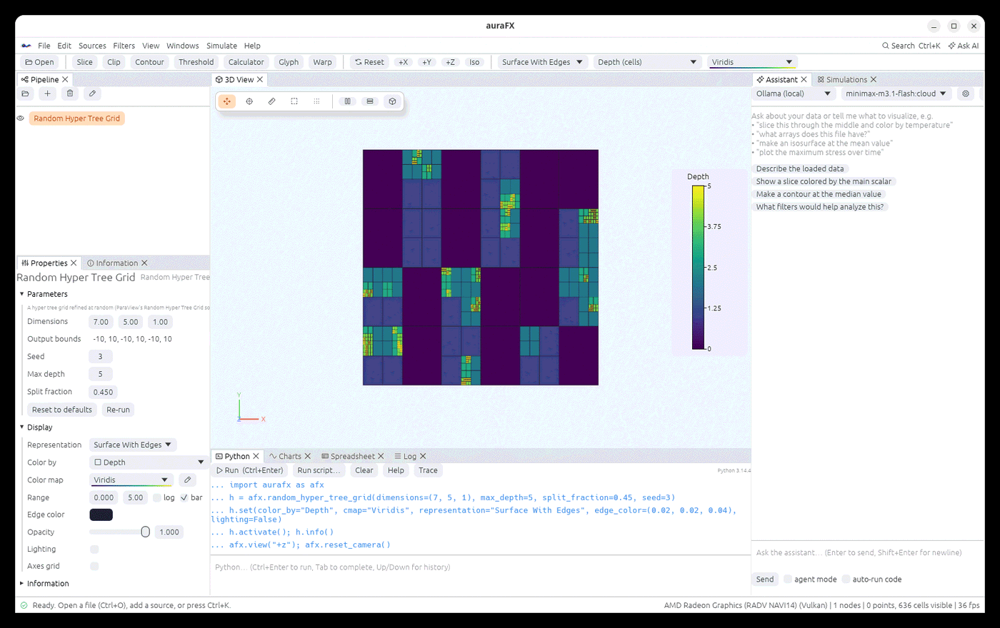

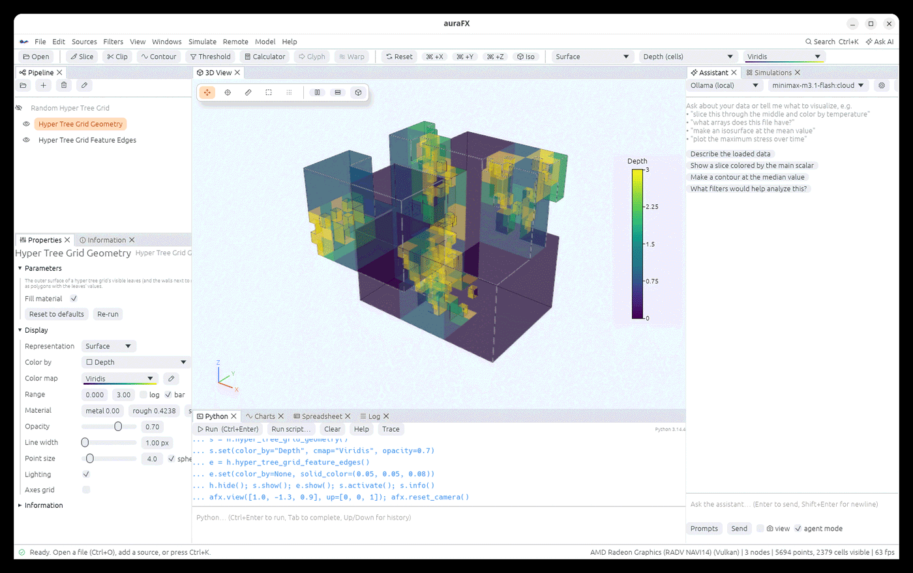

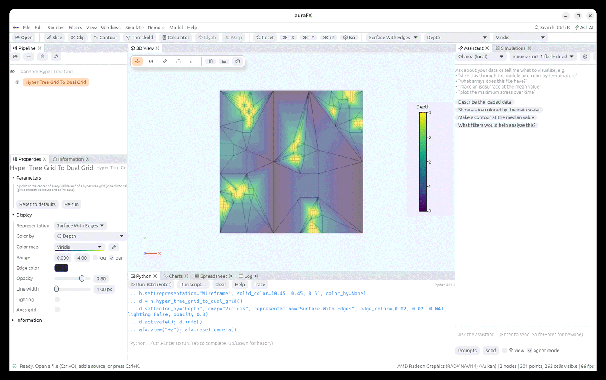

**Material interfaces.** A grid can describe where a material ends inside some cells, for
simulations that track interfaces between materials. The file names two
cell arrays (VTK's `InterfaceNormalsName` and `InterfaceInterceptsName`). For each cell they
hold a normal *n* (three values) and intercepts (*d1*, *d2*, *type*); each interface is the plane
*n*·*x* + *d* = 0:
- *type* −1: one plane (*d1*); the material is where *n*·*x* + *d1* ≥ 0;
- *type* 1: one plane (*d2*); the material is where *n*·*x* + *d2* ≤ 0;
- *type* 0: the material lies between the two planes;
- *type* 2 or more, or a zero normal: the cell is pure (all material).

Hyper Tree Grid Geometry (and the default drawing) cuts each mixed cell by its planes:
- In 1-D and 2-D, each mixed leaf becomes the part of its line or quad that is in the
  material.
- In 3-D, the faces of mixed cells and of their neighbors are drawn cut to the material, and
  each mixed cell adds its interface polygons.

With **Fill material** off, 2-D grids give only the interface lines. Saving as `.htg` keeps
the interface arrays.

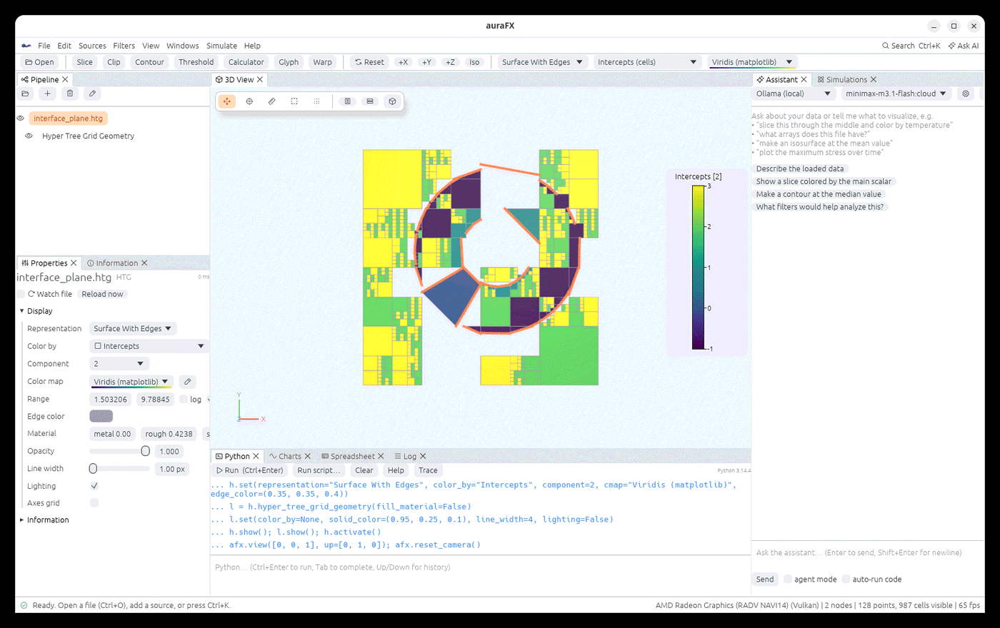

```python
h = afx.random_hyper_tree_grid(dimensions=(7, 5, 1), max_depth=5, split_fraction=0.45, seed=3)
h.set(color_by="Depth", representation="Surface With Edges")
t = afx.hyper_tree_grid(dimensions=(3, 3, 1), max_depth=3, descriptor="R... | .R.. | ....")
coarse = h.hyper_tree_grid_evaluate_coarse(operator="Max")
top = h.hyper_tree_grid_depth_limiter(depth=2)
leaves = afx.load("tree.htg").hyper_tree_grid_to_unstructured_grid()
dual = h.hyper_tree_grid_to_dual_grid()
holes = afx.random_hyper_tree_grid(seed=3, masked_fraction=0.25)
walls = holes.hyper_tree_grid_geometry()
edges = holes.hyper_tree_grid_feature_edges()
h.save("tree.htg")
m = afx.load("interface_plane.htg")       # drawn cut to its material
lines = m.hyper_tree_grid_geometry(fill_material=False)
```

To Unstructured Grid gives every leaf its index in `OriginalIds`, masked files included. To
Dual Grid makes points for visible leaves only. **Cell Centers** works on hyper tree grids
directly; there is no separate Axis Reflection filter for them. `.htg` files auraFX writes read
back unchanged.

Verified against a reference implementation; the comparisons are listed in the
verification notes (`docs/reference/verification.md` in the source tree).

Not available yet: version 1 `.htg` files. Ghost Cells only matters for data split across
processes. Interfaces are used by Geometry only: slicing or clipping a grid
with interfaces works on whole leaves.

### Cell grids

A *cell grid* holds cells whose fields are polynomials rather than one value per point or
cell. Simulation codes using finite elements of the discontinuous Galerkin (DG) kind write
fields this way. On each cell a field is a sum of basis functions, each times a coefficient
stored in the file. A field can jump from one cell to the next. It is VTK's newest data type.
auraFX reads VTK's `.dg` files (JSON).

Cells can be hexahedra, tetrahedra, wedges, pyramids, quadrilaterals, triangles, edges and
vertices. Fields can be:
- **nodal** (values at the corners, linear or quadratic; quadratic cells also have nodes on
  their edges, faces and middle), either shared between cells or kept per cell;
- **edge** fields (the H(curl) kind, for electric fields: their tangential part is continuous
  across faces);
- **face** fields (the H(div) kind, for fluxes: their normal part is continuous across faces);
- **constant** fields, one value per cell.

Edge and face fields are turned from the cell's own coordinates into space with the cell's
shape (its Jacobian), as in VTK. The cells' shape can itself be quadratic (curved).

What you get:
- The grid is drawn as its cells with every field evaluated at the corners. Quadratic cells
  are drawn as linear cells through their corners. Where cells meet, a field that jumps
  between them is averaged. Color by, the Spreadsheet, picking and every
  other filter see that mesh.
- **Information** names the cell types and the number of fields (and, after Compute Sides,
  the number of sides shown).
- Saving as `.dg` keeps the cell grid (every array, attribute and cell type, in the layout
  VTK writes). Saving as any other format writes the corner mesh
  as an unstructured grid.

**Source** (Sources › Cell Grid): one cell of a chosen **Cell type** with test fields:
`hgrad` (1, 0, 0 at the first corner, 0 elsewhere), and on hexahedra, tetrahedra, wedges,
quadrilaterals and triangles `hcurl` and `hdiv` (an edge and a face field whose first
coefficient is 1). A vertex gets a `constant` field.

**Filters** (Filters › Data):

| Filter | What it does |
|---|---|
| **Cell Grid To Unstructured Grid** | the cells with the fields at their corners (what is drawn); corners at the same place become one point |
| **Cell Grid Centers** | a point at the center of every cell with every field evaluated there (exact, not averaged) |
| **Cell Grid Elevation** | adds a field: the distance from **Origin** along **Axis** (or, with Spherical distance, from Origin) |
| **Cell Grid Transform** | moves, rotates (degrees) and scales the cells, as **Transform** does, or another 3-D attribute shared at points or stored per cell. Edge and face fields follow the new shape |
| **Cell Grid Warp** | moves the cells' points by **Scale** times a vector attribute shared at the points (the same basis and order as the shape) |
| **Cell Grid Probe** | finds the cells holding the points of a second dataset (the **Probe points**): a point for every cell each one is in, with `ContainingCellID` (the cell's number within its type), `CellType` (the VTK cell type number), `ParametricCoordinates` (where in the cell, in the cell's own coordinates) and, when **Attribute** names a field, the field's exact value there. Points in no cell are left out. A point on a face shared by two cells is listed twice |
| **Cell Grid Compute Sides** | finds the sides of the cells and draws them instead of the 3-D cells: by default the faces on the outside (those not shared by two cells). **Sides to include** picks faces, edges or corners; see below |
| **Convert To Cell Grid** | makes a cell grid from a mesh of vertices, lines, triangles, quads, tetrahedra, hexahedra, wedges and pyramids (other cells are skipped): point data becomes fields shared at the points, cell data constant fields (renamed "(cell)" when point data has the same name) |

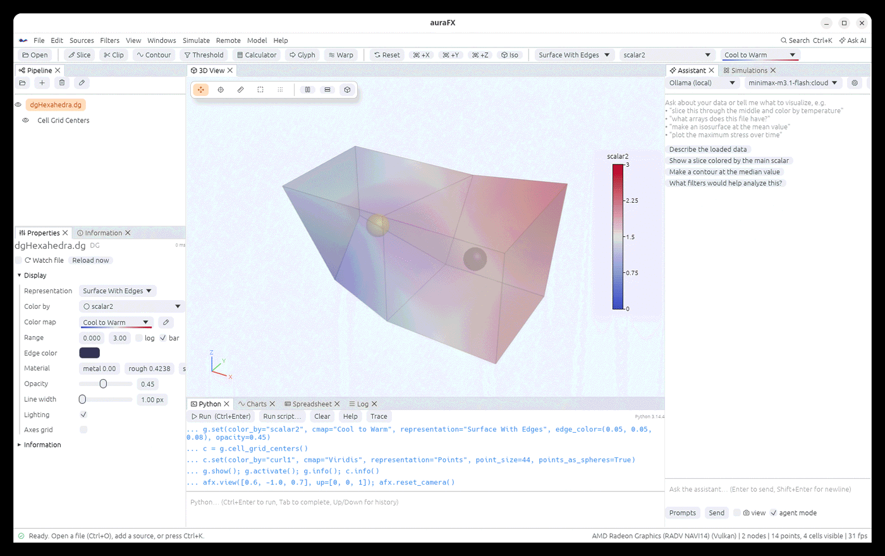

```python
g = afx.load("dgHexahedra.dg")
g.set(color_by="scalar2", representation="Surface With Edges")
centers = g.cell_grid_centers()
centers.set(color_by="curl1", points_as_spheres=True)
height = g.cell_grid_elevation(axis=(0, 0, 1))
cell = afx.cell_grid(cell_type="Tetrahedron")
mesh = g.cell_grid_to_unstructured_grid()
turned = g.cell_grid_transform(rotate=(0, 0, 30), scale=(1, 1, 2))
grid = afx.load("mesh.vtu").convert_to_cell_grid()
grid.save("mesh.dg")
cloud = afx.point_source(center=(1, 0.6, 0.5), radius=0.75, count=4000)
found = g.cell_grid_probe(cloud, attribute="quadratic")
outside = g.cell_grid_compute_sides()
edges = g.cell_grid_compute_sides(include="Edges of inputs", omit_renderable=False)
```

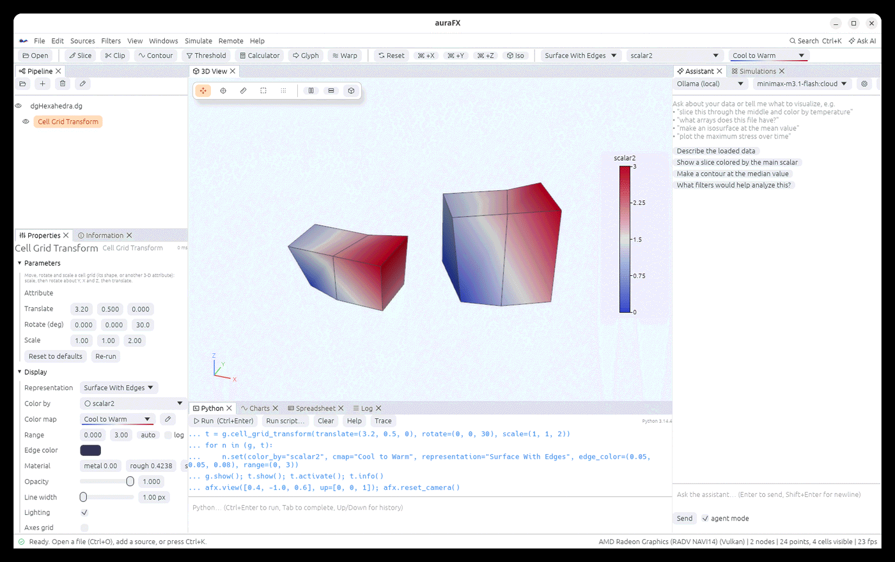

**Cell Grid Probe** looks up points in the cells. Select the cell grid, Ctrl+click the dataset whose
points you want to look up (any dataset: its points are used), then choose Filters › Data ›
Cell Grid Probe. In Properties, **Probe points** picks the second input and **Attribute** the
field to sample (empty: only find the cells). A cell is searched with a quick test first:
the point must lie behind each of the cell's faces, taken as flat planes through the corners
(on a flat cell, the edges' directions stand in for the normals).
Then the point's coordinates in the cell are found step by step from the cell's middle. On a
cell with curved faces a point just outside can pass the quick test; it is kept, with empty
(NaN) coordinates and values. Points on an edge cell are kept when they lie between the two
end planes and within the sphere around the edge, and are then kept only if they lie on the
edge. The output points are in single precision, and with several cell types they are listed
in the file's order. The grey points in the picture are such points,
next to the curved face the two cells share.

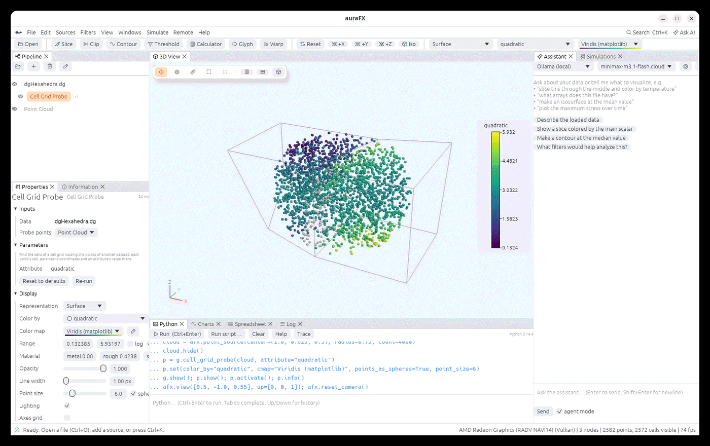

**Cell Grid Compute Sides** finds the sides of the cells. Every side of every cell is
listed, by cell and then by side, and a side is matched with the same side of a neighbor
cell whichever way round its corners go. A side is kept once, for the first cell that has
it. Properties:
- **Sides to include**:
  - *Next lowest dimension* (the default): the faces of 3-D cells, the edges of 2-D cells and
    the end points of edges;
  - *Surfaces of inputs*: the faces of 3-D cells;
  - *Edges of inputs*: the edges of 3-D and 2-D cells;
  - *Vertices of inputs*: the corners of every cell;
  - *All sides*: all of these.
- **Omit sides of surfaces and lines** (on by default): 2-D and 1-D cells give no sides, since
  they can be drawn as they are.
- **Keep surfaces and lines** (on by default): keep drawing the 2-D and 1-D cells and the
  sides already listed. 3-D cells are always hidden behind their sides.
- **Keep** (advanced):
  - *Boundary* (the default): faces of 3-D cells (or edges of 2-D cells, end points of edges)
    found once, so not shared by two cells, and every lower side (edges and corners of 3-D
    cells) once;
  - *Odd count*: every side found an odd number of times;
  - *Every side*: each side once.

The sides are stored in the grid as lists of (cell, side number) pairs, one per side shape
("quadrilateral sides of vtkDGHex"), as VTK stores them. The fields on a side are the fields of
its cell, so a field that jumps between cells shows the value from the cell the side belongs
to. Running Compute Sides on its result adds the sides of those sides, for example the edges of
the outer faces. Saving as `.dg` keeps the lists. Any filter other than the cell grid ones
works on what is drawn: the sides. VTK's markings of ghost and hidden points (which skip
sides) are not read.

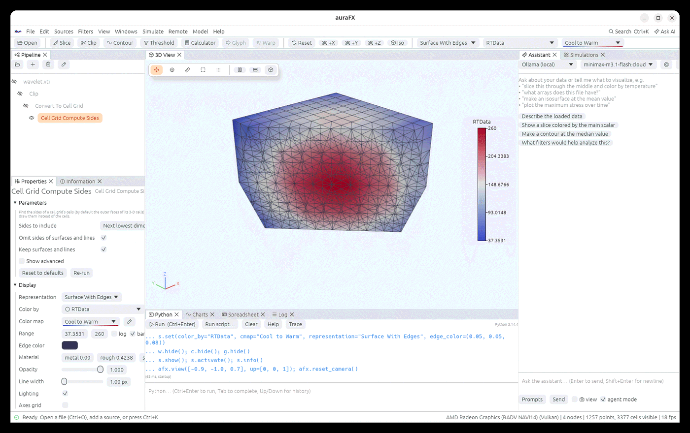

On quadrilaterals and triangles the cell's shape matrix (its Jacobian) is flat, so it is
completed with the cell's unit normal; edge and face fields then lie in the cell's plane, and
Cell Grid Probe gives coordinates on flat cells and edges.

Verified against a reference implementation; the comparisons are listed in the
verification notes (`docs/reference/verification.md` in the source tree).

Not available yet: cell grid range and copy filters. Slicing or clipping works on the corner
mesh, so curved cells come out straight.

## Writers

| Format | Extensions | Notes |
|---|---|---|
| VTK XML | `.vtu .vtp .vti .vtr .vts .vtm` | appended binary; multiblocks as a folder of pieces |
| VTK hyper tree grid | `.htg` | XML version 2: the trees, mask and cell data |
| VTK cell grid | `.dg` | the JSON layout VTK writes: arrays, attributes and cell types |
| VTK legacy | `.vtk` | |
| VTKHDF | `.vtkhdf` | all dataset kinds; multiblocks as a collection; time series with `all_times=True`; written with auraFX's own HDF5 encoder (read by h5py and VTK) |
| Exodus II | `.exo` | blocks, nodal and element variables, every time step with `all_times=True`; HEX20 and HEX27 elements; the element blocks, side sets and node sets of generated meshes (see [Geometry and meshing](geometry.md#meshes-blocks-and-sets)) |
| Abaqus input | `.inp` | nodes, elements (C3D8, C3D20, C3D27, tetrahedra, wedges, pyramids) in one element set per block, node sets, side sets as element-based surfaces |
| Gmsh | `.msh` | version 4.1 ASCII: one physical volume per element block, one physical surface of quadrilaterals per side set (node sets are not part of the format) |
| EnSight Gold | `.case` | C binary; one part per block (image, rectilinear and structured grids as blocks, the rest as elements of every standard type, polygons and polyhedra); every time step with `all_times=True`, the geometry written once when it does not change |
| CGNS | `.cgns` | HDF5 storage (CGNS 4): a zone per block, image/rectilinear/structured grids as structured zones, the rest as one element section (MIXED when the cell types differ) plus NGON/NFACE for polygons and polyhedra; vectors as `NameX/NameY/NameZ`; with `all_times=True` one solution per step (and coordinates per step when the points move), but the cells must stay the same |
| Xdmf 3 | `.xmf` + `.h5` | the description in the `.xmf`, the arrays in an HDF5 file beside it; block trees as spatial collections, time steps as a temporal collection that shares unchanged points and cells |
| Grain orientations | `.tex` | φ1 Φ φ2 in degrees, one line per grain in order of grain id (meshes with grains from Assign Grains or Overlay Mesh) |
| CSV, STL, PLY | | a multiblock of surfaces saved as `name.stl` writes one file per block, `name_<block>.stl` (Feature Surfaces gives one per grain) |
| Scenes | `.glb .obj .x3d .wrl` | see [Exporting](exporting.md) |
| Pictures | `.png .svg`, GIF/MP4 animations | see [Exporting](exporting.md) |

Files written by the VTK XML, VTKHDF, Exodus, EnSight, Xdmf and CGNS writers were read back
with the same points, cells and values (verified against a reference implementation; the
comparisons are listed in the verification notes, `docs/reference/verification.md` in the
source tree). EnSight groups the cells of each part by type, and
CGNS puts polyhedra after the other cells, so cells can come back in a different order (each
keeps its values). Cell types a format does not have (Lagrange and Bezier cells, for example)
are written by their corner points. A CGNS zone holds cells of one dimension: in a volume
mesh, boundary faces and lines are left out.

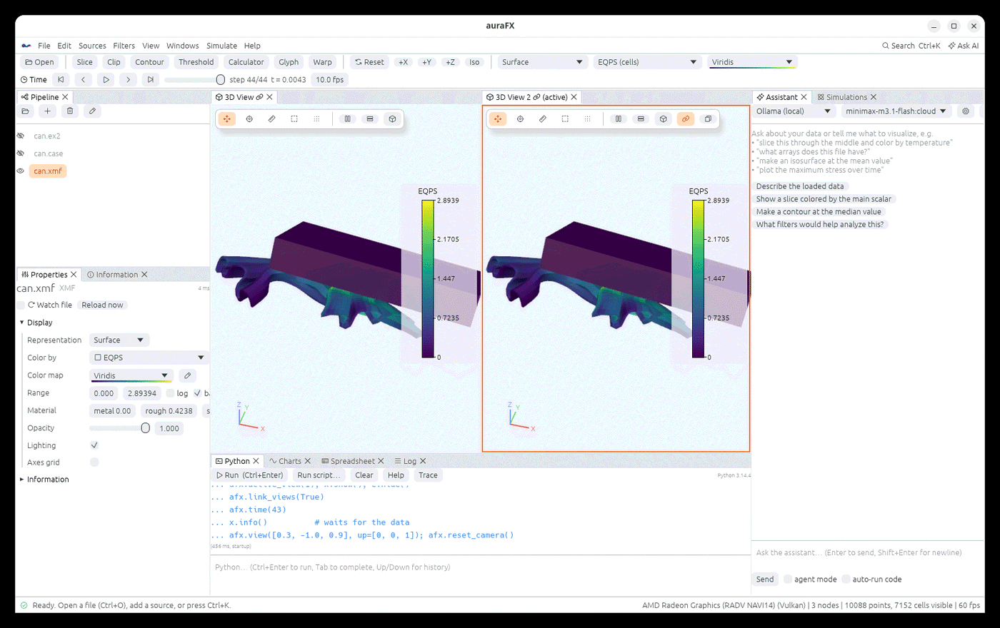

## Curved cells

VTK's Lagrange and Bezier cells of any order, quadratic cells and serendipity cells are read
with their node numbering, drawn curved and cut by the filters along their curvature; see
[Volumes, point clouds and curved cells](representations.md#curved-cells).

## Your own formats

A [plugin](plugins.md) reader is a Python function with `@afx.reader(extensions=[...])`; it
takes precedence over the built-in reader for its extensions and appears in the Open dialog.
