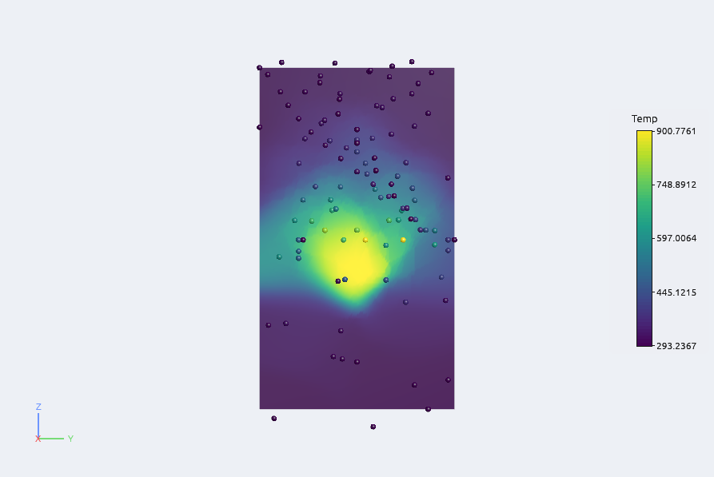
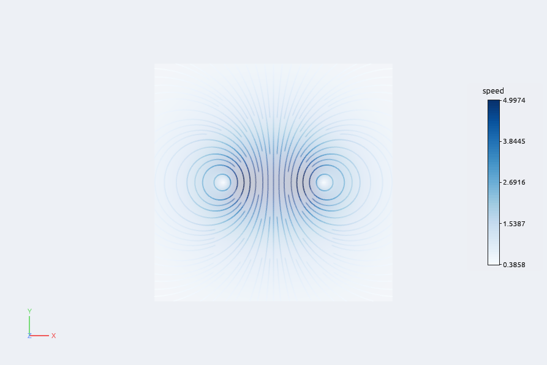
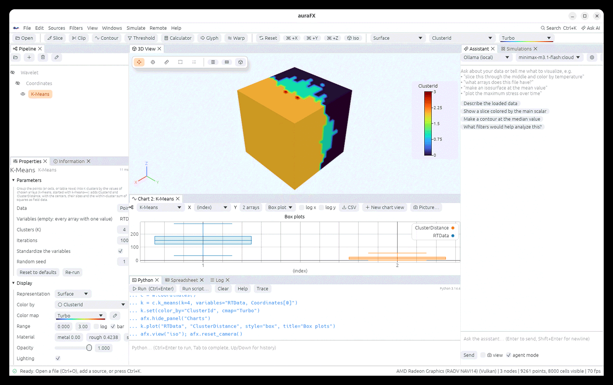
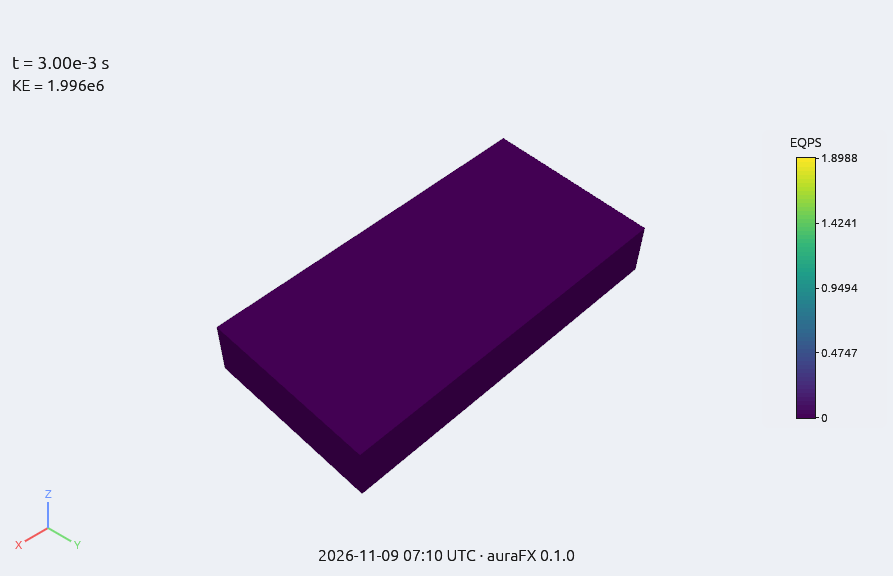
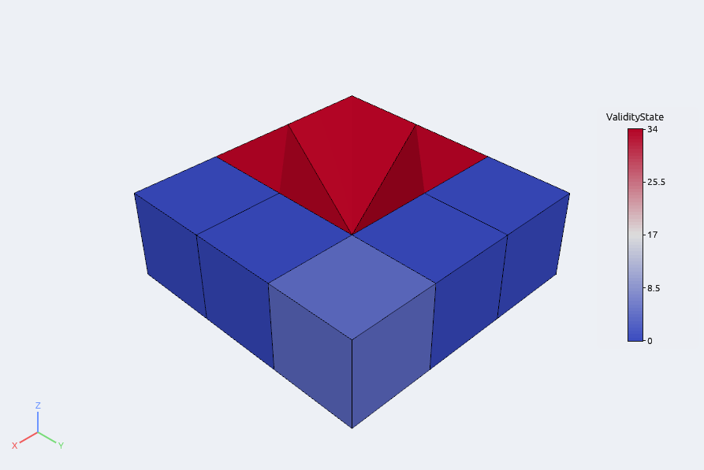
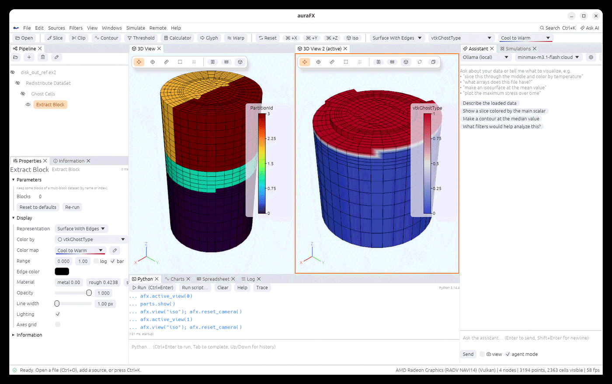
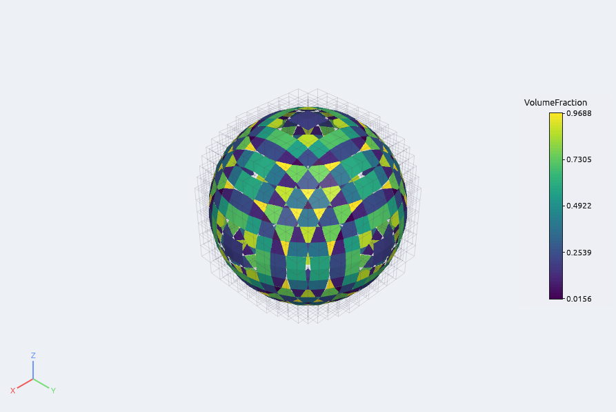
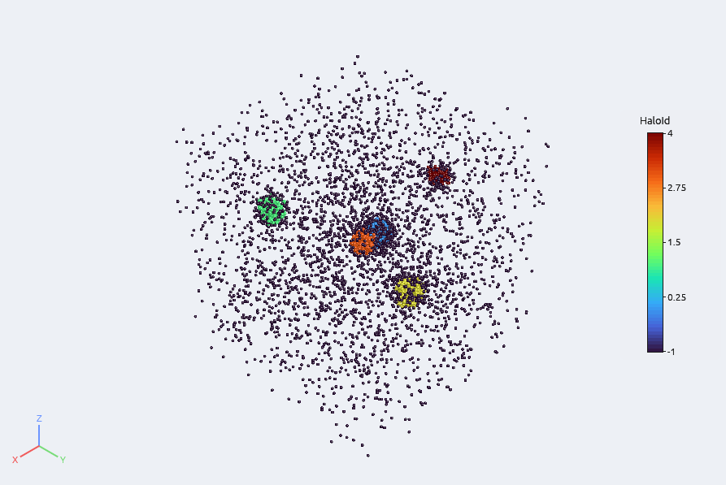
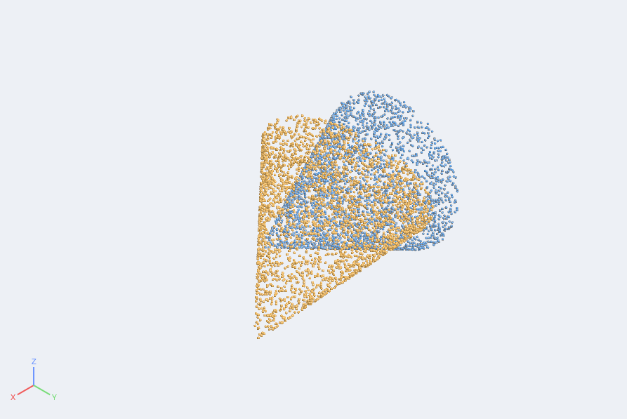

# Filters

A filter takes the output of the object above it and makes a new object. Select an input,
choose the filter, adjust it in Properties. Every filter is also a method in Python
(`node.slice(...)`), and the assistant knows all of them.


## Common filters (toolbar)

| Filter | What it does | Main parameters |
|---|---|---|
| **Slice** | the data on a plane or a sphere, with the values interpolated onto it | type, origin, normal (or radius); the plane can be dragged in the view |
| **Clip** | keeps one side of a plane, the inside/outside of a box or sphere, or the cells above/below a scalar value; **crinkle** keeps whole cells | type, origin, normal, box corners, radius, scalar and value, invert |
| **Contour** | isosurfaces (or isolines on 2-D data) at one or more values | array, values; computes normals |
| **Threshold** | the cells whose values lie in a range | array, min, max, all/any point |
| **Calculator** | a new array from an expression over other arrays (`sqrt(u*u+v*v)`, `mag(V)`, vectors with `iHat`...) | expression, result name, point or cell |
| **Glyph** | arrows, cones, spheres, cubes or lines at the points, scaled and oriented by arrays | shape, orientation and scale arrays, factor, maximum glyphs |
| **Warp By Vector / Scalar** | moves points by a vector array (displacements) or along the normal by a scalar | array, factor |
| **Stream Tracer** | streamlines of a vector field from a line or a point cloud of seeds; **Tube** makes them solid | vectors, seed type, seed line or cloud, integration direction and length |
| **Plot Over Line** | samples the data along a line and plots it in Charts | the two end points (draggable) |
| **Probe Location** | the values at one point, shown in Information and the Spreadsheet | location (draggable) |

## Analysis

Resample To Image, Resample With Dataset, Histogram, Descriptive Statistics, Integrate
Variables (areas, volumes and integrals of every array), Gradient (with divergence, vorticity
and Q-criterion), Cell Size, Mesh Quality, Elevation, Cell Centers, Connectivity, Find Data,
Extract Selection, Temporal Statistics (mean, min, max and standard deviation over all time
steps), Temporal Interpolator, Temporal Shift Scale, Temporal Array Operator, and the particle
filters (Particle Tracer, Particle Path, Streak Line) that follow particles through a
time-varying flow. Texture Map to Plane / Cylinder / Sphere, Perlin Noise and Spatio Temporal
Harmonics are described [below](#textures-and-made-up-data).

## Geometry

Extract Surface, Extract Edges, Feature Edges, Outline, Transform, Reflect, Shrink, Clean,
Surface Normals, Smooth, Triangulate, Tetrahedralize, Tessellate (curved cells into straight
pieces), Mask Points, Merge Blocks, Extract Block, Extract Subset (a sub-volume of an image),
Append Datasets / Geometry / Attributes, Cell Data to Point Data and back, Extract Component,
Rename Array, Pass Arrays, and OpenFOAM Boundary Patches.

## Sources

**Sources** adds objects without a file: Sphere, Cone, Cylinder, Box, Plane, Line, Point
Cloud, Wavelet (a test volume), Spatio Temporal Harmonics (a test volume of waves with its own
time steps), AMR Gaussian Pulse (a small [AMR](file-formats.md#amr-data-adaptive-mesh-refinement)
dataset), Hyper Tree Grid and Random Hyper Tree Grid
([hyper tree grids](file-formats.md#hyper-tree-grids)), Cell Grid (one
[DG cell](file-formats.md#cell-grids) with test fields) and Unstructured Cell Types (one of every
cell type, for tests).

## Textures and made-up data

### Showing an image on a surface

An image (PNG or JPEG) can be wrapped onto a surface, the way a world map goes onto a globe.
The surface needs **texture coordinates**, which say where each point falls in the image. Some
files and the Plane source come with them. For anything else, add one of these filters
(**Filters › Texture Map to Plane / Cylinder / Sphere**):

| Filter | How the image is laid on | Parameters |
|---|---|---|
| **Texture Map to Plane** | projected straight onto the surface from a plane, like a slide projector | **Automatic** fits the plane to the points and stretches the image over the bounds. Turn it off and give **Origin** (image corner), **Point 1** (the image's right edge) and **Point 2** (its top edge). |
| **Texture Map to Cylinder** | rolled around an axis: up the axis is up the image, around it is across | **Automatic** puts the axis along the object's longest side. Turn it off and give **Point 1** and **Point 2**, the axis ends. |
| **Texture Map to Sphere** | wrapped around a center: the image's top at the +z pole, its bottom at the −z pole | **Center** (under Show advanced; empty = the middle of the points) |

**Prevent seam** (cylinder and sphere, on by default) runs the image across half the way
round and back mirrored. That avoids a visible join, but shows the image twice. Turn it off
to wrap the image once, as for a world map. A thin seam then shows where the edges meet.

Then pick the image in **Properties › Display › Texture › Choose…** (× removes it). The row
appears when the object has texture coordinates. The image replaces the array colors and the
solid color; lighting and the material still apply. Coordinates outside 0 to 1 repeat the
image.


```python
ball = afx.sphere(radius=1, theta=128, phi=96)
globe = ball.texture_map_to_sphere(prevent_seam=False)
globe.set(texture="/path/to/world.jpg")       # texture=None removes it
p = d.texture_map_to_plane(automatic=False, origin=(0, 0, 0), point1=(10, 0, 0), point2=(0, 5, 0))
c = d.texture_map_to_cylinder(point1=(0, 0, -1), point2=(0, 0, 1), automatic=False)
```

The new array is called **Texture Coordinates**. The coordinates can also be colored by like any other
array.

Limits:
- The image is shown on surfaces (Surface and Surface With Edges) and on lines. Points and
  volumes don't show it.
- Ray tracing, scene export and pictures drawn on a server show the solid color instead of
  the image.
- The coordinates are stored at half precision for drawing (about 1/2000 of the image
  width), which only matters for images repeated many times.

### Made-up data for tests and demos

| Filter or source | What it makes | Parameters |
|---|---|---|
| **Perlin Noise** (filter) | a smooth random-looking value at every point (array **PerlinNoise**), for test data or rough-looking surfaces | **Frequency** (bumps per unit along x, y, z), **Phase** (shifts the pattern), **Amplitude**, result name |
| **Spatio Temporal Harmonics** (filter) | a sum of travelling sine waves at every point (array **SpatioTemporalHarmonics**) | **Harmonics**: 6 numbers per wave (amplitude, temporal frequency, wave vector x y z, phase). The value is the sum of amplitude × sin(frequency × time + wave vector · point + phase). |
| **Spatio Temporal Harmonics** (source, **Sources** menu) | an image volume with those waves and **20 time steps of its own** (one period), so it animates without a file | **Whole extent** (x min, x max, y min, y max, z min, z max; spacing 1), **Harmonics**, **Time steps** |

The source's time steps join the time toolbar like a file's. The filter follows the time of
its input. On data without time steps it uses time 0. The default
frequencies round π/5 to 0.6283.


```python
h = afx.spatio_temporal_harmonics_grid()     # waves in a 21×21×21 volume, 20 time steps
h.set(harmonics=[2, 1, 0.3, 0, 0, 0])         # one wave along x
afx.time(5)
n = afx.plane(xres=200, yres=200).perlin_noise(frequency=(4, 4, 4), amplitude=0.1)
n.warp_by_scalar(array="PerlinNoise")
```

## Programmable filters

**Programmable Filter**, **Programmable Source** and **Python Calculator** run Python that is
stored in the pipeline and in state files. The filter's code gets `data` (points and arrays
as NumPy) and returns it changed, or a new dataset built with `afx.make_*`. For code you want
to keep across sessions, write a [plugin](plugins.md).

## Filters with several inputs

Append Datasets, Append Geometry, Append Attributes, Resample With Dataset and Cell Grid Probe
take several inputs. Ctrl+click the inputs in the Pipeline, then choose the filter; the Properties panel
gets an **Inputs** section where the order can be changed.

```python
afx.apply_multi("append_datasets", [a, b, c])
r = probe_mesh.resample_with_dataset(source)
```

## Parameters that say "auto"

Many parameters start as **auto (data center)** or similar: the value is taken from the data
each time it runs (the center of the bounds, the middle of a range, 5 % of the size). Press
**edit** to type a value instead. Auto values follow the data through time steps and across
pieces of a parallel server.

## Speed

Slice, Contour, Clip, Threshold, Extract Surface, Stream Tracer, Gradient and Integrate
Variables run on every core and give exactly the same result on any number of threads. A
slice of 4 million cells takes about 80 ms. The thread count can be limited in **Settings ›
Filter threads** (0 = all cores) or with `AURAFX_THREADS`.

## Surface operations

Eight filters work on surfaces and lines (**Filters › Geometry**, **Data Analysis**):

- **Reverse Sense** turns a surface inside out: every polygon's vertex order is reversed, and by
  default the sign of its normals arrays too.
- **Linear Extrusion** sweeps lines into strips of quads along a *Vector* (times a *Scale
  factor*), and polygons into closed prisms (with their ends capped, optionally).
- **Rotational Extrusion** sweeps lines (and the boundary of polygons) round an *Axis* through a
  point by an *Angle*, in *Steps*: a surface of revolution, with *Translation* along the axis for a
  screw and *Change of radius per turn* for a spiral.
- **Ribbon** makes a strip of a given *Width* along every polyline, facing a chosen direction.
- **Subdivide** splits every triangle into four, *Levels* times. **Linear** keeps the shape;
  **Loop** rounds a coarse mesh toward a smooth surface (the corners pull in).
- **Decimate** removes a *Reduction* fraction of a surface's triangles by collapsing the edges that
  change its shape least (quadric error), refusing collapses that fold a triangle over; the open
  edges stay by default. A sphere at half its triangles keeps its volume within 2 %.
- **Curvature** gives the *Gaussian* (1/length²) or *Mean* (1/length, positive where the surface is
  convex) curvature of a triangle surface at its points, as the point array `Gauss_Curvature` or
  `Mean_Curvature`. On a sphere of radius r they are 1/r² and 1/r.
- **Delaunay 2D** triangulates points seen from above so that no point lies inside another
  triangle's circle; an *Alpha* radius drops long thin triangles and leaves holes and concavities.


```python
vase = afx.line(point1=(0.6, 0, 0), point2=(0.25, 0, 1.2)).rotational_extrusion(angle=270)
ball = afx.sphere(theta=6, phi=5).subdivide(scheme="Loop", levels=3).curvature(kind="Gaussian")
sheet = line.linear_extrusion(vector=(1, 0, 0))
tin = points.delaunay_2d(alpha=0.5)
light = sphere_surface.decimate(reduction=0.5)
```

## Extracting parts and making tetrahedra

- **Iso Volume** (**Filters › Data Analysis**) keeps the part where a point scalar lies between a
  *Lower* and an *Upper* value. It cuts through the cells where the scalar reaches those values,
  so the result's outer faces are the two value surfaces, not cell faces. Of a field that grows
  linearly along x, the part between a quarter and three quarters is exactly half the box.
- **Extract Cells By Region** keeps **whole** cells (nothing is cut) inside a *Box*, a *Sphere* or a
  half-space (the side a *Plane*'s normal points to). *All points inside* keeps the cells entirely
  in the region; *Crossing the boundary too* also keeps those the region's surface passes through.
  *Outside instead* keeps the rest.
- **Extract Cells By Type** keeps whole cells by type: *Types* lists VTK names (`Hexahedron`,
  `Tetra`, `Wedge`, `Pyramid`, `Triangle`, `Quad`, `Line`, `Vertex`, quadratic types…) or
  dimensions (`3D`, `2D`, `1D`, `0D`), separated by commas; *All but these* inverts it.
- **Clip Closed Surface** (**Filters › Geometry**) cuts a closed surface with a plane, keeps the side
  its *Normal* points to, and closes the cut with a flat cap, so the result is still a closed
  (watertight) surface: its volume can be measured, it can be meshed. A cut through a ring leaves the
  hole open in the cap. The cap's triangles have the cell array `Cap` = 1.
- **Delaunay 3D** joins a dataset's points into tetrahedra so that no point lies inside the sphere
  through another tetrahedron's corners, filling the points' convex hull (a regular grid of points
  is handled too). An *Alpha* radius drops the tetrahedra whose sphere is larger, leaving
  concavities and gaps between separate clusters.


```python
band = data.iso_volume(array="T", lower=300, upper=400)
core = mesh.extract_cells_by_region(region="Sphere", origin=(0, 0, 0), radius=2, mode="Crossing the boundary too")
hexes = mesh.extract_cells_by_type(types="Hexahedron")
half = closed_surface.clip_closed_surface(origin=(0, 0, 0), normal=(0, 0, 1))
tets = points.delaunay_3d(alpha=0.0)
```

## Tensors, derivatives and tables

**Fields of vectors and tensors** (**Filters › Data Analysis**):

- **Compute Derivatives** of a point vector field (a velocity, a displacement) adds its
  gradient `<name>_gradient` (9 components, dv_i/dx_j), the strain rate `<name>_strain_rate`
  (6 components), the vorticity `<name>_vorticity` (the curl), the divergence, and two vortex
  criteria: `Q_criterion` (positive where rotation beats strain; an isosurface of a positive value
  outlines vortex cores) and `lambda2` (negative inside a core). For a rigid rotation the vorticity
  is twice the angular velocity and the strain is zero.
- **Tensor Principal Invariants** of a symmetric tensor array (6 components XX YY ZZ XY YZ XZ, or
  9 row by row): the principal values (largest first), the three principal directions, and the
  invariants I1, I2, I3 and J2, J3 of the deviator.
- **Yield Criteria** of a stress tensor array: `von_Mises`, `Tresca` (σ1 − σ3), `max_principal`,
  `pressure` (minus the mean stress) and `triaxiality` (mean over von Mises). A uniaxial stress σ
  gives von Mises and Tresca σ; a pure shear τ gives √3 τ and 2τ.
- **Tensor Glyph** draws an ellipsoid at points (every n-th), its axes along the principal
  directions and as long as the principal values times a scale, colored by the largest one.
- **Surface Vectors** makes a vector field on a surface tangent to it (or keeps its normal part);
  **Surface Flow** gives the flux ∫ v·n dA through a surface and its area, as a one-row table.


**Tables and bookkeeping arrays:**

- **Table To Points** turns the rows of a table (a CSV file) into points: the columns named x, y, z,
  or chosen ones (or the first three numeric columns) give the positions, every column becomes point
  data; *2D* puts z at 0. **Table To Structured Grid** does the same into a structured grid of given
  dimensions (x fastest).
- **Transpose Table** swaps rows and columns (numeric columns; the column `Column` names the old
  columns). **Table FFT** gives the discrete Fourier transform of every numeric column, as
  `<name>_fft` (real and imaginary) and `<name>_magnitude`, for any number of rows, and a
  `Frequency` column when you give the time step.
- **Merge Vector Components** joins three scalar arrays into a vector. **Point And Cell Ids** adds
  `PointIds` and `CellIds`; **Generate Global Ids** adds ids unique over all the blocks of a
  multiblock (coinciding points share one); **Coordinates** adds the positions as an array.

```python
d = flow.compute_derivatives(array="velocity")      # velocity_vorticity, Q_criterion, lambda2, ...
cores = d.contour(array="Q_criterion", values=[0.3])
s = result.yield_criteria(array="stress")            # von_Mises, Tresca, max_principal, pressure, triaxiality
p = result.tensor_principal_invariants(array="stress")
g = slice_.tensor_glyph(array="stress", scale=0.01, stride=10)
pts = afx.load("probe.csv").table_to_points(x="X", y="Y", z="Z")
spec = afx.load("signal.csv").table_fft(dt=0.001)
```

## Scattered points onto grids and lines

**Point Interpolator** (**Filters › Data Analysis**) carries the point arrays of scattered points
(particles, probe measurements, a point cloud) onto other points. Each new value is a weighted mean
of the nearest points:

| Kernel | Weight of a neighbour at distance d |
|---|---|
| **Shepard** | 1 / dᵖ (the power p, 2 by default) |
| **Gaussian** | exp(−(s·d/R)²), with the sharpness s and the search radius R |
| **Linear** | the same for every neighbour (an average) |
| **Nearest point** | the closest point's value only |
| **SPH cubic**, **SPH quintic** | a smoothed-particle kernel of smoothing length h (support 2h); with *density* (and *mass*) arrays each particle counts with its volume, mass / density, otherwise the weights are scaled to add up to one |

The neighbours are the **N closest** points or those within a **radius** (0 picks one from the
points' spacing). Where no point is near, the result is a value of your choice or the nearest
point's. Without a second input the values go onto a **Volume** (a grid over the points'
bounds), a **Plane** across them or a **Line**; with a second input (Properties › Destination),
onto that data's points, keeping its cells and arrays. `vtkValidPointMask` is 0 where nothing was
near. A linear field sampled by 20 000 random points comes back within 2 % (Shepard, Gaussian) and
SPH on a lattice of particles within 1 %.



**Lines to plot** (all in **Filters › Data Analysis**, shown in the Charts panel):

- **Resample To Line** samples a straight line at evenly spaced points, **at the cell boundaries**
  (where the line enters and leaves each cell) or **at the cell centres** (once in the middle of
  each cell it crosses), with `arc_length`.
- **Plot On Sorted Lines** joins line segments (from Slice, Contour on a surface, Feature Edges)
  into curves ordered from one end to the other, each with its `arc_length`, one block per curve.
- **Plot On Intersection Curves** cuts a surface (a volume's outer surface) with a plane and gives
  the curves, ordered, with the surface's arrays: a profile around a section of a body.

A chart of data with several blocks draws one line per block (each against its own x array), named
`block/array`.

```python
pts = afx.load("probes.csv").table_to_points()
grid = pts.point_interpolator(kernel="Gaussian", output="Plane", axis="Z", nx=200, ny=200)
onto = pts.point_interpolator(mesh, kernel="Shepard", n_closest=12)   # onto another mesh
sph = particles.point_interpolator(kernel="SPH cubic", smoothing_length=0.02, density="rho", mass="m")
prof = body.plot_on_intersection_curves(origin=(0, 0, 0.5), normal=(0, 0, 1))
cells = mesh.resample_to_line(point1=(0, 0, 0), point2=(1, 0, 0), sampling="Cell boundaries")
```

**Evenly Spaced Streamlines 2D** fills the XY plane with streamlines of a vector field, evenly
spread: each new line starts at the *separation* from the lines already there and stops where it
comes closer than a fraction of it (or closes on itself), until no gap is left. There are no seeds
to place; the field's z component is not used.



```python
s = flow.evenly_spaced_streamlines_2d(vectors="V", separation=0.05)
```

## Statistics

In **Filters › Data Analysis**; *variables* is a list of array names (`T, p`; `V` is a vector's
magnitude, `V[1]` its second component), empty for every array with one value; *data* chooses the
point or cell arrays (table columns for tables).

- **K-Means** groups the points, cells or rows into K clusters by those values (k-means++ start,
  repeated until nothing moves; *standardize* divides each variable by its spread first). It adds
  `ClusterId` and `ClusterDistance`, and field data with each cluster's centre, size and the
  within-cluster sum of squares.
- **Principal Component Analysis** adds the projections `PCA 0`, `PCA 1`… (largest variance first)
  and gives as field data the eigenvalues, the fraction of the variance each explains and the
  components.
- **Multicorrelative Statistics**: the means, covariance matrix and (Pearson) correlation matrix
  as a table.
- **Contingency Statistics** of two arrays: how often each pair of values occurs (real values are
  put in bins), with joint and conditional probabilities; chi-square, its degrees of freedom and the
  mutual information as field data.
- **Compute Quartiles**: minimum, Q1, median, Q3, maximum, interquartile range and whisker ends per
  variable. The chart style **Box plot** draws a box of every plotted array's values.
- **Random Attributes** adds a random array (uniform between two values, scalars or vectors).
- **Kernel Smoothing** gives a smooth estimate of an array's distribution (a density that
  integrates to one) for the Charts panel; **Density Map** puts the joint density of two arrays on
  an image, with the levels holding 50, 90 and 99 % of the samples.

Three clusters of 200 points each are found exactly; PCA of a cloud stretched along (1, 1) gives
its two variances within 3 %.



```python
k = w.k_means(k=4, variables="RTData, Coordinates[0]")
p = w.principal_component_analysis(variables="RTData, Coordinates[0], Coordinates[1]", keep=2)
c = afx.chart_view(w.compute_quartiles(), y=["Q1"])
w.plot("RTData", style="box")
```

## Text in the 3D view

The **Annotation** filters write a line of text that every 3D view showing them draws in a
corner of your choice, at a size of your choice (hide the filter to hide the text):

- **Annotate Time Filter**: the time, in a format such as `Time: {:.3} s` (`{}` is the value,
  `{:.3}` three decimals, `{:.2e}` an exponent, `{:.4g}` four significant digits), scaled and
  shifted if you like.
- **Annotate Global Data**: a global (field) value, such as an energy; one value per time step
  shows the current step's.
- **Annotate Attribute Data**: the value of an array at one point or cell, following the time steps.
- **Annotate Selection**: on the output of Extract Selection, how many points are selected and the
  first ones with their numbers and values.
- **Environment Annotation**: the date and time, the user, the machine, the operating system, the
  auraFX version.
- **Python Annotation**: the result of a Python expression; the point and cell arrays are NumPy
  arrays by name (the blocks of a multi-block joined), with `points`, `inputs`, `t` (the time) and
  `step`, e.g. `f'max T = {T.max():.1f} K'`.



```python
c.annotate_time_filter(format="t = {:.2e} s", corner="upper right")
c.annotate_global_data(array="KE", format="kinetic energy {:.3g} J")
c.python_annotation(expression="f'max EQPS {EQPS.max():.3f}'", corner="lower left", size=20)
```

## Checking meshes

- **Validate Cells** checks every cell: `ValidityState` is 0 for a good cell, otherwise the sum of
  1 (wrong number of points), 2 (degenerate: no volume, area or length), 4 (inverted, turned inside
  out), 8 (a face that is not flat), 16 (a polygon that is not convex), 32 (repeated points); field
  data counts each problem. Threshold on `ValidityState` ≥ 1 to see the bad cells.
- **Overlapping Cells Detector** counts, for each cell, the other cells that share volume with it
  (or area, for surface cells in one plane): `NumberOfOverlapsPerCell`. Cells that only touch do
  not count.



## Partitions and ghost cells

Partitioned data is a multi-block whose blocks are the partitions: a `.pvtu`, `.pvtp`, `.pvts`,
`.pvtr` or `.pvti` file opened with the reader option **Pieces › Partitions** (one block per piece
file), or the output of Redistribute DataSet.

- **Redistribute DataSet** splits a mesh into partitions of nearly equal cell counts, cutting it in
  halves along its longest side again and again (64 cells into 3 partitions: 21, 21 and 22).
- **Ghost Cells** gives each partition layers of the neighbouring partitions' cells that touch it,
  marked in `vtkGhostType` (1 for a ghost cell, and for a point only ghost cells use), so that
  filters that look at neighbours agree at partition borders.
- **Remove Ghost Information** drops the ghost cells and the ghost arrays again.



```python
parts = mesh.redistribute_dataset(partitions=8, ghost_layers=1)
case = afx.load("run.pvtu"); case.set(pieces="Partitions")
g = case.ghost_cells(layers=2)
```

## Volume fractions and fragments

- **Material Interface** rebuilds the interfaces between materials from cell arrays of volume
  fractions (one per material, 0 to 1): in every mixed cell a plane facing down the fraction's
  gradient, placed so that the cell's material side holds exactly its fraction. One block of
  interface polygons per material (lines on surface meshes) with `VolumeFraction`, and the
  material's volume as field data. For a ball sampled on a 24³ grid the interface area is within
  4 % of the sphere's and every interface point within a third of a cell of it.
- **Fragment Integration** finds the fragments of a material: cells whose fraction (or any cell
  array) is at least a threshold, joined through shared faces (across the levels of AMR data,
  through touching boxes). The table gives each fragment's cell count, volume (fraction × cell
  volume), centroid and the volume integrals of the other cell arrays; *Output › Cells* gives the
  cells with `FragmentId`. Two balls come back as two fragments with their volumes within 1 %.
- **AMR Dual Clip** clips AMR data by a cell array without cracks between levels: the levels' cell
  centres are joined into one stitched mesh and the part above a value is kept.



## Halos and shape measures

- **Halo Finder** finds halos in particles: particles closer than a *linking length* (a fraction of
  the mean spacing, 0.2 by default) are friends, and friends of friends form one halo. It adds
  `HaloId` (−1 outside halos) or gives a table of halos with their count, mass, centre of mass,
  mean velocity, and `RadiusSOD` / `MassSOD`, the radius and mass inside which the mean density is
  the *overdensity* (200) times the box's mean density.
- **Minkowski Functionals** measures the region where an array is above a threshold, from its
  closed boundary surface: volume, surface area, integrated mean curvature, Euler characteristic
  (1 for a ball, 0 for a torus) and the normalised W0 to W3. A ball sampled on a 61³ grid comes
  within 1 % (volume), 2 % (area) and 3 % (mean curvature) of the exact values.



```python
h = particles.halo_finder(linking=0.2, min_members=20, mass="mass", velocity="v")
table = particles.halo_finder(output="Halos")
m = volume.minkowski_functionals(array="porosity", threshold=0.5)
```

## Point sets

In **Filters › Geometry**:

- **Point Sample Triangle Geometry** spreads a number of points over a surface at random (seeded),
  each triangle getting points in proportion to its area.
- **Crop Points** keeps the points inside a box, with their arrays.
- **Iterative Closest Point** moves a point set (the first input) rigidly onto another (the
  second, chosen in Properties): each round pairs every point with its nearest target point and
  finds the rotation and translation that bring the pairs closest, until it stops improving. The
  output is the moved points, with the 4 × 4 `Transform` (row by row) and the `RMSDistance` in
  its field data; a cloud turned by 10° and moved comes back to within 10⁻⁶. It finds the
  nearest fit from where the points start, so the two sets must already roughly overlap.

```python
target = afx.load("part.stl").point_sample_surface(samples=3000)
moved = target.transform(rotate=[0, 20, 10], translate=[0.2, 0, 0])
aligned = afx.iterative_closest_point(moved, target, iterations=100)
```



## From Python

```python
afx.filters()                 # every filter with its parameters
afx.help_filter("clip")       # one filter explained
s = d.slice(normal=(0, 1, 0))
c = d.contour(array="Temp", values=[400, 600])
k = d.clip(type="Box", box_min=(-3, -3, -2), box_max=(3, 3, 4))
t = d.threshold(array="Pres", min=0.01)
s.set(origin=(0, 1, 0))       # change a parameter; the filter re-runs
s.update()                    # wait for it
```
