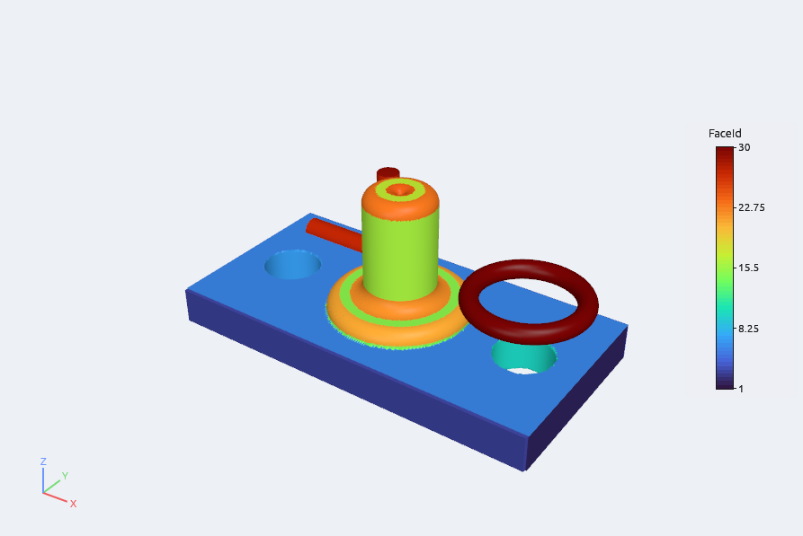
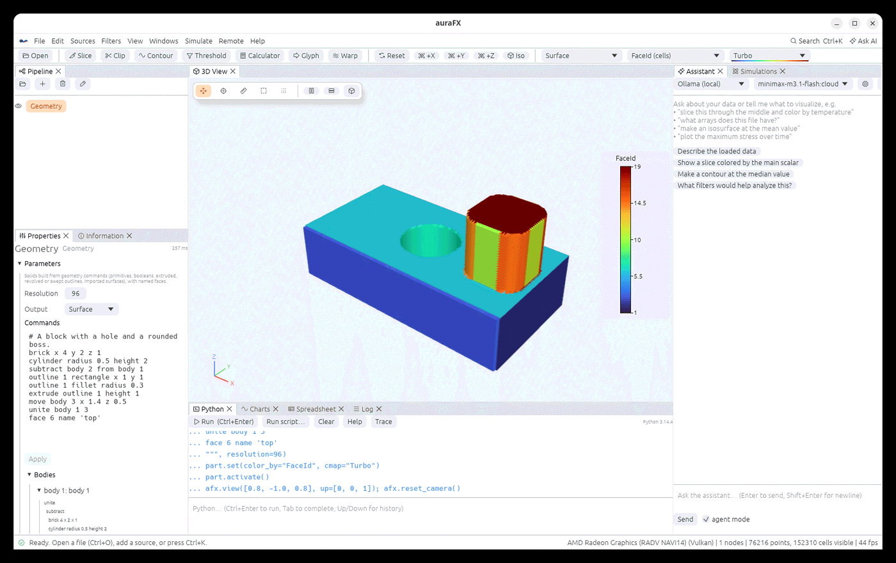
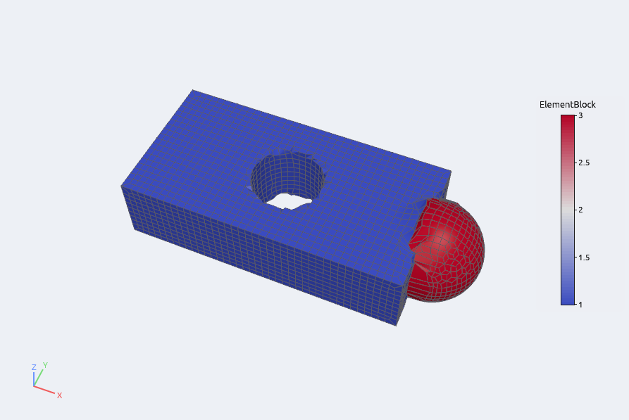
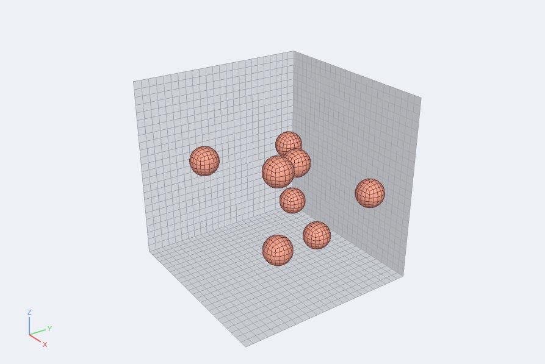
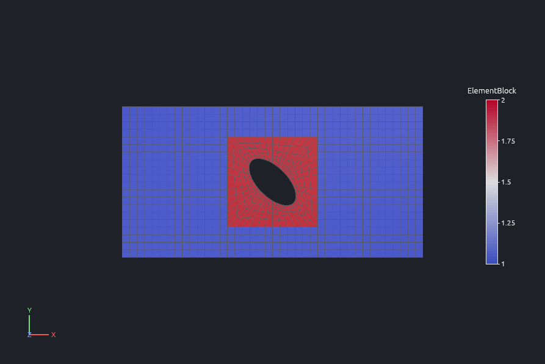
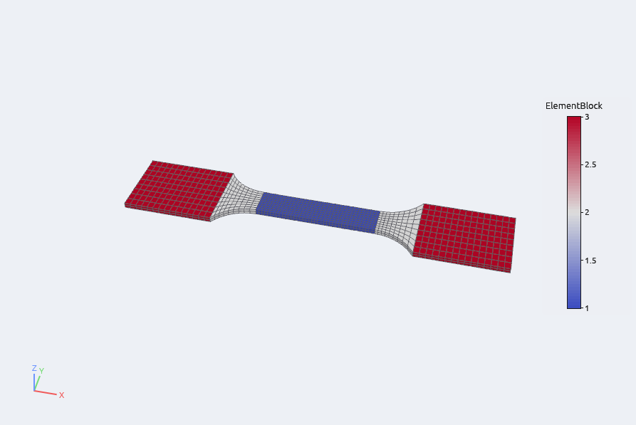
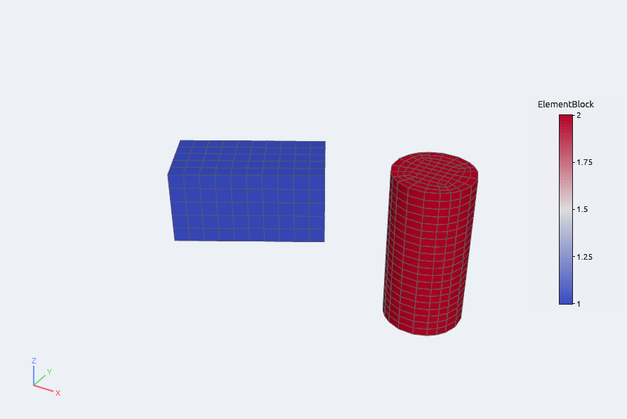
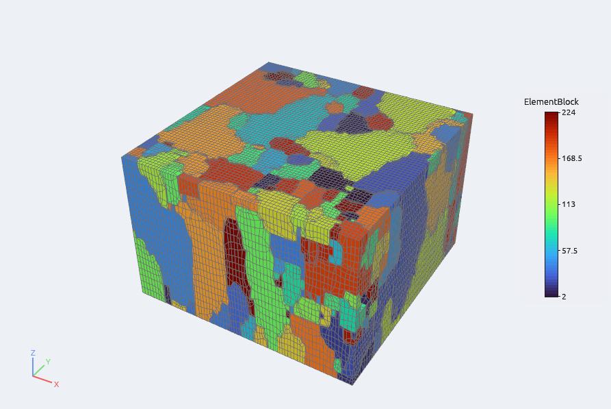
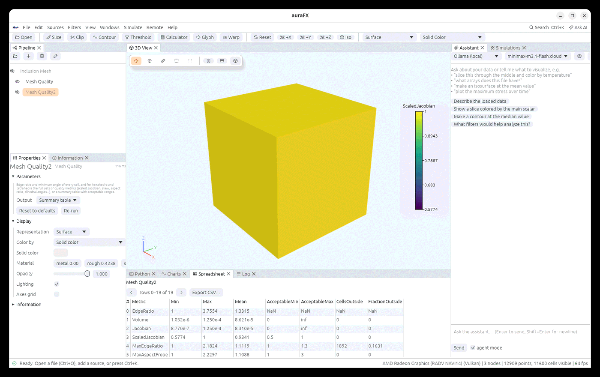

# Geometry and meshing

auraFX builds solid geometry from short commands: primitives, booleans, outlines extruded,
revolved or swept, and imported surfaces. Each body keeps named faces, so later steps can
refer to the top of a plate or the side of a hole. It also makes structured hexahedral meshes:
boxes, and boxes of matrix holding inclusions whose surfaces the elements follow exactly. The
meshes carry element blocks, side sets and node sets, check their quality, and write Exodus,
Abaqus and Gmsh files for solvers. Plates with holes, dog-bone specimens and swept surfaces
have their own generators, and bricks and cylinders built with commands can be meshed with
`mesh body` commands.

## The Geometry source

Add it with **Sources › Geometry**. Its Properties show:

- **Commands**: the command list, edited in the box and applied with **Apply**.
- **Bodies**: a tree of the bodies the commands make. It shows how each body was built and
  lists its faces with their numbers and names. A mistake in a command shows here, with the
  line it is on.
- **Resolution**: cells along the longest side of each body when its surface is drawn.
- **Output**: *Surface* gives the bodies' surfaces. *Distance field* gives the signed
  distance to the nearest body on a grid (negative inside), with the body and face nearest
  each point.

The surface output carries the cell arrays `BodyId` and `FaceId`. Its field arrays are
`FaceNames` (indexed by face number), `BodyIds`, `BodyNames`, and each body's `Volume` and
`SurfaceArea`. Color by `FaceId` to see the faces.





## Commands

Write one command per line, or separate commands with `;`. Text after `#` is a comment.
Bodies, outlines and faces are numbered from 1 in the order they are made. Sizes are in
model units and angles in degrees.

### Primitives

All primitives are centred on the origin, and round ones stand along z.

| Command | Makes |
|---|---|
| `brick x 4 y 2 z 1` (or `brick 2` for a cube) | a box; faces `x-`, `x+`, `y-`, `y+`, `z-`, `z+` |
| `sphere radius 1` | a sphere |
| `cylinder radius 0.5 height 2` | a cylinder; faces `side`, `bottom`, `top` |
| `cone radius 1 top 0.4 height 2` | a cone or frustum (top 0 for a point) |
| `torus major 2 minor 0.5` | a torus in the xy plane |
| `prism sides 6 radius 1 height 2` | a regular prism; faces `side 1` … , `bottom`, `top` |
| `superquadric x 1 y 0.8 z 0.6 e1 0.5 e2 0.7` | a superellipsoid (exponents 1 give an ellipsoid; smaller ones square it off) |
| `harmonic radius 1 coefficient 2 0 0.3 coefficient 3 2 0.1` | a star-shaped body with radius r (1 + Σ c Y<sub>lm</sub>), real spherical harmonics, for particle and grain shapes |
| `import 'part.stl' scale 0.001` | a closed surface from a file (STL, PLY, OBJ, VTK polygonal data) |

### Outlines and profile solids

An outline is a closed 2-D curve. Build it, then extrude, revolve or sweep it.

| Command | Does |
|---|---|
| `outline 1 polyline 0 0 2 0 2 1 0 1` | straight edges through the points, closed back to the start |
| `outline 1 rectangle x 2 y 1 center 0 0` | a rectangle |
| `outline 1 circle radius 1 center 0 0` | a circle |
| `outline 1 ellipse x 2 y 1` | an ellipse |
| `outline 1 regular sides 6 radius 1` | a regular polygon |
| `outline 1 spline 0 0 2 0 2 1 0 1` | a smooth closed curve through the points |
| `outline 1 add line 3 1 3 2` | straight edges appended to the outline |
| `outline 1 add arc center 0 0 radius 1 start 90 end -90` | an arc appended (counterclockwise when end > start) |
| `outline 1 fillet radius 0.2` | every corner between straight edges rounded |
| `extrude outline 1 height 2` | the outline from z = 0 to the height |
| `revolve outline 1 angle 360` | the outline turned about z; x is the distance from the axis and y the height |
| `sweep outline 1 path 0 0 0 4 0 0 4 3 0` | the outline carried along a path of points, kept normal to it |

Faces of profile solids are named after the outline's curves: `edge 1`, `edge 2`, … for
straight edges, then `arc 1`, `fillet 1`, `circle`, `spline 1`. Extrusions add `bottom` and
`top`, partial revolutions `start` and `end`, and sweeps `start` and `end`.

### Moving and combining bodies

| Command | Does |
|---|---|
| `move body 2 x 1 y 0 z 0.5` | translates |
| `rotate body 2 angle 30 about z center 0 0 0` | rotates (`about x`, `y`, `z` or a direction `1 1 0`) |
| `scale body 2 1.5` or `scale body 2 x 2 y 1 z 1` | scales about the origin |
| `unite body 1 2 3` | one body (numbered as the first) from several |
| `subtract body 2 3 from body 1` | removes bodies 2 and 3 from body 1 (add `keep` to keep them) |
| `intersect body 1 2` | the common part |
| `copy body 1` | a copy as a new body |
| `delete body 2` | removes a body |
| `body 1 name 'bracket'` | names a body |
| `face 6 name 'inlet'` | names a face |

A face keeps its name through booleans, so the faces of a hole are still `cylinder 2 side`
after the cylinder is subtracted, unless you rename them.

### Meshing bodies

These commands make a hexahedral mesh, shown when the Geometry source's **Output** is
*Hex mesh*:

| Command | Does |
|---|---|
| `mesh body 1 2 size 0.1 element HEX20` | meshes bodies with elements of about that size (HEX8 by default) |
| `mesh body 3 size 0.1 scheme overlay` | chooses how: `structured`, `overlay` or `stairstep` (by default bricks and cylinders are structured, everything else overlay) |
| `block 7 add body 2 name 'rod'` | puts bodies in an element block (by default each body is its own block, with its id and name) |
| `sideset 1 add face 6 9 name 'top'` | a side set of the mesh faces on those geometry faces |
| `nodeset 2 add face 1 name 'left'` | a node set of the nodes on those faces |

Bricks become structured boxes, and cylinders become an O-grid disk swept along their axis,
each moved, turned and scaled like its body. Every geometry face also becomes a side set
named after it, such as `brick 1 x+` or `cylinder 2 side`. With HEX20 or HEX27 elements, the
new nodes on a cylinder's side lie on the exact surface. Bodies meshed together are welded
where their nodes coincide.

Every other body (spheres, booleans, outlines, sweeps, imported surfaces) is meshed on an
overlay grid; see [Overlay meshing](#overlay-meshing) below.
- **One grid.** All overlay bodies share one grid of the smallest size asked for, so bodies
  that touch meet node to node. Each body is its own block, and the faces between two bodies
  form a side set named `interface <body> - <body>`.
- **Overlap.** Where bodies overlap, the one listed first in the `mesh` commands keeps the
  overlap.
- **Curved elements.** With HEX20 or HEX27 elements, the new nodes on a body's surface are
  moved onto it.
- **Stair-step.** `scheme stairstep` keeps whole grid cells, for a quick look.



## Python

`afx.mesh.geometry()` builds geometry command by command. Each command is checked at once,
so a mistake raises an error naming the line.

```python
g = afx.mesh.geometry()
g.cmd("brick x 10 y 5 z 2")
g.cmd("cylinder radius 1 height 4; subtract body 2 from body 1")
for b in g.bodies():                  # id, name, history, faces, bounds
    print(b["id"], b["name"], b["faces"])
part = g.result(resolution=96)        # adds the Geometry source to the pipeline
print(g.journal())                    # every command so far
```

The Geometry source is also an ordinary source: `afx.geometry(commands="sphere radius 1")`.
Edits made in the command box are recorded in the trace (**Trace** in the Python panel), so
the journal can be replayed.

## Signed Distance Field

**Filters › Mesh › Signed Distance Field** turns a closed surface, such as an STL file or the
Geometry output, into an image grid with a `Distance` point array. The array is negative
inside. **Resolution** sets the cells along the surface's longest side, and **Margin** adds
space around it as a fraction of its size. Contour it at 0 to get the surface back, or
threshold it to keep the inside.

```python
d = afx.load("part.stl").signed_distance(resolution=128, margin=0.1)
```

## Meshes, blocks and sets

A generated mesh is an unstructured grid of hexahedra with the cell array `ElementBlock` (the
block each element belongs to) and field arrays for the rest: `ElementBlockIds` and
`ElementBlockNames`, one `SideSet <name>` per side set (element index and Exodus side number
1 to 6 per face) and one `NodeSet <name>` per node set (node indices). Exodus files keep all
of them, as do Abaqus files (element sets, node sets and surfaces). Gmsh files keep the blocks
and side sets as physical groups. Exodus files written elsewhere read back the same way, with
their side sets and node sets.

**Filters › Mesh › Extract Set** shows one set: a side set's faces as a surface (with the
owning element's block and element variables) or a node set's nodes as points.

```python
walls = mesh.extract_set(set="x-")
mesh.save("part.e")          # or part.inp, part.msh
```

## Box Mesh

**Sources › Box Mesh** makes a box of hexahedra: its **Size**, **Origin** and **Cells** along
x, y and z, optionally **Graded**. The grading is the ratio of the largest to the smallest
interval along each axis, with the small intervals at the **Start**, the **End** or **Both**
ends. It has one block, `block_1`, and side sets and node sets `x-`, `x+`, `y-`, `y+`,
`z-` and `z+` on its faces. **Element** gives HEX8, HEX20 or HEX27 elements.

```python
b = afx.box_mesh(size=(2, 1, 1), cells=(40, 20, 20), grading=(3, 1, 1), cluster="Start")
```

## Inclusion Mesh

**Sources › Inclusion Mesh** makes a box of matrix with randomly placed inclusions, meshed with
conforming hexahedra. This is the method of hexaform, a structured mesher written by the
author of auraFX:

- **Background grid.** A grid of cubic cells covers the box. **Cells along the shortest side**
  sets the cell size.
- **Packing.** Each inclusion gets a box of whole grid cells. The boxes are placed at random,
  largest first, at least **Cells between boxes** apart and **Cells from the walls** away from
  the box faces. So anything that is placed can be meshed.
- **Blocks.** Each inclusion box is filled with a block:
  - a core filled from its six sides;
  - layers out to the exact inclusion surface, where every node lies on the surface;
  - layers out to the flat box faces, whose nodes are the grid's own.
- **Welding.** The pieces are welded exactly, so there are no hanging nodes and the elements
  fill the box exactly.

**Packing** *Random* places the inclusions once each, largest first. *Collective* then keeps
moving the placed ones, each by a random step or a push towards free space, to open room for
the rest. This reaches denser packings, but takes longer. **Shape** chooses spheres,
ellipsoids or superquadrics (with **Semi-axes / radius** and the
superquadric **Exponents**), or harmonic grains with a random surface of the given
**Roughness**. **Radius** and **Radius spread** set the size distribution, and **Random
orientation** turns the non-spherical shapes. **Seed** fixes the placement.

The mesh has:
- block 1 `matrix` (the grid and the outer layers) and block 100 `inclusions`, or one block per
  inclusion with **One block per inclusion**;
- side sets `x-` … `z+` on the box faces and `interface` (the matrix side of every inclusion
  surface), and node sets `x-` … `z+`;
- the element variable `particle_id`: the inclusion's number inside it, minus that number in
  its outer layers, 0 elsewhere;
- field arrays `InclusionsPlaced`, `InclusionsRequested`, `VolumeFraction` and `CellSize`.

With **Element** HEX20 or HEX27, the new nodes on the inclusion surfaces are placed on the
exact surface too. **Periodic** pairs every node on a box face with the node opposite it
(matched by their other two coordinates). It adds node sets `x-_node_set`/`x+_node_set` (and
y, z) listing the pairs in the same order, and the field arrays `PeriodicPairs x` (and y, z),
for periodic boundary conditions.

The advanced settings shape the blocks:
- the number of layers inside and outside the surface, and their grading;
- the core size and roundness;
- the box size relative to the inclusion;
- the spacing of the nodes on the surface.

The default blocks have a smallest scaled Jacobian of 1/√3 = 0.577, at the corners of the
inclusion boxes.

```python
m = afx.inclusion_mesh(size=(1, 1, 1), cells=24, count=8, radius=0.075, shape="Sphere", seed=7)
m.save("rve.e")
```



## Plate Mesh

**Sources › Plate Mesh** makes a plate of **Cell size** hexahedra, one element through the
thickness. The width and height must be whole multiples of the cell size. It can have a
circular or elliptical through-hole, given by its semi-axes **a** and **b**, the ellipse's
**angle** and its centre (empty for the plate centre).

The hole is meshed by a ring of elements whose inner nodes lie on the exact curve and whose
outer edge is a rectangle of whole background cells. So the ring hands over to the plate
without transition elements. The ring's layers grow from about the hole's arc spacing to the
cell size.

The mesh has:
- blocks 1 `plate` and 2 `ring`;
- side sets and node sets `x-` … `z+`;
- node sets `outer` (the four edges) and `grips` (both x faces);
- a node set and a side set `hole`.

```python
p = afx.plate_mesh(size=(100, 50, 1), cell=2.5, hole="Circle", a=2.5)
```



## Dog-bone Mesh

**Sources › Dog-bone Mesh** makes a flat tensile specimen as one mapped block:
- **Planform.** Grips of **Grip width** at both ends and a gage of **Gage width** and **Gage
  length** in the middle, joined by circular fillets of **Fillet radius**.
- **Thickness.** Constant in the grips. Along the gage it follows a spline through the
  **Thickness stations** (pairs of position from the gage start and thickness), and it blends
  linearly across the fillets.
- **Cells.** **Cell size** in the gage, growing to **Grip cell size** in the grips, with
  **Layers through the thickness** layers.

The mesh has:
- blocks 1 `gage`, 2 `shoulder` and 3 `grip`;
- side sets and node sets `x-` and `x+`;
- node sets `grips`, `z-`, `z+`, `edge-`, `edge+`, `gage-` and `gage+`, and `station_1`, … for
  each thickness station.

```python
d = afx.dogbone_mesh(stations=[0, 0.37, 4, 0.35, 8, 0.346], layers=2)
```



## Sweep Quads

**Filters › Mesh › Sweep Quads** sweeps a surface of quadrilaterals into layers of hexahedra
along a **Direction** over a **Distance**. The layers can be graded like Box Mesh's cells.
Blocks come from the surface's `ElementBlock` array. The side sets are `bottom` (the swept
surface), `top` and `side` (swept from the surface's boundary edges), with node sets of the
same names. Any quadrilateral surface can be swept, such as one face of a mesh from Extract
Set or a surface read from a file.

```python
thick = plate.extract_set(set="z-").sweep_quads(direction=(0, 0, 1), distance=4, layers=3)
```



## Overlay meshing

Overlay meshing fills any shape with hexahedra. It works in five steps:
1. **Grid.** A grid of cubes is laid over the shape, and each cell takes the material found
   at most of its sample points.
2. **Clean-up.** Pieces smaller than **Smallest piece**, and cells that stick out or form
   layers one cell thick, join their surroundings. Around every grid node, each material
   and the rest must each be connected through faces, and no material may form a saddle
   (faces pointing both ways along an axis). Single cells are changed until this holds, so
   the next step always has room.
3. **Pillowing.** Each material is wrapped in a layer of elements. No element then has more
   than one face on a surface.
4. **Surfaces.** The nodes on each surface move onto the true surface. Where two faces of
   the geometry meet at a convex edge, the nodes nearest the edge are put on it, and on its
   corners. For imported surfaces, the faces are the patches between creases of more than
   30°. Where the shape is only known as voxels, the nodes are smoothed along the surface
   instead.
5. **Smoothing.** The rest of the mesh is smoothed in stages:
   - Laplacian smoothing;
   - small moves of the nodes of elements whose scaled Jacobian is below 0.6;
   - a wider search below 0.3;
   - untangling of anything still flat.

   Every move is kept only if the elements around it stay valid.

The result has:
- one block per material;
- side sets and node sets for the outer faces of the grid (`x-` … `z+`), for each surface of
  the model (named after the geometry face, or `surface <block>`), and for each interface
  between two blocks (`interface <a> - <b>`);
- field data `MinScaledJacobian` and `InvertedElements`, to check the quality at a glance.

**Filters › Mesh › Overlay Mesh** runs it on data:
- **Image data with a label array** (`FeatureIds` by default): each label becomes a block,
  named `grain N` for grain numbers. Label 0 is empty space. **Cell size** 0 meshes on the
  image's own voxels.
- **A closed surface** (STL, OBJ, PLY, ...): the solid inside it. **Cell size** 0 uses a
  thirtieth of its largest size. Each patch between creases gets a side set (`surface 1`,
  `surface 2`, ...), and **Keep sharp edges** puts nodes on the creases and corners.
- **Interfaces** *Smooth* runs all five steps; *Stair-step* keeps whole cells, every element
  a perfect cube.
- **Mesh the empty space** meshes label 0, or the space around a surface, as a block of its
  own (`void`).
- **Periodic** keeps the outer faces of the grid flat and unmoved, and pairs their nodes
  across opposite faces (`PeriodicPairs x/y/z`), for representative volume elements.

```python
mesh = ebsd_volume.overlay_mesh(array="FeatureIds", periodic=True)
part = afx.load("part.stl").overlay_mesh(cell=0.5)
```



## Elevate

**Filters › Mesh › Elevate** turns 8-node hexahedra into 20-node (edge midpoints) or 27-node
(also face and cell centres) ones. Neighbouring elements share their new nodes, and the
blocks, sets and element variables are kept. The new nodes lie at the midpoints. Inclusion
Mesh's own **Element** setting also puts those on the inclusion surfaces onto the surface.

## Mesh Quality

**Filters › Data › Mesh Quality** gives every cell its edge ratio (longest over shortest edge)
and smallest corner angle. For hexahedra it also adds the quality metrics as cell arrays:
`Volume`, `Jacobian`, `ScaledJacobian`, `MaxEdgeRatio`, `MaxAspectFrobenius`,
`MeanAspectFrobenius`, `Skew`, `Taper`, `Stretch`, `Diagonal`, `Dimension`, `Oddy`, `Shear`,
`Shape`, `RelativeSizeSquared`, `ShapeAndSize`, `ShearAndSize` and `Distortion`. They follow
the definitions of the Verdict library (Sandia National Laboratories), which most mesh tools
share. **Output › Summary table** gives instead one row per metric: its minimum, maximum and
mean over the hexahedra, its acceptable range and how many cells fall outside it.

| Metric | Acceptable | Perfect cube |
|---|---|---|
| ScaledJacobian | 0.5 to 1 | 1 |
| MaxAspectFrobenius, MeanAspectFrobenius | 1 to 3 | 1 |
| MaxEdgeRatio | 1 to 1.3 | 1 |
| Skew, Taper, Oddy | 0 to 0.5 | 0 |
| Stretch | 0.25 to 1 | 1 |
| Diagonal | 0.65 to 1 | 1 |
| Shear, Shape | 0.3 to 1 | 1 |
| RelativeSizeSquared, Distortion | 0.5 to 1 | 1 |
| ShapeAndSize, ShearAndSize | 0.2 to 1 | 1 |
| Volume, Jacobian, Dimension | above 0 | |

A negative Jacobian or scaled Jacobian marks an inverted element. HEX20 and HEX27 elements are
measured by their corners.

```python
q = m.mesh_quality()                              # cell arrays
t = m.mesh_quality(output="Summary table")        # one row per metric
```



## Limits

- Surfaces are drawn by contouring each body's distance field, so sharp edges are rounded
  over about one cell. Raise **Resolution** for crisper edges. The `Volume` and
  `SurfaceArea` of smooth bodies are within about 0.5 % at a resolution of 96.
- The distances of superquadrics, harmonic shapes, partial revolutions, sweeps and
  non-uniform scaling are approximate away from the surface. The surface itself is exact.
- Sweeps along sharply bent paths join the pieces with a mitre, not a rounded bend.
- Imported surfaces must be closed. Their inside is found from the direction the triangles
  face.
- Inclusions must be star-shaped (one surface point along every direction from their
  centre) and cannot touch: each lies in its own box of grid cells, which caps how dense a
  packing can get even with collective packing.
- Overlay meshes keep convex edges and corners. Concave edges, such as where two crossed
  cylinders join, are rounded over about a cell, and so are features thinner than a
  cell.
- The clean-up may give a few cells at grain boundaries to the neighbouring grain, so very
  small grains lose some volume: a voxel sphere 5 voxels in radius comes out about 8 %
  smaller than the exact sphere.
- Overlay meshing of 100 000 voxels takes about 3 seconds.
- Gmsh files carry no node sets.
