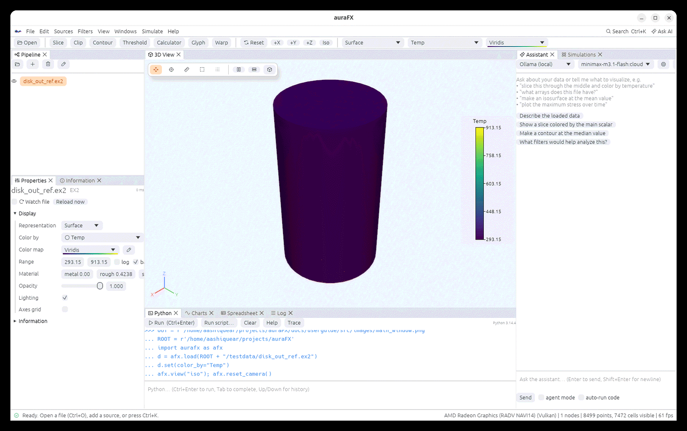

# Getting started

## Installing

Prebuilt packages are attached to each release on GitHub
(`github.com/aashiquear/auraFX/releases`). A one-line installer downloads the right one and
puts the app in your path:

```bash
curl -fsSL https://raw.githubusercontent.com/aashiquear/auraFX/main/scripts/install.sh | sh   # Linux, macOS
irm https://raw.githubusercontent.com/aashiquear/auraFX/main/scripts/install.ps1 | iex          # Windows PowerShell
```

| System | Package | Notes |
|---|---|---|
| Linux (x86_64, aarch64) | `auraFX-<version>-<arch>.AppImage`, `auraFX-<version>-linux-<arch>.tar.gz` | the AppImage runs from anywhere (`chmod +x` first); the installer unpacks the tarball into `~/.local` and adds a menu entry (`--prefix DIR` for another place, `--uninstall` to remove); needs a Vulkan driver (Mesa or the vendor's) |
| macOS 11 or newer (Apple silicon, Intel) | `auraFX-<version>-macos-<arch>.dmg` | drag the app to Applications, or use the installer line; the app is signed ad hoc, so the first start is **right-click › Open** |
| Windows 10/11 (x64) | `auraFX-<version>-windows-x64-setup.exe`, `auraFX-<version>-windows-x64.zip` | the installer adds a Start-menu entry and file associations; the zip is portable (unpack anywhere and run `aurafx.exe`) |
| Android 8 or newer | `auraFX-<version>-android.apk` | a viewer build (files, filters, rendering; no Python console, no simulations); allow the install from the browser or file manager |
| iOS / iPadOS 15 or newer | `auraFX-<version>-ios-unsigned.ipa` | a viewer build; sign and install it with Xcode, AltStore or Sideloadly using your own Apple ID |

Desktop packages bundle Python 3.12 with NumPy, so the Python console works without setup;
the packages carry `aurafx-server` as well, for reading data on another machine (see [Data on
another machine](client-server.md): **File › Open on Server… › Install server** copies it to a
host over SSH). On Linux the installer also sets up the `.desktop` entry
(`scripts/install-desktop.sh` does only that, for a build from source).

To build from source you need Rust 1.85 or newer, Python 3.10+ with development headers, and a
Vulkan (Linux, Windows) or Metal (macOS) GPU driver:

```bash
cargo build --release
./target/release/aurafx                   # start
./target/release/aurafx run.e             # open a file
./target/release/aurafx --script setup.py # run a Python script at startup
```

## The window



The window has five areas; every panel can be closed, reopened from the **Windows** menu, and
dragged to another place.

| Area | Purpose |
|---|---|
| **Pipeline** (top left) | the files you opened and the filters below them; click to select, click the eye to show or hide |
| **Properties** / **Information** (bottom left) | the selected object's parameters and display settings; the Information tab shows arrays, ranges, bounds, cell types and time steps |
| **3D View** (middle) | the picture; drag to rotate, right-drag or wheel to zoom, middle-drag (or Shift-drag) to pan, double-click to fit |
| **Python**, **Charts**, **Spreadsheet**, **Log** (bottom) | the console, plots, the data as a table, messages |
| **Assistant**, **Simulations** (right) | the AI chat and the job runner |

The toolbar has the most used filters (Slice, Clip, Contour, Threshold, Calculator, Glyph,
Warp), the camera buttons (Reset, +X, +Y, +Z, Iso) and, for the selected object, its
representation, the array it is colored by and the color map. The status bar at the bottom
names the GPU in use and counts the visible points and cells.

## Opening a file

- **File › Open…** (Ctrl+O), or drop a file onto the window, or start the app with the file
  name.
- **File › Open Recent** keeps the last files; the three sample datasets at the bottom of that
  menu (a heated disk, a wavelet volume, a sphere) are good for trying things out.
- Numbered files (`run_0001.vtu`, `run_0002.vtu`, …), `.pvd` collections, Exodus and
  OpenFOAM cases open as time series: the time toolbar appears under the main toolbar.

When a file opens, the object is colored by its first array and the camera fits the data. The
file is watched: if a solver rewrites it, auraFX reloads it (**Watch file** in Properties).

```python
d = afx.load("run.e")              # Python does the same
d.set(color_by="Temp")
afx.view("iso"); afx.reset_camera()
```

## Applying a filter

Select an object, then pick a filter from the toolbar, the **Filters** menu, or the command
palette (**Ctrl+K**, type part of its name). The filter runs at once with sensible defaults (a
slice through the center, a contour at the middle value) and appears below its input in the
Pipeline. Change its parameters in Properties; they apply as you type. **Re-run** forces a
recomputation and **Reset to defaults** restores the defaults.

Filters can be stacked: a Contour of a Clip of a file. Delete an object with the trash button
or the Delete key; the objects below it go too.

## Saving your work

- **File › Save State** (Ctrl+S) writes an `.afx` file holding the pipeline, every parameter,
  the display settings, the camera and any keyframes. **File › Open** reopens it, including
  objects that live on a remote server.
- On the next start, **Restore last session** in the empty view brings back the last state.
- Right-click an object › **Save data…** writes its output to a file (see
  [File formats](file-formats.md)).
- **Edit › Undo / Redo** cover every change to the pipeline and display settings.

## Getting help

- **Help › Keyboard shortcuts** and **Help › Python API cheat sheet** open inside the app.
- The command palette (Ctrl+K) finds filters, sources and actions by name.
- The AI assistant answers questions about the loaded data and the app (see
  [AI assistant](ai-assistant.md)).
