# Grains and crystals

auraFX reads electron backscatter diffraction (EBSD) maps, serial-section stacks and voxel
microstructures, and works with crystal orientations. It colors them, converts them between
representations and re-expresses them in a turned reference frame. It also crops, resamples
and aligns voxel volumes. It finds the grains (features) and measures them: sizes, shapes,
average orientations, misorientations, neighbours and boundaries. Texture analysis and
building synthetic microstructures come in later releases.

## EBSD maps

Open a map with **File › Open** or `afx.load("scan.ang")`.

| Format | Extension | Notes |
|---|---|---|
| TSL/EDAX | `.ang` | square grids, and hexagonal grids (resampled, see below) |
| Oxford | `.ctf` | angles in degrees in the file, converted to radians |
| EBSD stacks | `.h5ebsd` | serial sections from TSL or Oxford (HKL) maps, read as one volume |
| EDAX OIM HDF5 | `.h5` | square-grid scans; choose the scan with the **Scan** reader option |
| Bruker Esprit HDF5 | `.h5` | angles in degrees in the file; phases from their space group |
| Microstructures | `.dream3d` | voxel volumes and meshes with their cell, feature and phase arrays; see below |

`.h5` files are recognised by their contents, so other HDF5 files with that extension still
open with their own readers.

A map becomes image data with one cell per measured point, the cells centered on the points
(so the map's corner lies half a step before the first point). Its arrays are:

- **Cell data:** `EulerAngles` (three Bunge angles φ1, Φ, φ2 in radians, as stored in the
  file) and `Phases` (the phase of each point, 0 where the pattern was not indexed). A `.ang`
  file adds `Image Quality`, `Confidence Index`, `SEM Signal` and `Fit`. A `.ctf` file adds
  `Bands`, `Error`, `MAD`, `BC` and `BS`.
- **Field data:** one entry per phase, entry 0 standing for "not indexed".
  `CrystalStructures` holds the crystal class of each phase (see the numbers below),
  `MaterialName` its name and `LatticeConstants` a, b, c, α, β, γ.

**Hexagonal grids.** A `.ang` scan on a hexagonal grid (rows of `NCOLS_ODD` and `NCOLS_EVEN`
points, every other row shifted by half a step) is read on a square grid whose cells are the
scan's x step: each square cell takes every value of the scan point nearest to it. The field
array `ResampledFromHexGrid` says so and gives both grids, so the map's filters (segmentation,
IPF colors, pole figures) work on it as on any square map.

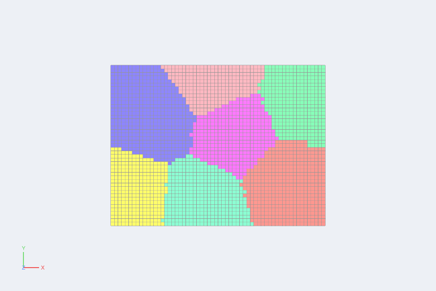

A single-phase `.ang` scan writes phase 0 for every point. auraFX counts those points as
phase 1, unless their confidence index is negative.

An `.h5ebsd` stack becomes one volume with a cell layer per slice, the slices `Z Resolution`
apart. The stack's sample and Euler transformations are not applied. They are kept as the
field arrays `SampleTransformationAngle`, `SampleTransformationAxis`,
`EulerTransformationAngle` and `EulerTransformationAxis`. Apply them with Rotate Orientations
(and Transform for the sample) if you need them.

**Hexagonal axes.** Oxford files describe hexagonal crystals with the [10-10] direction along
x. auraFX, `.ang` files and the color key put [2-1-10] along x. By default the `.ctf` reader
adds 30° to φ2 of hexagonal and trigonal phases to match. To keep the angles as stored, set
the reader option **Hexagonal axes** to *As stored* in the Properties panel, or in Python:

```python
m = afx.load("titanium.ctf", hexagonal_axes="As stored")
```

### Crystal classes

| Number | Class | | Number | Class |
|---|---|---|---|---|
| 0 | Hexagonal 6/mmm | | 6 | Orthorhombic mmm |
| 1 | Cubic m-3m | | 7 | Tetragonal 4/m |
| 2 | Hexagonal 6/m | | 8 | Tetragonal 4/mmm |
| 3 | Cubic m-3 | | 9 | Trigonal -3 |
| 4 | Triclinic -1 | | 10 | Trigonal -3m |
| 5 | Monoclinic 2/m | | 999 | Unknown |

Face-centered and body-centered cubic metals (nickel, aluminium, iron) are Cubic m-3m.
Hexagonal close-packed metals (titanium, magnesium, zirconium) are Hexagonal 6/mmm.

### Microstructure files (.dream3d)

A `.dream3d` file holds one or more data containers, each a geometry with arrays. auraFX reads
image (voxel), rectilinear, vertex, edge, triangle, quadrilateral, tetrahedral and
hexahedral geometries.

- Cell arrays (voxels, triangles, ...) become cell data, and vertex arrays become point data.
- Feature arrays (one row per feature, such as `AvgQuats`, `Volumes` or `Centroids`) and phase
  arrays (`CrystalStructures`, `LatticeConstants`, `MaterialName`) become field data.
- Neighbor lists are not read.
- A file with several data containers opens as blocks. The **Data container** reader option
  picks one.
- Large volumes load faster with only the arrays you need. Give their names in the **Arrays**
  reader option, separated by commas.

```python
v = afx.load("volume.dream3d", arrays="EulerAngles, Phases, FeatureIds")
```


**Saving.** **File › Save Data** writes `.dream3d` files of volumes, meshes and point sets
(see [File formats](file-formats.md#writers)). The file also records the pipeline that made
the data.

### Pipelines in .dream3d files

**File › Import Pipeline…** builds a pipeline from a pipeline file:
- a `.json` pipeline with numbered steps, the form `.dream3d` files record;
- the pipeline inside a `.dream3d` file.

Files auraFX wrote rebuild exactly: the same filters, parameters and inputs, starting from the
same files.

Pipelines from other `.dream3d` files are built as a chain of the auraFX filters that do the
same work:
- reading steps open their file when it exists; otherwise the chain starts from the data
  selected in the pipeline;
- Crop, Change Resolution, Rotate Orientations, Convert Orientations;
- thresholds (as a Calculator mask), Segment Features, Fill Bad Data, Minimum Size;
- the per-feature steps (sizes, centroids, shapes, neighbors, average and reference
  orientations, kernel average misorientation, distances, merging twins);
- IPF colors, Align Sections, Quick Surface Mesh and Smooth Boundaries.

Steps without a counterpart are listed in the Log and the notice: writing files, deleting
arrays, image filters, point cloud alignment and the like.

```python
v = afx.load("window.dream3d")
steps = afx.import_pipeline("segmentation.json", v)   # the new nodes; skipped steps are printed
seg = v.segment_features(tolerance=3, mask="SampleVoxels")
seg.save("segmented.dream3d")                          # records Open File and Segment Features
print(seg.pipeline_json())
again = afx.import_pipeline("segmented.dream3d")       # the same pipeline, rebuilt
```

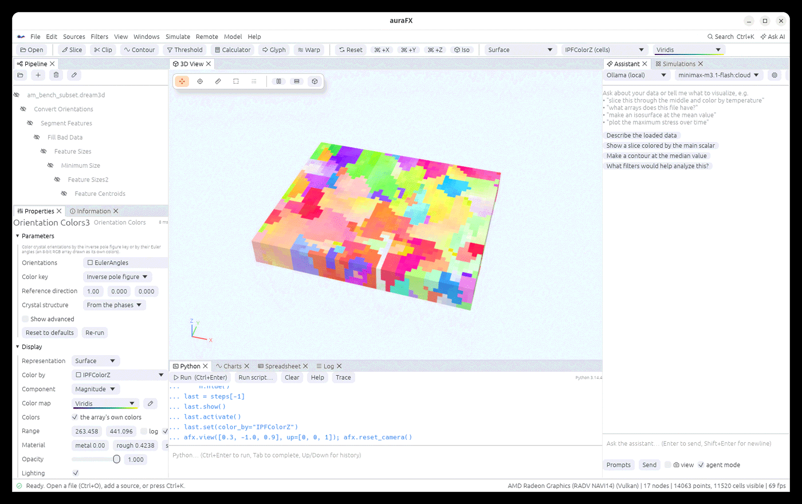

Limits:
- Pipelines with numbered steps (version 6) are read. The newer layout with a `pipeline` list
  is not.
- A pipeline from another program becomes one chain, so steps that worked on another data
  container continue from the previous step.

## Orientation conventions

An orientation turns the sample axes into the crystal axes. A direction with sample
coordinates *s* has crystal coordinates *g s*, where *g* is the orientation matrix. Euler
angles are Bunge angles in radians: *g* = Rz(φ2) Rx(Φ) Rz(φ1). Quaternion arrays store
(x, y, z, w), with w ≥ 0. Orientation matrices are stored row by row (9 components).

## Orientation Colors

**Filters › Grains › Orientation Colors** adds an 8-bit RGB array named `IPFColor`. Each
point is colored by one of two keys:

- **Inverse pole figure** (the default). The reference direction, z by default (the map
  normal), is turned into crystal coordinates. The crystal's symmetry brings it into the
  standard triangle of its class, and its place there gives the color. For cubic crystals,
  [001] is red, [101] green and [111] blue. For hexagonal crystals, [0001] is red,
  [2-1-10] green and [10-10] blue. Choose x or y as the reference direction to see the
  orientation along the map's edges.
- **Euler angles**: φ1, Φ and φ2 scaled to red, green and blue.

The class of each point comes from its phase and `CrystalStructures`, as EBSD files give
them. For data without phases, choose the class under **Crystal structure**. Points not
indexed, of an unknown class, or where the optional **Mask** array is 0, are black. The
orientation array can hold Euler angles (3 components), quaternions (4) or orientation
matrices (9). If none is chosen, the filter uses `EulerAngles`, `Quats` or
`OrientationMatrix`, whichever it finds first.

```python
m = afx.load("scan.ang")
ipf = m.orientation_colors(direction=(0, 0, 1))      # key="Euler angles" for the other key
ipf.set(color_by="IPFColor")
```

### Arrays drawn as their own colors

An array of 8-bit values with 3 or 4 components, like `IPFColor`, is drawn with its own
colors when you color by it, not through a color map. No legend is shown for it. To map
such an array through a color map instead, clear **Colors: the array's own colors** under
Color by in the Properties panel, or use `node.set(direct_colors=False)`. Choosing one component of the
array also uses the color map.

## IPF Color Key

**Sources › IPF Color Key** draws the color key of a crystal class: its standard triangle in
stereographic projection, colored as Orientation Colors colors it. It lies around the origin
in the xy plane, about half a unit across, so move and enlarge it with **Transform** to place
it next to a map.

```python
key = afx.ipf_color_key(structure="Cubic m-3m", resolution=60)
key.transform(scale=(20, 20, 1), translate=(42, 12, 0)).set(color_by="IPFColor")
```


## Convert Orientations

**Filters › Grains › Convert Orientations** writes the orientations in another
representation. It reads and writes Euler angles, quaternions, orientation matrices,
axis-angle pairs (the unit axis and the angle in radians), Rodrigues vectors (the unit axis
and tan(ω/2)) and homochoric vectors. With **Reduce to the fundamental zone**, each
orientation is replaced by its symmetry equivalent with the smallest rotation angle (for cubic
crystals, at most 62.8°). The output is named after the representation (`Quats`,
`OrientationMatrix`, …) unless you give a name.

```python
q = m.convert_orientations(input_type="Euler angles", output_type="Quaternions", reduce=True)
```

## Rotate Orientations

**Filters › Grains › Rotate Orientations** re-expresses the orientations after the reference
frame is turned by an angle (degrees) about an axis. The points do not move; only the
description of their orientations changes.

- **Sample** frame: use this when the map's axes differ from those you want, such as a scan
  taken with the sample turned 90° about its normal.
- **Crystal** frame: turns the crystal axes the orientations refer to.

```python
r = m.rotate_orientations(frame="Sample", axis=(0, 0, 1), angle=90)
```

## Crop

**Filters › Grains › Crop** keeps the cells of a voxel volume or EBSD map whose centres lie
inside a box, given in sample coordinates (leave a side unset to keep everything on that
side). The cells keep their place in space. With **Renumber features** (on by default), the
remaining feature ids are numbered from 1 and the per-feature field arrays keep only the
rows of those features. To crop by grid index instead, use **Extract Subset**.

```python
c = v.crop_volume(min=(0, 0, 0), max=(100, 80, 20))
```

## Change Resolution

**Filters › Grains › Change Resolution** resamples a voxel volume or EBSD map onto cells of
another size. Each new cell takes the values of the old cell that holds its centre, so
orientations, phases and feature ids stay valid. The volume keeps its corner and, rounded to
whole cells, its size. Features that disappear are dropped and the rest renumbered, as in
Crop. Point data is not carried over.

```python
coarse = v.change_resolution(spacing=(2, 2, 2))
```

## Align Sections

**Filters › Grains › Align Sections** moves each z slice of a serial-section volume in x and
y, by whole cells, so it matches the slice below. Choose how slices are compared:

- **Misorientation** (the default): two cells match when their orientations differ by less
  than the **Tolerance** (5° by default), with the crystal class of their phase.
- **Feature ids**: two cells match when they belong to the same feature.
- **Given shifts**: no search. Each slice moves by the x and y cells you give, against the
  slice below.

The search starts from no move and steps to the neighbouring shift with fewer differing cells
until none is better, at most **Largest shift** cells each way. A **Mask** array (a sample or
good-data mask) limits the comparison to cells where it is not 0. Cells uncovered by a move
are set to 0 (phase 0, not indexed). The total shift of each slice is kept as the field array
`SectionShifts` (x, y cells). Point data is not carried over.

```python
a = stack.align_sections(method="Misorientation", tolerance=5, mask="SampleVoxels")
a.align_sections(method="Given shifts", shifts=[2, -1, 3, 1, -1, 2])   # 3 slices after the first
```


## Features (grains)

A feature is a connected set of cells, cells sharing a face, that belong together: usually a
grain. **Segment Features** finds them and writes the cell array `FeatureIds` (0 for cells
in no feature). The other feature filters then add per-feature results as field arrays, one
row per feature id (row 0 stands for id 0). All of them are under **Filters › Grains** and work
on voxel volumes and on flat EBSD maps.

A typical sequence for an EBSD volume:

```python
v = afx.load("scan.dream3d")
g = (v.segment_features(tolerance=2, mask="SampleVoxels")
      .fill_bad_data(min_defect=7)
      .minimum_size(min_cells=7)
      .feature_sizes().feature_centroids().feature_shapes()
      .average_orientations().reference_misorientations()
      .kernel_average_misorientation(kernel=(2, 2, 1))
      .feature_neighbors())
table = g.feature_table()           # one row per grain, for the Spreadsheet, charts and CSV
g.feature_colors().set(color_by="FeatureColors")
```

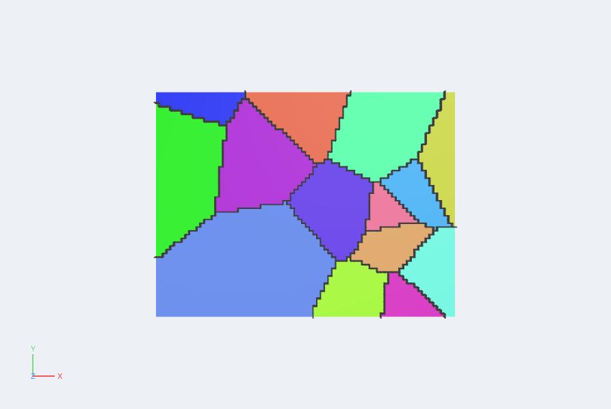

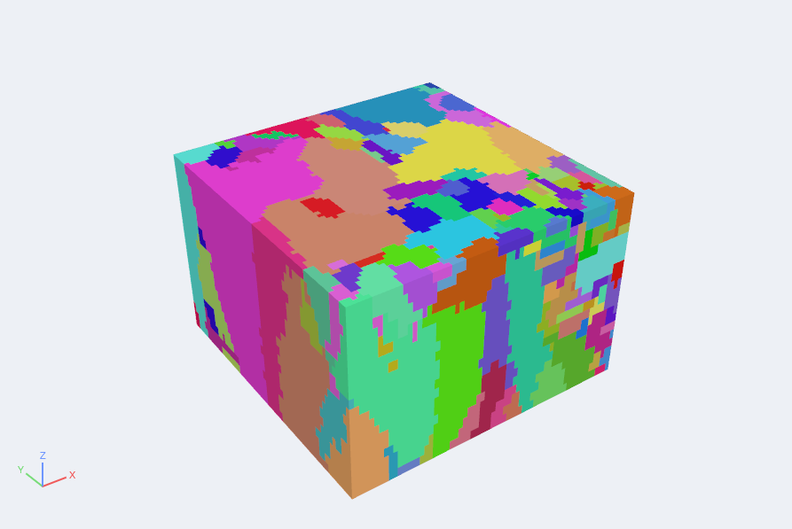

### Segment Features

Neighbouring cells join the same feature when they pass the test of **Group by**:

- **Misorientation**: same phase, and misorientation below the **Tolerance** in degrees.
- **C-axis alignment**: same phase, and crystal c axes within the tolerance either way round.
  This is for hexagonal crystals.
- **Scalar**: values of the chosen cell array differ by at most the tolerance.

Cells outside the **Mask** (cells where it is 0), and cells of no known crystal class, stay
at 0. Features are numbered in the order their first cell appears (x fastest, then y, then
z). **Shuffle ids** numbers them in a shuffled order instead, which gives better colors
when coloring by id. The field arrays `Active` and `FeaturePhases` (the phase of each
feature) are added, and per-feature arrays from an earlier segmentation are removed.

### Cleaning up

- **Fill Bad Data**: clusters of cells without a feature that are smaller than **Smallest
  kept defect** are filled from the surrounding features. Each cell takes every cell array
  from the neighbour whose feature most of its neighbours belong to, sweep after sweep.
  Larger clusters (pores, the outside of the sample) stay 0.
- **Minimum Size**: features with fewer cells than **Fewest cells** are removed and filled
  from their neighbours the same way. Feature 0 can win, so a small feature against the
  outside may become outside. The remaining features are renumbered from 1 in their old
  order, and per-feature field arrays keep their rows.

Before or instead of segmenting, noisy maps can be cleaned cell by cell (every cell array moves
with the cell it comes from):

- **Replace Element Attributes with Neighbor** (neighbour confidence correlation): each cell
  whose confidence (an array such as `Confidence Index`) is below a minimum takes the values of
  its most confident neighbour, again and again if asked.
- **Neighbor Orientation Correlation**: each low-confidence cell takes the values of the
  neighbour that most other neighbours agree with in orientation (within a misorientation
  tolerance), when enough of them agree, from 6 agreeing neighbours down to 6 minus the
  *cleanup level*.
- **Bad Data Neighbor Orientation Check**: a cell outside the mask (bad) with enough good
  neighbours of nearly its own orientation becomes good.
- **Erode Dilate Bad Data**: the features grow into the bad cells (erode) or the bad cells into
  the features (dilate), a number of times, along chosen axes.
- **Erode Dilate Coordination Number**: a cell with at least this many face neighbours in one
  other feature joins that feature: smooths jagged boundaries.
- **Identify Sample**: the largest connected region of good cells is the sample; other good
  cells become bad, and with *fill holes* bad pockets inside the sample become good.
  **Isolate Largest Feature** keeps only the largest feature.

A 20 × 20 map of four grains with one cell in 17 spoilt (wrong orientation, low confidence)
comes back to its four grains exactly with Replace Element Attributes with Neighbor, Neighbor
Orientation Correlation, or one pass of Erode Dilate Bad Data.

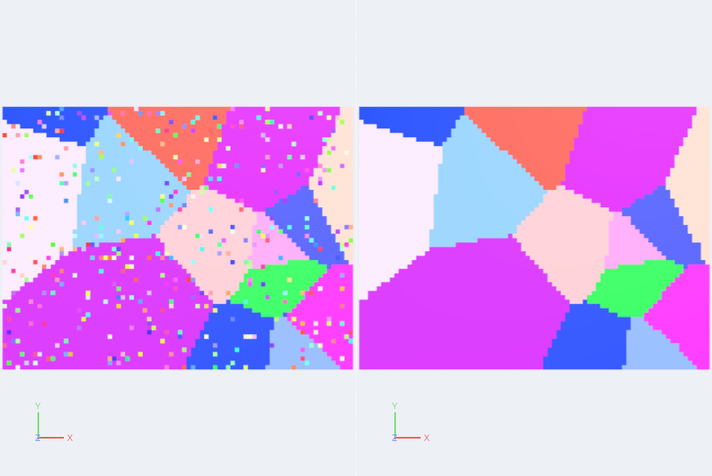

To put a sample the right way round: **Rotate Sample Reference Frame** turns the grid and its
data (not the crystal orientations; use Rotate Orientations for those) by an angle about an
axis, exactly for multiples of 90°; **Apply Transformation to Geometry** scales, turns and moves
the grid (only the origin and spacing change when there is no turn), also by a 4 × 4 matrix;
**Set Origin and Spacing** gives the volume a new origin and cell size; **Resample Rectilinear
To Image** puts an unevenly spaced grid on an even one.

### Image filters on volumes

In **Filters › Data Analysis**, for any image data (an EBSD map's quality arrays, an optical or
X-ray volume): **Median Image** (the median of a box of cells, against speckle), **Gaussian Smooth
Image** (a standard deviation in cells), **Otsu Threshold** (one to four thresholds that best
split the histogram; a label array and the thresholds as field data) and **Binary Morphology**
(erode, dilate, open or close the non-zero cells with a ball of cells). The results agree with
scipy.ndimage (median, Gaussian, binary erosion and dilation) on a test volume.

```python
m = volume.median_image(array="ImageData", radius=(1, 1, 1))
o = m.otsu_threshold(array="Median", thresholds=1)
clean = o.binary_morphology(array="Otsu", operation="Open", radius=1)
```

### Per-feature results

| Filter | Field arrays (per feature) | Cell arrays |
|---|---|---|
| Feature Sizes | `NumElements`, `Volumes`, `EquivalentDiameters` (sphere of equal volume; circle of equal area on flat maps) | |
| Feature Centroids | `Centroids` (mean of the cell centres) | |
| Feature Shapes | `AxisLengths` (semi-axes a ≥ b ≥ c of the ellipsoid with the same moments of inertia), `AspectRatios` (b/a, c/a), `AxisEulerAngles` (Bunge angles of the axes: the rows of the rotation are the a, b and c directions), `Omega3s` (1 for an ellipsoid, smaller for other shapes) | |
| Average Orientations | `AvgQuats` (x, y, z, w), `AvgEulerAngles` | |
| Reference Misorientations | `FeatureAvgMisorientations` | `FeatureReferenceMisorientations` (degrees from the feature's average orientation) |
| Kernel Average Misorientation | | `KernelAverageMisorientations` (degrees) |
| Feature Neighbors | `NumNeighbors`, `SurfaceFeatures` (1 when touching the edge of the volume or cells without a feature), `AvgMisorientations` (mean misorientation to the neighbouring features of the same crystal class, when average orientations exist) | `BoundaryCells` (face neighbours in another feature) |
| Distance to Boundaries | | `GBEuclideanDistances`, `TJEuclideanDistances`, `QPEuclideanDistances` (distance between cell centres to the nearest boundary, triple-line and quadruple-point cell; -1 where there is none) |
| Merge Twins | `ParentIds` | `ParentIds` |

- **Feature Shapes** uses the exact second moments of the cells: each cell counted at its
  centre with its own inertia. On flat maps it gives the ellipse of the same moments: a and b,
  b/a, and the angle of the long axis in the plane as the first Euler angle.
- **Average Orientations** adds, cell by cell, the symmetry equivalent nearest the running
  average (the identity for the first cell), then normalises.
- **Kernel Average Misorientation** averages a cell's misorientation to the cells of the same
  feature within **Kernel** cells along x, y and z (1 1 1 means the 26 neighbours). The cell
  itself counts, with 0. Cells without a feature get 0.
- **Merge Twins** gives neighbouring cubic m-3m features a common parent when their average
  orientations differ by 60° about a ⟨111⟩ axis, within the **Axis** and **Angle**
  tolerances. Chains of twins share one parent. Parents are numbered in the order of their
  first feature.

More measures of features and their boundaries:

| Filter | Gives |
|---|---|
| **Find Neighborhoods** | `Neighborhoods`: how many feature centres lie within some multiple of the mean equivalent diameter |
| **Find Largest Cross Sections** | `LargestCrossSections`: the largest area of a feature in one slice normal to x, y or z |
| **Find Feature Clustering** | a table of the radial distribution function of feature centres (of one phase), for the Charts panel |
| **Find Surface Area to Volume** | `SurfaceAreas`, `SurfaceAreaVolumeRatio` and `Sphericity` per feature |
| **Find Boundary Strengths** | a table per pair of neighbouring grains: m′ (|cos ψ cos κ| of the slip systems with the highest Schmid factors for a load direction), F1 (the largest m′), F1spt (m′ weighted by both Schmid factors) and F7 (the best slip-direction alignment): slip transmission across the boundary |
| **Find Twin Boundary Schmid Factors** | for every Σ3 twin boundary of cubic grains, the Schmid factors of the three slip directions in the twin plane, in each grain |
| **Find C-Axis Locations** | `CAxisLocation` of hexagonal cells (unit vectors) |
| **Find Feature Reference C-Axis Misorientations** | the angle of each cell's c axis from its grain's mean c axis |
| **Identify Micro-Texture Regions** | `MTRIds`: neighbouring hexagonal grains whose c axes line up (within a tolerance) joined into regions |
| **Generate Precipitate Statistics** | a table for one phase: count, volume fraction, number density, lognormal size fit, mean nearest-neighbour distance |
| **Copy Feature Array to Cells** | a per-feature array (equivalent diameter…) on every cell of the feature, to color by |

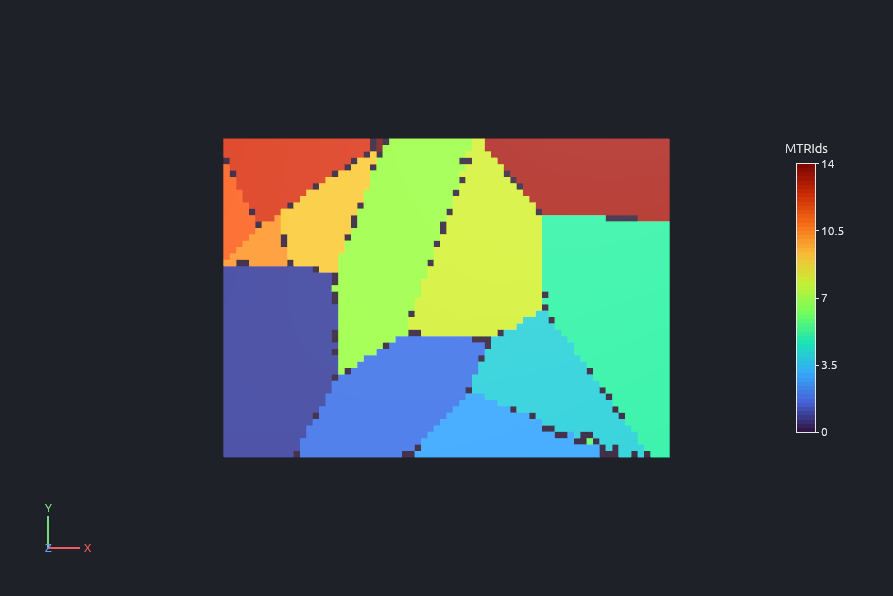

### Boundaries, colors and the table

- **Feature Boundaries** gives the cell faces between different features as a surface. Each
  face has `FeatureIdA` and `FeatureIdB`, the `Misorientation` (degrees) between the two
  cells, and `Twin` (1 on twin boundaries of cubic m-3m crystals). **Include the outer
  surface** adds the faces against cells without a feature and the edge of the volume.
  Draw it as **Wireframe** over a flat map to see the boundaries as lines.
- **Feature Colors** gives each feature a distinct, stable color (`FeatureColors`, drawn as
  its own colors).
- **Feature Table** turns the per-feature field arrays into a table, one row per feature with
  a `FeatureId` column, for the Spreadsheet, charts and **Export CSV**.

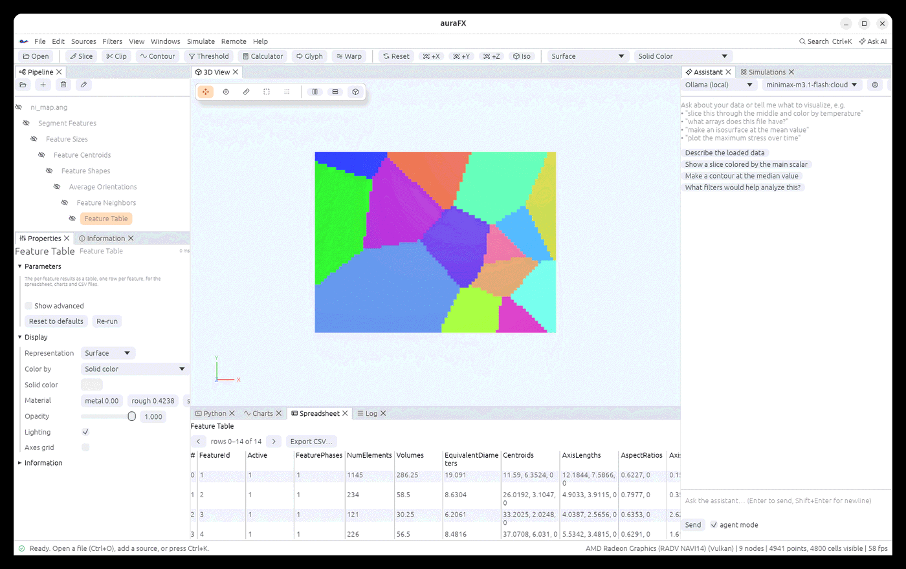

## Texture

The texture filters (**Filters › Grains**) describe how the orientations of a map or volume
are distributed. Every density is in multiples of a random distribution (MRD): 1 is what
randomly oriented crystals give, 3 means three times as often as random. Each density is a
smoothed count: every orientation spreads over a Gaussian of the **Smoothing** width.

The texture filters work on one phase:
- **Phase** chooses it. With 0, every indexed point is used, and they must all have one
  crystal class.
- **Mask** can leave out more points.
- **Orientations used at most** caps how many are counted (60 000 for the figures, 10 000 for
  the ODF). When there are more, a random subset with a fixed seed is taken, so the result is
  the same each time.

The figures come out as flat panels side by side in the view, colored by `MRD` or `ODF`. To
keep the numbers, save the output as CSV: every panel goes into one file, with a `Block`
column naming the panel and the direction or angles of each point.

### Pole Figure

**Pole Figure** shows where the crystal directions of a family point in the sample.
- **Directions** lists the families, written like `100, 110, 111`, `-112` or `1 2 3`.
  Every symmetry-equivalent direction and its opposite are counted.
- Each family is a disk: sample X to the right, Y up, sample Z at the centre and the
  horizontal plane at the rim.
- **Projection** is *Stereographic*, which keeps angles, or *Equal area*, which keeps areas.
- The directions are first gathered in **Bin size** cells (2° by default) before smoothing.
  This keeps large maps fast.

```python
pf = ebsd.pole_figure(families="100, 110, 111", projection="Stereographic", sigma=7.5)
```

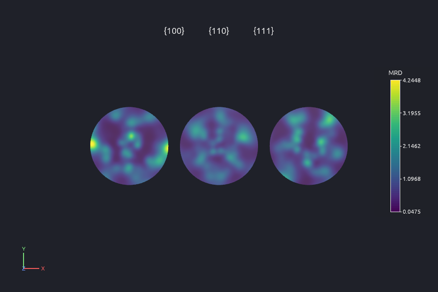

To keep the pole figures as pictures, one per phase and family, call
`save_pole_figures` (Python only): each phase's figures share one scale, from 0 (dark blue) to the
largest MRD of that phase (red), with sample X to the right and Y up, white outside the disk.

```python
files = ebsd.save_pole_figures("pole_figures", families="100, 110, 111", size=256)
# [('pole_figures/phase1_100.png', 3.1), ...]: the file and its largest MRD
```

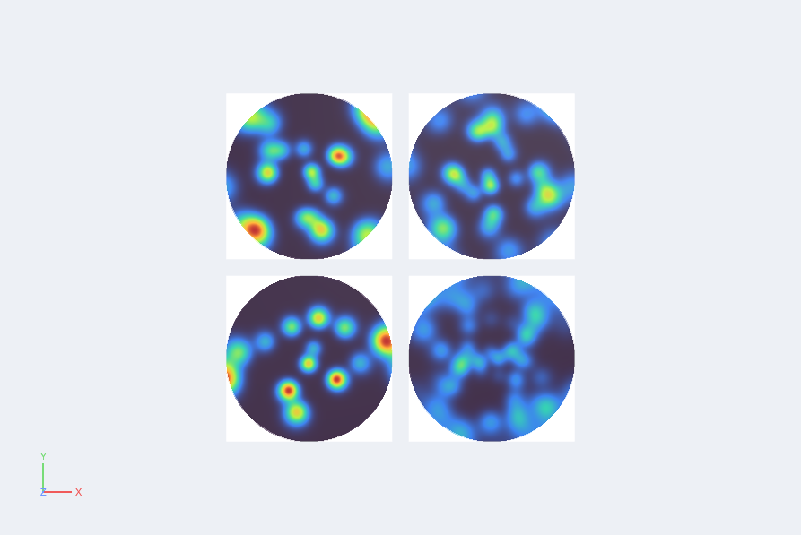

### Inverse Pole Figure

**Inverse Pole Figure** shows which crystal directions lie along a sample direction (X, Y
or Z, or all three side by side). The density is drawn on the standard triangle of the
crystal class, the same region the orientation color key uses. A fibre texture shows here
as one bright corner or spot.

```python
ipf = ebsd.inverse_pole_figure(directions="X, Y and Z")
```

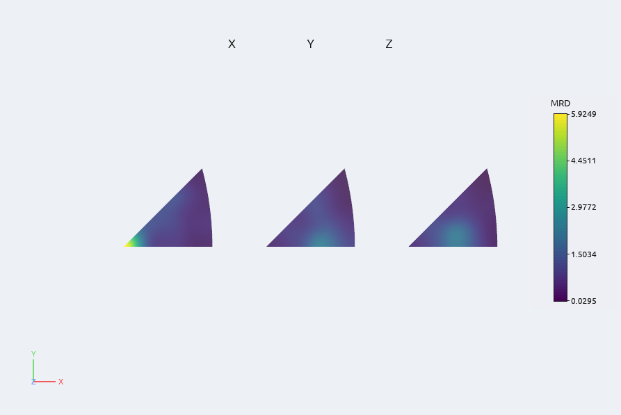

### ODF Sections

**ODF Sections** computes the orientation distribution function (ODF): how often each
orientation occurs, smoothed over the disorientation angle.
- Each section has a constant φ2 (**Sections**, 0, 45 and 65° by default). φ1 runs across
  from 0 to 360°, and Φ runs down from 0 to 90° for classes with a two-fold axis across the
  c axis (otherwise to 180°).
- Each point's Euler angles are kept with its value.
- The output also carries the **texture index** `TextureIndex`: the mean of the squared ODF
  over all orientations. It is 1 for a random texture and grows as the texture sharpens.
- `MaxODF` is the ODF's largest value. Both come from a grid of **Texture index step**
  degrees over the whole orientation space.
- With a finite number of orientations, even a random set gives an index a little above 1:
  about 1.001 for 20 000 random orientations with 7.5° smoothing.

```python
odf = ebsd.odf_sections(sections="0, 45, 65", step=5)
print(odf.array("TextureIndex", "field"))
```

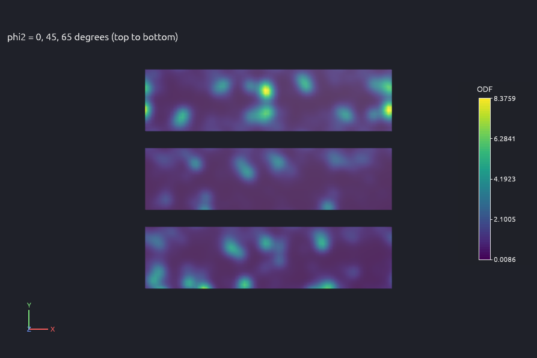

### Misorientation Distribution

**Misorientation Distribution** makes a table of disorientation angles (the smallest
rotation between two orientations, allowing for crystal symmetry) with three columns:
- **Neighbours:** between neighbouring points of a map or volume.
- **Random pairs:** between randomly chosen pairs of points (**Random pairs** of them). This
  shows what the texture alone gives, without any spatial correlation.
- **Uniform:** between randomly oriented crystals, computed exactly for the crystal class.

Each column is a density per degree, so all three can be plotted on one axis. Angles below
**Smallest angle** (5° by default, meant to leave out the small angles inside grains) are
left out of all three. Peaks in Neighbours that are missing from the other two point to
special boundaries, such as twins near 60° in cubic metals.

The table plots in the **Charts** panel with `bin_center` on the x axis. Its field data
counts the neighbour pairs and gives their mean angle.

```python
m = ebsd.misorientation_distribution(min_angle=5, bin=1)
x = m.array("bin_center")
afx.plot(x, m.array("Neighbours"), label="Neighbours", clear=True)
afx.plot(x, m.array("Uniform"), label="Uniform")
```

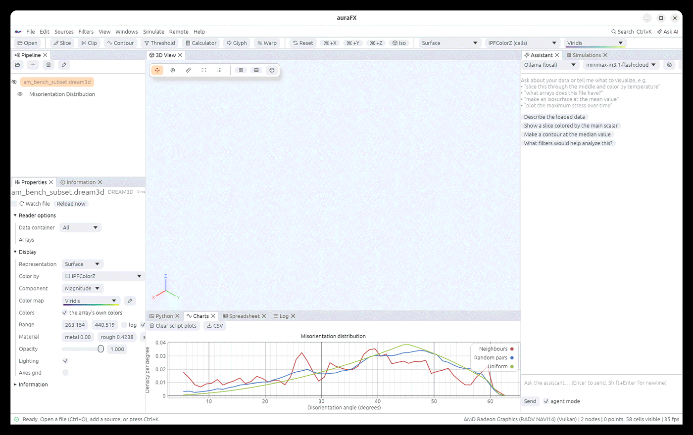

### Texture Components

**Texture Components** makes a table of the fraction of orientations that have a crystal
direction of a family within **Cone** degrees of a sample axis. It has one row per direction
and axis, such as `<100> Z` for orientations with a cube axis along Z. The defaults are the
families `100, 110, 111` against the axes `X, Y, Z`, with a 15° cone.

```python
tc = ebsd.texture_components(families="100, 111", axes="Z", cone=15)
```

### Chord Lengths

**Chord Lengths** measures grain size along straight lines through a map or volume.
- **Lines.** They run in x, y and, for a volume, z. **Line spacing** is the distance between
  them, in length units; 0 uses every row of points.
- **Boundaries.** A boundary lies between two neighbouring points whose disorientation is at
  least **Boundary angle** (10° by default). A chord is the distance between two boundaries
  that follow each other along a line.
- **Unused points.** Points of other phases, unindexed points and masked points are skipped.
  A run of more than **Largest gap** of them ends the line segment there.
- **Partial chords.** A chord that touches a segment's end, or the edge of the data, is left
  out, because its true length is unknown.
- **Specks.** **Ignore single-point specks** stops a single stray point, whose two
  neighbours agree with each other, from counting as two boundaries.

**Output** gives either every chord (its direction and length) or a histogram with one column
per direction. Both carry the mean chord and the number of chords per direction as field
data (`MeanChordX`, `ChordsX`, ...).

```python
ch = ebsd.chord_lengths(threshold=10, output="Histogram", bin=2)
print(ch.array("MeanChordX", "field"))
```

## Synthetic microstructures

These sources build microstructures without measured data. They have the same arrays an
EBSD reader gives: `FeatureIds`, `Phases` and `EulerAngles` per cell, and
`CrystalStructures`. Every filter in this chapter therefore works on them, and Overlay Mesh
turns them into a mesh. A fixed **Random seed** gives the same microstructure every time.

### Voronoi Grains

**Sources › Voronoi Grains** places **Grains** seeds at random in a grid of **Cells** and
gives every cell to its nearest seed.
- **Size spread** above 0 makes Laguerre grains: each seed gets a radius drawn from a
  lognormal distribution with that log-sigma, and a cell goes to the seed with the
  smallest squared distance minus the squared radius. Grain sizes then vary much more than
  in Voronoi grains.
- **Periodic** wraps the grains across opposite faces, for representative volume elements.
- **Orientations** are random, or a fibre with `<100>` or `<111>` along Z, scattered by
  **Fibre spread** and random about Z.
- The seed positions are kept as the field array `Seeds`.
- **Realism** (0 to 1) makes the grains look grown instead of tessellated, and
  **Orientation gradient** lets every grain's orientation change inside it; see
  [Grain Realism](#grain-realism) and [Orientation Gradient](#orientation-gradient) below.
  Both are 0 by default, which gives the plain tessellation with one orientation per grain.

```python
v = afx.voronoi_grains(cells=[64, 64, 64], grains=300, size_sigma=0.4, periodic=True)
grown = afx.voronoi_grains(cells=[64, 64, 64], grains=300, realism=0.8)
```

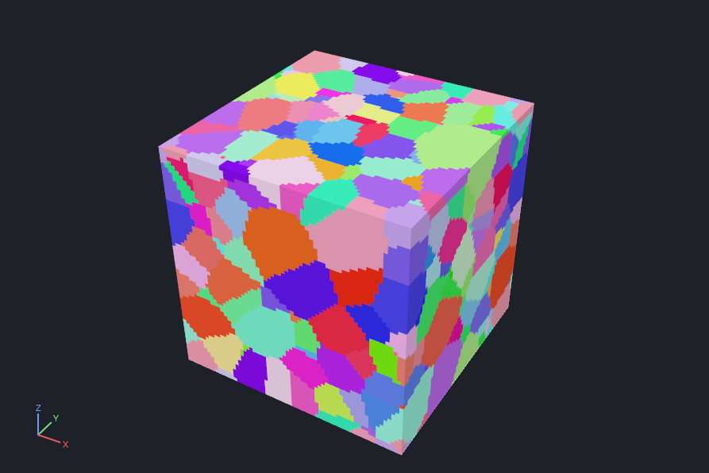

### Columnar Grains

**Sources › Columnar Grains** grows the columnar grains of an additive build along Z:
- **Columns.** As many columns as fit one **Grain width** apart are alive at every height.
  Each is tilted at random (**Column tilt**) and grows to a lognormal height (**Median
  grain height**, **Height spread**).
- **Ending.** A column also ends when its neighbours grow over it. Each slice of the box is
  shared among the columns alive there, so a column can lose its whole cross-section.
- **Renewal.** A column that ends is replaced at that height by a new grain at a random
  position.
- **Widths.** **Width spread** and **Width grows with height** make the columns differ in
  width, with tall grains wider.
- **Orientations.** By default every grain has a `<100>` direction near Z, as in many
  additively built cubic metals.
- **Per-grain field arrays:** `GrainBase`, `GrainTop`, `GrainTilt` and `Originating`
  (1 for grains that start inside the build rather than on the base plate).
- **Realism** (0 to 1) adds what a layered build does to its grains (competitive growth,
  layers, fine grains at the layer boundaries, curved boundaries), and **Orientation
  gradient** lets every grain turn as it grows; see [Grain Realism](#grain-realism) and
  [Orientation Gradient](#orientation-gradient) below. Both are 0 by default.

```python
g = afx.columnar_grains(size=(300, 300, 450), voxel=5, width=50, height=150)
build = afx.columnar_grains(realism=0.8, layer=40, gradient=0.03)
```

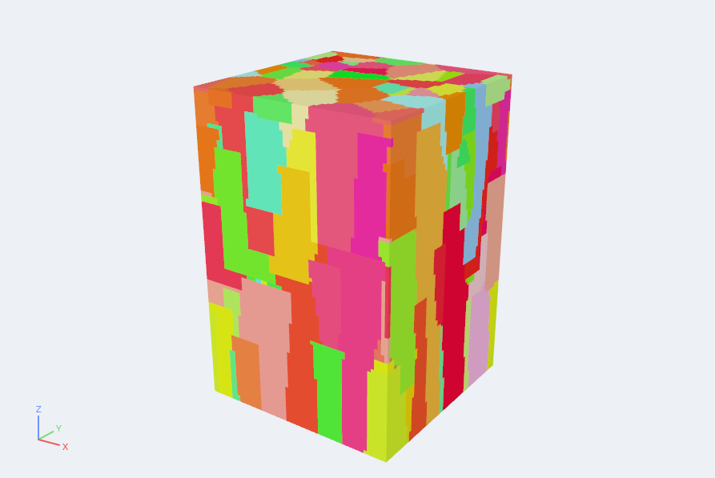

### Add Orientation Noise and Jumble Orientations

**Add Orientation Noise** turns every point's orientation by a small random rotation. The
rotation is about a random axis, with an angle drawn from a normal distribution with
standard deviation **Angle**, so the mean turn is about 0.8 times **Angle**. With **One
rotation per feature**, every point of a grain turns alike.

**Jumble Orientations** gives the grains each other's orientations at random. The texture
stays the same, but any link between a grain's orientation and its neighbours' or its
shape is lost. Each grain takes the orientation of the first point of the grain it
swapped with.

```python
noisy = v.orientation_noise(sigma=2)
mixed = v.jumble_orientations()
```

### Orientation Gradient

A synthetic grain has one orientation. A grain of additively manufactured material does
not: its lattice turns slowly as the grain grows from layer to layer, it carries a smooth
spread of a degree or so, and it is divided into sub-grain cells by low-angle boundaries.
**Filters › Grains › Orientation Gradient** gives the grains of a volume with `FeatureIds`
and orientations such an inside. It rewrites the orientation of every cell; the grains
themselves do not change.

- **Gradient** is the steady turn, in degrees per unit of length along **Direction** (z, the
  build direction, by default). Every grain turns about one axis of its own. Measured
  nickel-alloy builds turn by about 0.02 to 0.1 degrees per micrometre; with the volume's
  lengths in micrometres, 0.05 gives 2 degrees per 40 micrometre layer.
- **Spread between grains** gives each grain its own rate, lognormal about the gradient
  (0.5 by default: most grains between half and twice the gradient). 0 makes all alike.
- **Rotation axis** is random for each grain, random but perpendicular to the direction, or
  one **Fixed axis** for all grains.
- **Unturned at** says where a grain keeps the orientation it had: its *centroid* (the
  grain's average orientation then stays about the same), or its *lowest point* along the
  direction, as for a grain that grew out of the layer below.
- **Smooth spread** adds a turn that wanders smoothly inside each grain, with this
  root-mean-square angle in degrees (0.5 by default; 0.5 to 2 is typical of as-built
  material). **Spread correlation length** is the distance over which it changes; left at
  0 it is half of each grain's diameter. A short length gives a mottled reference
  misorientation map and a larger kernel average misorientation.
- **Sub-grain cell size** above 0 divides every grain into cells of about that size, each
  turned a little differently. **Misorientation between cells** is the mean angle across a
  cell boundary (1 degree by default). Solidification cells in additively manufactured
  metals are about a micrometre across, so they only show in volumes with finer cells.
- **Grows with grain size** (advanced) multiplies the gradient, the spread and the cell
  misorientation by (grain diameter / median diameter) to that power, so that large grains
  hold more misorientation than small ones. 0.5 to 1 is a reasonable range; 0 is off.
- **Largest turn** (advanced) is a cap in degrees: no cell turns further than this from the
  orientation its grain started with. The turn levels off smoothly towards the cap, so
  near it the gradient is less than asked for.

What the filters that measure see:
- [SROD](#srod) recovers the gradient: its rate is the gradient times the layer thickness,
  a little less for grains whose top layer is not full.
- **Kernel Average Misorientation** along the direction is two thirds of the gradient times
  the cell size, for the default kernel of one cell each way.
- **Reference Misorientations** grows with the distance from the grain's centroid along the
  direction, and its root mean square for the smooth spread alone is the spread asked for.

**Segment Features** compares neighbouring cells, so a grain stays one grain as long as
the step from one cell to the next stays under the tolerance. The gradient and the smooth
spread change by a small fraction of a degree per cell. Cell boundaries are the steps that
count. **Misorientation between cells** is their mean, and about one cell boundary in a
thousand is 2.5 times steeper, so keep it under 0.4 of the tolerance (under 2 degrees for
the usual 5) if no cell is to be cut out of its grain. The cap limits something else, the turn from the grain's
starting orientation: two cells of one grain then differ by at most twice the cap, and a
long grain cannot turn into the orientation of its neighbour.

With every part at 0 the filter returns its input unchanged. The sources Voronoi Grains,
Columnar Grains and Pack Grains have an **Orientation gradient** setting that applies the
filter as it comes, with that gradient along z.

```python
g = afx.columnar_grains()
t = g.orientation_gradient(rate=0.05, amplitude=0.8, reference="Lowest point")
cells = g.orientation_gradient(rate=0.02, cell_size=15, cell_angle=1, cap=4)
print(t.srod(layer=40).array("SRODRate", "field"))     # about 2 degrees per layer
```

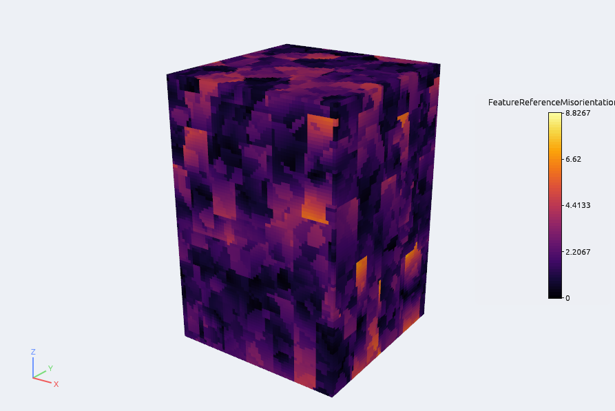

### Grain Realism

A tessellation has flat faces that meet at whatever angles the seeds give. Grown grains
have curved faces that meet three at a time at about 120 degrees, sizes that spread more
widely, and boundaries that wander. Simulating the growth gives this but takes minutes to
hours. **Filters › Grains › Grain Realism** moves a labelled volume (one with `FeatureIds`)
most of the way there in a second or so, in three steps:

- **Boundary roughness** pushes the boundaries out of place by a smooth random field, by
  about this distance in the volume's length unit. **Roughness wavelength** is the distance
  over which the push changes (left at 0: four times the roughness). A tenth of the grain
  size, with a wavelength of half the grain size, makes boundaries gently wavy.
- **Remove smallest grains** gives this share of the grains, smallest first, to their
  neighbours, as growth consumes its small grains.
- **Relaxation sweeps** then relax the boundaries. In each sweep a cell takes the grain
  that holds the largest share of the cells around it, counted with weights that fall off
  over **Relaxation width** cells. This moves every boundary towards its centre of
  curvature: corners round off, junctions open towards equal angles, bumps flatten and the
  smallest grains shrink. Three to five sweeps settle the junctions, and more changes
  little, because a boundary stops once a sweep would move it by less than half a cell.
  The width decides what is rounded: 1.5 cells rounds corners and cell-size steps, an
  eighth of the grain size in cells (2 to 3 for grains 16 to 24 cells across) rounds whole
  grains.
- **Periodic** treats opposite faces of the volume as neighbours, for periodic volumes.

Every cell array follows the cells, so a cell that changes grain takes the orientation of
its new grain. Grains that vanish are dropped, the others are numbered from 1 in their old
order, and the per-feature field arrays keep their rows. Cells without a feature (id 0)
stay as they are.

On a flat Voronoi map of 45 grains 24 cells across, four sweeps of width 3 bring the
spread of the junction angles about 120 degrees from 27 down to 18 degrees and shorten the
boundaries by 5 %; a phase-field growth run long enough to settle the junctions of such a
map reaches about 14 degrees and 7 %.

```python
v = afx.voronoi_grains(cells=[64, 64, 64], grains=100)
r = v.realistic_grains(relax=4, width=2, coarsen=0.1, roughness=1.0, roughness_length=6)
```

**Realism on Voronoi Grains.** The source's **Realism** setting (0 to 1) does the same
while the grains are made, scaled to the grain size: seed radii spread with a log-sigma of
0.3 × realism (when **Size spread** is 0), which widens the size distribution from a
log-sigma of about 0.14 towards 0.3; roughness of 0.06 × realism grain sizes; the smallest
0.1 × realism of the grains removed; and 5 × realism sweeps an eighth of the grain size
wide. The advanced settings **Relaxation sweeps**, **Boundary roughness** and **Remove
smallest grains** override these one by one. With realism 0 and those left alone the
source gives exactly the plain tessellation.

**Realism on Columnar Grains.** Here **Realism** adds what a layered build does:

- **Competitive growth** (set to realism): columns with a `<100>` direction close to Z
  widen with height and their neighbours narrow, and a column that is overgrown is not
  replaced. Fewer and wider grains are left towards the top, and those are the
  well-aligned ones. In the default box, nine grain widths tall, about half as many grains
  are left at the top as at the bottom with 0.5, and a quarter with 1.
- **Layer thickness** (40 by default; set it to the build's layer height in the box's
  length unit) places the layer boundaries.
- **Columns continuing through a layer** (1 − 0.3 × realism): the others stop at the layer
  boundary and a new grain starts in their place. Values of 0.6 to 0.9 are typical.
- **Lean with the scan** (10 × realism degrees): the columns lean along X, one way in even
  layers and back in odd ones, as under a scan that reverses from layer to layer.
- **Fine grains at layer boundaries** (0.15 × realism): small equiaxed grains with random
  orientations, 0.4 grain widths across, sit just above each layer boundary; 1 would
  cover it with them.
- **Boundary roughness** (0.05 × realism grain widths) and **Relaxation sweeps**
  (4 × realism) as in the filter, periodic across X and Y.

Each of these is an advanced setting that can be set on its own with realism at 0, and
overrides realism when set.

```python
build = afx.columnar_grains(realism=0.8, layer=40)
only_competition = afx.columnar_grains(competitive=1, height=2000)
layered = afx.columnar_grains(layer=50, epitaxial=0.6, scan_tilt=12, equiaxed=0.2)
```

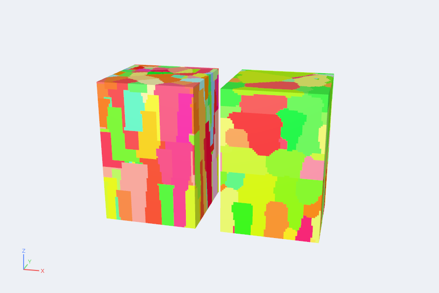

### Generate Ensemble Statistics

**Generate Ensemble Statistics** describes a segmented microstructure (one with
`FeatureIds`) as a table of fits:
- **Size:** a lognormal fit of the equivalent diameters (`ESD mu` and `ESD sigma` of their
  logarithms), with the mean, smallest and largest diameter.
- **Shape:** beta-distribution fits of the aspect ratios b/a and c/a (a, b and c are a
  grain's axes, longest first).
- **Neighbours:** a lognormal fit of the neighbour counts.

Features touching the outside are left out unless **Include features on the surface** is
on, because their size and neighbours are cut short. The values are also field data of the
table.

```python
st = v.ensemble_statistics(include_surface=True)
print(st.array("ESD sigma", "field"))
```

### Pack Grains

**Sources › Pack Grains** builds a microstructure from goal statistics.
- **Size.** Equivalent diameters are lognormal: **Size mu** and **Size sigma** describe their
  logarithms. The advanced cut-offs limit the draws to a few sigmas either side.
- **Shape.** The aspect ratios follow beta distributions: **b/a** and **c/a**, each given as
  (alpha, beta), so their mean is alpha / (alpha + beta).
- **Grain shape** is an ellipsoid, a superellipsoid (boxier as its exponent grows), a
  cube-octahedron or a cylinder. Its axes are turned at random, or lie along x, y, z with
  **Axes along x, y, z**.
- **Filling.** Grains are drawn until their volume fills the box. Each is then moved about
  at random, and a move is kept when it lowers the overlap and the gaps. Every cell goes to
  the grain it lies deepest inside, and the gaps are filled by growing the grains a layer at
  a time.
- **Matrix.** With a **Grain volume fraction** below 1, grains are added until they cover
  that fraction. The rest of the box becomes a matrix phase (phase 2, one feature).
- **Calibration.** Grains that fill space come out a little smaller and flatter than the
  shapes drawn. **Match the goal sizes and shapes** (on by default)
  measures the result, shifts the goals by what is missing and packs again, up to four
  times. The grains away from the box faces then match the goal mean size and aspect
  ratios to within about 0.02.

`OverlapFraction` in the output's field data is the share of cells that more than one grain
reached during packing.

```python
g = afx.pack_grains(cells=[80, 80, 80], esd_mu=2.48, esd_sigma=0.15, ba=[12, 4], ca=[10, 6])
```

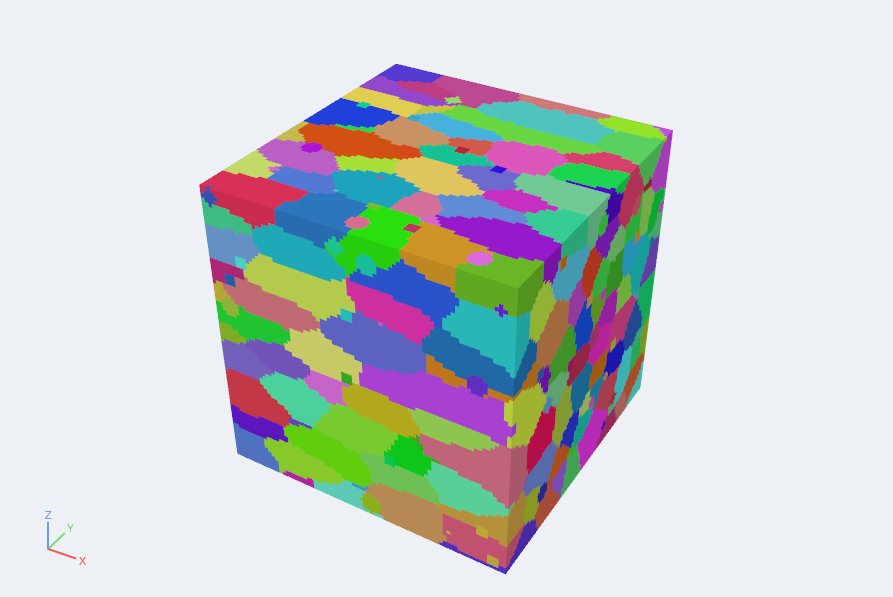

**View › Goal Statistics** edits the goals with live plots: the lognormal size distribution
(mu, sigma and where it is cut), the beta distributions of b/a and c/a, the shape, whether the
grain axes follow x, y and z, the orientations (random or a fibre with its spread), the volume,
the matrix fraction and the seed. With a Pack Grains source selected the panel edits it and draws
the packed volume's measured sizes and aspect ratios as bars under the goal curves, with the
goal and packed means; with none selected, **Pack** adds one. `afx.show_panel("goal statistics")`
opens it from Python.

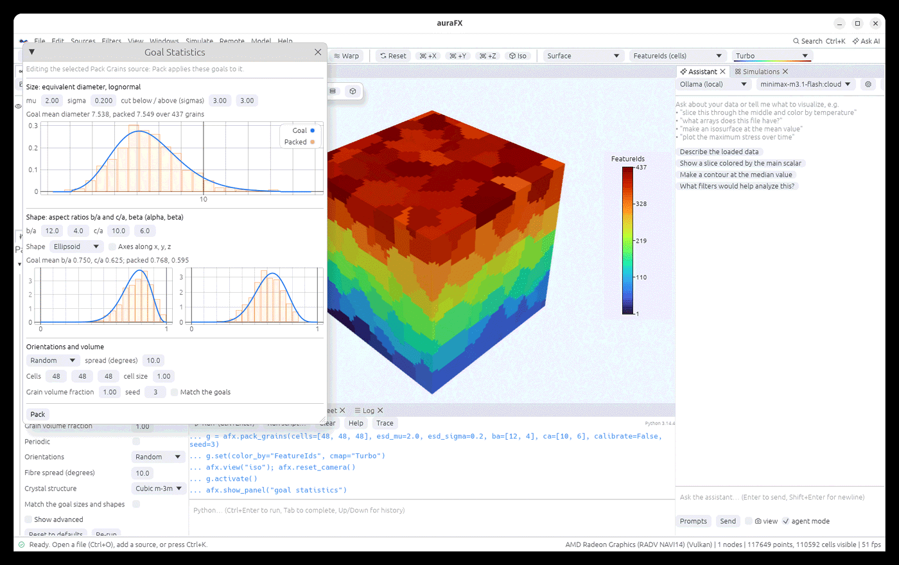

### Pack Like

**Pack Like** makes a statistical copy of a segmented microstructure in a box of any size:
- It measures the input like Generate Ensemble Statistics.
- It packs grains with those size and shape statistics.
- The new grains take orientations of the measured grains, chosen in proportion to their
  volume, so the copy has the same texture.

```python
copy = measured.pack_like(cells=[100, 100, 100])
```

### Insert Precipitates

**Insert Precipitates** adds particles of a new phase to a microstructure until they fill
the **Volume fraction**:
- **Shape and size.** Particles are spheres whose diameters are lognormal (**Size mu**,
  **Size sigma**).
- **Placement.** They are placed at random, or on grain boundaries with **On grain
  boundaries**. No two particles touch.
- **Output.** Each particle is a feature with a random orientation, in the next phase
  number, whose crystal structure is added to `CrystalStructures`.

### Insert Transformation Phases and Adjust Volume

**Insert Transformation Phases** puts plates into a fraction of the grains of a parent phase: a
plate of a thickness in cells through the grain, on one of its {111} planes, becomes a new
feature of a new phase, turned from its parent by an angle about the plane normal (60°: an
annealing twin). `TransformationParentIds` gives each plate's parent. **Adjust Volume** moves
cells on feature boundaries between neighbours so that each feature's size comes closer to a
target (a per-feature array of cell counts or equivalent diameters).

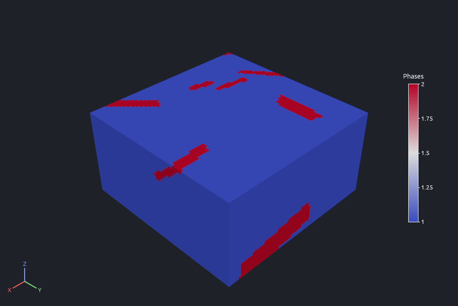

### Match Crystallography

**Match Crystallography** takes a second input: a reference microstructure, normally the
measured one. It works in two steps:
1. **Texture.** Each grain of phase 1 gets an orientation drawn from the reference's grains
   by volume, which reproduces the texture.
2. **Boundaries.** It swaps orientations between grains, or draws new ones, whenever that
   brings the distribution of disorientation angles across grain boundaries closer to the
   reference's. The distributions are weighted by boundary area, in 5° bins.

The field data `MDFErrorBefore` and `MDFErrorAfter` give the summed difference between the
two distributions before and after the swaps.

```python
matched = synthetic.match_crystallography(measured)
```

## Grain boundary surfaces

These filters work on the boundaries between the features of a segmented volume.

### Quick Surface Mesh

**Quick Surface Mesh** turns every voxel face between two different features into two
triangles, including the faces on the outside of the volume.
- **`FaceLabels`** (two per triangle) are the features on either side. The triangle's
  normal points out of the first and into the second, and -1 is the outside.
- **`NodeType`** counts the features meeting at each node: 2 on a boundary, 3 on a triple
  line, 4 at a quadruple point. Nodes on the outer faces of the volume get 10 more (12, 13,
  14).
- **Orientations.** When the volume has orientations, the surface keeps each feature's mean
  orientation (`AvgQuats`) and phase (`FeaturePhases`) for the filters below.

### Smooth Boundaries

**Smooth Boundaries** removes the voxel staircase.
- **Steps.** Each node moves towards the mean of its neighbours by **Step (lambda)**, and
  on every other pass back by **Inflating step (mu)**. This is Taubin smoothing, which keeps
  the grains' volumes. With mu 0 it is plain Laplacian smoothing, which shrinks them.
- **Triple lines** follow only their neighbours on triple lines, with their own step.
  **Quadruple points** stay put by default.
- **Outer faces.** Nodes on the outer faces of the volume move only within those faces.

### Triangle Geometry and Feature Surfaces

**Triangle Geometry** measures each triangle: `FaceAreas`, `FaceNormals`, `FaceCentroids`,
and `FaceMinimumAngles` (its smallest corner angle, a measure of its quality). For every
feature it also adds, as field data, the volume its boundary encloses (`SurfaceVolumes`) and
its boundary area (`SurfaceAreas`).

**Feature Surfaces** gives the closed surface of each feature, its triangles facing
outwards, one block per feature. Saved as STL (`grains.stl`), it writes one file per
feature: `grains_feature_1.stl`, `grains_feature_2.stl`, ... **Features** chooses some
of them.

```python
s = volume.quick_surface_mesh().smooth_boundaries(iterations=20)
s.feature_surfaces().save("grains.stl")
```

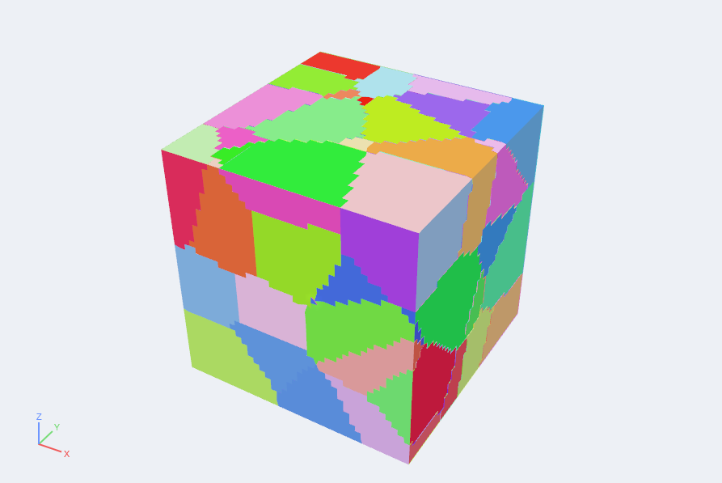

### Triangle angles and boundary curvature

**Find Triangle Angles** gives each triangle of a surface mesh its smallest and largest interior
angle and the largest dihedral angle with its neighbours on the same boundary. **Find Feature
Face Curvature** measures the mean and Gaussian curvature of every boundary (one pair of
`FaceLabels`) on its own. A grain surface mesh is also written as text files with
`mesh.save("grains.triangles")`: `grains.nodes` (node id, type, x, y, z) and `grains.triangles`
(triangle id, its nodes, the two features on either side).

### Face Orientation Colors

**Face Orientation Colors** colours each triangle three ways:
- **`FaceIPFColors`:** the inverse pole figure key of its plane, in the crystal of the
  feature it faces out of (on the outer surface, the feature inside).
- **`FaceMisorientations`:** the disorientation angle across it, in degrees.
- **`FaceMisorientationColors`:** a colour for that disorientation. The hue comes from where
  its axis falls in the standard triangle, and it is darker for smaller angles.

### GBCD Section

The grain boundary character distribution (GBCD) tells how often each boundary plane occurs
for each misorientation, in multiples of random. **GBCD Section** shows one misorientation
(**Misorientation angle** about **Misorientation axis**, within **Tolerance**). It is a disk
of crystal directions (stereographic or equal area, [001] at the centre), colored by how
often boundaries of that misorientation lie on each plane.
- **How it is counted.** Every boundary triangle counts from both sides, with every
  symmetry-equivalent description of its misorientation, weighted by its area.
- **Random.** A microstructure with random orientations and planes gives 1 everywhere.
- **`MisorientationMRD`** is how much more often than random the boundaries have that
  misorientation at all.
- **Smooth first.** The voxel staircase points the faces along the grid axes, so a GBCD of
  an unsmoothed surface smears each plane into a ring. Use Smooth Boundaries first.

```python
g = s.gbcd_section(angle=60, axis=(1, 1, 1), tolerance=5)
```

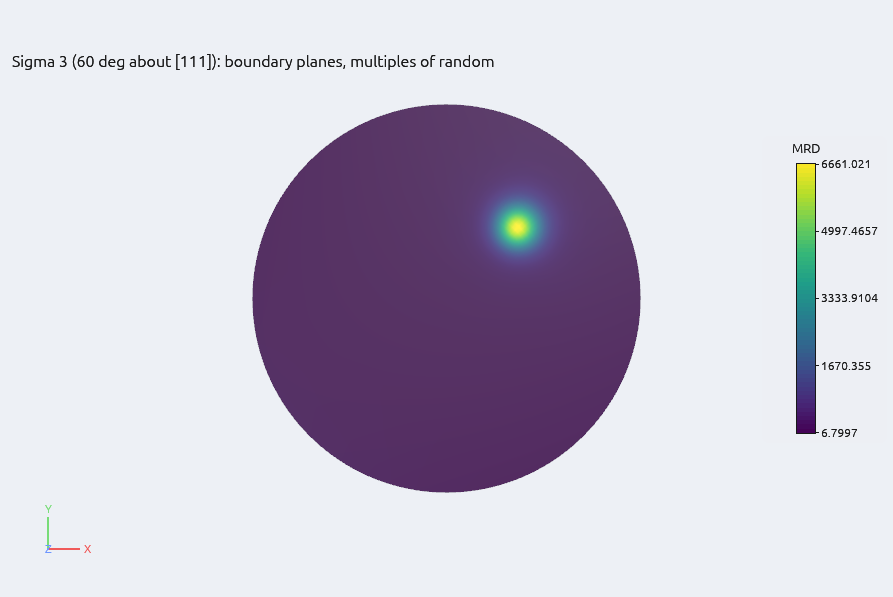

## Mechanics and additive manufacturing

### Crystal Mechanics

**Crystal Mechanics** works out, for every orientation and a **Loading direction** in the
sample, three quantities:
- **`SchmidFactor`:** the largest Schmid factor of the material's slip systems, with the
  system in `SlipSystem` (numbered as in the field array `SlipSystemNames`).
- **`TaylorFactor`:** the full-constraint Taylor factor for straining along the direction. It
  is exact: every set of five independent slip systems is tried, weighted by the relative
  resistance of their families.
- **`YoungsModulus`:** in GPa, from the elastic constants.

The field data gives the means, the Voigt (`YoungsModulusVoigt`), Reuss and Hill averages of
the modulus, and, for materials with a known base strength, a yield estimate:

> σy = σbase · M / 3.06 + α μ b M √ρ

Here M is the mean Taylor factor, 3.06 is a random texture's, and ρ is the mean of an
optional dislocation-density array (from GND Density). The result is in
`YieldEstimateMPa`, with its two parts in `YieldTextureMPa` and `YieldDislocationMPa`.

| Material | Lattice | Slip families (relative resistance) | Base strength |
|---|---|---|---|
| IN718, CoNi GammaPrint-700 | FCC | {111}<110> | 647.6 MPa, 400 MPa |
| Nickel, Copper, Aluminium | FCC | {111}<110> | |
| Iron (BCC) | BCC | {110}<111>, {112}<111> | |
| Titanium (HCP) | HCP, c/a 1.587 | basal 1, prismatic 0.7, pyramidal <a> 1, pyramidal <c+a> 3 | |
| Magnesium (HCP) | HCP, c/a 1.624 | basal 1, prismatic 10, pyramidal <a> 10, pyramidal <c+a> 15 | |

**Custom** takes the lattice, the elastic constants (C11 C12 C44, or C11 C12 C13 C33 C44 for
hexagonal crystals), the shear modulus, the Burgers vector, c/a and the slip families
(written like `Basal <a>=1, Prismatic <a>=0.7`). The families available are {111}<110> for
FCC; {110}, {112} and {123}<111> for BCC; basal, prismatic and pyramidal <a>, and pyramidal
<c+a>, for HCP.

```python
m = volume.crystal_mechanics(material="IN718", direction=(0, 0, 1))
print(m.array("YieldEstimateMPa", "field"))
```

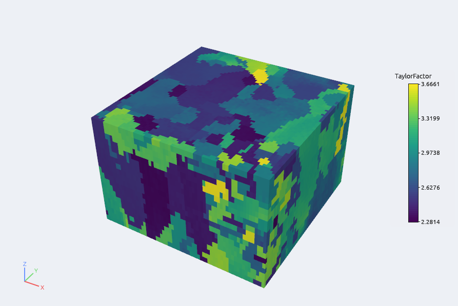

### SROD

In an additive build, a grain's orientation turns slowly as it grows layer by layer. **SROD**
measures, for every grain, how far its orientation has turned from the orientation it
started with, with z the build direction.
- **Reference.** A grain's starting orientation is the mean of its lowest sections that hold
  the **Reference volume** (at most a few sections).
- **Cells.** Every cell gets its disorientation from that reference (`SROD`, degrees). Cells
  of grains smaller than **Smallest grain** are left out and drawn grey.
- **Bins.** Bins of one **Layer thickness**, counted from the grain's lowest section, give
  the disorientation of their mean orientation.
- **Rate.** A grain's rate (`SRODRate`, degrees per layer) is the straight-line slope of its
  bins after the first.
- **Classes**, by where a grain starts relative to the **Plate top**:
  - *plate*: wholly below it;
  - *epitaxial*: growing out of the plate;
  - *interface*: starting within **Interface height** of it;
  - *originating*: starting higher in the build.

**Output** *Volume* keeps the volume with `SROD` and the per-grain field arrays (class, base,
top, bins, first-bin and largest SROD, rate). *Bins* gives one row per grain and bin, with the
spread of its cells (mean and 10th to 90th percentiles). *By height* gives the mean SROD of
each class layer by layer, for the Charts panel.

```python
s = volume.srod(layer=40, plate_top=0)
by_height = volume.srod(layer=40, plate_top=0, output="By height")
```

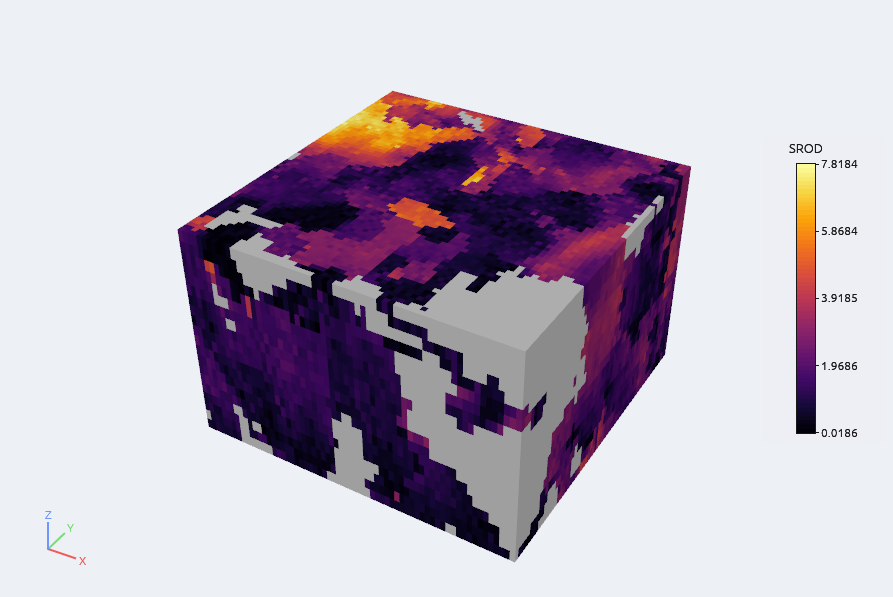

### GND Density

**GND Density** estimates the density of geometrically necessary dislocations in every
cell (`GND`, 1/m²):
- **Nye tensor** fits the lattice curvature inside the grain over a **Kernel** of cells, by
  least squares on the small rotations to the neighbouring cells. It turns the curvature
  into Nye's dislocation tensor and sums its entries over the **Burgers vector**. Cells with
  too few neighbours in their grain are left empty.
- **From KAM** converts a kernel average misorientation array (Kernel Average
  Misorientation) as KAM / (step · b).

The field data gives the mean, median and 90th percentile.

On a 2-D map the curvature across the map cannot be measured, so the Nye tensor method sums the
five components of the tensor a map gives (a lower bound of the density). A map whose lattice
turns steadily about its normal gives back that rate over b within 2 %.

```python
g = volume.gnd_density(method="Nye tensor", burgers=2.54e-10, kernel=3)
```

## Limits

- Hexagonal-grid EDAX `.h5` files, Oxford `.h5oina` files, and `.dream3d` neighbor lists are not
  read yet (hexagonal `.ang` files are, resampled on a square grid).
- Cubochoric vectors are not among the representations.
- Neighbor lists (each feature's neighbours and shared areas) are not kept as arrays; Feature
  Boundaries holds the same information face by face.
- Merge Twins handles cubic m-3m crystals only.
- Texture directions are Cartesian crystal directions. For cubic crystals they are the Miller
  indices. For hexagonal and trigonal crystals, `001` is the c axis and `100` the a1 axis.
  Four-index Miller-Bravais notation is not read.
- The texture filters assume no sample symmetry and count every point equally.
- Voronoi and Laguerre grains are tessellations of random seeds, and columnar grains are
  power diagrams slice by slice; use Pack Grains to match given size and shape statistics.
- Grain Realism imitates what growth does to the shapes; it is not a growth simulation.
  Every boundary is treated alike (no dependence on misorientation), relaxation does not
  move boundaries that are nearly flat, and a thin neck of a grain can be cut in two, which
  leaves one feature id on two pieces (Segment Features separates them). A sweep smooths
  the surroundings of every grain in turn, holding up to about 200 MB of them at a time; a
  128-cube volume of 500 grains takes a few seconds.
- Competitive growth, layers, lean and fine grains in Columnar Grains are geometric rules
  with a strength, not a solidification model: the melt pool's shape, the scan pattern
  beyond a lean along X, and remelting are not represented. Pack Grains has no Realism
  setting; apply the Grain Realism filter to its output.
- Orientation Gradient works on voxel volumes and flat maps with cell orientations. The
  steady turn is a straight ramp per grain; the smooth spread is a sum of six random waves
  per grain, so it is not a measured spectrum; sub-grain cells are the same pattern of cell
  centres in every grain, each grain turning its cells independently. The orientations are
  written as 64-bit numbers.
- Pack Grains matches the mean size and mean aspect ratios. The spread of sizes and the
  neighbour counts follow from the packing rather than from a goal. Grains cut by the box
  faces of a periodic volume are measured as pieces.
- Match Crystallography matches the boundary misorientation angles, not their axes.
  Precipitates are spheres.
- Quick Surface Mesh works on volumes; for 2-D maps use Feature Boundaries. Smoothing keeps
  the volumes to within about 0.5 % but does not stop a triangle from folding when it runs
  for many passes on very thin features.
- The GBCD is shown one misorientation at a time; the full five-parameter distribution is
  not stored as an array.
- The Taylor factor takes at most 30 slip systems (all of FCC, of {110} and {112} BCC, and of
  the four HCP families together). Twinning is not counted. The yield estimate is the
  texture and dislocation scaling above, not a crystal-plasticity calculation.
- The feature filters copy the volume they work on: a volume of 80 million cells needs several
  gigabytes of memory. Segmentation of such a volume takes about 10 seconds.
- The orientation mathematics is checked against independent references: rotations from
  SciPy, disorientation angles by brute force over every crystal class, and the color key by
  a separate implementation. On a window of a real volume, the inverse pole figure colors
  agree with those stored in the file within one level of 255. The verification notes (`docs/reference/verification.md` in the
  source tree) list the comparisons.
