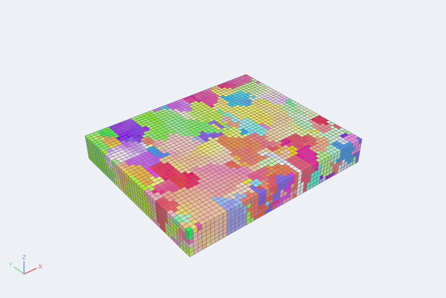
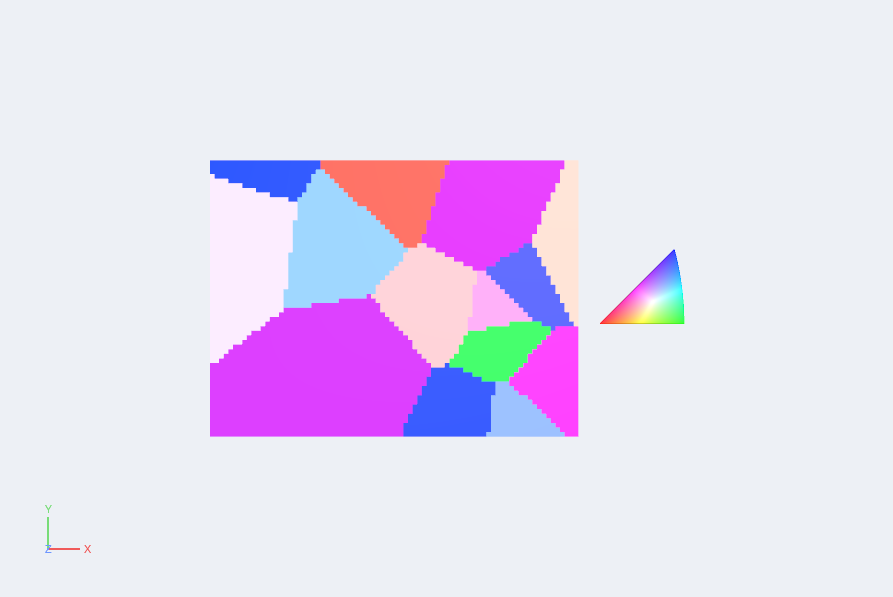
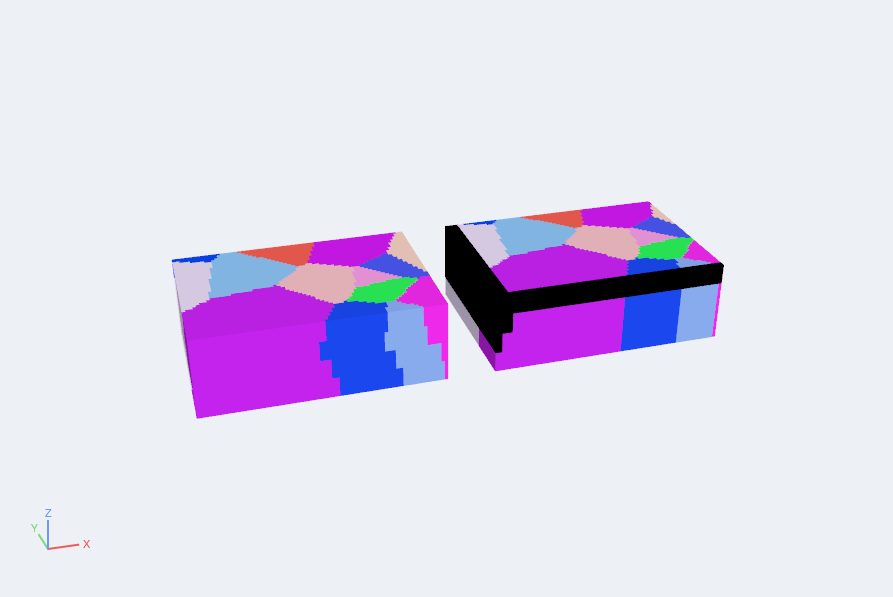

# Grains and crystals

auraFX reads electron backscatter diffraction (EBSD) maps, serial-section stacks and voxel
microstructures, and works with crystal orientations. It colors them, converts them between
representations and re-expresses them in a turned reference frame. It also crops, resamples
and aligns voxel volumes. This is the first part of the grain workbench. Segmenting grains,
grain statistics and building synthetic microstructures come in later releases.

## EBSD maps

Open a map with **File › Open** or `afx.load("scan.ang")`.

| Format | Extension | Notes |
|---|---|---|
| TSL/EDAX | `.ang` | square grids; hexagonal grids are not read yet |
| Oxford | `.ctf` | angles in degrees in the file, converted to radians |
| EBSD stacks | `.h5ebsd` | serial sections from TSL or Oxford (HKL) maps, read as one volume |
| EDAX OIM HDF5 | `.h5` | square-grid scans; choose the scan with the **Scan** reader option |
| Bruker Esprit HDF5 | `.h5` | angles in degrees in the file; phases from their space group |
| Microstructures | `.dream3d` | voxel volumes and meshes with their cell, feature and phase arrays; see below |

`.h5` files are recognised by their contents, so other HDF5 files with that extension still
open with their own readers.

A map becomes image data with one cell per measured point, the cells centered on the points
(so the map's corner lies half a step before the first point). Its arrays are:

- **Cell data:** `EulerAngles` (three Bunge angles φ1, Φ, φ2 in radians, as stored in the
  file) and `Phases` (the phase of each point, 0 where the pattern was not indexed). A `.ang`
  file adds `Image Quality`, `Confidence Index`, `SEM Signal` and `Fit`. A `.ctf` file adds
  `Bands`, `Error`, `MAD`, `BC` and `BS`.
- **Field data:** one entry per phase, entry 0 standing for "not indexed".
  `CrystalStructures` holds the crystal class of each phase (see the numbers below),
  `MaterialName` its name and `LatticeConstants` a, b, c, α, β, γ.

A single-phase `.ang` scan writes phase 0 for every point. auraFX counts those points as
phase 1, unless their confidence index is negative.

An `.h5ebsd` stack becomes one volume with a cell layer per slice, the slices `Z Resolution`
apart. The stack's sample and Euler transformations are not applied. They are kept as the
field arrays `SampleTransformationAngle`, `SampleTransformationAxis`,
`EulerTransformationAngle` and `EulerTransformationAxis`. Apply them with Rotate Orientations
(and Transform for the sample) if you need them.

**Hexagonal axes.** Oxford files describe hexagonal crystals with the [10-10] direction along
x. auraFX, `.ang` files and the color key put [2-1-10] along x. By default the `.ctf` reader
adds 30° to φ2 of hexagonal and trigonal phases to match. To keep the angles as stored, set
the reader option **Hexagonal axes** to *As stored* in the Properties panel, or in Python:

```python
m = afx.load("titanium.ctf", hexagonal_axes="As stored")
```

### Crystal classes

| Number | Class | | Number | Class |
|---|---|---|---|---|
| 0 | Hexagonal 6/mmm | | 6 | Orthorhombic mmm |
| 1 | Cubic m-3m | | 7 | Tetragonal 4/m |
| 2 | Hexagonal 6/m | | 8 | Tetragonal 4/mmm |
| 3 | Cubic m-3 | | 9 | Trigonal -3 |
| 4 | Triclinic -1 | | 10 | Trigonal -3m |
| 5 | Monoclinic 2/m | | 999 | Unknown |

Face-centered and body-centered cubic metals (nickel, aluminium, iron) are Cubic m-3m.
Hexagonal close-packed metals (titanium, magnesium, zirconium) are Hexagonal 6/mmm.

### Microstructure files (.dream3d)

A `.dream3d` file holds one or more data containers, each a geometry with arrays. auraFX reads
image (voxel), rectilinear, vertex, edge, triangle, quadrilateral, tetrahedral and
hexahedral geometries.

- Cell arrays (voxels, triangles, ...) become cell data, and vertex arrays become point data.
- Feature arrays (one row per feature, such as `AvgQuats`, `Volumes` or `Centroids`) and phase
  arrays (`CrystalStructures`, `LatticeConstants`, `MaterialName`) become field data.
- Neighbor lists are not read.
- A file with several data containers opens as blocks. The **Data container** reader option
  picks one.
- Large volumes load faster with only the arrays you need. Give their names in the **Arrays**
  reader option, separated by commas.

```python
v = afx.load("volume.dream3d", arrays="EulerAngles, Phases, FeatureIds")
```



## Orientation conventions

An orientation turns the sample axes into the crystal axes. A direction with sample
coordinates *s* has crystal coordinates *g s*, where *g* is the orientation matrix. Euler
angles are Bunge angles in radians: *g* = Rz(φ2) Rx(Φ) Rz(φ1). Quaternion arrays store
(x, y, z, w), with w ≥ 0. Orientation matrices are stored row by row (9 components).

## Orientation Colors

**Filters › Grains › Orientation Colors** adds an 8-bit RGB array named `IPFColor`. Each
point is colored by one of two keys:

- **Inverse pole figure** (the default). The reference direction, z by default (the map
  normal), is turned into crystal coordinates. The crystal's symmetry brings it into the
  standard triangle of its class, and its place there gives the color. For cubic crystals,
  [001] is red, [101] green and [111] blue. For hexagonal crystals, [0001] is red,
  [2-1-10] green and [10-10] blue. Choose x or y as the reference direction to see the
  orientation along the map's edges.
- **Euler angles**: φ1, Φ and φ2 scaled to red, green and blue.

The class of each point comes from its phase and `CrystalStructures`, as EBSD files give
them. For data without phases, choose the class under **Crystal structure**. Points not
indexed, of an unknown class, or where the optional **Mask** array is 0, are black. The
orientation array can hold Euler angles (3 components), quaternions (4) or orientation
matrices (9). If none is chosen, the filter uses `EulerAngles`, `Quats` or
`OrientationMatrix`, whichever it finds first.

```python
m = afx.load("scan.ang")
ipf = m.orientation_colors(direction=(0, 0, 1))      # key="Euler angles" for the other key
ipf.set(color_by="IPFColor")
```

### Arrays drawn as their own colors

An array of 8-bit values with 3 or 4 components, like `IPFColor`, is drawn with its own
colors when you color by it, not through a color map. No legend is shown for it. To map
such an array through a color map instead, clear **Colors: the array's own colors** under
Color by in the Properties panel, or use `node.set(direct_colors=False)`. Choosing one component of the
array also uses the color map.

## IPF Color Key

**Sources › IPF Color Key** draws the color key of a crystal class: its standard triangle in
stereographic projection, colored as Orientation Colors colors it. It lies around the origin
in the xy plane, about half a unit across, so move and enlarge it with **Transform** to place
it next to a map.

```python
key = afx.ipf_color_key(structure="Cubic m-3m", resolution=60)
key.transform(scale=(20, 20, 1), translate=(42, 12, 0)).set(color_by="IPFColor")
```



## Convert Orientations

**Filters › Grains › Convert Orientations** writes the orientations in another
representation. It reads and writes Euler angles, quaternions, orientation matrices,
axis-angle pairs (the unit axis and the angle in radians), Rodrigues vectors (the unit axis
and tan(ω/2)) and homochoric vectors. With **Reduce to the fundamental zone**, each
orientation is replaced by its symmetry equivalent with the smallest rotation angle (for cubic
crystals, at most 62.8°). The output is named after the representation (`Quats`,
`OrientationMatrix`, …) unless you give a name.

```python
q = m.convert_orientations(input_type="Euler angles", output_type="Quaternions", reduce=True)
```

## Rotate Orientations

**Filters › Grains › Rotate Orientations** re-expresses the orientations after the reference
frame is turned by an angle (degrees) about an axis. The points do not move; only the
description of their orientations changes.

- **Sample** frame: use this when the map's axes differ from those you want, such as a scan
  taken with the sample turned 90° about its normal.
- **Crystal** frame: turns the crystal axes the orientations refer to.

```python
r = m.rotate_orientations(frame="Sample", axis=(0, 0, 1), angle=90)
```

## Crop

**Filters › Grains › Crop** keeps the cells of a voxel volume or EBSD map whose centres lie
inside a box, given in sample coordinates (leave a side unset to keep everything on that
side). The cells keep their place in space. With **Renumber features** (on by default), the
remaining feature ids are numbered from 1 and the per-feature field arrays keep only the
rows of those features. To crop by grid index instead, use **Extract Subset**.

```python
c = v.crop_volume(min=(0, 0, 0), max=(100, 80, 20))
```

## Change Resolution

**Filters › Grains › Change Resolution** resamples a voxel volume or EBSD map onto cells of
another size. Each new cell takes the values of the old cell that holds its centre, so
orientations, phases and feature ids stay valid. The volume keeps its corner and, rounded to
whole cells, its size. Features that disappear are dropped and the rest renumbered, as in
Crop. Point data is not carried over.

```python
coarse = v.change_resolution(spacing=(2, 2, 2))
```

## Align Sections

**Filters › Grains › Align Sections** moves each z slice of a serial-section volume in x and
y, by whole cells, so it matches the slice below. Choose how slices are compared:

- **Misorientation** (the default): two cells match when their orientations differ by less
  than the **Tolerance** (5° by default), with the crystal class of their phase.
- **Feature ids**: two cells match when they belong to the same feature.
- **Given shifts**: no search. Each slice moves by the x and y cells you give, against the
  slice below.

The search starts from no move and steps to the neighbouring shift with fewer differing cells
until none is better, at most **Largest shift** cells each way. A **Mask** array (a sample or
good-data mask) limits the comparison to cells where it is not 0. Cells uncovered by a move
are set to 0 (phase 0, not indexed). The total shift of each slice is kept as the field array
`SectionShifts` (x, y cells). Point data is not carried over.

```python
a = stack.align_sections(method="Misorientation", tolerance=5, mask="SampleVoxels")
a.align_sections(method="Given shifts", shifts=[2, -1, 3, 1, -1, 2])   # 3 slices after the first
```



## Limits

- Hexagonal-grid `.ang` and EDAX files, Oxford `.h5oina` files, and `.dream3d` neighbor lists
  are not read yet.
- Cubochoric vectors are not among the representations.
- The orientation mathematics is checked against independent references: rotations from
  SciPy, disorientation angles by brute force over every crystal class, and the color key by
  a separate implementation. On a window of a real volume, the inverse pole figure colors
  agree with those stored in the file within one level of 255. The verification notes (`docs/reference/verification.md` in the
  source tree) list the comparisons.
