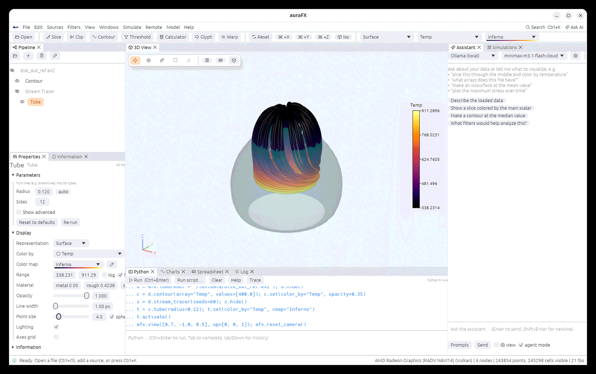

# auraFX User Guide

auraFX is a scientific visualization, analysis and simulation workbench. It opens the files
your solvers write (Exodus, VTK, OpenFOAM, LAMMPS, CGNS, EnSight, NetCDF and many more),
shows them in a 3D view drawn by your GPU, lets you cut, contour, threshold, trace and
measure them with the usual filters, and adds three things next to the 3D view:

- a **Python console** with a one-line-per-idea API (`afx.load("run.e").slice().color_by("T")`),
- an **AI assistant** that sees your pipeline and writes runnable code for you,
- a **simulation runner** that launches solvers locally, over SSH or through Slurm and opens
  the results when they finish.

It also builds what solvers need: a **parametric CAD modeler**, a **geometry and mesh
generator** and a **grain workbench** for microstructures live in the same window, and Jupyter
notebooks can drive all of it.

This guide walks through every feature. Each chapter says where a feature is in the window,
how to call it from Python, and what its limits are.

## How this guide is organised

| Part | What it covers |
|---|---|
| Basics | opening files, the pipeline, filters, coloring, views, selection, time and animation |
| Rendering | lighting, shadows, ambient occlusion, ray tracing, materials, volumes, point clouds |
| Scripting | the Python API and notebooks, the AI assistant, writing plugins in Python or Rust, tutorials |
| Data | every file format read and written, exporting pictures and scenes, running simulations, working on remote machines and with files larger than memory, grains and crystals, geometry and meshing, CAD modeling |
| Reference | settings and keyboard shortcuts, every filter with its settings, benchmarks |

## Formats of this guide

The guide is kept as Markdown in the repository (`docs/userguide/src`), published as an online
book, and printed to a PDF (`docs/userguide/auraFX-user-guide.pdf`). All three come from the
same source files, so they always say the same thing.
