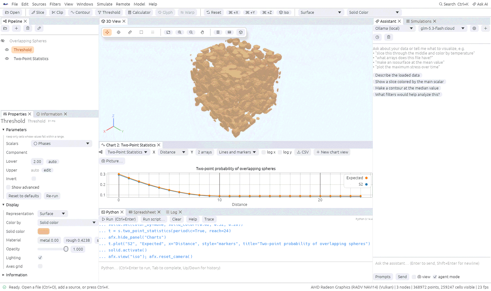
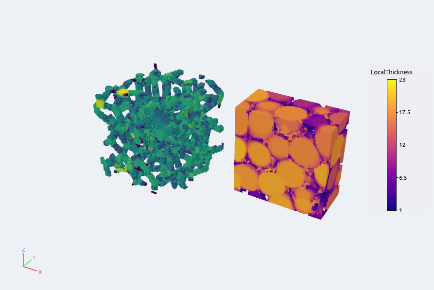
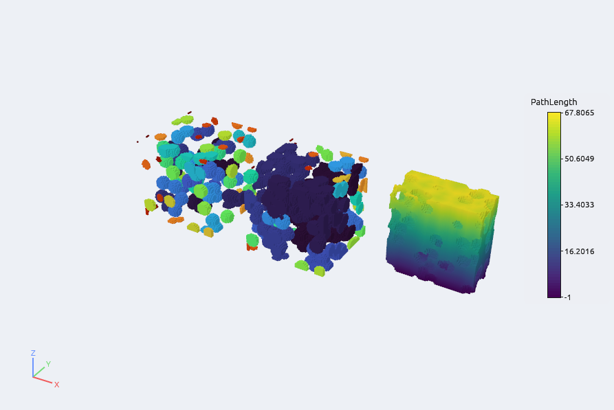
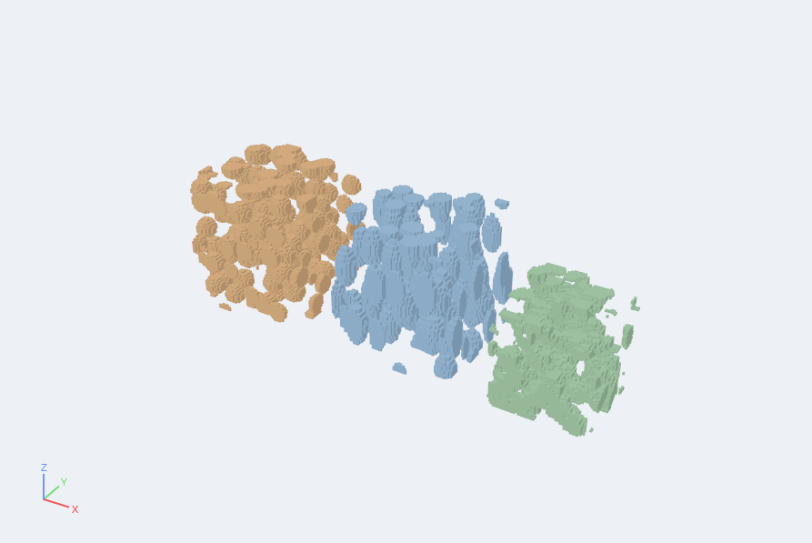
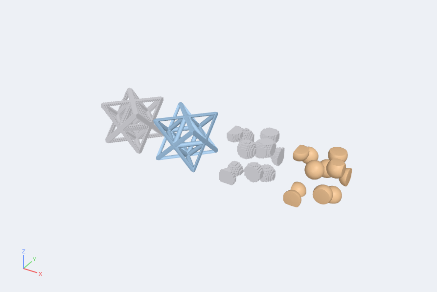
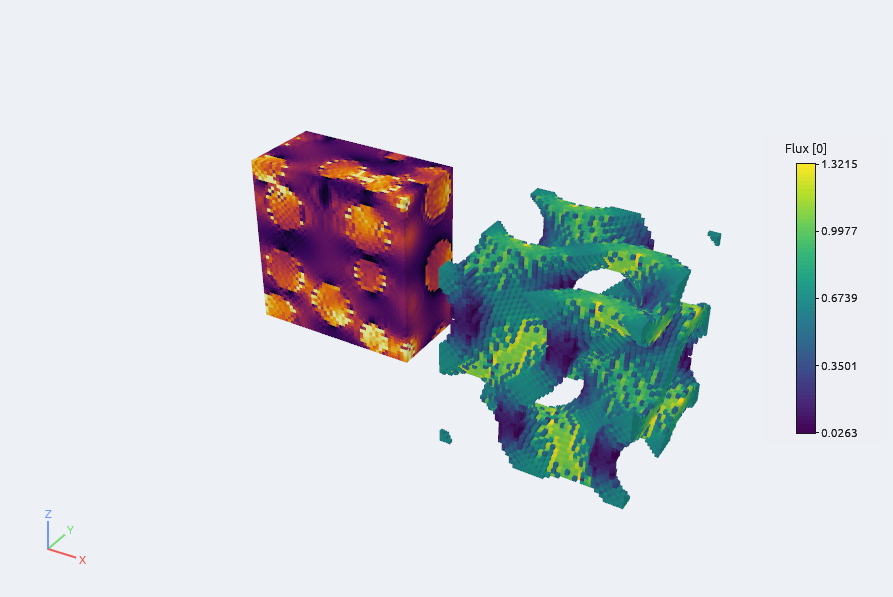
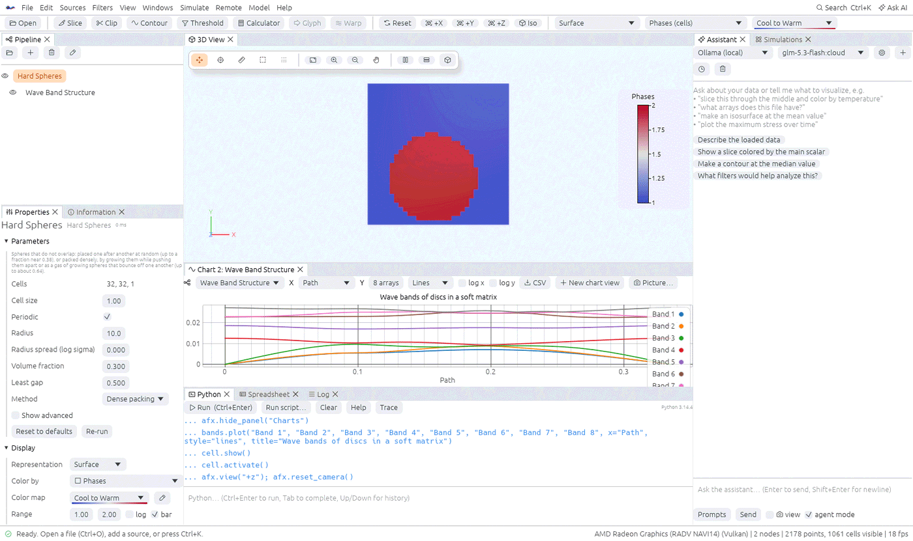
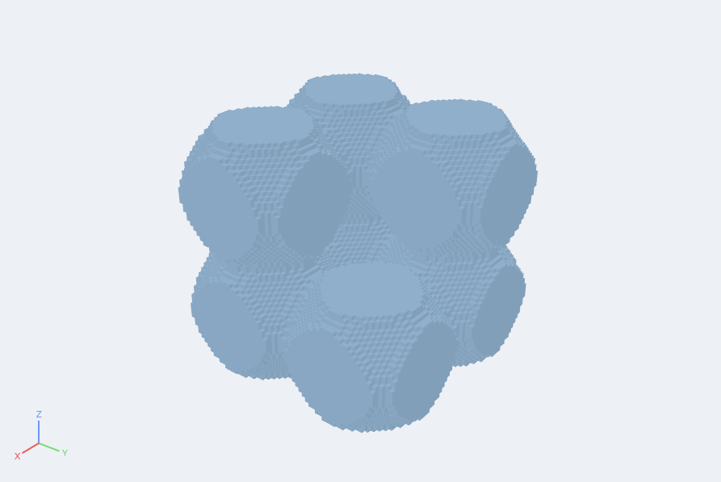
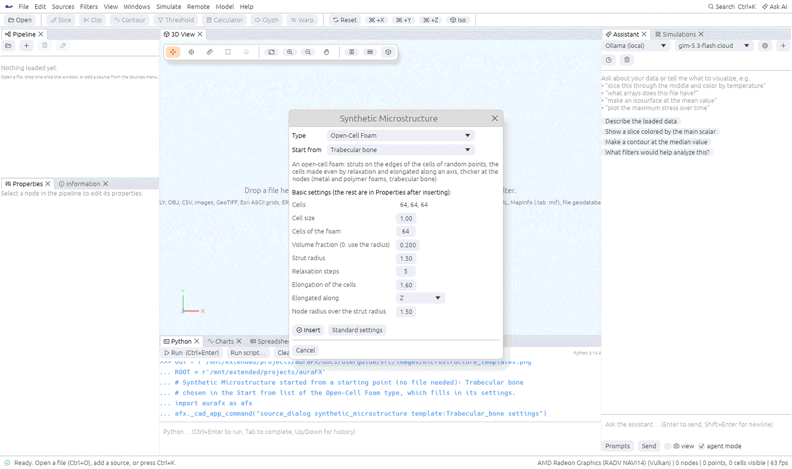
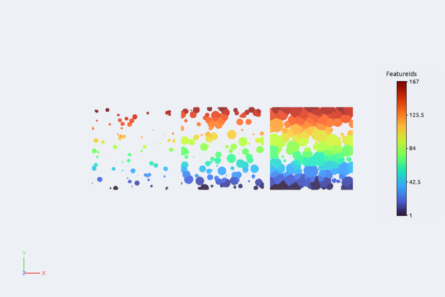

# Measuring and simulating microstructures

The filters under **Filters › Microstructure** read a microstructure, say what it is like in
numbers, and compute what it does: how much of each phase there is and how it is arranged,
whether a phase runs through the sample, how stiff and how conducting the whole is, and how
large a sample must be for those numbers to be trusted. They work on the types of
[Synthetic microstructures](synthetic-microstructures.md) and on any other image with a
phase for every cell: a segmented tomography, a map of phases, the result of **Threshold**
on a volume.

This chapter also covers four sources of the **Synthetic Microstructure** window that run
the models rather than being one: starting points that stand for a material, a model
followed while it forms, a model run over many sizes and seeds, and a unit cell found for
its stiffness or conductivity.

## What the filters read

Every filter reads a **phase** for every cell of an image:

- **Phases** (advanced): the cell array that holds the phases. Empty, it is the array named
  `Phases`. Any whole-number cell array will do (a `FeatureIds` array, a segmentation).
- **Phase**: the number of the phase to measure. The synthetic types use 1 for the matrix
  or the pores and 2 for the solid.
- **Through periodic faces**: on for a structure that was made periodic, so that what
  leaves through a face is counted as coming back through the opposite one.

A filter that gives numbers gives a table (open it in the Spreadsheet, or plot it); the
numbers that sum up a result are field values, shown in the Information panel and read from
Python with `node.array("Name", "field")`.

## Fractions, surface and connectivity

**Phase Measures** gives a table with a row for every phase:

| Column | Meaning |
|---|---|
| `VolumeFraction` | The share of the cells. |
| `SpecificSurface` | The surface of the phase per unit volume, from the boundaries met along lines in 13 directions (in a plane: the length of the outline per unit area, from 4 directions). |
| `MeanChord` | The mean length of the straight stretches through the phase: 4 times the fraction over the surface. |
| `EulerNumber` | The connected parts, less the tunnels, plus the closed cavities (in a plane: the parts less the holes). 1 for a ball, 0 for a ring, 2 for a hollow ball. A large negative number: a network with many loops. |
| `EulerNumberPerVolume` | The same per unit volume. |
| `ConnectedParts` | The number of separate parts (cells joined across faces). |
| `ExpectedFraction`, `ExpectedSpecificSurface` | What the model gives exactly, where it kept it: the fraction of overlapping spheres and fibres, their surface and that of fibres on lines and of Gaussian fields. |

```python
s = afx.overlapping_spheres(radius=6, fraction=0.3)
t = s.phase_measures(periodic=True)
```

The surface of a round shape drawn on cells is found to within about 5 % when the shape is
a few cells across; thin features read low.

## Two-point statistics

**Two-Point Statistics** follows a phase against the distance between two points:

- **`S2`**: the probability that both points lie in the phase, over all directions, and
  along each axis as `S2 X`, `S2 Y`, `S2 Z`. At no distance it is the volume fraction; far
  apart, the fraction squared; how fast it falls tells the size of the features, and a
  difference between the axes tells an anisotropy.
- **`LinealPath X`** (and Y, Z): the probability that the whole segment between the points
  lies in the phase.
- **`Cluster X`** (and Y, Z): the probability that the points lie in the same connected
  part.
- **`Expected`**: the exact curve of the model, for overlapping spheres of one radius and
  for Gaussian field media.

The field value `IntegralRange` is the volume (the area in a plane) over which the phase is
correlated with itself: a sample many times larger holds many independent pieces.
**Farthest distance** (0: half the box) limits the table.

```python
t = s.two_point_statistics(phase=2, periodic=True, reach=24)
t.plot("S2", "Expected", x="Distance")
```



## Chords, thickness and pore size

**Phase Chord Lengths** gives the lengths of the straight stretches of a phase along lines
in X, Y and Z, as the share of the chords in each class of length (**Classes**), with their
means as the field value `MeanChord`. Chords cut by the box are left out.

**Local Thickness** gives, at every cell of a phase, the diameter of the largest ball that
fits inside the phase and holds the cell (`LocalThickness`): the thickness of struts and
walls for the solid, the size of the pores for phase 1. The field values `MeanThickness`
and `LargestThickness` sum it up. With **Result** *Size distribution* the filter gives a
table instead: the share of the phase in each class of thickness, and the share thinner
than each size (what openings by balls of growing size would remove, one after another).

```python
foam = afx.open_cell_foam(fraction=0.15)
struts = foam.local_thickness(phase=2)                 # LocalThickness at every cell
pores = foam.local_thickness(phase=1, output="Size distribution")
```



The balls are centred on cells, so thicknesses are right to about one cell; the faces of the
box do not count as a boundary of the phase.

## Paths, fabric and percolation

**Tortuosity** finds the shortest path inside a phase from one face of the box (**From the
face at the start of** X, Y or Z) to every cell, kept as `PathLength` (-1 where no path
leads). `Tortuosity` is the mean length of the paths that reach the opposite face over the
straight distance, `ShortestPath` the same for the shortest one, `ReachedShare` the share of
the opposite face that is reached. Paths go from cell to cell through faces, edges and
corners, so they come out a few percent longer than a free path would.

**Fabric Tensor** tells along which directions a phase is long and short. It measures the
mean chord along 13 directions and fits an ellipsoid to them; the table has a row for each
axis of the ellipsoid (the mean chord along it, its share, its direction), and
`DegreeOfAnisotropy` is the longest over the shortest. Trabecular bone and stretched foams
give values well above 1; a structure with no preferred direction gives 1.

**Percolation** numbers the connected parts of a phase from the largest (`ClusterIds`), and
says whether one of them joins opposite faces of the box: `Percolates` holds 1 or 0 for X,
Y and Z, `SpanningShare` the share of the phase in such parts, `Clusters` their number and
`LargestClusterShare` the share of the largest. **Cells are joined across** faces, faces and
edges, or corners too.

```python
p = s.percolation(phase=2)
print(p.array("Percolates", "field"))                      # [1, 1, 1]: the spheres join every pair of faces
paths = s.tortuosity(phase=1, axis="Z")                # through the pores
```



## How large a sample

**Representative Volume** answers the question from one large image. It cuts the box into
blocks of growing size and follows the variance of the mean of a property over the blocks
against their volume. The variance falls as the variance of a single point times
(range / volume) to a power; the fit gives the `IntegralRange`, the `Exponent` (1 for a
structure without long-range order) and:

- `RepresentativeVolume` and `RepresentativeEdge`: the volume, and the edge of the cube,
  that bring the mean to the **Relative precision** asked with the number of **Samples**
  given (several smaller samples do as well as one large);
- `PrecisionOfThisVolume`: the relative precision this image itself gives.

**Property** empty measures the volume fraction of the phase. A cell array measures its
mean: a component of the stress or of the flux from the property filters below gives the
size needed for a stiffness or a conductivity, which is larger than the one the fraction
needs.

```python
big = afx.overlapping_spheres(cells=[128, 128, 128], radius=4, fraction=0.3)
r = big.representative_volume(phase=2, precision=0.01)
print(r.array("RepresentativeEdge", "field"))
```

## Particle sizes

**Split Touching Particles** tells apart the particles of a phase that touch. Every cell of
the phase goes to the particle whose core it leads to, the cores being the places farthest
from the boundary; the particles are numbered in `FeatureIds`, so the feature filters of
[Grains and crystals](grains.md) (sizes, shapes, centroids, neighbours) measure them.
**Least neck depth** decides when two cores are one particle: when the neck between them is
less than this narrower, in radius, than the smaller core. Raise it if round particles come
out cut in pieces.

**Unfold Section Sizes** gives the sizes of spheres in space from the sizes of their
sections by a plane, as measured on a micrograph. A sphere shows a section of any size up to
its own, so the largest sections count the largest spheres, and what those add to the
smaller classes is taken off class after class. Give the **Section diameters** (a column of
a table, or an array: the equivalent diameters from **Feature Sizes** on a section), the
number of **Classes** and the **Area of the section**. The table has, for every class of
diameter, the sections per unit area and the spheres per unit volume; the field values
`SpheresPerVolume`, `MeanDiameter` and `VolumeFraction` sum it up. The method assumes
spheres; few sections in a class make the result uneven.

## Stretching and rebuilding

**Stretch Microstructure** stretches a structure by a factor along each of three axes
(**Stretch along the axes**), the axes turned by Bunge angles if wanted: elongated grains
and pores, aligned ellipsoids from spheres, a field correlated farther one way. The result
is on the same grid. With **The structure is periodic** on, what comes in from beyond the
box is the structure repeated; off, its mirror image. A stretched structure no longer joins
up through the faces it was stretched along, and it no longer keeps the description of its
objects.

**Reconstruct Microstructure** makes a new random medium, of any size, with the statistics
of a phase of the input: its volume fraction, its two-point probability along each axis and,
with **Match the lineal path too**, the lengths of its straight stretches. Cells of the
phase are swapped with cells outside it again and again, a swap kept when it brings the
statistics nearer (simulated annealing); **Swaps tried per cell** sets how long it runs.
From a single layer of cells (a micrograph) it makes a volume, the third axis taking the
mean of the two measured ones. The result is periodic. Two media with the same two-point
probability can look different: the copy is a statistical one.

```python
long = s.stretch_microstructure(stretch=[1, 1, 2])
copy = s.reconstruct_microstructure(phase=2, cells=[48, 48, 48], sweeps=20)
```



## Exact geometry and smooth surfaces

The types made of objects keep a description of them with the image: the spheres of the
particle types, the pieces of the fibres, the struts of lattices, foams and networks, the
pipes and the branches. Two filters draw from it.

**Microstructure Objects** gives the objects as geometry: spheres as points, fibre pieces
and struts as lines, each with its `Radius` (and `Length` for the lines). **Glyph** with
spheres scaled by `Radius` and **Tube** with a radius from `Radius` draw them exactly; the
points and lines are also what a beam model or a count of objects needs.

**Smooth Surface** gives the closed surface of a phase as triangles, without the steps of
the cells. For a type that kept its objects, the surface is that of the exact spheres,
round-ended fibres and struts, drawn **Resolution** times finer than the image. For any
other image (a field, a foam drawn from distances, a tomography), the steps of the cells
are smoothed over **Smoothing** cells. The surface is closed where the box cuts the phase.
Save it as STL to print it, or give it to **Tet Mesh** for a mesh of tetrahedra that
follows the surface.

```python
lattice = afx.strut_lattice(cell="Octet", fraction=0.15)
skin = lattice.microstructure_surface(refine=3)
skin.save("octet.stl")
```



Hollow fibres and struts, flat fibre ends, coatings and combinations are not in the
description: turn **Always from the cells** on for those.

**Framework Rigidity** takes the struts of a lattice as bars joined by pins and counts, from
the rank of the matrix that gives the stretch of every bar from the movements of the nodes:

| Column | Meaning |
|---|---|
| `Nodes`, `Struts`, `StrutsPerNode` | The frame. |
| `MaxwellNumber` | Struts less the freedoms of the nodes: the states of self-stress less the mechanisms. |
| `Mechanisms` | The ways the frame can move without stretching a strut. |
| `StatesOfSelfStress` | The ways its struts can be stressed with no load. |
| `FloppyStrains` | For a periodic lattice: the mean strains (of six) it cannot resist by stretching its struts. |

A lattice with no floppy strain carries loads by stretching its struts and is stiff for its
weight (the octet truss); one with floppy strains bends its struts instead (the cubic
lattice in shear, the Kelvin cell). On a **Disordered Strut Lattice** the count shows where
removing struts makes the lattice lose its stiffness. Large lattices are refused: analyse a
few cells.

## Conductivity and stiffness

Two filters compute the properties of the microstructure as a whole from those of its
phases. The box is taken as one period of an endless medium; a mean gradient (or strain) is
applied and the field found everywhere by an iterative solver that works in Fourier space.
Make the structure periodic when you can; a structure that is not is still computed, with
its faces joined as they come.

**Effective Conductivity** (heat, electricity, diffusion) takes the **Conductivity of each
phase**, in the order of the phases (phase 1 first; the last value serves for the phases
beyond). It keeps:

- `EffectiveConductivity`: the nine values of the tensor (the flux along each axis for a
  unit gradient along each axis);
- `ConductivityBounds`: four values the result must lie between, from the fractions alone:
  the phases in series, the Hashin-Shtrikman lower and upper bounds, the phases in parallel;
- `TortuosityFactor`, along each axis: by how much the paths through the best conductor
  are longer and narrower than straight ones (its fraction times its conductivity over the
  effective one);
- the cell arrays `Gradient` and `Flux` for the gradient along one axis (**Keep the fields
  of the gradient along**).

**Effective Stiffness** takes a **Young's modulus** and a **Poisson's ratio** for each
phase. Give pores a small modulus (a thousandth of the solid) rather than 0. It keeps:

- `EffectiveStiffness`: the 36 values of the stiffness matrix, rows and columns in the
  order xx, yy, zz, yz, xz, xy, with engineering shear strains;
- `EffectiveModuli` (Young's moduli along X, Y, Z, shear moduli YZ, XZ, XY) and
  `PoissonRatios` (XY, XZ, YZ);
- `BulkModulus` and `ShearModulus`, the means over the directions, with `BulkBounds` and
  `ShearBounds` (Reuss, Hashin-Shtrikman lower and upper, Voigt), and `AnisotropyRatio`
  (1 when the stiffness is the same in every direction);
- the cell arrays `Strain`, `Stress` (six components in the same order) and
  `VonMisesStress` for one of the six loads (**Keep the fields of**).

```python
s = afx.hard_spheres(radius=6, fraction=0.3)
e = s.effective_stiffness(youngs=[1, 20], poisson=[0.3, 0.2], load="Stretch along X")
print(e.array("EffectiveModuli", "field"))
e.set(color_by="VonMisesStress")
k = s.effective_conductivity(conductivities=[1, 50])
```



The solvers need cubic cells. A grid of 64 cells along each edge takes from seconds to a
minute; the time grows with the contrast between the phases, and **Iterations at most** and
**Tolerance** (advanced) bound it: `SolverResidual` says how far the solver got. The
properties are those of this one sample; see **Representative Volume** for how far they are
from those of the material.

## Waves and band gaps

**Wave Band Structure** gives the frequencies of the elastic waves that can travel through
a structure repeated in every direction, along a path of wave vectors: from the centre of
the zone of one period to the middle of a face, of an edge, to a corner and back. Give each
phase its **Young's modulus**, **Poisson's ratio** and **Density**. The table has the
distance along the path (`Path`), the wave vector and one column per band; plotted against
`Path` they are the dispersion curves. A range of frequencies that no band crosses is a
band gap, in which no wave gets through: `BandGaps` lists them (lower and upper frequency),
`PathStops` where the corners of the path are.

```python
cell = afx.hard_spheres(cells=[32, 32, 1], radius=10, fraction=0.3, method="Dense packing")
bands = cell.wave_band_structure(youngs=[1, 30], density=[1, 8], waves=4, bands=8)
bands.plot("Band 1", "Band 2", "Band 3", "Band 4", x="Path")
```



The displacement is written as a sum of plane waves, from minus to plus **Plane waves each
way along an axis** along every axis. More waves give finer bands and take much longer (in
a volume, 3 each way is already slow); with a strong contrast between the phases the higher
bands are indicative only, and voids must be given a small stiffness and a small density
rather than none. Frequencies are in cycles per unit time for the units of the moduli, the
densities and the cell size.

## Unit cells found for a property

**Optimized Unit Cell** (Synthetic Microstructure › Lattices and foams) finds a periodic
unit cell rather than drawing one: every cell holds a density of material between 0 and 1,
the property of the periodic medium and what each cell contributes to it are computed, and
material is moved to where it serves most, step after step, at a constant **Volume
fraction**. **Best** chooses the property: the *Bulk modulus* (stiffness in compression from
all sides), the *Shear modulus* or the *Conductivity*. The result has `Phases` like every
type and the `Density` it was cut from; the value reached (`BulkModulus`, `ShearModulus` or
`Conductivity`, with the solid's own property as unit) is kept beside the `UpperBound` that
no structure of that fraction can pass.

- **Smoothing radius** sets the least size of a member, in cells.
- **Start from** *A soft centre* gives cells with a void in the middle; *Random* a few soft
  places at random (other seeds, other cells).
- One layer of cells along Z designs a cell in the plane.

```python
cell = afx.optimized_cell(goal="Bulk modulus", fraction=0.3, cells=[32, 32, 32], iterations=40)
print(cell.array("BulkModulus", "field"), cell.array("UpperBound", "field"))
```



The search stops at a good cell, not always the best one, and a coarse grid limits how thin
its walls can be. It takes a minute or so for 32 cells along each edge.

## Starting points

The **Start from** list of the Synthetic Microstructure window belongs to the type chosen
above it. Its first entry, **Standard settings**, is the type as it comes; the others are
settings that stand for a material, which can then be changed like any others. Only the
starting points of the chosen type are listed.

| Type | Starting points beside the standard settings |
|---|---|
| Voronoi Grains | **Annealed metal**: equiaxed grains with spread sizes and relaxed boundaries. **Drawn wire**: grains with a fibre texture along the wire. **Even grains**: grains without order, nearly as even in size as in a crystal. |
| Pack Grains | **Faceted crystals**: grains packed as cube-octahedra. |
| Columnar Grains | **Directionally solidified metal**: long columns that hardly lean. **Layer by layer build**: columns that grow through the layers of an additive build. |
| Nucleation and Growth Grains | **Partly recrystallized metal**: new grains growing in the old material. |
| Dead Leaves Mosaic | **Three-phase ceramic**: grains of three phases that fill space. |
| Overlapping Spheres | **Porous rock**: grains that overlap, the pores between them. **Polydisperse inclusions**: inclusions of widely spread sizes. |
| Penetrable Spheres | **Nearly hard particles**: particles that overlap only at their rims. |
| Hard Spheres | **Sintered powder**: a dense packing of spheres of several sizes. **Particle-filled polymer**: filler particles apart from one another. |
| Clustered Spheres | **Carbon black in rubber**: small particles gathered in aggregates. |
| Overlapping Fibres | **Fibre felt**: straight fibres lying in a plane. **Hollow fibre insulation**: fibres with an open core. |
| Poisson Line Fibres | **Paper and long-fibre mats**: fibres without ends in a plane. |
| Curved Fibres | **Nonwoven mat**: long curved fibres lying near a plane. |
| Hard Fibres | **Short glass fibre composite**: fibres that do not overlap, mostly along Z. |
| Bending Fibres | **Pressed fibre board**: fibres bent around one another near a plane. |
| Cross-Linked Fibres | **Bonded nonwoven**: fibres bonded at most of their contacts. |
| Delaunay Fibre Network | **Gel network**: thin fibres joined at nodes. |
| Random Laminate | **Layered rock**: layers of uneven thickness with few holes. |
| Gaussian Field Medium | **Polymer blend**: two interwoven phases in equal shares. **Sheet between two phases**: a phase that lies as a sheet between two others. |
| Reconstructed Medium | **Sandstone pores**: a pore space rebuilt from its statistics. |
| Triply Periodic Surface | **Bone scaffold**: a gyroid sheet to print. **Heat exchanger core**: a sheet that separates two channel systems. **Gyroid network**: one of the two channel systems of the gyroid, filled. |
| Strut Lattice | **Printed truss**: an octet truss at a relative density of 0.15. **Kelvin cell foam**: the struts of a regular foam. **Diamond lattice**: four struts at every node. |
| Disordered Strut Lattice | **Irregular truss**: a truss with its nodes moved off their places. |
| Fractal Sponge | **Vicsek cross**: crosses of crosses. |
| Open-Cell Foam | **Trabecular bone**: struts on elongated cells, thick at the nodes. |
| Level-Set Foam | **Open-cell metal foam**: struts of three-sided section that thicken towards the nodes. **Closed-cell polymer foam**: cells closed by thin walls, hollow strut sides. |
| Scale-Rich Network | **Beam network**: beams of many sizes that end on older ones. |
| Cellular Automaton Structure | **Domains on hexagons**: domains coarsened on a honeycomb of cells. **Quasicrystal pattern**: domains on a tiling that never repeats. |
| Reaction-Diffusion Pattern | **Spotted pattern**: separate spots. |
| Aggregation Cluster | **Soot aggregate**: one branched fractal cluster. **Deposited film**: a porous film grown from the base. |
| Branching Network | **Vascular tree**: a tree that thickens from the tips to the root. |
| Nacre | **Polygonal nacre**: polygonal tablets in a thin mortar. **Brick and mortar**: tablets in rows, shifted from row to row, in a thin mortar. |
| Twisted Plywood | **Crustacean shell**: layers of fibres that turn from layer to layer. |
| Honeycomb | **Softwood**: growth rings and rays. **Honeycomb core**: thin-walled hexagonal cells. |
| Haversian Bone | **Cortical bone**: osteons, cement lines and canals. |



From Python and the command palette the same are **Microstructure Template**:

```python
bone = afx.microstructure_template(template="Trabecular bone")
wood = afx.microstructure_template(template="Softwood", cells=[128, 96, 48])
```

## Watching a structure form

**Microstructure Formation** (Synthetic Microstructure › Sequences and studies) follows a
model while it forms, as time steps to play with the animation controls: grains that
nucleate and grow, an automaton or a pattern step after step, an aggregate particle after
particle, a network ligament after ligament.

- **Model**: Nucleation and Growth Grains, Cellular Automaton Structure, Activator-Inhibitor
  Pattern, Reaction-Diffusion Pattern, Aggregation Cluster or Scale-Rich Network.
- **Settings of the model**: the settings that differ from the standard ones, written as
  `name = value; name = value` with the names of Python (`cells = 96 96 1; seed = 3`).
- **Time steps**, and **From, to**: the first and last values of what advances the model
  (the time, the number of steps, the fraction, the number of ligaments); empty, the
  standard ones.

```python
f = afx.microstructure_formation(model="Nucleation and Growth Grains", frames=24,
                                 settings="cells = 128 128 1; rate = 0.0005")
afx.save_animation("growth.mp4")
```



Every time step makes the model again up to that stage, so a step takes as long as the
model does.

## Studies over sizes and seeds

**Microstructure Study** (Synthetic Microstructure › Sequences and studies) runs a model
again and again and gives a table, a row for every size of the box and every value of one
setting:

- **Model** and **Settings of the model** as above;
- **Setting to vary** (the Python name of one setting, or empty) and **Its values**;
- **Cells along an edge**: one box size or several;
- **Samples of each**: the number of seeds;
- **Phase** and how its cells are joined.

The columns are the mean and the variance of the volume fraction of the phase
(`MeanFraction`, `VarianceOfFraction`), the `IntegralRange` the variance gives, the
`SpecificSurface`, and the share of the samples in which the phase joins opposite faces
(`PercolatesX`, `PercolatesY`, `PercolatesZ`, and `Percolates` for any of them). With a
setting varied, the field value `Thresholds` holds, for every size, the value at which half
the samples percolate, and `ThresholdOfAnEndlessBox` carries them to an endless box.

```python
t = afx.microstructure_study(model="Overlapping Spheres", settings="radius = 3",
                             vary="fraction", values=[0.2, 0.24, 0.28, 0.32, 0.36, 0.4],
                             sizes=[40, 56], realizations=10)
print(t.array("Thresholds", "field"))                      # near 0.29 for overlapping spheres
```

A study makes sizes x values x samples structures, up to 5000: start small. The threshold
needs values on both sides of it and enough samples for the shares to be smooth.

## Limits

- The measures read cells: a feature under about three cells across is not resolved, and
  surfaces and thicknesses are right to a few percent or a cell.
- The property filters, the optimized cell and the band structure need cubic cells and take
  the box as periodic.
- Wave bands with voids, and stiffness with a modulus of 0, are not solved: give the voids
  small values.
- Framework Rigidity counts pin-jointed bars; it says nothing of the stiffness the bending
  of the struts adds.
- Unfold Section Sizes assumes spheres.

## Methods

- Surface from intercepts, Euler number, granulometry by openings, integral range and
  representative volume: J. Serra, *Image Analysis and Mathematical Morphology* (1982);
  J. Ohser and F. Mücklich, *Statistical Analysis of Microstructures in Materials Science*
  (2000); T. Kanit, S. Forest, I. Galliet, V. Mounoury and D. Jeulin, Int. J. Solids Struct.
  40 (2003).
- Two-point probability, lineal path and cluster functions, reconstruction: S. Torquato,
  *Random Heterogeneous Materials* (2002); B. Lu and S. Torquato, Phys. Rev. A 45 (1992);
  C. Yeong and S. Torquato, Phys. Rev. E 57 (1998).
- Local thickness: T. Hildebrand and P. Rüegsegger, J. Microsc. 185 (1997). Fabric from mean
  intercept lengths: T. Harrigan and R. Mann, J. Mater. Sci. 19 (1984).
- Unfolding of section sizes: S. Saltykov, *Stereometric Metallography* (1958).
- Percolation and finite-size scaling: D. Stauffer and A. Aharony, *Introduction to
  Percolation Theory* (1994).
- Properties by Fourier transforms: H. Moulinec and P. Suquet, Comput. Methods Appl. Mech.
  Eng. 157 (1998); J. Zeman, J. Vondřejc, J. Novák and I. Marek, J. Comput. Phys. 229
  (2010); F. Willot, C. R. Mécanique 343 (2015). Bounds: Z. Hashin and S. Shtrikman,
  J. Mech. Phys. Solids 11 (1963).
- Unit cells by moving material: O. Sigmund, Int. J. Solids Struct. 31 (1994); M. Bendsøe
  and O. Sigmund, *Topology Optimization* (2003).
- Rigidity of frames: S. Pellegrino and C. Calladine, Int. J. Solids Struct. 22 (1986);
  S. Guest and J. Hutchinson, J. Mech. Phys. Solids 51 (2003); V. Deshpande, M. Ashby and
  N. Fleck, Acta Mater. 49 (2001).
- Wave bands by plane waves: M. Kushwaha, P. Halevi, L. Dobrzynski and B. Djafari-Rouhani,
  Phys. Rev. Lett. 71 (1993).
