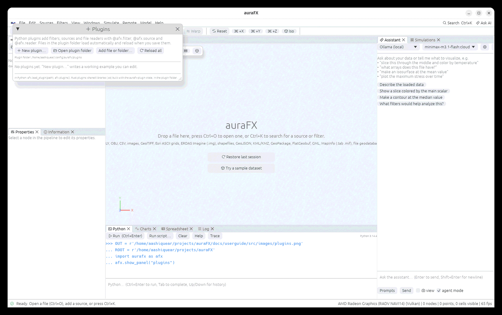
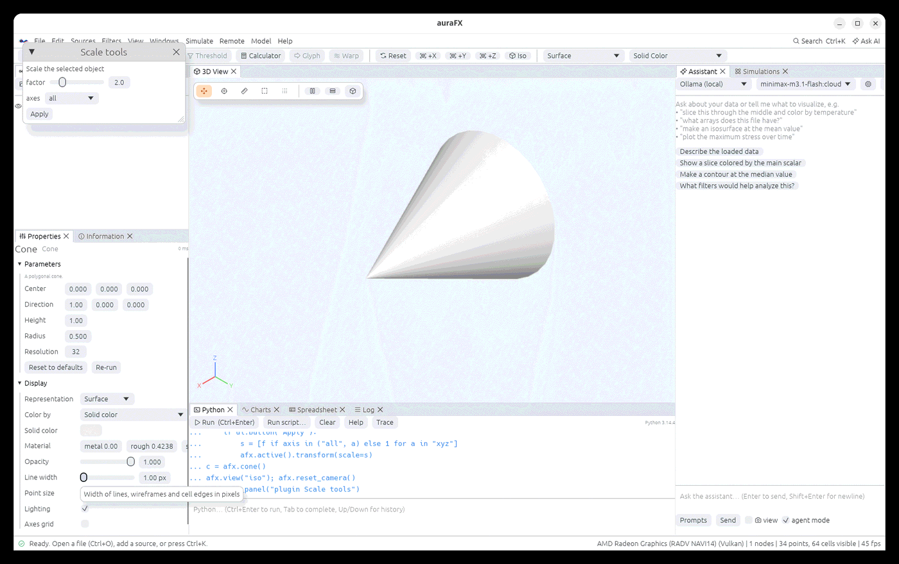
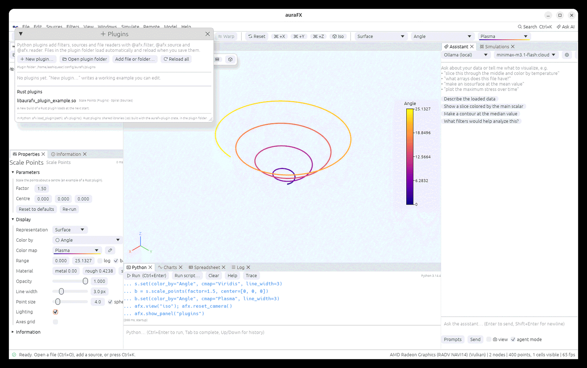

# Plugins



A plugin is a Python file that adds filters, sources and file readers. They appear in the
Filters and Sources menus, in the command palette, in Python (`node.my_filter()`,
`afx.my_source()`), in the Open dialog (readers) and to the AI assistant, like the built-in
ones.

## Where plugins live

- The plugin folder: **Edit › Plugins… › Open plugin folder** (`~/.config/aurafx/plugins` on
  Linux, the auraFX config folder on macOS and Windows). Every `.py` file in it is loaded.
- Folders listed in the `AURAFX_PLUGIN_PATH` environment variable.
- Files or folders added with **Add file or folder…** in the Plugins window.
- From a script: `afx.load_plugin("path/to/tools.py")`.

Plugins reload when you save them, and the objects that use their filters re-run. Files whose
name starts with `_` are skipped (use them for shared helpers). A plugin that fails to load
shows its error in the Plugins window and the Log; switch a plugin off with its checkbox.
**New plugin…** writes a working example and opens it in your editor.

## A filter

```python
import aurafx as afx
import numpy as np

@afx.filter(category="Flow")
def speed(data, vectors=afx.ArrayParam(vector=True), name="speed"):
    """Magnitude of a vector array."""
    v = data.point_data[vectors]
    data.point_data[name] = np.linalg.norm(v, axis=1)
    return data
```

Keyword arguments become parameters in Properties; their type comes from the default:
`float`, `int`, `bool`, `str`, a 3-tuple (a vector), `afx.Choice([...])`,
`afx.ArrayParam(vector=False, cells=False)` (an array of the input) and `afx.Code("...")`
(a text box). The docstring's first line is the description. Other decorator options:
`label`, `description`, `keywords`, `id`, and `inputs=2` or `inputs=(2, None)` for filters
with several inputs (the function receives a list).

`data` is an `afx.Data`, a copy of the input: `data.points` (N×3), `data.point_data["T"]`,
`data.cell_data[...]`, `data.field_data[...]` (assign to add, `del` to remove), `data.n_points`,
`data.n_cells`, `data.bounds`, `data.type`, `data.cells` (offsets, connectivity, VTK types),
`data.blocks()`, `data.copy()`. The spellings `data.PointData.append(a, "name")` and
`data.CellData` work too. Build new data with `afx.make_points`, `afx.make_polydata`, `afx.make_image`,
`afx.make_grid` and `afx.make_multiblock`.

## Sources and readers

```python
@afx.source(category="Shapes")
def helix(turns=4.0, points=400):
    t = np.linspace(0, turns * 2 * np.pi, int(points))
    return afx.make_polydata(np.c_[np.cos(t), np.sin(t), t / 10], lines=[list(range(len(t)))])

@afx.reader(extensions=["xyzt"], label="XYZ + temperature")
def read_xyzt(path):
    a = np.loadtxt(path, ndmin=2)
    d = afx.make_points(a[:, :3])
    d.point_data["T"] = a[:, 3]
    return d
```

Readers take precedence over the built-in readers for their extensions.

## Rules

- Plugin functions run on a worker thread while the pipeline runs: do not call pipeline
  functions (`afx.load`, `node.slice()`, `show`…) inside them.
- Ids must be unique and cannot replace built-in filters.
- For one-off code, the **Programmable Filter**, **Programmable Source** and **Python
  Calculator** run Python stored in the pipeline (and in state files).

## Panels

A plugin can add a small window of its own controls: `@afx.panel("Title")` on a function that
gets a `ui`. It appears under **Windows › Plugin panels**. The function runs when the panel opens
and again whenever a button is pressed or a value changes, so it reads like a script from top
to bottom: `ui.button(text)` is `True` on the run its press causes, and `ui.slider`,
`ui.number`, `ui.checkbox`, `ui.text` and `ui.choice` give their current values, which last
between runs. `ui.label(text)`, `ui.separator()` and `ui.image(path)` show things. An error in
the function shows in the panel, under what it drew before.

```python
import aurafx as afx

@afx.panel("Scale tools")
def scale_tools(ui):
    ui.label("Scale the selected object")
    f = ui.slider("factor", 2.0, 0.1, 10.0)
    axis = ui.choice("axes", ["all", "x", "y", "z"])
    if ui.button("Apply"):
        s = [f if axis in ("all", a) else 1 for a in "xyz"]
        afx.active().transform(scale=s)
```

Unlike filters, panel functions run on the Python thread between pipeline runs, so they may call
`afx.load`, filters and `show`.



## Rust plugins

Filters and sources can also be written in Rust, compiled into a shared library (`.so` on
Linux, `.dylib` on macOS, `.dll` on Windows) and put in the plugin folder, or added with
**Edit › Plugins › Add file**, or `afx.load_plugin("libmy_filters.so")`. The `aurafx-plugin`
crate in the auraFX source gives the types and a macro:

```rust
use aurafx_plugin::{export_plugin, DataSet, Filter, Param, Params};

fn scale_points(inputs: &[DataSet], p: &Params) -> Result<DataSet, String> {
    let mut d = inputs[0].clone();
    let f = p.f64("factor", 2.0);
    // ... change the points of d ...
    Ok(d)
}

export_plugin! {
    name: "My filters",
    filters: [Filter::new("scale_points", "Scale Points", scale_points)
        .describe("Scale the points about a centre.")
        .param(Param::float("factor", "Factor", 2.0).range(0.0, 100.0))],
}
```

with `crate-type = ["cdylib"]` in its `Cargo.toml`. `Filter::source` makes a source,
`.inputs(n)` a filter of several inputs; `Param::float`, `int`, `bool`, `string`, `vec3`,
`choice` and `array` are its settings in the Properties panel. `crates/aurafx-plugin-example`
is a complete plugin (Scale Points and a Spiral source): `cargo build --release -p
aurafx-plugin-example` builds it.

- A plugin library is checked when it loads: it must be built against the same version of
  auraFX's data crate (the message says which), since the data passes between them as bytes in
  that layout.
- Errors returned by the plugin show as the filter's error; a panic in the plugin is caught and
  shown the same way.
- In a plugin folder only libraries with `aurafx` in their file name are loaded
  (`libaurafx_my_filters.so`), so other shared libraries lying there are left alone; a library
  with any name can be added as a file (Edit › Plugins › Add file, or `afx.load_plugin(path)`).
- A library loads once per run: after rebuilding a plugin, restart auraFX. After updating
  auraFX, rebuild your plugins: one built for another version of the data layout is refused
  with a message that says so.
- Load only libraries you trust: a plugin runs with the same rights as auraFX.


