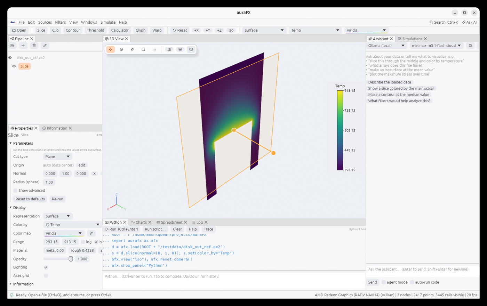

# Python



auraFX embeds Python with NumPy. The **Python** panel is a console: type a line and press
**Ctrl+Enter** (or **Run**), use Tab to complete, Up/Down for history, **Run script…** to run a
file, **Clear** to empty the log, **Help** for the cheat sheet. **Trace** turns what you did
with the mouse into the equivalent code, which you can paste into a script. Everything the
UI does is reachable from the `afx` module, and `aurafx --script file.py` runs a script at
startup (the app stays open afterwards).

Packages installed into the embedded interpreter with `pip` (SciPy, pandas, PyTorch…) are
available in the console.

## Loading and the pipeline

```python
d = afx.load("run.e")                     # a Node; afx.load("slices/img_*.png") stacks images
d = afx.load("/scratch/run.e", host="cluster")   # read on another machine (see Data on another machine)
afx.nodes(); afx.active(); afx.get("Slice")      # find nodes
s = d.slice(normal=(0, 1, 0))             # any filter: node.<filter>(**params)
s.set(origin=(0, 1, 0), opacity=0.5)      # parameters and display settings
s.inputs(); s.activate(); s.delete()
s.update(); s.output()                    # wait; the data (an afx.Data: points, arrays as NumPy)
s.info()                                  # arrays, ranges, bounds, counts
d.array("Temp")                           # a NumPy array; d.add_array("T_C", T - 273.15)
afx.apply_multi("append_datasets", [a, b])
afx.points_from(xyz, temperature=t)       # a node from NumPy
afx.filters(); afx.help_filter("contour")
afx.run()                                 # run whatever is pending
afx.undo(); afx.redo()
afx.save_state("work.afx"); afx.load_state("work.afx")
```

## Display

```python
d.set(color_by="Temp", cmap="Inferno", range=(300, 900), log_scale=True, representation="Surface With Edges")
d.set(opacity=0.6, point_size=6, points_as_spheres=True, line_width=2, axes_grid=True)
d.set(metallic=1, roughness=0.2, specular=0.5)           # material
d.set(representation="Volume", volume_opacity=2, volume_threshold=0.3)
d.set(representation="Surface LIC", lic_vectors="V")
d.set(nonlinear_subdivision=2)                           # curved cells
d.show(); d.hide(); d.set_name("inlet")
```

## Views and camera

```python
afx.view("iso"); afx.view("+x"); afx.view([1, 1, 0.5]); afx.reset_camera()
afx.split_view("right"); afx.active_view(1); d.send_to_view(1, keep=True)
afx.link_views(True); afx.match_views()
afx.layout("analyze"); afx.show_panel("Charts"); afx.hide_panel("Log"); afx.set_theme("light")
afx.annotate("Run 42", corner="upper left", size=18); afx.time_label(True); afx.clear_annotations()
afx.lighting(shadows=True, ssao=True, edl=False, fxaa=True, tone_mapping="aces",
             environment="sky", ray_tracing=False)      # see Lighting
```

## Time, charts, selection

```python
afx.times(); afx.time(10)
afx.over_time(d, "EQPS", stat="max")      # returns (times, values) and plots them
afx.plot(x, y, label="T", title="Temperature"); afx.clear_plots()
afx.temporal_statistics(d)
afx.select(d, ids, "cells"); afx.selection(); afx.extract_selection(); afx.clear_selection()
afx.probe(d, (0, 0, 1))                   # values at a point
```

## Pictures, animations, files

```python
afx.screenshot("fig.png", width=3840, transparent=True, annotations=True)   # waits until written
afx.screenshot("fig.svg")                 # vector picture
afx.export_scene("scene.glb")             # also .obj, .x3d, .wrl
afx.save_animation("run.mp4", fps=24); afx.save_animation("turn.gif", orbit=72)
afx.key_camera(0); afx.key_camera(1, interp="ease in-out"); d.key("opacity", 1, 0.2)
afx.animation(frames=120, time=True); afx.animation_time(0.5); afx.clear_keyframes()
afx.save_animation("sweep.gif", cue=lambda t: c.set(values=[300 + 600 * t]), frames=60)
d.save("out.vtu"); d.save("all.exo", all_times=True); d.save("all.vtkhdf", all_times=True)
afx.colormaps(); afx.define_colormap(name, points); afx.import_colormaps("maps.json")
```

## Assistant, plugins, simulations, servers

```python
afx.ask("plot the maximum stress over time", agent=True)
afx.plugins(); afx.load_plugin("tools.py")
afx.submit("lmp -in in.melt", host="rocm-server", workdir="~/runs", gpu="amd:0", outputs="dump.*", auto_load=True)
afx.sweep("lmp -var T {T} -in in.melt", T=[300, 600, 900], host="cluster")
afx.jobs(); afx.job(id); afx.cancel(id); afx.gpus("rocm-server"); afx.hosts()
afx.servers(); afx.load_remote("cluster", "/scratch/run.e")
```

The **Help › Python API cheat sheet** window lists the same calls inside the app, and every
function has a docstring (`help(afx.lighting)`).
