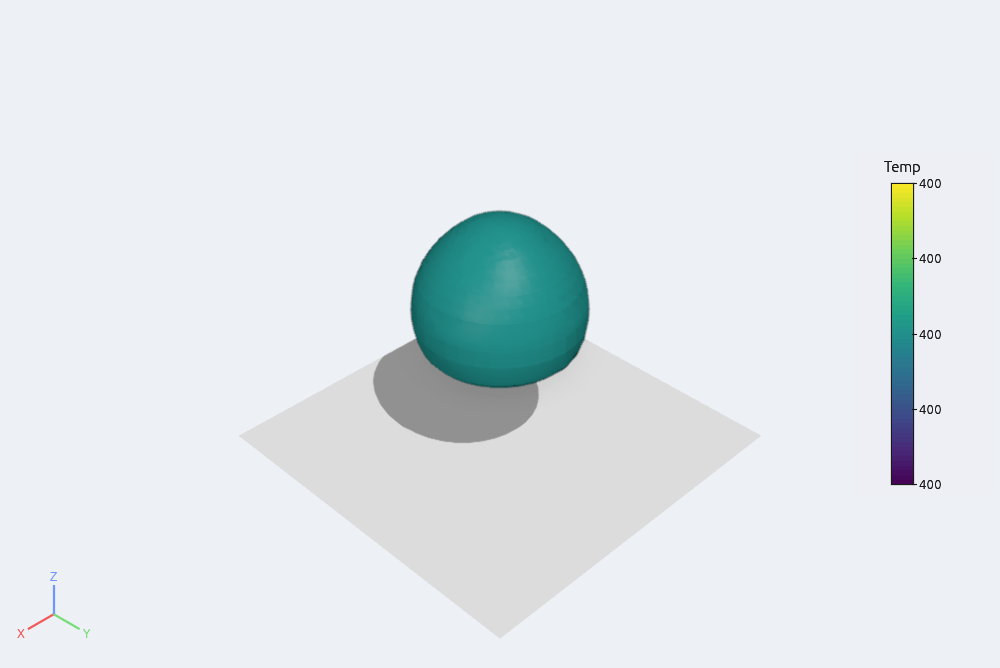
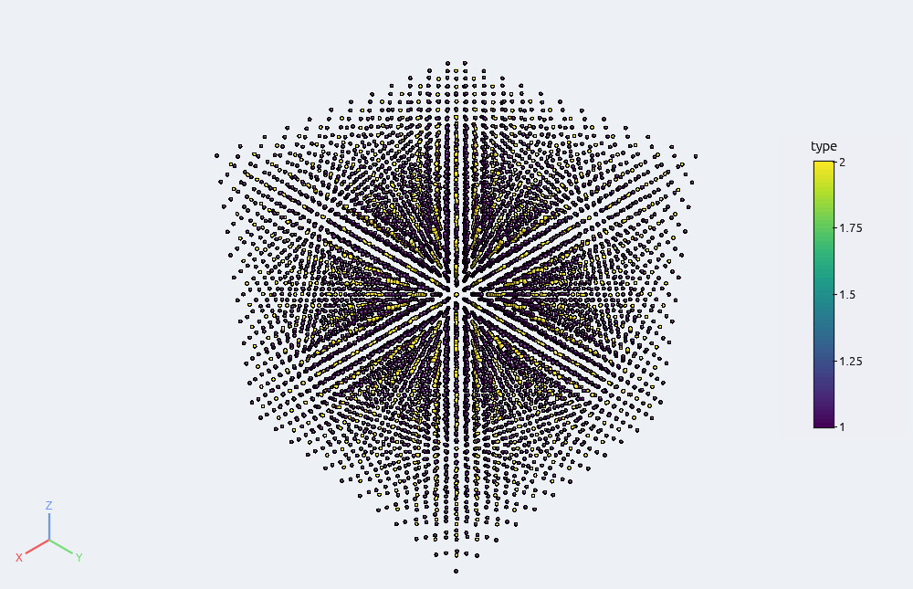
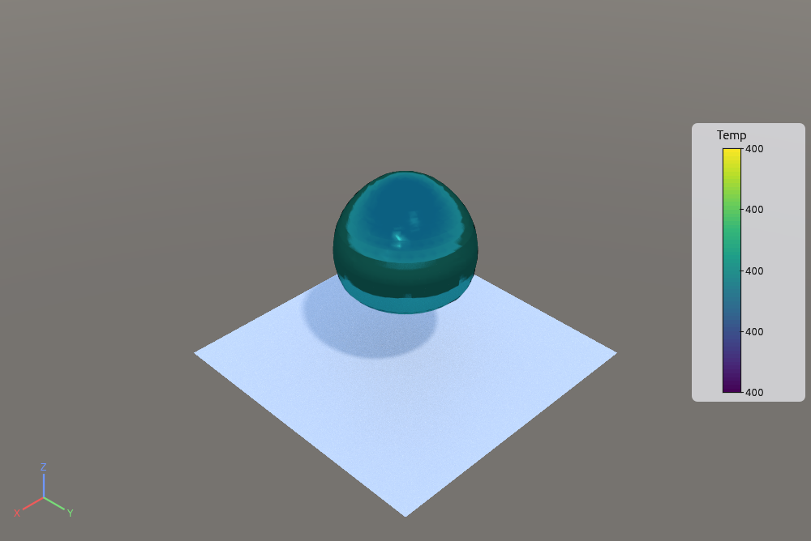
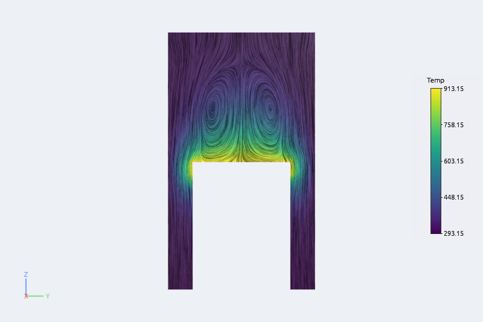

# Lighting, shadows and effects

Everything here is in **View › Lighting**, and in Python through `afx.lighting(...)`. Calling
`afx.lighting()` without arguments returns the current defaults; unknown options raise an
error, so typos are caught.



## Lights

- **Light kit** (on by default): a key light from the upper right, a fill light from the lower
  left and a head light, like ParaView's. Untick it for a single head light.
- **Custom lights**: tick it to edit the lights yourself. Each light has a color, an
  intensity, an azimuth and an elevation, follows the camera or stays fixed in the scene, and
  can cast shadows. **Add light** adds one; **ambient** sets the light from everywhere.
- **Show lights in the view** draws each custom light as a small sun around the data; drag a
  sun to aim its light.

```python
afx.lighting(light_kit=False)
afx.lighting(lights=[{"direction": (0.5, 0.5, 1), "intensity": 0.8},
                     {"direction": (-0.7, -0.2, 0.5), "intensity": 0.3, "color": (0.6, 0.7, 1), "camera_relative": False}],
             ambient=0.15)
```

## Shadows

**Shadows** draws the shadow of the key light (or of the first custom light with shadows
ticked) on every opaque surface: a shadow map fitted to the visible objects, softened at the
edges. Objects drawn by a remote server are shadowed on that machine, so they do not cast
shadows on local objects.

## Ambient occlusion

**Ambient occlusion** darkens creases, cavities and the contact between objects, which makes
depth easier to read. The sliders set its strength and radius (a fraction of the data size).
It works from the picture's depth, so it costs the same whatever the mesh size.

## Eye-Dome Lighting



**Eye-Dome Lighting** shades every pixel by how much it stands out from its neighbours in
depth: outlines and depth cues for point clouds, particles and dense meshes without any
normals. The slider sets the strength. `afx.lighting(edl=True)`.

## Anti-aliasing, tone mapping and exposure

Edges are smoothed by multisampling (4 samples). **FXAA** adds a cheap post pass that smooths
the remaining jagged edges of thin lines. **Tone mapping** compresses bright pictures with
the **Reinhard** or **ACES filmic** curves, and **exposure** scales brightness before it.

```python
afx.lighting(fxaa=True, tone_mapping="aces", exposure=1.2)
```

## Transparency

Translucent objects (**Opacity** below 1 in Properties) are blended in a way that does not
depend on the order they are drawn in, so several overlapping translucent surfaces look right
from any angle. Translucent objects are always drawn on this computer, even when the rest of
the data is drawn by a server.

## Materials and environment maps



**Material** in Properties gives each surface a **metal** factor (0 plastic-like, 1 metal:
reflections take the object's color), a **rough**ness (small: sharp highlights and mirror-like
reflections; 1: matte) and a highlight strength. The defaults reproduce the plain shading.

**View › Lighting › Environment** lights the scene with a picture of the surroundings: the
built-in **sky**, **studio** and **white** environments, or your own equirectangular
`.hdr`/`.png`/`.jpg` (z up). It replaces the flat ambient light with soft directional light,
adds reflections on shiny and metallic surfaces, and **as background** shows it behind the
data. While an environment is on, the built-in lights are dimmed by half.

```python
c.set(metallic=1.0, roughness=0.25, specular=0.5)
afx.lighting(environment="sky", environment_intensity=1.2, show_environment=True)
afx.lighting(environment="/data/hdri/studio_small.hdr")
```

## Ray tracing

**View › Lighting › Ray tracing** path-traces the opaque surfaces: soft shadows, light from
the sky or environment, and light bouncing between surfaces. It refines while the camera is
still (the rasterizer draws while you move) and the status corner shows the samples done.
Set the number of **samples** per pixel to stop at, the number of **bounces**, and where it
runs: **auto** (the GPU when the data fits in its memory, else the CPU), **GPU** or **CPU**.
Edges, points, lines, translucent objects, volumes and the legend are still drawn on top.
Screenshots wait for the tracer to finish and are traced at the requested size.

```python
afx.lighting(ray_tracing=True, ray_samples=256, ray_bounces=3, ray_device="auto")
afx.screenshot("traced.png", width=3840)
```

## Surface LIC



The **Surface LIC** representation (Properties › Representation) draws a vector field as
streaks on any surface while the surface stays colored by any array: the classic way to see
a flow on a slice. Choose the vector array (**LIC vectors**), the streak **strength** and the
**streak length** in pixels.

```python
s.set(representation="Surface LIC", lic_vectors="V", color_by="Temp", lic_length=30)
```
