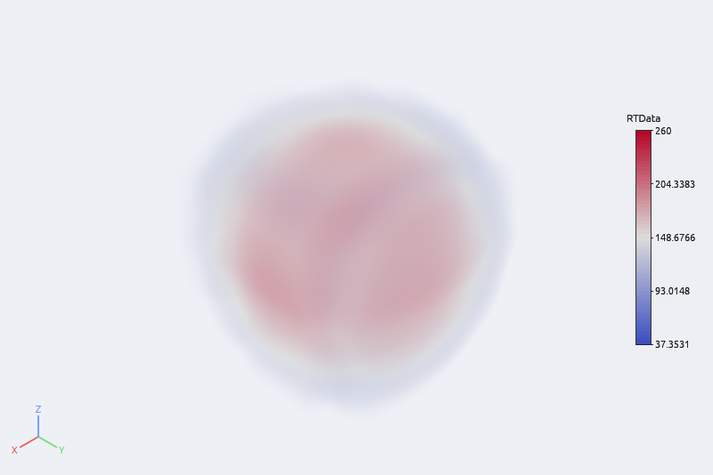
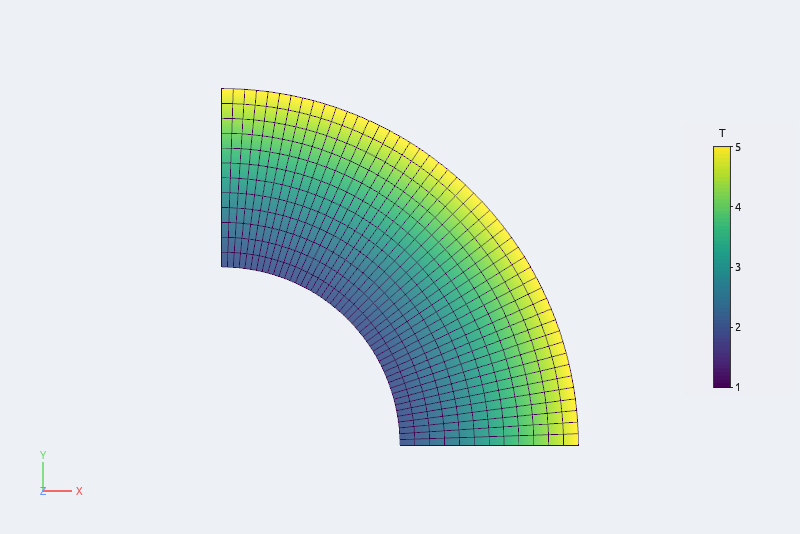

# Volumes, point clouds and curved cells

## Representations

**Representation** in Properties (and the toolbar) chooses how an object is drawn:

| Representation | Use |
|---|---|
| **Surface** | the outer surface, smooth-shaded (hard edges stay sharp: a 30° crease angle) |
| **Surface With Edges** | the surface with cell edges (**Edge color** in Properties) |
| **Wireframe** | edges only |
| **Points** | the points, as flat dots or shaded spheres (**Point size**, **spheres**) |
| **Outline** | the bounding box |
| **Volume** | GPU ray casting of image data (other meshes are resampled first) |
| **Surface LIC** | a vector field as streaks (see [Lighting](rendering.md)) |

**Lighting** can be switched off per object (flat colors, for 2-D data). **Axes grid** draws
a labelled grid around the object with tick values.

## Volume rendering



The **Volume** representation draws image data as a translucent cloud colored by the array:
**Volume density** sets how opaque it is and **Transparent below** makes values under a
fraction of the range invisible, which clears away the noise around a feature. Volumes are
depth-merged with the surfaces around them.

```python
w.set(representation="Volume", color_by="RTData", volume_opacity=2.0, volume_threshold=0.3)
```

## Point clouds and particles

LAMMPS dumps, XYZ files, PDB files and point sources open as points. Draw them as spheres
sized by **Point size**, color them by type, and switch on
[Eye-Dome Lighting](rendering.md#eye-dome-lighting) to see the structure of a dense cloud.
The **Glyph** filter draws arrows or spheres scaled by an array; **Tube** gives lines a
thickness.

## Curved cells



Quadratic cells and Lagrange or Bezier cells of any order (VTK types 68–80, with rational
weights and per-cell degrees) are drawn curved. **Curved cells › subdivision** in Properties
sets how finely: 0 draws straight edges between corners, 1 passes through the nodes, each
further level halves the pieces. Slice, Clip, Contour, Probe and Integrate Variables follow
the curved shape, as ParaView does; the **Tessellate** filter turns curved cells into
straight ones for filters that need them. The Information panel lists the cell types.

```python
a.set(nonlinear_subdivision=3)
t = a.tessellate(level=2)
```
