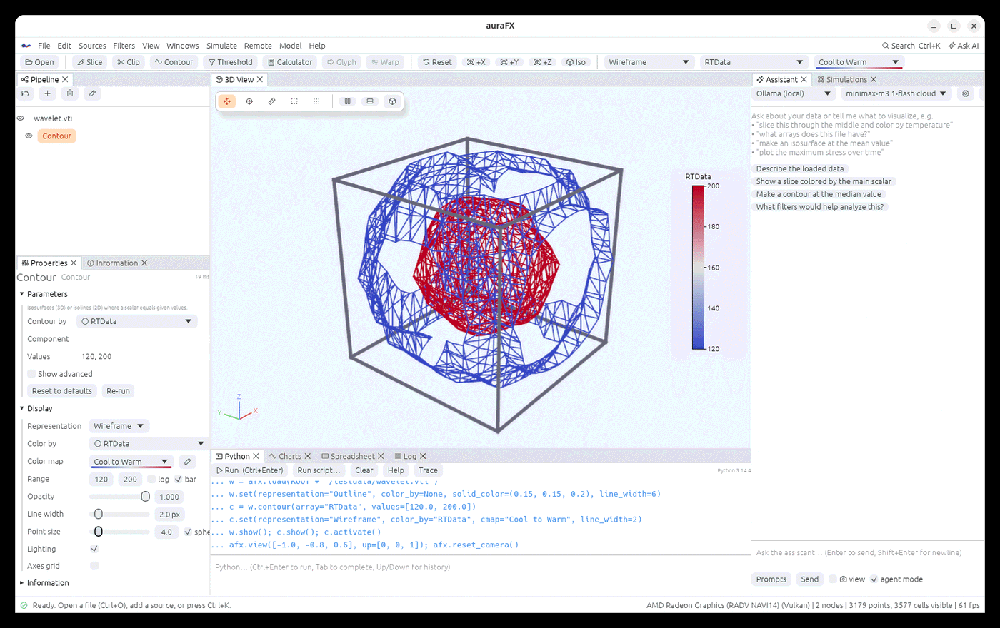
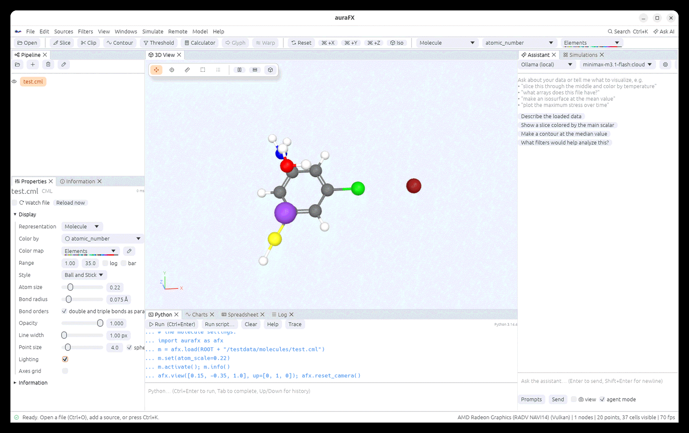
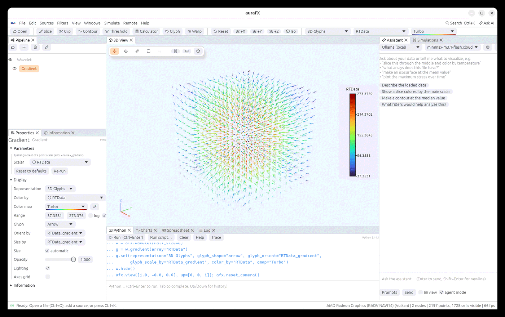

# Volumes, point clouds and curved cells

## Representations

**Representation** in Properties (and the toolbar) chooses how an object is drawn:

| Representation | Use |
|---|---|
| **Surface** | the outer surface, smooth-shaded (hard edges stay sharp: a 30° crease angle) |
| **Surface With Edges** | the surface with cell edges (**Edge color** in Properties, `edge_color=` in Python) |
| **Wireframe** | edges only |
| **Points** | the points, as flat dots or shaded spheres (**Point size**, **spheres**) |
| **Outline** | the bounding box (every box of [AMR data](file-formats.md#amr-data-adaptive-mesh-refinement)) |
| **Volume** | GPU ray casting of image data (other meshes are resampled first) |
| **Surface LIC** | a vector field as streaks (see [Lighting](rendering.md)) |
| **Molecule** | atoms as spheres and bonds as cylinders (see [Molecules](#molecules)) |

**Lighting** can be switched off per object (flat colors, for 2-D data). **Axes grid** draws
a labelled grid around the object with tick values.

**Line width** (Properties › Display, shown for Wireframe, Surface With Edges, Outline and
line data; `line_width=` in Python) sets how many pixels wide lines, wireframes and cell edges
are drawn, from 1 to 10 (any width from Python). It is a width on the screen, so lines keep
their width when you zoom. Wider lines are drawn as flat bands with square ends
(reaching half the width past each point), which fills the joints of bent lines. Wide lines
show in screenshots and in pictures drawn on a server; picking still uses 1-pixel lines. For lines with a
thickness in the scene (shaded, and growing as you zoom in), use the **Tube** filter.



```python
c.set(representation="Wireframe", line_width=2)
w.set(representation="Outline", line_width=6)
```

## Volume rendering


The **Volume** representation draws image data as a translucent cloud colored by the array:
**Volume density** sets how opaque it is and **Transparent below** makes values under a
fraction of the range invisible, which clears away the noise around a feature. Volumes are
depth-merged with the surfaces around them.

```python
w.set(representation="Volume", color_by="RTData", volume_opacity=2.0, volume_threshold=0.3)
```

## Point clouds and particles

LAMMPS dumps, XYZ files, PDB files and point sources open as points. Draw them as spheres
sized by **Point size**, color them by type, and switch on
[Eye-Dome Lighting](rendering.md#eye-dome-lighting) to see the structure of a dense cloud.
The **Glyph** filter draws arrows or spheres scaled by an array; **Tube** gives lines a
thickness.

## Molecules

Molecules are points (the atoms) with an atomic number array (`atomic_number`, or VTK's `Atomic
Numbers`), and lines (the bonds). The PDB, XYZ, VASP and CML readers produce them (and the
atoms block of a Gaussian cube file). A molecule opens in the **Molecule** representation, colored by element with the
**Elements** color map (Jmol's colors). Files with more than 100 000 atoms open
as points instead; switch to Molecule when you need it.

Settings (Properties › Display, or `node.set(...)`):

| Setting | Python | Default | What it does |
|---|---|---|---|
| **Style** | `molecule_style` | Ball and Stick | **Ball and Stick**: atoms at a fraction of their van der Waals radius, bonds as thin sticks. **Van der Waals**: atoms at their full radius, no bonds (space filling). **Liquorice**: atoms and bonds as tubes of one width |
| **Atom size** | `atom_scale` | 0.3 | fraction of the van der Waals radius (Ball and Stick) |
| **Bond radius** | `bond_radius` | 0.075 Å | radius of the sticks |
| **Bond orders** | `bond_orders` | on | double and triple bonds (a `bond_order` array, from CML files) drawn as two or three sticks |

Each half of a bond takes the color of its atom. Color by any other atom array (charge,
residue, B factor...) with **Color by** as usual. The radii and colors come from VTK's
periodic table.



```python
m = afx.load("molecule.cml")                 # Molecule representation, colored by element
m.set(molecule_style="Van der Waals")        # or "Liquorice", "Ball and Stick"
m.set(atom_scale=0.25, bond_radius=0.1, bond_orders=False)
b = m.compute_molecule_bonds(tolerance=0.45) # bonds from distances
```

**Filters › Compute Molecule Bonds** finds bonds from distances: two
atoms are bonded when they are closer than the sum of their covalent radii, each increased by
half the **Tolerance** (0.45 Å). With **Absolute tolerance** off, each radius is multiplied
by the tolerance instead. Bonds already there stay; only new ones are added. The
bonds were verified on a test molecule with each tolerance setting.

Large structures (crystals, MD snapshots) draw fastest as **Points** with **spheres**. The
Molecule representation builds geometry for every atom, which is fine up to a few hundred
thousand atoms.

## 3D Glyphs

The **3D Glyphs** representation draws a shape at every point: an arrow, a cone, a sphere or a
cube, turned along a vector array (**Orient by**) and sized by an array (**Size by**: the
largest value gets the **Size**; automatic is about the spacing of the points), colored like
any other representation. The GPU draws the one shape once per point, so a million arrows take
32 MB instead of several gigabytes as geometry, and changing the size or array is immediate.
The **Glyph** filter makes the same arrows as real geometry, to save or to cut further.
Glyphs are not picked and cast no shadows.

```python
g = afx.wavelet().gradient(array="RTData")
g.set(representation="3D Glyphs", glyph_shape="arrow", glyph_orient="RTData_gradient",
      glyph_scale_by="RTData_gradient", color_by="RTData")
```



## Big surfaces

Surfaces are cut into runs of 16 000 triangles with their bounds; runs outside the view are
not drawn, so zooming into a big surface is fast. A surface of more than a million triangles
also gets a coarse copy (about 400 000 triangles, made in the background), drawn while the
camera moves; the whole surface is drawn again as soon as it stops. Pictures and animations
are always made from the whole surface. On a laptop GPU, a surface of 15.5 million triangles
took 110 ms per frame in full, 35 ms while moving and 2 ms zoomed in.

## Curved cells


Quadratic cells and Lagrange or Bezier cells of any order (VTK types 68–80, with rational
weights and per-cell degrees) are drawn curved. **Curved cells › subdivision** in Properties
sets how finely: 0 draws straight edges between corners, 1 passes through the nodes, each
further level halves the pieces. Slice, Clip, Contour, Probe and Integrate Variables follow
the curved shape; the **Tessellate** filter turns curved cells into
straight ones for filters that need them. The Information panel lists the cell types.

```python
a.set(nonlinear_subdivision=3)
t = a.tessellate(level=2)
```
