# Sample pipelines

The short clips on the [project page](https://aashiquear.github.io/auraFX/) are ordinary auraFX
pipelines, recorded with the same command anyone can use. This chapter goes through every one
of them from the file (or the source) to the finished clip, twice: once as the steps in the
window, with the menu each one is in, and once as the Python that does the same. Type the
Python into the console (the **Python** panel), or save it as a file and run
`aurafx --script file.py`.

The data files are in the repository's `testdata/` and `examples/` folders
(<https://github.com/aashiquear/auraFX>); four examples need no file at all. The scripts
that made the clips on the page are in `scripts/site/media/`, one per clip.

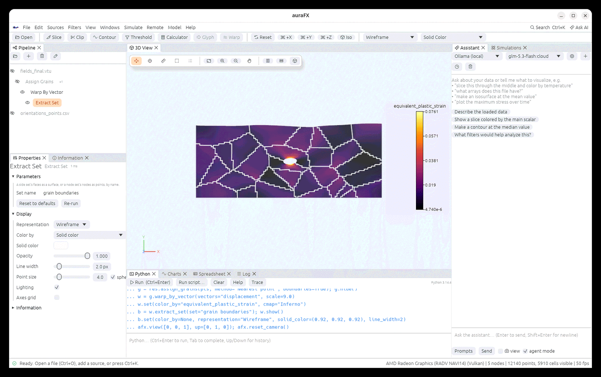

## What every example uses

**Opening and adding.** **File › Open…** (Ctrl+O) opens a file; a file with time steps shows
the time toolbar. A filter is added to the object selected in the Pipeline from **Filters ›**
*its menu*, or by typing its name after Ctrl+K. Sources (data made without a file) are in the
**Sources** menu.

**Showing and hiding.** A new filter hides the object it was made from and shows its own
result. The eye beside each object in the Pipeline shows or hides it (`node.hide()`,
`node.show()`); the examples say when an eye has to be closed or opened by hand.

**Coloring and drawing.** With an object selected, **Properties** has **Color by** (the array),
the color map beside it, **Range** (type two values to fix it over all time steps),
**Representation** (Surface, Surface With Edges, Wireframe, Points, Volume) and **Opacity**.
See [Coloring and color maps](coloring.md) and
[Volumes, point clouds and curved cells](representations.md).

**The camera.** **+X**, **+Y**, **+Z** and **Iso** in the toolbar look along an axis; drag to
turn, and **Fit** in the 3D view's own toolbar (or the R key) shows everything. From Python,
`afx.view(direction, up=...)` then `afx.reset_camera()`.

**Recording.** **File › Animation…** records the clip. Choose the mode (**Time steps**,
**Orbit 360°** or **Keyframes**), the frame rate, the size and the format, then **Save…**.
MP4 and WebM need the video encoder, which the Animation window offers to fetch when the
machine has none ([Time, charts and animation](time-animation.md#the-video-encoder)). The
clips on the page are 720 pixels wide; for a figure or a talk raise the size, for example
1920 × 1080.

| Kind of clip | In the window | In Python |
|---|---|---|
| A turntable | mode **Orbit 360°**, 80 frames, 20 frames a second | `afx.save_animation("clip.mp4", fps=20, orbit=80)` |
| The data's time steps | mode **Time steps** | `afx.save_animation("clip.mp4", fps=12)` |
| A value that changes | **Keyframes** tab: select the value, **Key value at** 0 % and at 100 % | `afx.save_animation("clip.mp4", frames=45, cue=f)` with a function `f(t)`, t from 0 to 1 |

`poster="clip.jpg"` in `afx.save_animation` also writes the first frame as a picture.

## Crystal plasticity: a polycrystal plate under tension

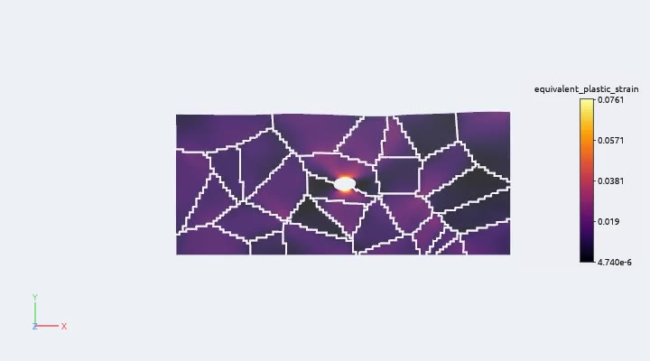

This one starts before the data exists: the plate is meshed, given grains, run in a
crystal-plasticity solver and read back. It needs the PINNACLE solver on the machine (or on a
remote one, see [Running simulations](simulations.md)); to skip the run, open the result kept
in `testdata/solver/pinnacle_plate_fine/` and go to step 5.

**Build and run**

1. **Sources › Mesh…**, type **Plate Mesh.** In Properties leave **Width, height, thickness** at 100, 50, 1,
   **Hole** at *Circle* with **Semi-axis a (radius)** 2.5, and set **Cell size** to 1. The plate is one element thick, with its faces
   named `x-`, `x+` and so on.
2. With the plate selected, **Filters › Mesh › Assign Grains.** **Grains from** *Voronoi*,
   **Grains (Voronoi)** 30, **Random seed** 1, and tick **One block per grain**. Color by `grain_id` to
   see them.
3. **Simulate › Run a simulation…** opens the Simulations panel. **Template** *PINNACLE crystal
   plasticity*; the grain mesh selected in the Pipeline shows under **Case from**. Set a
   **Working directory**, **Material** *Aluminium*, **Pull along** x, **strain** 0.02 and
   **steps** 40.
4. **Run.** The panel writes `mesh.e`, `orientations_points.csv` and `case.i` into the
   folder and starts the solver; the job's log follows each load step. On a laptop this mesh
   (about 5 000 elements) takes around half an hour. With **open when done** ticked, the
   result (`solver/fields.pvd`) opens when the run ends.

```python
import aurafx as afx
plate = afx.plate_mesh(size=(100, 50, 1), cell=1.0, hole="Circle", a=2.5)
poly = plate.assign_grains(grains=30, seed=1, blocks=True)
afx.run_case(poly, "pinnacle", "~/runs/plate", material="Aluminium", axis="x",
             strain=0.02, steps=40, wait=True)
```

**From the result to the clip**

5. **File › Open…** the final state of the run (`solver/fields.vtk` in the working directory;
   in the repository, `testdata/solver/pinnacle_plate_fine/fields_final.vtu`) and the case's
   `orientations_points.csv`. The result has the displacement, the stress and
   the equivalent plastic strain, but not the grains: the point file has them, one point at
   every element's centre.
6. Select the result, **Filters › Mesh › Assign Grains.** **Grains from** *Nearest point*,
   choose the point file as the second input, and tick **Side set on grain boundaries**. Every
   element has its grain again, and the faces between grains are a set named
   `grain boundaries`.
7. **Filters › Common › Warp By Vector**, **Vectors** `displacement`. Set **Scale factor** to
   0 for now: the keyframes will raise it. **Color by** `equivalent_plastic_strain`, color
   map *Inferno*.
8. With the warped plate selected, **Filters › Mesh › Extract Set**, **Set name**
   `grain boundaries`. In Properties: **Solid color** a light grey, **Representation**
   *Wireframe*, **Line width** 2. The new filter hid the plate: open the plate's eye again in
   the Pipeline.
9. **+Z** in the toolbar, then **Fit**.
10. **File › Animation…**, **Keyframes** tab: select the Warp By Vector's *Scale factor*, set
    it to 0 and press **Key value at 0 %**; move the slider to 100 %, set it to 9, press
    **Key value at 100 %**. 45 frames at 15 a second, 720 × 400, **Save…**.

```python
d = "testdata/solver/pinnacle_plate_fine/"
res = afx.load(d + "fields_final.vtu"); res.hide()
pts = afx.load(d + "orientations_points.csv"); pts.hide()
g = res.assign_grains(pts, method="Nearest point", boundaries=True); g.hide()
w = g.warp_by_vector(vectors="displacement", scale=0.0)
w.set(color_by="equivalent_plastic_strain", cmap="Inferno")
b = w.extract_set(set="grain boundaries"); w.show()     # a new filter hides its input
b.set(color_by=None, representation="Wireframe", solid_color=(0.92, 0.92, 0.92), line_width=2)
afx.view([0, 0, 1], up=[0, 1, 0]); afx.reset_camera()
afx.save_animation("plate_cp.mp4", fps=15, frames=45, width=720, height=400,
                   cue=lambda t: w.set(scale=9.0 * t))
```

The displacements are drawn nine times larger than they are, so that 2 % strain can be seen.
Statistics per grain (mean stress, mean plastic strain) come from the same `grain_id` array:
see [Grains on the results](simulations.md#simulation-cases-from-the-pipeline).

## CAD modeling: a flange that follows its dimensions

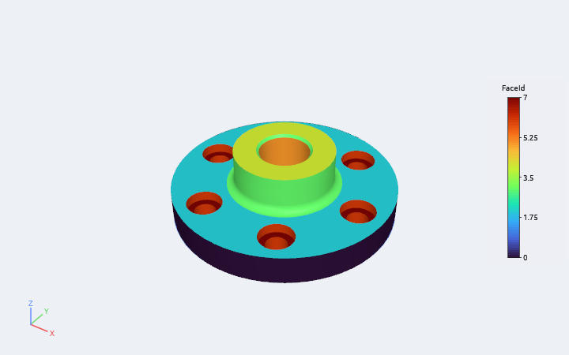

No file. A part from the templates is rebuilt while three of its dimensions change.

1. **Model › New CAD part** opens the CAD environment. On the ribbon's *Files* tab choose
   **New from template** › *flange*, then **Apply** to return to the pipeline with the part.
2. **Color by** `FaceId`, color map *Turbo*: every named face has its own color.
3. **Kernel** *B-rep* in the part's Properties, for exact edges on every frame.
4. Look from a direction above and to the side, **Fit**.
5. The dimensions are in Properties under **Dimensions**: `od` (outside diameter),
   `bolt_circle` and `holes`. Type a new value and the part is rebuilt with the same face
   names. The clip changes all three between frames with a function, which keeps the bolt
   circle at three quarters of the diameter and adds bolt holes as the flange grows; that part
   is Python.

```python
import math
m = afx.cad_model(template="flange")
m.set(color_by="FaceId", cmap="Turbo", kernel="B-rep")
afx.view([0.7, -1.0, 0.9], up=[0, 0, 1]); afx.reset_camera()

def cue(t):
    s = 0.5 - 0.5 * math.cos(2 * math.pi * t)          # 0 → 1 → 0
    od = 90 + 40 * s
    m.set(od=od, bolt_circle=round(od * 0.75, 1), holes=int(6 + round(4 * s)))

afx.save_animation("cad_model.mp4", fps=14, frames=48, width=720, height=450, cue=cue)
```

More in [CAD modeling](cad.md).

## Mechanics: explicit dynamics from an Exodus file

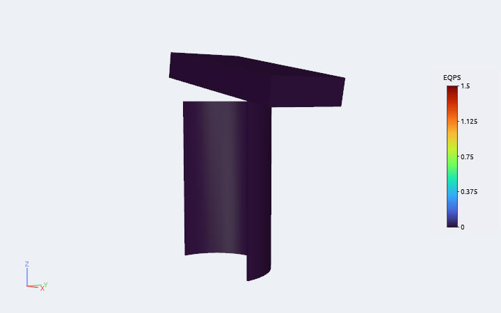

1. **File › Open…** `testdata/can.ex2` (44 time steps).
2. **Color by** `EQPS`, color map *Turbo*. Type the **Range** 0 to 1.5, so the colors mean the
   same at every step (the last step reaches about 1.8).
3. Move the time slider to the middle step before framing, so both the plate and the can
   stay in the picture; look from the side and **Fit**.
4. **File › Animation…**, mode **Time steps**, 14 frames a second.

```python
c = afx.load("testdata/can.ex2")
c.set(color_by="EQPS", cmap="Turbo", range=(0.0, 1.5))
n = afx.time()[1]                       # the number of time steps
afx.time(n // 2)
afx.view([1.0, -0.75, 0.12], up=[0, 0, 1]); afx.reset_camera()
afx.save_animation("can_crash.mp4", fps=14, frames=n, width=720, height=450,
                   cue=lambda t: afx.time(round(t * (n - 1))))
```

## Flow and heat: streamlines over a temperature surface

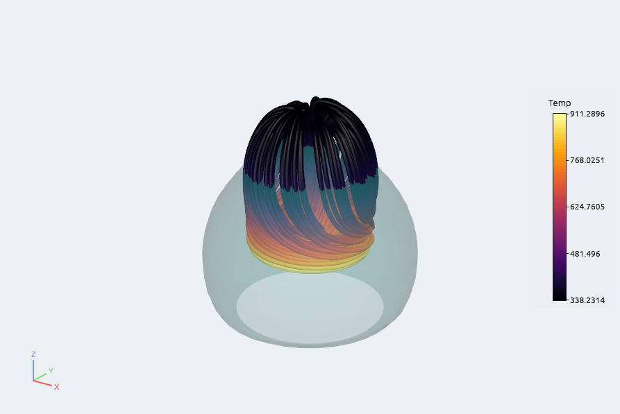

1. **File › Open…** `testdata/disk_out_ref.ex2`; close its eye.
2. Select the file, **Filters › Common › Contour**: **Contour by** `Temp`, **Values** 400.
   **Color by** `Temp`, **Opacity** 0.35.
3. Select the file again, **Filters › Common › Stream Tracer**, **Number of seeds** 60. Close its eye:
   the lines are drawn by the next filter.
4. With the Stream Tracer selected, **Filters › Geometry › Tube**, **Radius** 0.12.
   **Color by** `Temp`, color map *Inferno*.
5. The Contour and the Tube now show together (their eyes are open in the Pipeline). Frame,
   then **File › Animation…**, **Orbit 360°**, 80 frames.

```python
d = afx.load("testdata/disk_out_ref.ex2"); d.hide()
c = d.contour(array="Temp", values=[400.0]); c.set(color_by="Temp", opacity=0.35)
s = d.stream_tracer(seeds=60); s.hide()
t = s.tube(radius=0.12); t.set(color_by="Temp", cmap="Inferno")
afx.view([0.7, -1.0, 0.5], up=[0, 0, 1]); afx.reset_camera()
afx.save_animation("flow.mp4", fps=20, orbit=80)
```

## Phase field: spinodal decomposition

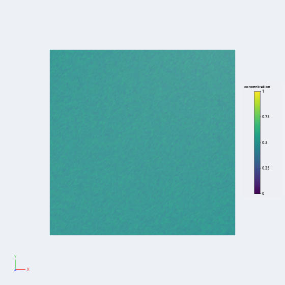

The data comes from a small solver in the repository, run from auraFX.

1. **Simulate › Run a simulation…**, **Template** *Python pipeline*, **Working directory**
   `examples/phase_field`, **Input** `cahn_hilliard.py`, **Result files** `ch_*.vtk`, **Run**
   (about ten seconds). The series opens when it ends; or open `ch_00000.vtk` afterwards, which
   brings the whole series.
2. **Color by** `concentration`, color map *Viridis*, **Range** 0 to 1.
3. **+Z**, **Fit**. **File › Animation…**, **Time steps**, 12 frames a second, 560 × 560.

```python
afx.submit("python3 -u cahn_hilliard.py", workdir="examples/phase_field",
           outputs="ch_*.vtk", wait=True)
d = afx.load("examples/phase_field/ch_00000.vtk")
d.set(color_by="concentration", cmap="Viridis", range=(0, 1))
afx.view([0, 0, 1], up=[0, 1, 0]); afx.reset_camera()
n = afx.time()[1]
afx.save_animation("spinodal.mp4", fps=12, frames=n, width=560, height=560,
                   cue=lambda t: afx.time(round(t * (n - 1))))
```

## Grain growth: a Potts-model run

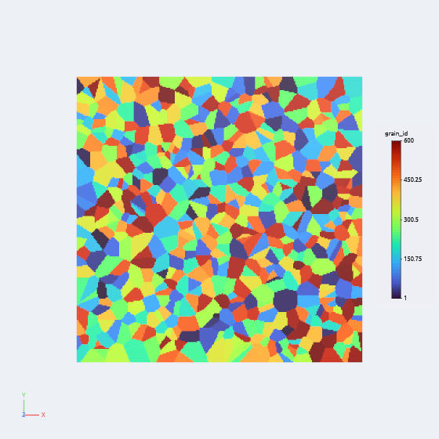

The same as the phase-field example with `examples/grain_growth/potts.py` (result files
`grains_*.vtk`): color by `grain_id` with *Turbo*, record the time steps.

```python
afx.submit("python3 -u potts.py", workdir="examples/grain_growth", outputs="grains_*.vtk", wait=True)
d = afx.load("examples/grain_growth/grains_0000.vtk")
d.set(color_by="grain_id", cmap="Turbo")
afx.view([0, 0, 1], up=[0, 1, 0]); afx.reset_camera()
n = afx.time()[1]
afx.save_animation("grain_growth.mp4", fps=12, frames=n, width=560, height=560,
                   cue=lambda t: afx.time(round(t * (n - 1))))
```

**Filters › Grains › Segment Features** on a step (**Group by** *Scalar*, **Tolerance** 0) gives feature
ids that the grain filters measure.

## Particles: a melting crystal

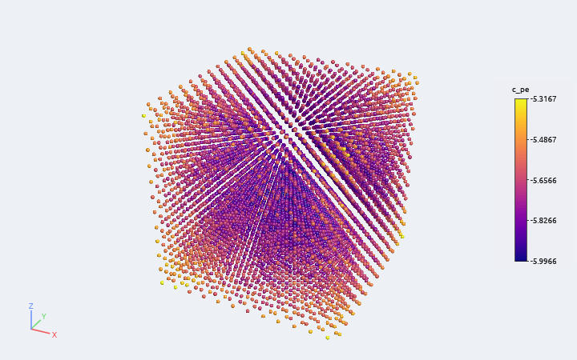

1. **File › Open…** `testdata/fcc_melt.dump` (a LAMMPS dump, 20 frames).
2. **Representation** *Points*, **Point size** 5. **Color by** `c_pe`, color map *Plasma*.
3. Frame, **File › Animation…**, **Time steps**, 8 frames a second.

```python
d = afx.load("testdata/fcc_melt.dump")
d.set(representation="Points", point_size=5, color_by="c_pe", cmap="Plasma")
afx.view([0.5, -1.0, 0.6], up=[0, 0, 1]); afx.reset_camera()
n = afx.time()[1]
afx.save_animation("particles.mp4", fps=8, frames=n, width=720, height=450,
                   cue=lambda t: afx.time(round(t * (n - 1))))
```

## Chemistry: a molecule

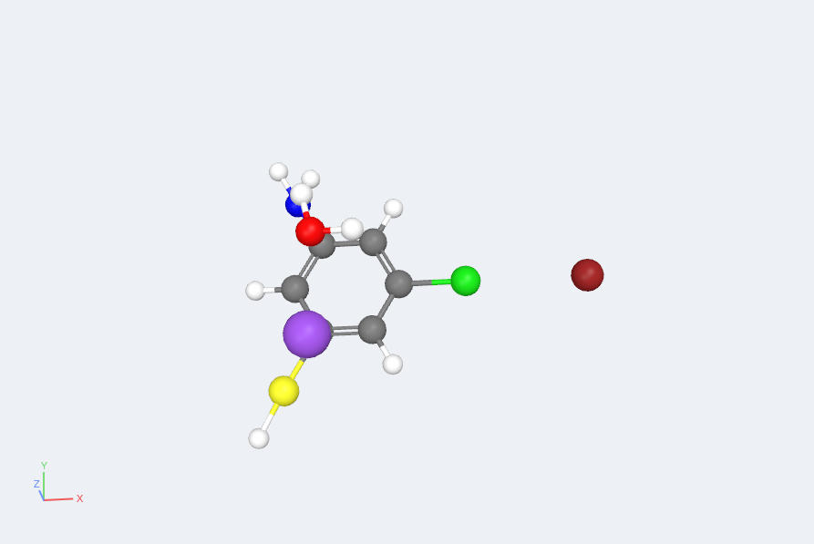

1. **File › Open…** `testdata/molecules/test.cml`. It opens as balls and sticks.
2. **Atom size** 0.22 in Properties.
3. Frame, **File › Animation…**, **Orbit 360°**.

```python
m = afx.load("testdata/molecules/test.cml")
m.set(atom_scale=0.22)
afx.view([0.15, -0.35, 1.0], up=[0, 1, 0]); afx.reset_camera()
afx.save_animation("molecule.mp4", fps=20, orbit=80)
```

## Geoscience: ocean temperature on the globe

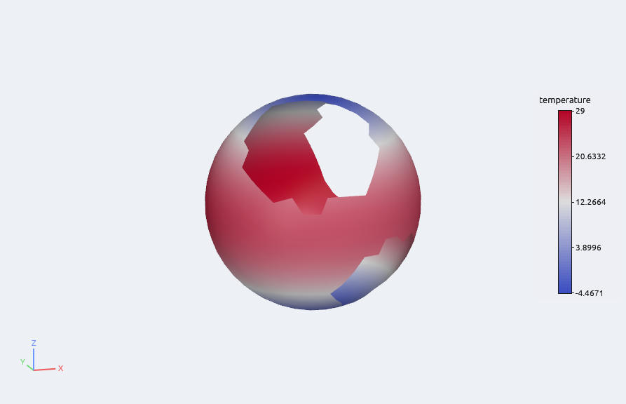

1. **File › Open…** `testdata/netcdf/mpas_ocean.nc`. The cells are placed on the sphere as the
   file says.
2. **Color by** `temperature`, color map *Cool to Warm*.
3. Move the time slider to step 2. Frame, **File › Animation…**, **Orbit 360°**.

```python
d = afx.load("testdata/netcdf/mpas_ocean.nc")
d.set(color_by="temperature", cmap="Cool to Warm")
afx.time(2)
afx.view([-0.3, -1.0, 0.25], up=[0, 0, 1]); afx.reset_camera()
afx.save_animation("ocean.mp4", fps=20, orbit=80)
```

## Geoscience: terrain from an elevation model

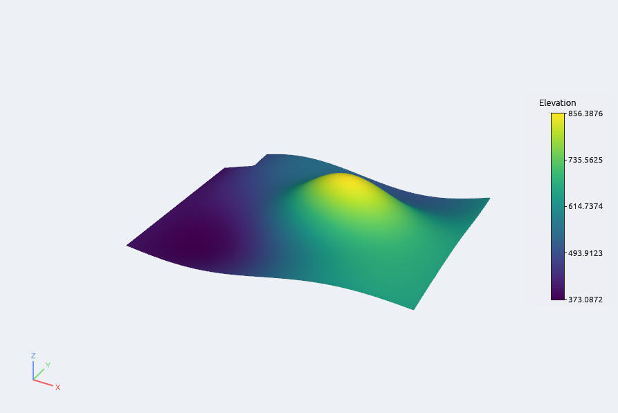

1. **File › Open…** `testdata/rasters/dem.tif`. A raster has one value per cell.
2. **Filters › Data › Cell Data to Point Data**: Warp By Scalar moves points, so the
   elevation has to be on the points.
3. **Filters › Common › Warp By Scalar**: **Scalars** `Elevation`, **Scale factor** 2.
   **Color by** `Elevation`, color map *Viridis*.
4. Frame, **File › Animation…**, **Orbit 360°**.

```python
d = afx.load("testdata/rasters/dem.tif"); d.hide()
p = d.cell_data_to_point_data(); p.hide()
w = p.warp_by_scalar(array="Elevation", scale=2.0)
w.set(color_by="Elevation", cmap="Viridis")
afx.view([0.55, -1.0, 0.75], up=[0, 0, 1]); afx.reset_camera()
afx.save_animation("terrain.mp4", fps=20, orbit=80)
```

## Microstructure: grain boundary surfaces

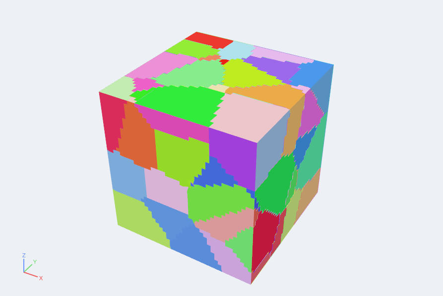

No file. The same chain works on a 3D EBSD volume in place of the synthetic grains.

1. **Sources › Synthetic Microstructure**, type **Voronoi Grains**, **Change settings first…**: **Cells** 40 × 40 × 40, **Grains** 60.
2. **Filters › Grains › Quick Surface Mesh** makes triangles on every face between two grains.
3. **Filters › Grains › Smooth Boundaries**, **Iterations** 20, takes the stair steps out.
4. **Filters › Grains › Face Orientation Colors** colors each triangle by the crystal direction
   of its boundary plane. **Color by** `FaceIPFColors` (drawn with its own colors).
5. Frame, **File › Animation…**, **Orbit 360°**.

```python
v = afx.voronoi_grains(cells=[40, 40, 40], grains=60); v.hide()
s = v.quick_surface_mesh(); s.hide()
m = s.smooth_boundaries(iterations=20); m.hide()
c = m.face_orientation_colors()
c.set(color_by="FaceIPFColors")
afx.view([0.6, -1.0, 0.8], up=[0, 0, 1]); afx.reset_camera()
afx.save_animation("grains_orbit.mp4", fps=20, orbit=80)
```

More in [Grain boundary surfaces](grains.md#grain-boundary-surfaces).

## Meshing: conforming hexahedra around inclusions

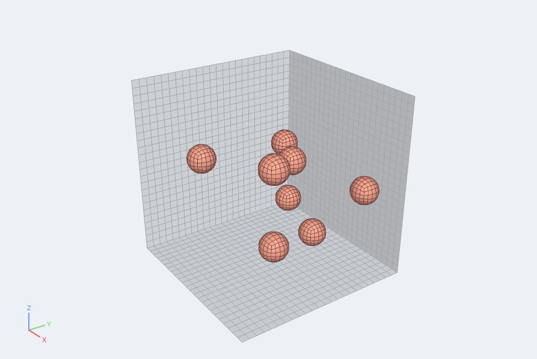

No file.

1. **Sources › Mesh…**, type **Inclusion Mesh**: **Inclusions** 8, **Radius** 0.075, **Cells along the
   shortest side** 24, **Seed** 7. Close its eye: the next steps show parts of it.
2. Select the mesh, **Filters › Common › Threshold**: **Scalars** `ElementBlock`, **Lower** 50.
   This keeps the inclusions' blocks. **Solid color** a red, **Representation** *Surface With
   Edges*.
3. Select the mesh again, **Filters › Mesh › Extract Set**, **Set name** `x-`; grey, *Surface With
   Edges*. Do the same for `y+` and `z-`: three walls of the box.
4. The inclusions and the three walls show together. Frame, **File › Animation…**, **Orbit
   360°**.

```python
m = afx.inclusion_mesh(count=8, radius=0.075, cells=24, seed=7); m.hide()
incl = m.threshold(array="ElementBlock", lower=50)
incl.set(color_by=None, solid_color=(0.85, 0.35, 0.25),
         representation="Surface With Edges", edge_color=(0.15, 0.05, 0.05))
for name in ("x-", "y+", "z-"):
    w = m.extract_set(set=name)
    w.set(color_by=None, solid_color=(0.78, 0.8, 0.84),
          representation="Surface With Edges", edge_color=(0.35, 0.37, 0.42))
afx.view([1.0, -0.7, 0.6], up=[0, 0, 1]); afx.reset_camera()
afx.save_animation("hex_mesh.mp4", fps=20, orbit=80)
```

More in [Geometry and meshing](geometry.md#inclusion-mesh).

## Rendering: a volume

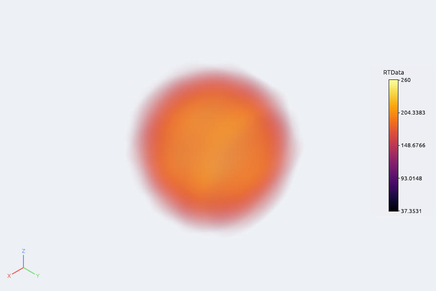

1. **File › Open…** `testdata/wavelet.vti`.
2. **Representation** *Volume*, **Color by** `RTData`, color map *Inferno*. Set **Transparent
   below** to 0.45 so the low values are clear.
3. **Iso**, **Fit**, **File › Animation…**, **Orbit 360°**.

```python
w = afx.load("testdata/wavelet.vti")
w.set(representation="Volume", color_by="RTData", cmap="Inferno", volume_threshold=0.45)
afx.view("iso"); afx.reset_camera()
afx.save_animation("volume.mp4", fps=20, orbit=80)
```

## Making all of them again

In a checkout of the repository with the release program built, `scripts/site/media.sh` runs
every script in `scripts/site/media/` and writes the clips and their first frames into
`site/media/`; `scripts/site/media.sh flow` makes one. The two examples that run a solver first
(`examples/phase_field/cahn_hilliard.py`, `examples/grain_growth/potts.py`) take a few seconds
each with plain Python and NumPy.
