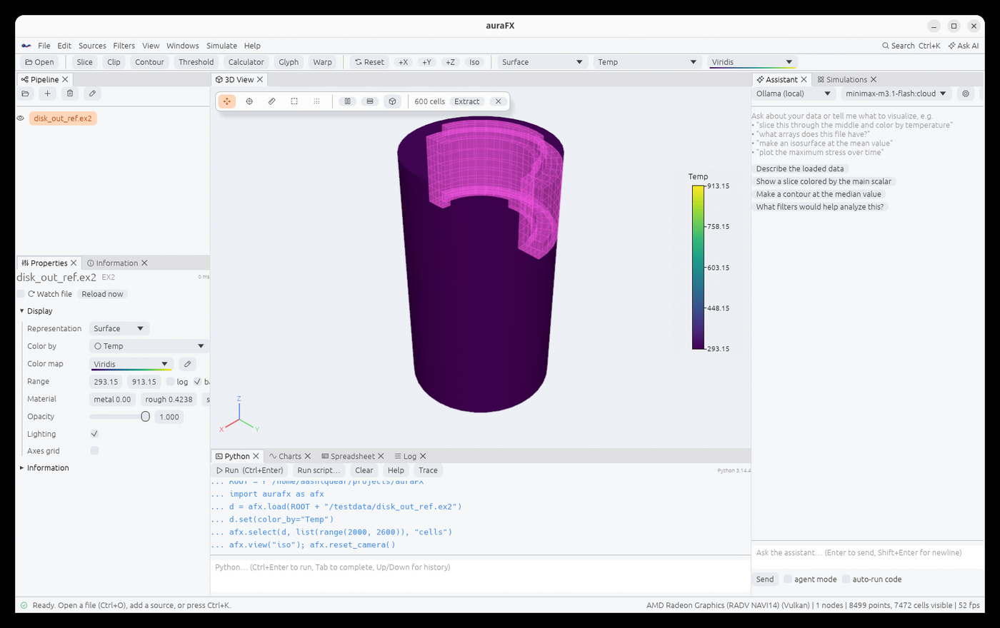
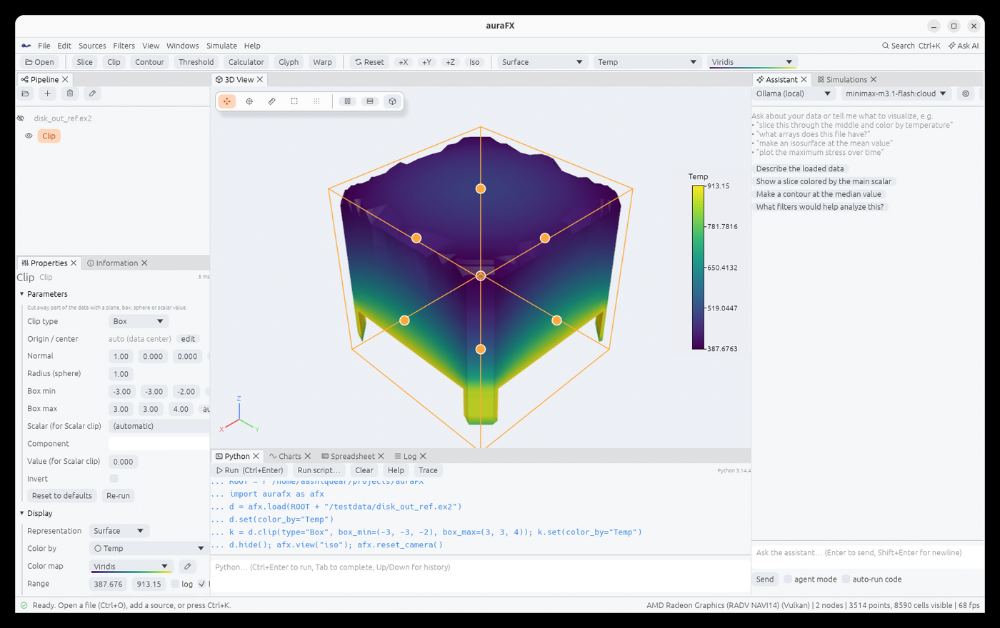

# Selection, picking and widgets

## Picking values

Press **P** (or choose the pick mode in the view toolbar, or Ctrl+click in any mode) and
click a surface: the point is marked and the Information panel lists every array's value
there, with the object's name. `afx.probe(node, (x, y, z))` returns the same values from Python.

## The ruler

Press **M**, click two points on surfaces: the distance is drawn and printed between them.
Press M again (or Esc) to leave the mode.

## Selecting cells and points

Press **S** (cells) or **D** (points) and drag a rectangle over the view. The selected cells
are drawn highlighted through the surface. **Shift** adds to the selection, **Ctrl** removes
from it. By default only the cells you can see are selected; **Select through** in the view
toolbar takes every cell inside the rectangle, hidden ones included.

- **Create an Extract Selection node** (the button in the view toolbar,
  `afx.extract_selection()`) turns the selection into a new object you can filter further.
- **Find Data** (Filters) selects by a query such as `Temp > 600` or the N largest values.
- The Spreadsheet shows the selected rows; `afx.selection()` returns them, `afx.select(node,
  ids, "cells")` sets them, `afx.clear_selection()` clears.

## Widgets: dragging filter shapes in the view

When the selected filter has a shape, it is drawn in the view with orange handles:

| Filter | Widget |
|---|---|
| Slice, Clip (plane) | a plane: drag the center along the normal, drag the tip to tilt |
| Clip (box), Box source | a box: drag the center to move it, a face handle to resize that side |
| Slice/Clip (sphere), Stream Tracer point-cloud seeds, Sphere source | a sphere: center and radius handles |
| Plot Over Line, Stream Tracer line seeds, particle tracers, Line source | a line: either end, or the middle to move both |
| Probe Location | a point |

The parameters in Properties follow the drag, and typing values moves the widget. Custom
lights can be aimed the same way; see [Lighting](rendering.md).

## Annotations

**Filters › Annotation**, `afx.annotate("Run 42", corner="upper left", size=18)` puts text in
a corner of the view; `afx.time_label(True)` (or **View › Time label**) shows the current
time. Both are drawn in screenshots and animations. `afx.clear_annotations()` removes them.
