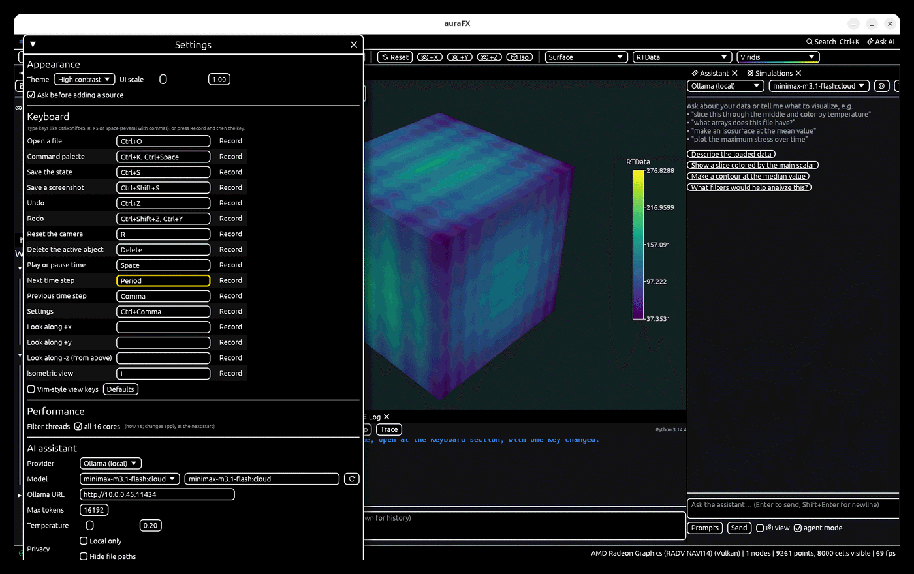

# Settings and keyboard shortcuts

## Settings

**Edit › Settings…** (Ctrl+,):

| Setting | Meaning |
|---|---|
| **Theme** | dark, light, system or **high contrast** (black panels, white text and borders, thick yellow outlines on the control under the mouse and the one in use); the 3D background per theme |
| **Ask before adding a source** | adding a source opens a window to insert it with its standard settings or change them first (on by default) |
| **UI scale** | enlarges the whole interface |
| **Orientation axes**, **Time label** | shown in the 3D views |
| **Filter threads** | cores used by the parallel filters (0 = all); takes effect at the next start; `AURAFX_THREADS` overrides it |
| **Default color map** | for new objects |
| **AI** | provider, model, server URL, API key, auto-run and agent mode, saved prompts and skills (see [AI assistant](ai-assistant.md)) |
| **Keyboard** | the key of every action, typed or recorded (see below) |
| **Plugins** | the Plugins window (also **Edit › Plugins…**) |
| **Lighting** | in **View › Lighting**; the choices are saved with the settings |

Settings live in `~/.config/aurafx/settings.toml` (Linux) or the app's config folder on
other systems; the window layout in `~/.local/share/aurafx/app.ron`.

## Keyboard shortcuts

| Keys | Action |
|---|---|
| Ctrl+O | open a file |
| Ctrl+S | save state |
| Ctrl+Shift+S | save a screenshot |
| Ctrl+K, Ctrl+Space | command palette |
| Ctrl+Z, Ctrl+Y | undo, redo |
| Ctrl+Enter | run the code in the Python console |
| Ctrl+, | settings |
| R | reset the camera |
| Esc, P, M, S, D | view modes: navigate, pick, ruler, select cells, select points |
| Delete | delete the selected object |
| Space | play / pause time |
| Double-click in the view | fit the data |

**Help › Keyboard shortcuts** shows the keys as they are set.

### Changing the keys

Every action in the list (open, palette, save the state, screenshot, undo, redo, reset the
camera, delete the object, play, next and previous step, settings, and four view directions
that have no key at first) takes any keys in **Settings › Keyboard**: type them (`Ctrl+Shift+S`,
`R`, `F5`, `Space`; several with commas; Ctrl is Cmd on a Mac), or press **Record** and then the
key (Esc cancels). Keys bound to two actions are pointed out. **Defaults** puts every key back.
Keys without Ctrl or Alt do nothing while a text field has the keyboard.

**Vim-style view keys** (off by default): `h` and `l` turn the view about its up direction, `j`
and `k` tilt it, `+` and `-` zoom, `0` fits the data.

```python
afx.set_shortcut("screenshot", "Ctrl+P")
afx.set_shortcut("view_iso", "I")
afx.set_shortcut(vim=True)
```



### Screen readers

auraFX describes its controls to screen readers (Orca on Linux, NVDA or Narrator on Windows,
VoiceOver on macOS): buttons, check boxes, fields and menus give their names and states, and Tab
moves between them. The default color map, Viridis, reads in grey and for the common kinds of
color blindness.

## Environment variables

| Variable | Use |
|---|---|
| `AURAFX_THREADS` | thread limit for filters |
| `AURAFX_PLUGIN_PATH` | extra plugin folders |
| `AURAFX_SERVER` | path of `aurafx-server` on a host (in its setup lines) |
| `AURAFX_DATA_DIR` | where settings and state are kept |
| `OLLAMA_HOST`, `ANTHROPIC_API_KEY` | AI providers |
| `PYO3_PYTHON` (at build time) | which Python to embed |
