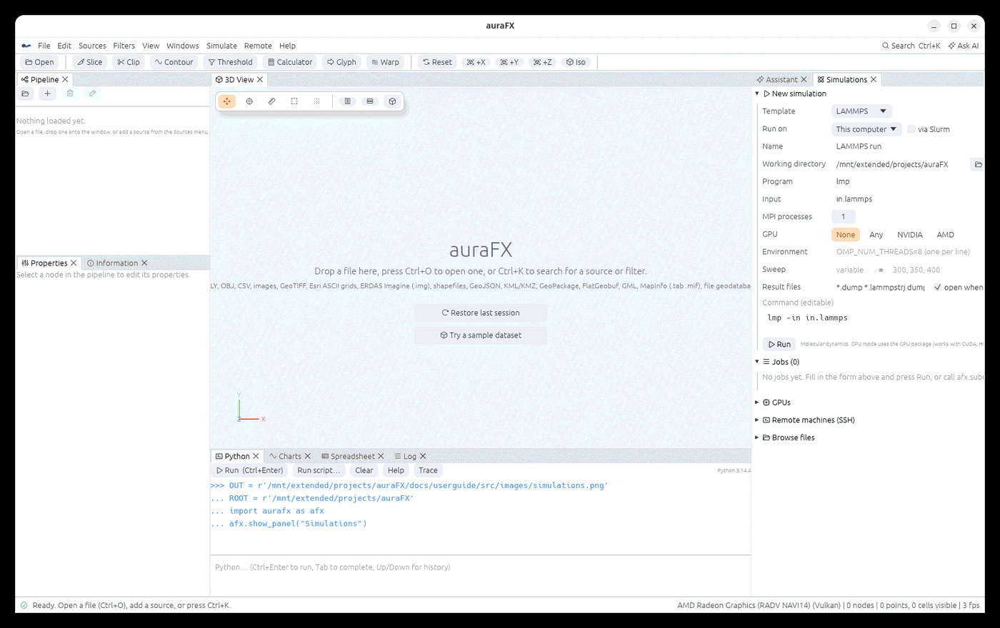
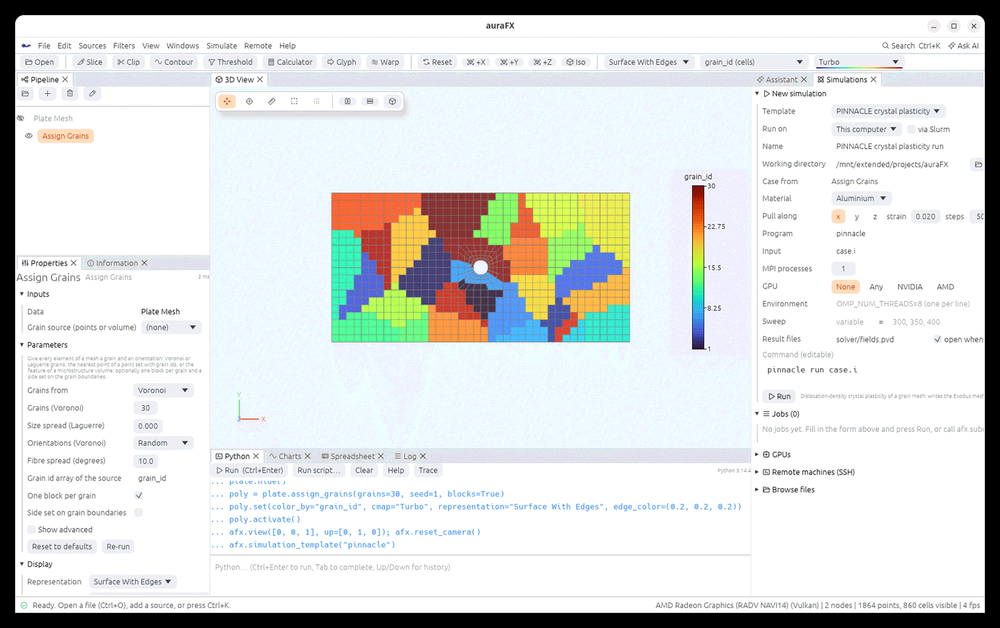
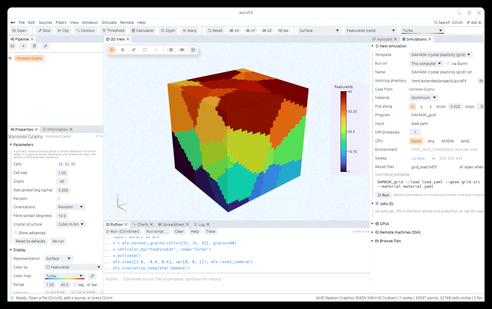
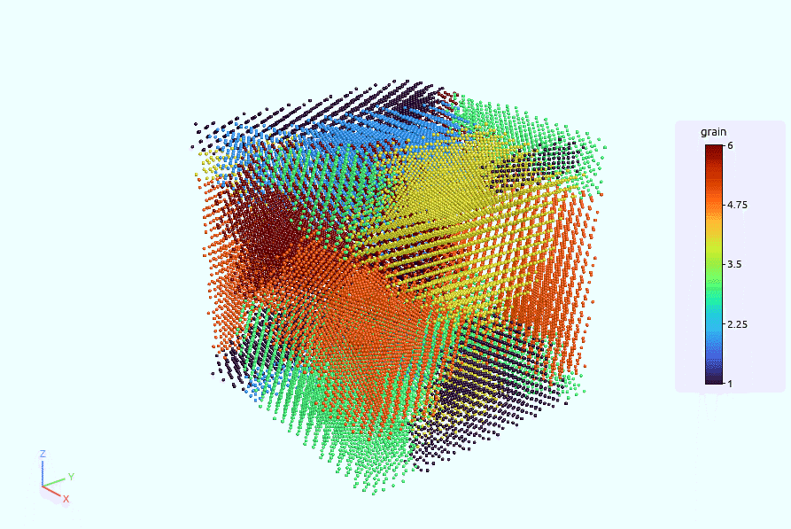
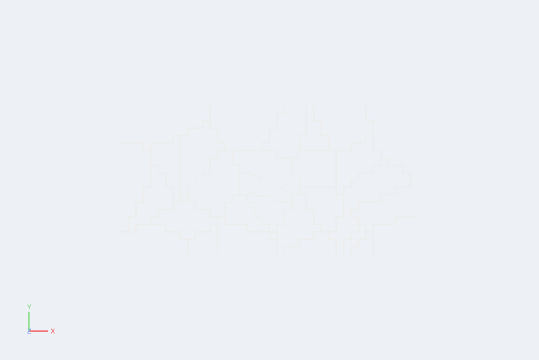

# Running simulations



The **Simulations** panel (right side; **Simulate › Run a simulation…**, or
**Windows › Simulations**) launches solvers and opens their results when they finish.

## A new simulation

| Field | Meaning |
|---|---|
| **Template** | LAMMPS, MOOSE app, MOOSE polycrystal, SPPARKS grain growth, PINNACLE crystal plasticity, DAMASK, FFT texture file, LAMMPS polycrystal, OpenFOAM, Python pipeline or Custom command; fills in the program, input and result-file patterns (the polycrystal and grain growth templates also write their input files, see below) |
| **Run on** | this computer, or a remote machine from the SSH list; **via Slurm** submits with `sbatch` there (partition, time and extra `#SBATCH` lines appear) |
| **Name**, **Working directory** | where the run lives; a remote directory when running over SSH |
| **Program**, **Input**, **MPI processes** | the command line is assembled from these and shown below, editable |
| **GPU** | None, Any, NVIDIA or AMD; the panel finds the GPUs on the host and sets the solver's flags (LAMMPS GPU package, `CUDA_VISIBLE_DEVICES` / `HIP_VISIBLE_DEVICES`) |
| **Environment** | extra `VAR=value` lines (one per line) |
| **Sweep** | a variable name and a list of values: one job per value, `{var}` in the command replaced, each in its own folder |
| **Result files** | patterns of the files to open when the run ends (**open when done**) |

**Run** starts the job. Jobs appear in the **Jobs** list with their state, a live log tail,
and buttons to cancel, open the results or the folder, and resubmit. Files a running solver
writes can be opened while it runs; auraFX reloads them as they change (live reload).

## Simulation cases from the pipeline

Six templates write their input files from the data selected in the pipeline, then run the
solver:

| Template | Selected data | Files written into the working directory |
|---|---|---|
| **MOOSE polycrystal** | a grain mesh (from [Assign Grains](geometry.md#grains-on-meshes), or Overlay Mesh of a microstructure) | `mesh.e` (one block per grain, block id = grain id), `grain_euler.txt` (each block's Euler angles, read with `PropertyReadFile`), `grains.tex` (the same orientations for `EulerAngleFileReader`), `slip_systems.txt`, `polycrystal.i` |
| **SPPARKS grain growth** | a microstructure volume with `FeatureIds` | `grains.spparks` (the site file), `in.potts` (a Potts-model run that reads it) |
| **PINNACLE crystal plasticity** | a grain mesh | `mesh.e`, `orientations_points.csv` (each element's centre with its grain and Euler angles), `case.i` |
| **DAMASK crystal plasticity (grid)** | a microstructure volume with `FeatureIds` and orientations | `grid.vti` (cell array `material` = grain id − 1), `material.yaml` (the phase from the material table, then one material per grain with its mean orientation as a quaternion), `load.yaml` (a strain rate along the axis, the other normal stresses free) |
| **FFT texture file** | a microstructure volume | `micro.txt`: one line per voxel, x fastest: φ1 Φ φ2 (Bunge, degrees), x y z (voxel indices from 1), grain id, phase id; `micro_README.txt` with the grid size |
| **LAMMPS polycrystal** | a microstructure volume | `atoms.data` (every grain filled with the material's FCC or BCC lattice turned to the grain's orientation; of two atoms closer than half the nearest-neighbour distance across a boundary one is removed; periodic box), `atom_grains.txt` and `atoms.dump` (each atom's grain), `in.lammps` (relax, then heat and hold) |

Choose the template, select the data in the pipeline (the panel shows it under **Case
from**), and set the case:
- **Material**: the elastic constants, shear modulus and Burgers vector come from the
  material table of [Crystal Mechanics](grains.md#mechanics-and-additive-manufacturing).
  Only cubic materials (FCC, BCC) are offered.
- **Pull along**, **strain** and **steps**: the faces named `x-` and `x+` (or `y-`/`y+`,
  `z-`/`z+`) are held and pulled. The faces of the other two directions are held on their
  lower side when the mesh names them. Box Mesh, Plate Mesh, Dog-bone Mesh and the Geometry
  source name their faces this way.
- For SPPARKS: **Monte Carlo steps** and **temperature**.
- For LAMMPS: the lattice constant comes from the material's Burgers vector (a = b√2 for FCC,
  2b/√3 for BCC; 4.05 Å for aluminium), and the volume's longest side holds about 40 lattice
  cells unless `angstrom_per_unit` says how many ångström one unit of the volume is. The
  potential file named in `in.lammps` (`Al.eam.alloy` and so on) is yours to provide.

A DAMASK case written this way was checked with DAMASK's own Python package: it loads the grid
and the load case, finds the material file complete and valid, and its own conversion of the
grains' Euler angles gives the same quaternions.

**Run** writes the files and starts the job. For a remote machine they are written to a local
folder and uploaded to the working directory there. With **open when done**, the results open
when the run ends, named after the run:
- MOOSE: `polycrystal_out.e`, with one block per grain.
- SPPARKS: `dump.potts`, each snapshot a volume with `FeatureIds`.
- PINNACLE: `solver/fields.pvd`, the field snapshots as a time series.
- DAMASK: `grid_load.hdf5` (DAMASK's result file; post-process it with DAMASK's tools).
- LAMMPS: `dump.lammpstrj`, the atoms over time.







The input files are a starting point. Edit them for the material's hardening and slip
parameters, the boundary conditions and the solver settings before production runs.

```python
poly = afx.plate_mesh().assign_grains(grains=30, blocks=True)
case = afx.simulation_case(poly, "moose", "~/runs/plate", material="Copper", axis="x",
                           strain=0.02, steps=50)        # only write the files
print(case["command"], case["files"])
jid = afx.run_case(poly, "pinnacle", "/data/runs/plate", strain=0.02, steps=40, wait=True)
jid = afx.run_case(volume, "spparks", "~/gg", host="cluster", np=16, mc_steps=500)
v = afx.voronoi_grains(cells=[64, 64, 64], grains=200, periodic=True)
afx.simulation_case(v, "damask", "~/runs/damask", material="Copper", strain=0.05, steps=100)
afx.simulation_case(v, "fft", "~/runs/fft")
afx.simulation_case(v, "lammps", "~/runs/md", material="Aluminium", angstrom_per_unit=5)
```

`run_case` takes `host`, `exe` (the solver program), `np`, `slurm`, `auto_load` and `wait` as
`afx.submit` does, plus the case options: `material`, `axis`, `strain`, `steps`, `end_time`,
`fixed` and `loaded` (other set names), `mc_steps`, `temperature`, `dump_every`, `seed`, and for
LAMMPS `lattice_constant` (Å) and `angstrom_per_unit`.

**Grains on the results.** MOOSE keeps the grain blocks. A PINNACLE result has no grain
array, but every element sits on its own point of `orientations_points.csv`, so Assign Grains
(nearest point) gives the grains back exactly. Statistics per grain then come from the arrays:

```python
res = afx.load("/data/runs/plate/solver/fields.pvd")
g = res.assign_grains(afx.load("/data/runs/plate/orientations_points.csv"), method="Nearest point")
import numpy as np
gid, sxx = g.array("grain_id", "cells"), g.array("stress", "cells")[:, 0]
for k in np.unique(gid):
    print(k, sxx[gid == k].mean())
```



Limits:
- Every element and site needs a grain: no grain id 0. Fill Bad Data fills unindexed cells
  of a volume.
- The crystal-plasticity cases cover cubic crystals (FCC and BCC).
- SPPARKS sites lie on a simple-cubic lattice of the volume's cells. The lattice constant is
  the cell size when the cells are cubes, else 1.

## Remote machines

**Remote machines (SSH)** holds the hosts: a name, the SSH target (`user@machine`, or an
alias from `~/.ssh/config`), port, key file, jump host, and **setup lines** run before every
command (module loads, `source` of an environment, `AURAFX_SERVER=...`). SSH keys or an agent
must be set up so that `ssh host` works without a password prompt. The same hosts serve
**File › Open on Server…** (see [Data on another machine](client-server.md)).

**GPUs** lists the GPUs of each host; **Browse files** opens a remote file browser to pick
inputs or results.

## From Python

```python
jid = afx.submit("lmp -sf gpu -pk gpu 1 -in in.melt", host="rocm-server",
                 workdir="~/runs/melt", gpu="amd:0", outputs="dump.melt", auto_load=True)
afx.sweep("lmp -var T {T} -in in.melt", T=[300, 600, 900], host="cluster", workdir="~/sweep")
afx.jobs(); afx.job(jid); afx.cancel(jid)
afx.gpus("rocm-server"); afx.hosts()
afx.load_remote("rocm-server", "~/runs/melt/dump.melt")   # copy a file here and open it
```

`gpu` is `None`, `"any"`, `"nvidia"`, `"amd"` or e.g. `"nvidia:0,1"`. `afx.job(id)` returns
the state, exit code, log tail and output files.
