# Synthetic microstructures

**Sources › Synthetic Microstructure** makes a microstructure from a few numbers: a size, a
volume fraction, a random seed. One window holds every type, in families: grains,
particles, fibres and layers, random fields, lattices and foams, automata and growth,
structures of living materials, and sequences and studies that run the others. This chapter
lists the types, what each one makes and the settings that matter;
[Measuring and simulating microstructures](microstructure-analysis.md) covers the filters
that measure them and compute their properties, the starting points, and the sequences and
studies. The grain types (Voronoi, packed and columnar grains) have their own
longer sections in [Grains and crystals](grains.md#synthetic-microstructures).

## The window

1. Choose **Sources › Synthetic Microstructure…** (or, in the Welcome window, **Synthesize
   crystal › All types…**).
2. Pick a **Type** from the list at the top. The types are grouped by family; hovering over
   one says what it makes. Or pick a material from **Start from**
   ([starting points](microstructure-analysis.md#starting-points)): it selects a type and
   fills in its settings.
3. The window shows what the type makes and its standard settings. **Insert with these
   settings** adds it as it is. **Change settings first…** shows the basic settings to edit;
   **Standard settings** puts them back.
4. After inserting, every setting (the advanced ones too, under **Show advanced**) is in the
   Properties panel, and the structure is made again when one changes.

Choosing another type keeps the window open and shows that type's standard settings, so the
types can be read through one after another before anything is inserted.

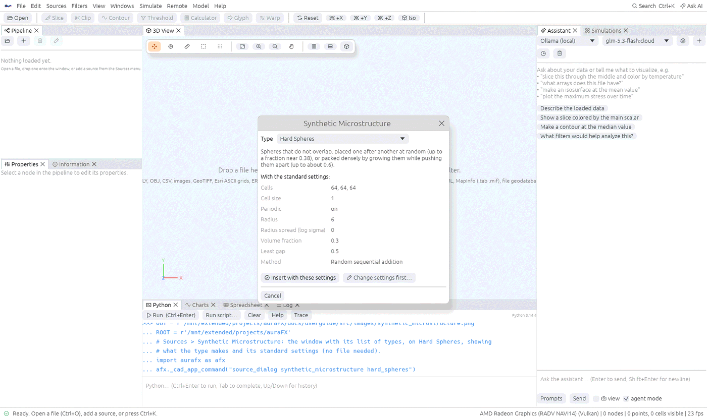

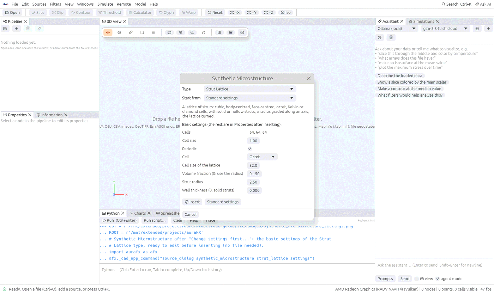

Every type is also a source of its own: the command palette (`Ctrl+K`) finds it by name
("gyroid", "foam", "hard spheres"), and Python makes it with `afx.<name>(...)`.

```python
import aurafx as afx
s = afx.hard_spheres(radius=6, fraction=0.3)          # the standard grid, 64 x 64 x 64 cells
g = afx.triply_periodic_surface(surface="Gyroid", cell_size=32, fraction=0.2)
solid = g.threshold(array="Phases", lower=2)          # the solid alone
```

## What every type gives

The result is an image (a grid of cubic cells) with:

- **`Phases`**, a cell array: 1 is the matrix or the pores, 2 the solid or the particles,
  3 and above further phases (cross-links, aggregates, cement lines, canals). **Threshold**
  on `Phases` from 2 keeps the solid.
- **`FeatureIds`** where the structure is made of separate objects (spheres, fibres, layers,
  tablets, osteons, clusters): 0 for the matrix, then one number per object. The grain types
  give `FeatureIds`, `Phases` and `EulerAngles` like the other grain sources, so every filter
  of [Grains and crystals](grains.md) works on them.
- **`PhaseFractions`**, a field value (Information panel): the measured volume fraction of
  each phase. Where the model has a closed form, **`ExpectedFraction`** sits beside it.
- A few numbers of the model, also as field values: `Centers` and `Radii` of spheres, the
  number of `Fibres`, `Contacts` and `CrossLinks`, the `StrutRadius` of a lattice, and so on.
- For the types made of spheres, fibres, struts, pipes or branches: the description of those
  objects, from which [Microstructure Objects and Smooth Surface](microstructure-analysis.md#exact-geometry-and-smooth-surfaces)
  draw exact geometry at any resolution.

Settings shared by the types:

| Setting | Meaning |
|---|---|
| **Cells** | Cells along X, Y and Z. With one cell along Z the model is drawn in the plane (discs for spheres, strips for plates). |
| **Cell size** | The edge of a cell. Every length of the model (radius, length, thickness) is in the same unit. |
| **Periodic** | The structure continues through opposite faces of the box, for representative volume elements. |
| **Volume fraction** | The fraction of the solid. Where a type has both a fraction and a size (a strut radius), the fraction wins unless it is 0. |
| **Random seed** (advanced) | The same seed gives the same structure. |

## Grains and polycrystals

| Type | What it makes |
|---|---|
| **Voronoi Grains** | Equiaxed grains: the cells of random seeds, or Laguerre cells with spread sizes. See [Voronoi Grains](grains.md#voronoi-grains). |
| **Pack Grains** | Grains packed to goal size and shape statistics. See [Pack Grains](grains.md#pack-grains-and-insert-precipitates). |
| **Columnar Grains** | The columns of a layered build. See [Columnar Grains](grains.md#columnar-grains). |
| **Nucleation and Growth Grains** | Nuclei appear at random and grow at one speed until they meet. |
| **Dead Leaves Mosaic** | Grains that are not convex: spheres or spheroids that fall one after another and hide what lies under them. |

**Nucleation and Growth Grains.** With **Nucleation** *All at the start* the grains are
Voronoi cells. *At a constant rate* gives the curved boundaries and the wide spread of sizes
of grains born at different times: early grains are large, late ones small. **Stop at time**
above 0 ends the growth early; the cells not yet reached are the last feature, of phase 2, and
`TransformedFraction` is kept beside the `ExpectedFraction` of the kinetics law
(1 − exp(−π N G³ t⁴ / 3) for N nuclei per volume and time growing at the speed G). The cell
array `TransformationTime` holds the time each cell was reached: a **Threshold** on it shows
the structure at any earlier time. **Growth front** *Cubes* or *Octahedra* gives faceted
grains, the facets along each grain's crystal axes. **Grain growth sweeps** above 0 lets the
grains coarsen once the box is full: at every sweep each cell may join a neighbouring grain
when that shortens the boundaries, so boundaries straighten, small grains vanish and the
others grow (a hundred sweeps remove about half of 300 grains on 32 cells along each edge).

**Voronoi Grains** has **Stealthy seeds** (advanced): above 0, the seeds are moved until no
density wave longer than a limit is left in their pattern. The grains then have no order,
yet are nearly as even in size as in a crystal (their volumes spread by a few percent, against
42 % for random seeds). The value, up to about 0.45, is the share of the freedoms of the seeds
this takes; up to 4000 seeds. Open-Cell Foam and Delaunay Fibre Network have the same
setting.

**Dead Leaves Mosaic.** **Phase fractions** lists the volume fraction of each phase of
leaves (`0.5, 0.5` for two phases); **Radius of each phase** (advanced) gives the phases
leaves of different sizes. **Aspect ratio** other than 1 makes spheroids. With **Coverage**
above 0 only so many leaves fall as cover a point that many times on average, and what stays
uncovered is a background (the fraction exp(−coverage) of the box).

```python
g = afx.nucleation_growth_grains(nucleation="At a constant rate", rate=5e-5, growth=1.0)
part = afx.nucleation_growth_grains(time=14)       # stopped early: a partly transformed material
m = afx.dead_leaves_mosaic(radius=8, phase_fractions=[0.7, 0.3])
```

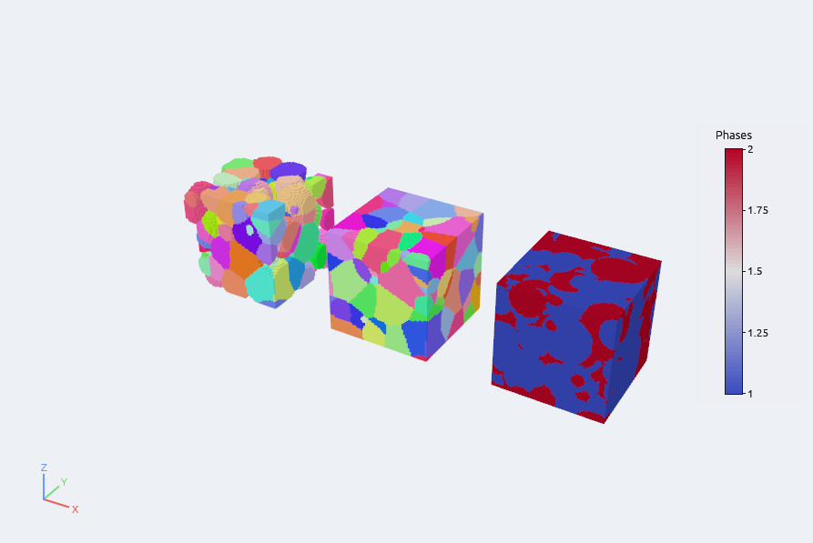

## Particles

| Type | What it makes |
|---|---|
| **Overlapping Spheres** | Spheres at random points, free to overlap. The number of spheres follows from the fraction f of their union: f = 1 − exp(−n V) for n spheres per unit volume of mean volume V. |
| **Penetrable Spheres** | Spheres that overlap down to a hard core. **Impenetrability** is the core radius over the sphere radius: 0 gives overlapping spheres, 1 hard spheres. |
| **Hard Spheres** | Spheres that do not overlap, with a **Least gap** between them. |
| **Clustered Spheres** | Small particles gathered inside aggregates (overlapping spheres), as fillers in a rubber. The aggregates can be a third phase around the particles. |

**Hard Spheres** has three methods. *Random sequential addition* places the spheres one
after another at random and never moves them; it stops near a fraction of 0.38 for equal
spheres, and says so when asked for more. *Dense packing* places the spheres small, grows
them step by step and pushes overlapping pairs apart after each step; it reaches about 0.6.
*Dense packing by collisions* lets the spheres fly as a gas while they grow at a steady rate
and bounce apart when they touch; grown slowly (**Growth per step**, advanced) they
rearrange and pack to about 0.64, the densest random packing of equal spheres. **Radius
spread** gives lognormal radii with any method.

```python
b = afx.overlapping_spheres(radius=6, fraction=0.3)
c = afx.penetrable_spheres(radius=6, impenetrability=0.5, density=0.6)
d = afx.hard_spheres(radius=5, fraction=0.58, gap=0, method="Dense packing")
n = afx.clustered_spheres(aggregate_radius=12, aggregate_fraction=0.25, radius=2.5, local_fraction=0.35)
```

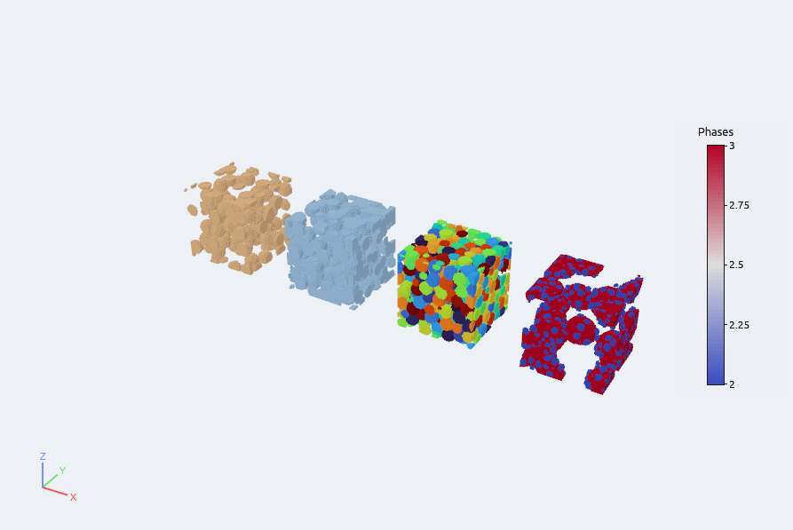

## Fibres and layers

| Type | What it makes |
|---|---|
| **Overlapping Fibres** | Straight fibres of a given length at random places, free to overlap; flat or round ends. |
| **Poisson Line Fibres** | Fibres without ends: cylinders about random lines that cross the whole box. The box is not periodic. |
| **Curved Fibres** | Worm-like chains (they forget their direction over the **Persistence length**), arcs of circles or helices; overlapping or not. |
| **Hard Fibres** | Straight fibres with round ends placed one after another without overlap. |
| **Bending Fibres** | Long bending fibres packed without overlap to high fractions. |
| **Cross-Linked Fibres** | Entangled straight fibres bonded where they touch: a share of the contacts carries a cross-link, a ball of phase 3. |
| **Delaunay Fibre Network** | Fibres on the edges of the Delaunay triangulation of random points, joined at every point. |
| **Random Laminate** | Layers of random thicknesses a random distance apart, with round holes through them. |

**Directions** sets the law of the fibre directions for every fibre type: *Isotropic*, *Along
Z*, *In the XY plane*, *Beta law about Z* or *Girdle about the XY plane*. The advanced setting
beside it is the beta of the beta law (1 is isotropic, towards 0 the fibres line up with Z,
large values lay them in the plane) or the spread of the girdle in degrees.

**Bending Fibres.** Each fibre is a random walk of steps one radius long. A step is drawn
about a mix of the fibre's main direction (**Hold to the main direction**) and of the step
before it (**Hold to the previous step**: high values give smooth, stiff fibres). The fibres
start overlapping; then the balls along their axes push one another apart, each fibre keeping
its length and resisting bending, until the overlaps are gone. `LargestOverlap` (in radii)
says what is left. **Draw into contact within** (advanced) pulls fibres that end up close
together until they touch.

**Hollow** (advanced, on the fibre types) is the inner radius over the radius: the fibres
become tubes, and the bores join where fibres cross.

```python
f = afx.overlapping_fibres(radius=2, length=30, directions="In the XY plane", fraction=0.15)
w = afx.curved_fibres(shape="Worm-like chain", length=60, persistence=30, fraction=0.1)
p = afx.bending_fibres(radius=2, length=40, fraction=0.25)
x = afx.cross_linked_fibres(radius=1.5, fraction=0.085, bonded=0.5, link_radius=3)
d = afx.delaunay_fibre_network(points=200, radius=1.2)
flat = afx.delaunay_fibre_network(cells=[128, 128, 1], points=200)    # in the plane: six fibres at a node
l = afx.random_laminate(thickness=4, layer_spacing=8, hole_fraction=0.2)
```

With one cell along Z the **Delaunay Fibre Network** is the triangulation of points of the
plane.

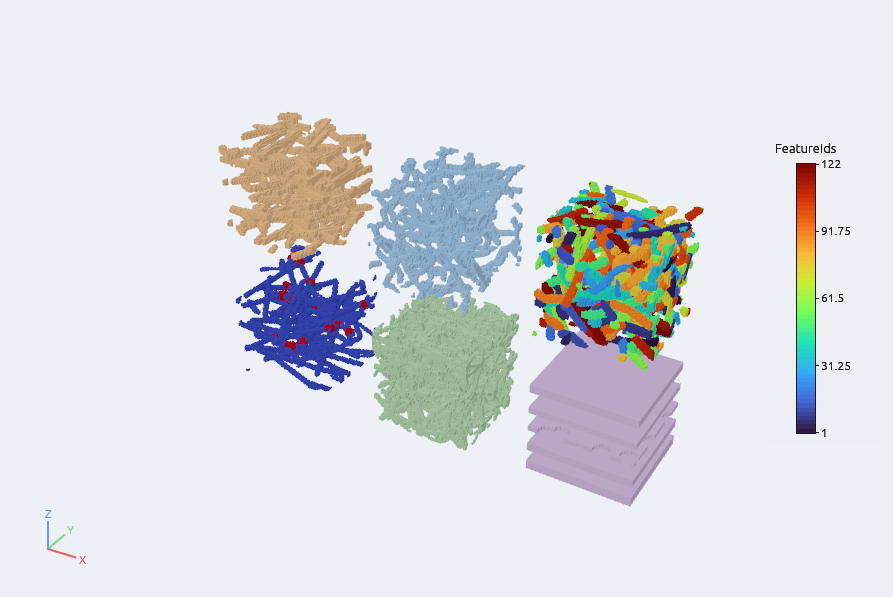

## Random fields

| Type | What it makes |
|---|---|
| **Gaussian Field Medium** | A smooth random field cut at a level: two interwoven phases with rounded shapes. **Correlation length** sets the size of the features. *Between two levels* gives sheets. |
| **Transparent Leaves Medium** | A random function of leaves that let part of what lies under them show through, cut at a level. |
| **Reconstructed Medium** | A medium rebuilt from a statistic alone, by simulated annealing. |

**Reconstructed Medium** starts from random cells at the volume fraction and swaps two cells
of different phases again and again. A swap is kept when it brings the probability that two
points a distance apart are both solid nearer to the target, f² + f (1 − f) exp(−distance /
**Correlation length**) along the axes; a swap that takes it away is kept less and less
often. **Swaps tried per cell** sets how long this goes on. The target and the result are
kept as the field values `TwoPointTarget` and `TwoPointResult`. It is the slowest type: the
standard 40 × 40 × 40 cells take a few seconds, and it is limited to 8 million cells.

The Gaussian and transparent-leaves types keep the field they cut as the cell array `Field`.

```python
g = afx.gaussian_field_medium(length=8, fraction=0.4)
t = afx.transparent_leaves_medium(radius=5, transparency=0.4, fraction=0.35)
r = afx.reconstructed_medium(cells=[40, 40, 40], fraction=0.3, length=3)
```

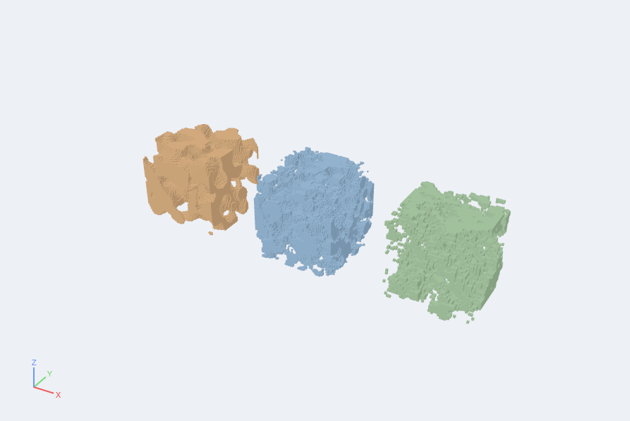

## Lattices and foams

| Type | What it makes |
|---|---|
| **Triply Periodic Surface** | Gyroid, Schwarz P, Schwarz D, Neovius or I-WP: the *Sheet* about the surface or the *Network* on one side of it. |
| **Strut Lattice** | Cubic, body-centred, face-centred, octet, Kelvin, diamond or pyrochlore cells of struts. |
| **Disordered Strut Lattice** | A lattice with struts missing and nodes moved at random. |
| **Hierarchical Lattice** | A lattice whose struts are themselves frames of octahedra made of tubes. |
| **Fractal Sponge** | The Menger sponge, the Vicsek fractal or the Cantor dust. |
| **Open-Cell Foam** | Struts on the edges of the cells of random points, with balls at the nodes. |
| **Level-Set Foam** | A foam drawn from the distances to packed seeds: struts with three-sided sections, open or closed cells. |
| **Scale-Rich Network** | Ligaments grown one after another, each thinner than the one before. |
| **Optimized Unit Cell** | A periodic cell found for its stiffness or conductivity: see [Unit cells found for a property](microstructure-analysis.md#unit-cells-found-for-a-property). |

**Strut Lattice.** **Wall thickness** above 0 hollows the struts. **Radius at the far face**
(advanced) grades the radius along an axis, and **Rotation** turns the lattice. A lattice
is periodic when the box holds a whole number of cells and it is not turned. On a lattice
lined up with the grid, whole shells of cells come in at the same radius, so the fraction
moves in steps: the nearest step to the fraction asked is taken, and `PhaseFractions` says
what it is.

**Disordered Strut Lattice.** **Struts per node** removes struts at random down to that mean
number, and **Node displacement** moves every node. `MeanCoordination` and `MaxwellNumber`
(struts less three times the nodes: below 0 the frame has mechanisms) are kept with the
result.

**Hierarchical Lattice** needs a fine grid: with one generation and three octahedra per
frame a cell holds 1296 tubes. The standard settings use one cell of 128 cells.

**Open-Cell Foam.** **Relaxation steps** move the points to the centres of their cells for
even cells; **Elongation** stretches the cells along an axis, as in trabecular bone.

**Level-Set Foam.** The seeds are ellipsoids packed without overlap; **Seed shape** elongates
them along Y and Z. **Curvature of the strut sides** between 0 and 1 hollows the sides, as in
a drained liquid foam, and below 0 makes them bulge. **Closed cells** above 0 adds walls.
Every strut thickens from its own mid-span to its nodes, whatever its length.

**Scale-Rich Network.** The ligament number t is t to the power minus the **Thinning
exponent** as thick as the first. Each starts at a random point of the voids and grows until
it meets a ligament or the box, so thicknesses and lengths spread over orders of magnitude.
With one cell along Z (the standard settings) the ligaments are strips in the plane; with more
cells they are *Plates* that close cells, or *Beams*. **Directions in the plane** `0, 90`
keeps the ligaments along X and Y. **Ligaments turned towards a pole** makes that share of
the ligaments, the first and thickest, point along the rays from a pole (**Angle to the
direction of the pole** 0) or turn around it (90); in space the angle is that of the plates
to the direction of the pole. **Density of starting points** `1, 4` starts four times as
many ligaments at the far end of an axis (or far from the pole) as at the near end, which
grades the size of the cells.

```python
g = afx.triply_periodic_surface(surface="Schwarz P", variant="Network", cell_size=32, fraction=0.3)
o = afx.strut_lattice(cell="Octet", cell_size=32, fraction=0.15)
h = afx.strut_lattice(cell="Kelvin", fraction=0, radius=3, wall=1.2)       # hollow struts
d = afx.disordered_strut_lattice(coordination=5, perturbation=0.15)
s = afx.fractal_sponge(pattern="Menger sponge", level=3)
f = afx.open_cell_foam(foam_cells=64, fraction=0.15, anisotropy=1.6)
n = afx.scale_rich_network(cells=[256, 256, 1], ligaments=500, decay=0.5, fraction=0.4)
```

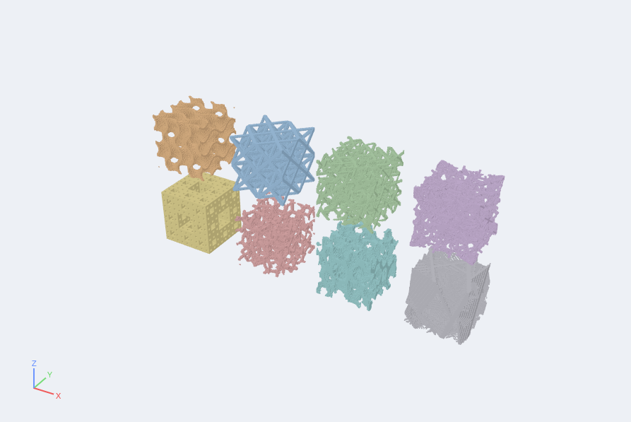

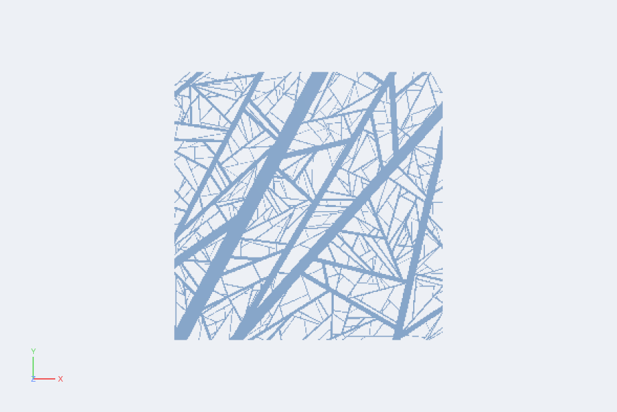

## Automata and growth

| Type | What it makes |
|---|---|
| **Cellular Automaton Structure** | Two phases grown from random cells by a rule on the neighbours. |
| **Activator-Inhibitor Pattern** | Spots, stripes and labyrinths from short-range activation and longer-range inhibition. |
| **Reaction-Diffusion Pattern** | Spots, worms, labyrinths and holes of two species that diffuse and react. |
| **Aggregation Cluster** | Clusters and deposits grown one cell at a time. |
| **Pipe Network** | Pipes assembled from tiles that must fit their neighbours. |
| **Polarized Blocks** | Blocks that each deform in one way only, assembled so that every face moves the same way on both sides. |
| **Branching Network** | A tree grown towards points scattered in the box. |

**Cellular Automaton Structure.** *Annealing* (the majority rule with its two middle counts
swapped) coarsens noise into two interwoven phases; *Majority* freezes early; *Majority at a
constant fraction* keeps the volume fraction; *Births and survivals* takes the numbers of
live neighbours at which a cell is born or survives (`5-8`, or `4, 6, 7`).

**Cells of the automaton** runs it on other cells than those of the grid, drawn over the
grid several cells across (**Size of those cells**): *Hexagons* and *Triangles*; *Penrose
rhombi* and *Squares and rhombi (eightfold)*, two tilings of the plane that never repeat;
*Truncated octahedra* and *Rhombic dodecahedra*, the cells of the body-centred and
face-centred lattices. Tilings of the plane are stacked in layers when the grid has several.
`FeatureIds` then numbers the tiles. With **Neighbours** *Faces* a tile looks at the tiles
it shares a side with (6 for a hexagon, 3 for a triangle, 4 for a rhombus, 14 and 12 for the
two lattices), otherwise also at those it shares a corner with. These cells do not join up
through the faces of the box.

**Polarized Blocks.** Each block is long along one axis and short along the two others, or
the reverse, and can only deform that way: it pushes its neighbours out through two opposite
faces and pulls them in through the four others. Blocks fit when every shared face moves the
same way on both sides, so the motion alternates along every line of blocks, and a periodic
box needs an even number of blocks along every axis. The blocks are drawn as cubes with a
pore, long along the axis that pushes out; `BlockAxis` (0, 1, 2) and `BlockSign` give the
state of each block.

**Aggregation Cluster.** *Diffusion-limited*: a particle wanders at random and sticks where
it first touches the aggregate, which gives branched, fractal clusters. *Eden growth*: a
random cell of the surface is added, which gives compact clusters. *Ballistic*: particles
fly straight and stick on contact. **Grown from** *Clusters* starts from seeds in the box,
*Deposit on the base* from the bottom face.

**Pipe Network.** Every tile of a cubic lattice opens towards some of its neighbours, and
**Open sides allowed** lists how many open sides a tile may have. Without 1 in the list no
pipe ends in a dead end.

**Branching Network.** Points scattered in the box pull the nearest node of the tree; each
pulled node grows a segment towards its points, and points the tree has reached are removed.
The radii thicken from the tips to the root: with the **Branching exponent** n, the radius r
of a branch and those of its children satisfy rⁿ = sum of theirs (3 for vessels, 2 for
plants). The cell array `BranchRadius` holds the radius of each branch.

```python
a = afx.cellular_automaton_structure(rule="Annealing", steps=40)
t = afx.activator_inhibitor_pattern(activation=3, inhibition=7, fraction=0.35)
r = afx.reaction_diffusion_pattern(pattern="Labyrinth", steps=3000, fraction=0.4)
c = afx.aggregation_cluster(process="Diffusion-limited", seeds=20, fraction=0.08)
p = afx.pipe_network(tile_cells=8, degrees=[0, 2, 3, 4])
v = afx.branching_network(attractors=3000, step=1.5, tip_radius=0.6, exponent=3)
q = afx.cellular_automaton_structure(cells=[160, 160, 1], lattice="Penrose rhombi", tile=9)
k = afx.polarized_blocks(tile_cells=16)
```

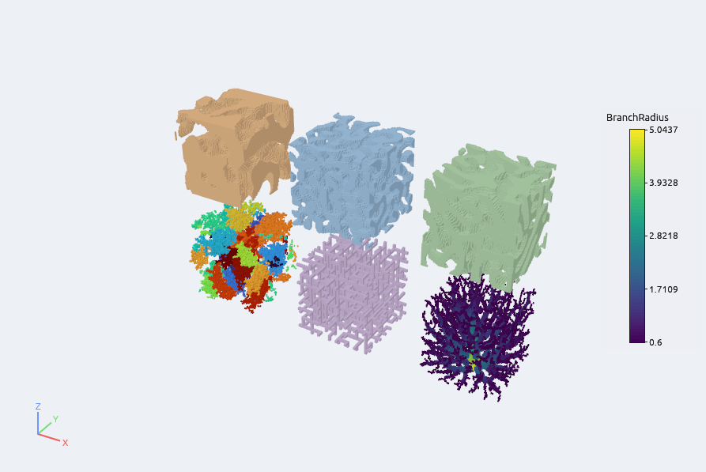

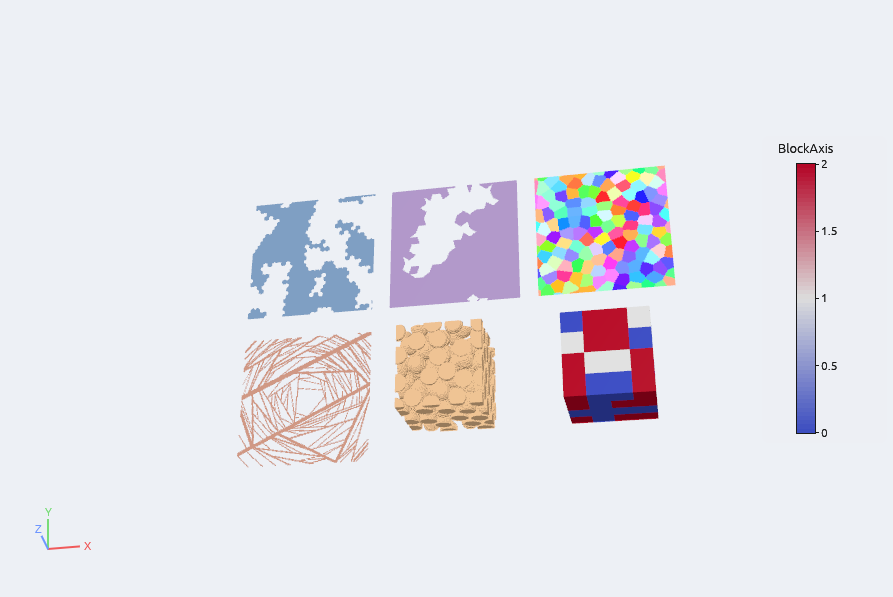

## Bio-inspired structures

| Type | What it makes |
|---|---|
| **Nacre** | Layers of mineral tablets in a thin mortar: square bricks shifted from layer to layer, or polygons. |
| **Twisted Plywood** | Layers of parallel fibres whose direction turns by **Turn per layer** from each layer to the next. |
| **Honeycomb** | Prismatic cells along Z: hexagons, squares, random cells, or wood. |
| **Haversian Bone** | The cross-section of cortical bone: osteons with canals and cement lines. |

**Honeycomb** with **Cells** *Wood* makes rows of cells along X whose size and walls change
through each growth ring, from large thin-walled earlywood cells to small thick-walled
latewood cells; the advanced settings give the ring width, the latewood share and the rays.
A ray is a ribbon of small cells between two rows, each cell a box with walls of its own
(phase 3) around its lumen; rays never sit side by side.

**Haversian Bone.** Osteons arrive one after another at random places and cover what was
there. The phases are 1 interstitial bone, 2 the bone of the osteons, 3 cement lines and
4 canals. The model gives their fractions exactly (`ExpectedFractions`): for a coverage p and
a canal ratio c the canals take p c².

```python
n = afx.nacre(arrangement="Bricks", tablet_size=24, tablet_thickness=8, mortar=4, shift=0.5)
p = afx.twisted_plywood(radius=2.5, fibre_spacing=7, layer=7, pitch=15)
h = afx.honeycomb(arrangement="Wood", cells=[128, 64, 32])
b = afx.haversian_bone(cells=[192, 192, 4], radius=20, coverage=0.65)
```

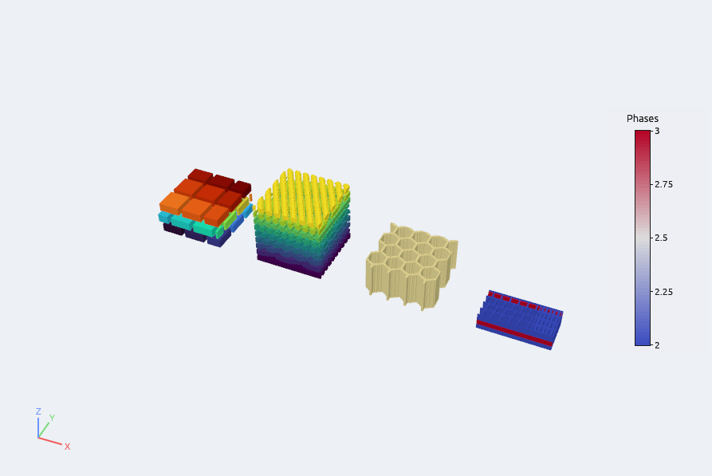

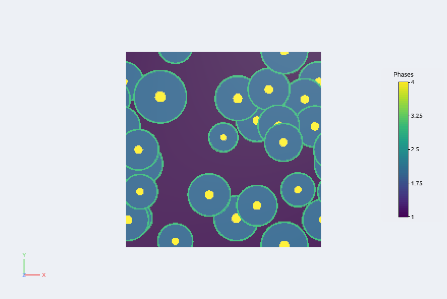

## Coatings and combinations

Two filters (under **Filters › Microstructure**) build on any of the types.

**Coat Phase** adds a layer of a new phase around a phase (**Side** *Outside*: coatings and
interphases around particles, fibres and struts) or just inside it (*Inside*: hollow spheres
and tubes, core and shell). **Thickness** is counted between cell centres. Turn **Through
periodic faces** on for a structure that was made periodic.

**Combine Microstructures** takes a second microstructure on the same grid (choose it under
**Second microstructure** in Properties) and one phase of each:

| Operation | Result |
|---|---|
| *Union*, *Intersection*, *Difference* | Two phases: 2 where the operation holds. |
| *Inclusions over the first* | The first microstructure, with the phase of the second laid over it as a new phase (particles in a polycrystal). |
| *Second inside the first* | The phase of the first, kept only where the second has its phase too (a gyroid made of a lattice, spheres within struts). |

```python
s = afx.hard_spheres(radius=6, fraction=0.12, gap=4)
coated = s.coat_phase(phase=2, thickness=2, periodic=True)          # phase 3 around the spheres
g = afx.triply_periodic_surface(fraction=0.5, variant="Network")
l = afx.strut_lattice(cell_size=16, fraction=0.3)
both = afx.combine_microstructures(g, l, operation="Second inside the first")
```

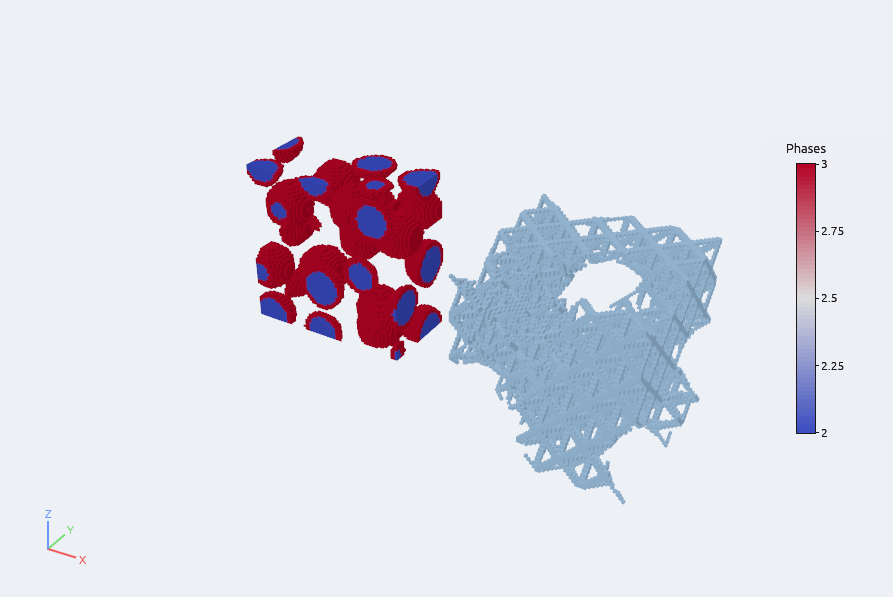

## Limits

- The structures are images of cubic cells: a feature thinner than about three cells is not
  resolved, and measured fractions differ from the exact ones by the rounding to cells.
- Grids are limited to 100 million cells. The types that compare every cell with every
  object (Level-Set Foam, Nucleation and Growth Grains) stop with a message when the two
  numbers together are too large.
- Poisson Line Fibres, Branching Network, Hierarchical Lattice and the scale-rich networks
  are not periodic. Twisted Plywood and Triply Periodic Surface are periodic only when the
  box fits their periods.
- A packing that cannot reach its fraction stops with a message that says how far it got.
- Reaction-diffusion patterns run on the cubic grid only. The automaton's other cells
  (hexagons, tilings, lattice cells) do not wrap through periodic faces, and the tiling by
  golden rhombohedra is not there.
- Stealthy seeds are limited to 4000 points; the packing by collisions slows down sharply
  above a fraction of 0.6.

## Methods

The models follow published methods:

- Overlapping grains and fibres (the Boolean model), dead leaves and their transparent form:
  G. Matheron, *Random Sets and Integral Geometry* (1975); D. Jeulin, *Morphological Models
  of Random Structures* (2021).
- Penetrable spheres, random sequential addition, reconstruction from the two-point
  probability: S. Torquato, *Random Heterogeneous Materials* (2002); C. Yeong and S. Torquato,
  Phys. Rev. E 57 (1998).
- Bending fibres: H. Altendorf and D. Jeulin, Phys. Rev. E 83 (2011).
- Fibres on Poisson lines: J. Dirrenberger, S. Forest and D. Jeulin, Int. J. Solids Struct.
  51 (2014).
- Delaunay fibre networks: E. Ban et al., J. Appl. Mech. 83 (2016).
- Kinetics of nucleation and growth: W. Johnson and R. Mehl (1939); M. Avrami (1939);
  A. Kolmogorov (1937).
- Foams as level sets of distances to packed seeds: B. Sonon, B. François and T. Massart,
  Comput. Methods Appl. Mech. Eng. 223 (2012).
- Scale-rich networks: Both, Chen, Gao, Mooij, Charara, Wadhwa, Portela and Barabási (2026).
- Hierarchical frames: D. Rayneau-Kirkhope, Y. Mao and R. Farr, Phys. Rev. Lett. 109 (2012).
- Annealing automaton: G. Vichniac, Physica D 10 (1984). Activator-inhibitor automaton:
  D. Young, Math. Biosci. 72 (1984). Reaction and diffusion: P. Gray and S. Scott, Chem. Eng.
  Sci. 39 (1984).
- Diffusion-limited aggregation: T. Witten and L. Sander, Phys. Rev. Lett. 47 (1981).
- Packing by collisions of growing spheres: B. Lubachevsky and F. Stillinger, J. Stat. Phys.
  60 (1990). Stealthy hyperuniform points: O. Uche, F. Stillinger and S. Torquato, Phys. Rev.
  E 70 (2004).
- Tilings that never repeat, from families of parallel lines: N. de Bruijn, Indag. Math. 43
  (1981). Grain growth: M. Anderson, D. Srolovitz, G. Grest and P. Sahni, Acta Metall. 32
  (1984). Blocks that deform in one way: C. Coulais, E. Teomy, K. de Reus, Y. Shokef and
  M. van Hecke, Nature 535 (2016).
- Branching by space colonization: A. Runions, B. Lane and P. Prusinkiewicz (2007); radii:
  C. Murray, Proc. Natl. Acad. Sci. 12 (1926).
- Twisted plywoods: Y. Bouligand, Tissue Cell 4 (1972). Honeycombs and wood: L. Gibson and
  M. Ashby, *Cellular Solids* (1997).
