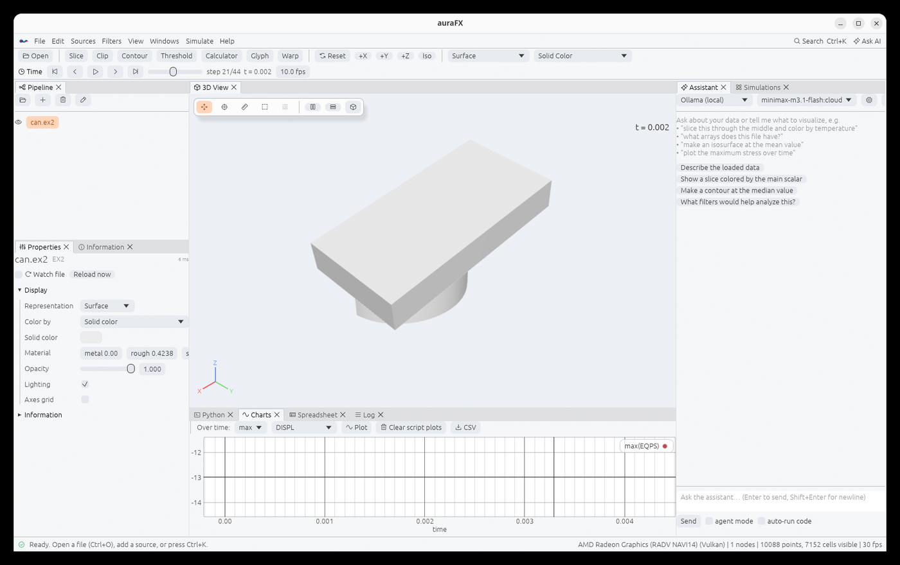
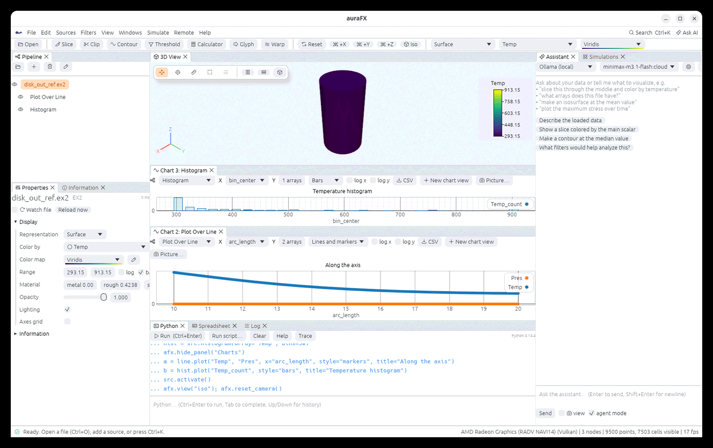
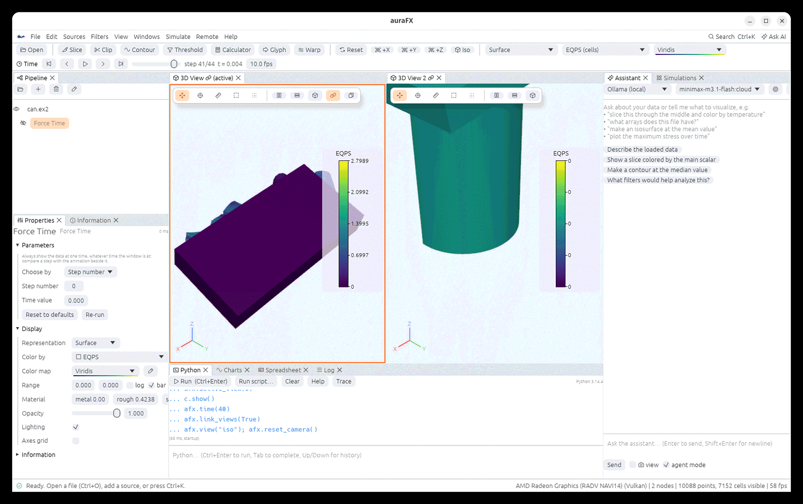
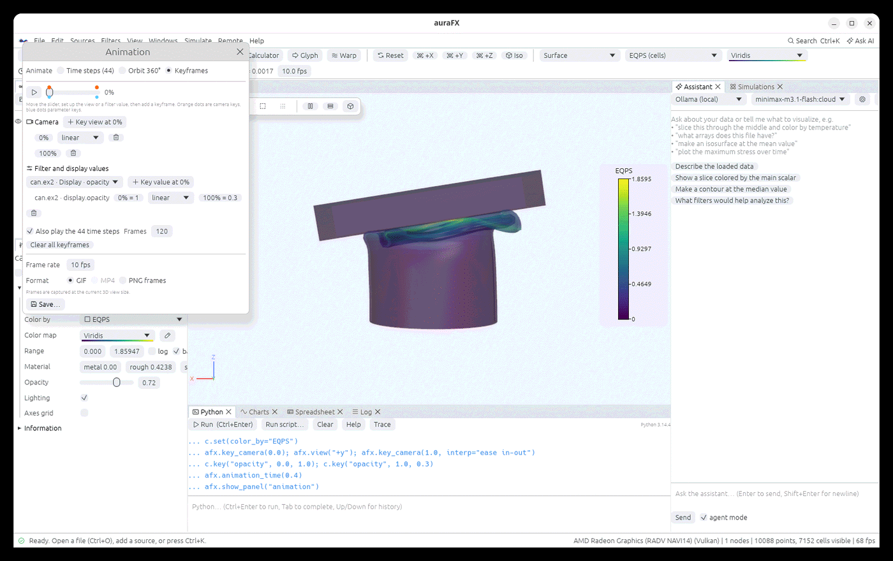

# Time, charts and animation

## Time steps

Files with several time steps (Exodus, `.pvd`, OpenFOAM cases, LAMMPS dumps, numbered file
series, VTKHDF, EnSight, Xdmf, NetCDF, CGNS), and the Spatio Temporal Harmonics source, show
the **time toolbar**: play/pause, first,
previous, next, last, a slider, the step number, the time value and the playback speed.
Every filter follows the time step; filters that look across time (Temporal Statistics,
Particle Tracer, Temporal Interpolator…) read the steps they need.

```python
afx.times()          # the time values
afx.time(20)         # go to step 20
```



## Charts

The **Charts** panel plots the arrays of an object as lines, points, lines with markers or bars,
with zoom, a legend and log axes:

- **Plot Over Line** (a filter) plots the arrays along a line;
- **Edit › Plot Over Time…** or `afx.over_time(node, "EQPS", stat="max")` plots a statistic
  (max, min, mean, sum, or the value of a global variable) over every time step;
- `afx.plot(x, y, label="T")` plots your own NumPy arrays; `afx.clear_plots()` empties the panel.

The boxes along the top of a chart choose, from left to right: the **object** it plots
(*Selected object* follows whatever is selected in the Pipeline), whether a mesh's **point**
or **cell** arrays are plotted, the **X** array (or the index), the **Y** arrays, the
**style** (lines, points, lines and markers, bars), and **log x** / **log y** (values that are
not positive are left out). **CSV** saves the plotted values; **Picture…** saves the chart as a
PNG without these controls.

### Several chart views

A chart view can be opened for every object you want to compare, and each keeps its own
object, arrays and style while you select other things:

- **View › New Chart View** opens one for the selected object;
- right-click an object in the Pipeline › **Plot in a new chart view**;
- **New chart view** on any chart opens another one beside it.

Chart views open beside the Charts panel and can be dragged, split and stacked like the 3D
views (drag a tab to an edge). Closing a chart's tab closes the view. State files
(`.afx`) keep the chart views and reopen them.



```python
line = src.plot_over_line(point1=[0, 0, -10], point2=[0, 0, 10])
hist = src.histogram(array="Temp", bins=30)
a = line.plot("Temp", "Pres", x="arc_length")       # a new chart view of the line
b = hist.plot("Temp_count", style="bars")           # another one, of the histogram
afx.chart_view(view=a, log_y=True)                  # change view a later
afx.chart_view(y="V_X")                             # a view that follows the selection
afx.chart_views()                                   # a list of dicts, one per view
afx.plot(t, energy, label="E", view=b)              # your own line in chart view b
afx.close_chart_view(a)
```

`node.plot(*arrays, x=..., style=..., data="points"|"cells", log_x=..., log_y=..., title=...)`
and `afx.chart_view(node=None, y=..., x=..., style=..., data=..., log_x=..., log_y=...,
title=..., view=None)` return the view's number (`view=0` is the Charts panel). Charts
plot up to two million values per array.

The **Spreadsheet** panel shows the selected object's points, cells or field data as a table
with sorting, column choice and export to CSV.

### Choosing and changing time steps

In **Filters › Temporal**:

- **Extract Time Steps** keeps some steps: a list such as `0, 3, 5-8, 10:20:2` (step numbers from
  0; `start:stop:stride` leaves out stop), or every N-th step from a first one.
- **Generate Time Steps** gives data a new set of evenly spaced time values (each shows the data at
  that time, or at the step before it); static data gets a time axis to animate filters against.
- **Force Time** always shows the data at one step (or time), whatever time the window is at: put
  step 0 beside the animation to compare.
- **Temporal Snap to Time Step** shows the data at one of its own steps (nearest, previous or next)
  when the window is at a time in between, set by other data or by Temporal Interpolator.
- **Temporal Cache** keeps the last steps shown in memory, so stepping back and forth or replaying
  a loop does not read and filter them again.

Particle Tracer, Particle Path and Streak Line release their seeds again every N steps with
*Release again every N steps*, which makes streak lines from a continuous injection.

```python
first = case.force_time(step=0)                 # step 0 beside the playing data
every5 = case.extract_time_steps(stride=5)
smooth = case.temporal_interpolator(interval=0.01).temporal_snap_to_time_step(mode="Previous")
```



## Animation

**File › Animation…** records one of three things:

| Mode | What it plays |
|---|---|
| **Time steps** | every time step of the data |
| **Orbit 360°** | the camera turning once around the data (choose the number of frames) |
| **Keyframes** | the keyframe timeline described below |

Pick the frame rate and the format: **GIF**, **MP4** (needs `ffmpeg` on the PATH) or a folder
of **PNG frames**. Frames are captured at the 3D view's size, with the legend, labels and
annotations.

**Record › all views** records every visible 3D view and chart view in each frame, placed as
they are laid out in the window: the charts follow the time steps (a chart of a Plot Over Line
changes with the data) while the 3D views play. **Record › chart views** records only the
charts. These frames have the window's pixels; the Animation window is hidden while they are
recorded, and the charts' controls are left out.

```python
afx.save_animation("run.gif", fps=10)          # time steps (or keyframes if any)
afx.save_animation("turn.mp4", orbit=72)       # a turntable
afx.save_animation("all.mp4", views="all")     # every 3D view and chart view, as laid out
```

## Keyframes



The **Keyframes** tab of the Animation window is a timeline from 0 % to 100 %:

1. Move the slider, set up the view, press **Key view at …** to record the camera.
2. Select a filter or display value in the list (any numeric filter parameter, or opacity,
   point size, line width, colors…), set it, press **Key value at …**.
3. Each key has an interpolation menu for the way it moves on to the next key: **linear**,
   **step** (hold), **ease in**, **ease out**, **ease in-out**, **exponential** (constant
   ratio, for zooms and scales) or **wave** (there and back, a sinusoid).
4. Press play to preview; tick **Also play the time steps** to run the data's time along
   the animation; set the number of **Frames**; **Save…** records it.

The camera moves on a sphere around the focal point, so turns look even and zooms do not
rush. Orange dots on the timeline are camera keys, blue dots value keys; click a key to jump
to it, right-click to delete it.

```python
afx.key_camera(0.0); afx.view("+y"); afx.key_camera(1.0, interp="ease in-out")
c.key("opacity", 0.0, 1.0); c.key("opacity", 1.0, 0.3)
s.key("origin", 0.5, (0, 2, 0), interp="wave")
afx.animation(frames=120, time=True)
afx.animation_time(0.4)                        # preview a moment
afx.save_animation("keys.mp4", fps=24)
afx.clear_keyframes()
```

## Animations driven by a function

`afx.save_animation("a.mp4", cue=f, frames=60)` calls your function `f(t)` with the
animation time `t` from 0 to 1 before each frame (after the keyframes are applied), so
anything can change between frames: filter values, colors, the data loaded. The call returns
when the file is written.

```python
def cue(t):
    c.set(values=[350 + 500 * t])
afx.save_animation("contour_sweep.gif", fps=8, cue=cue, frames=40)
```
