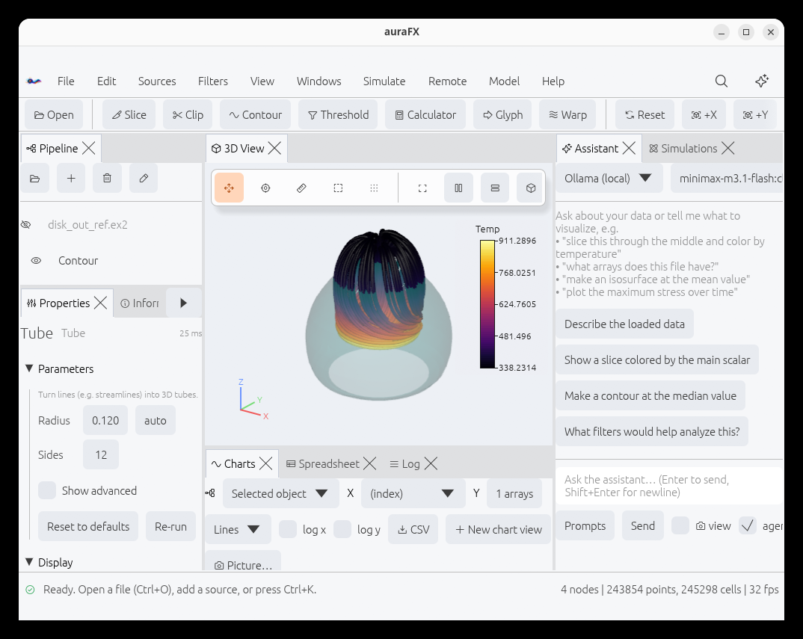
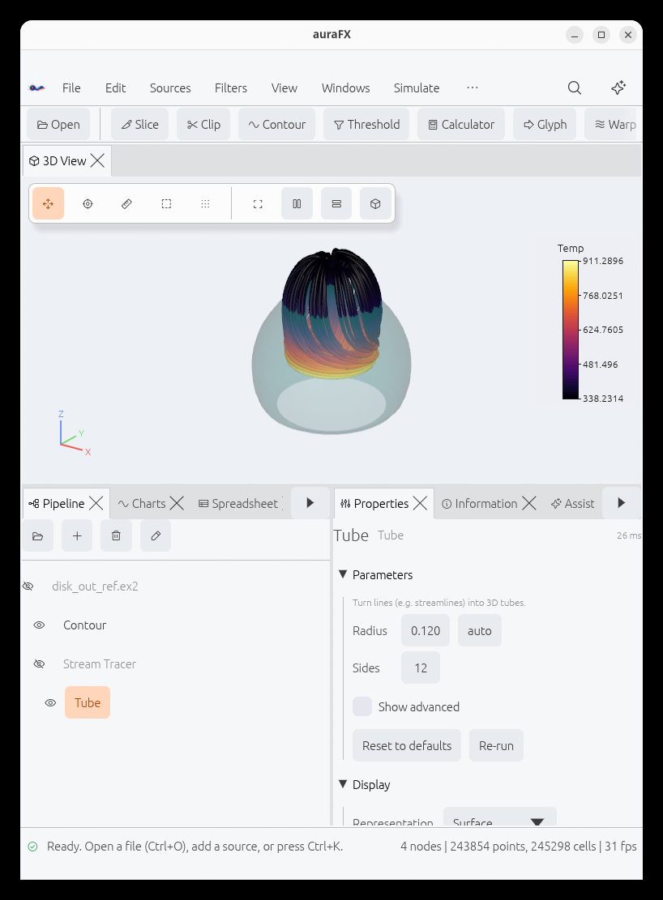
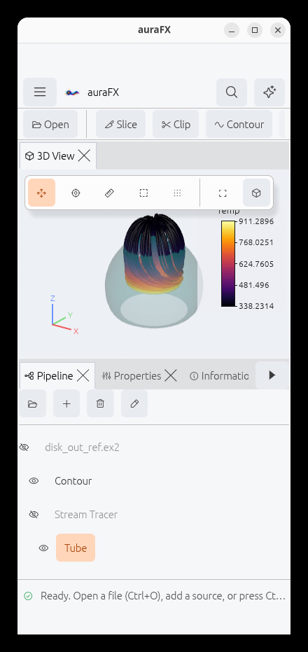
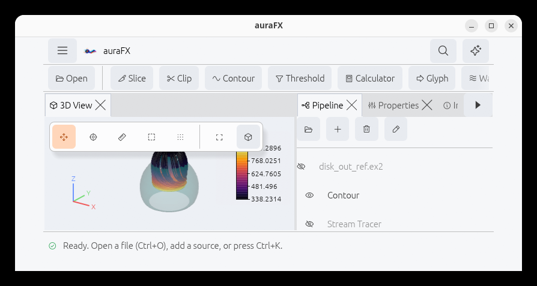
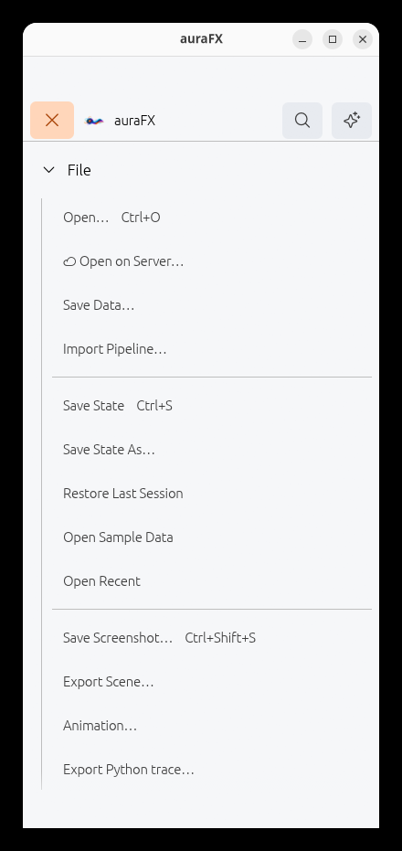
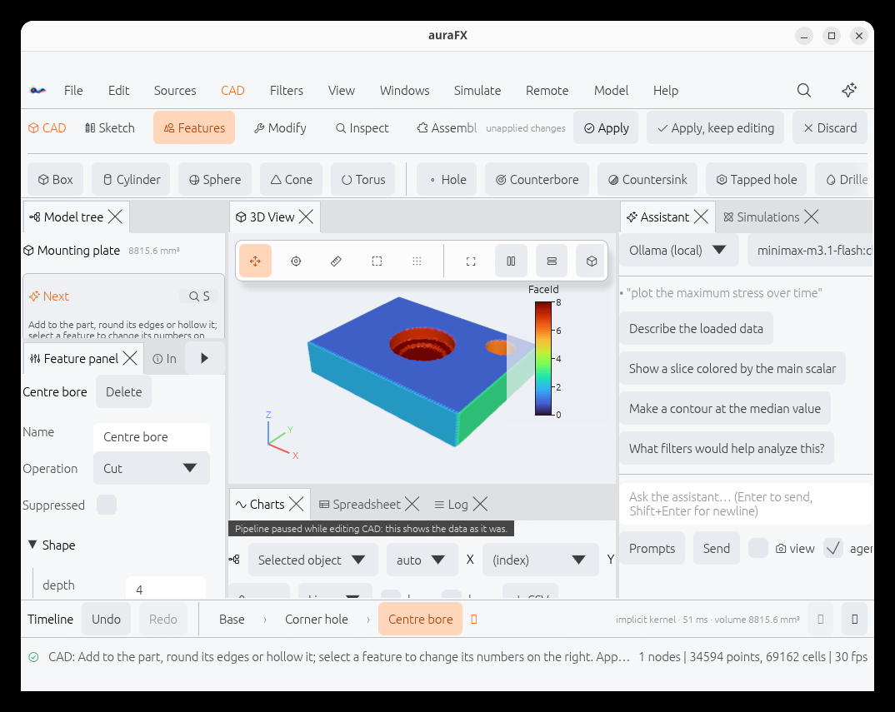
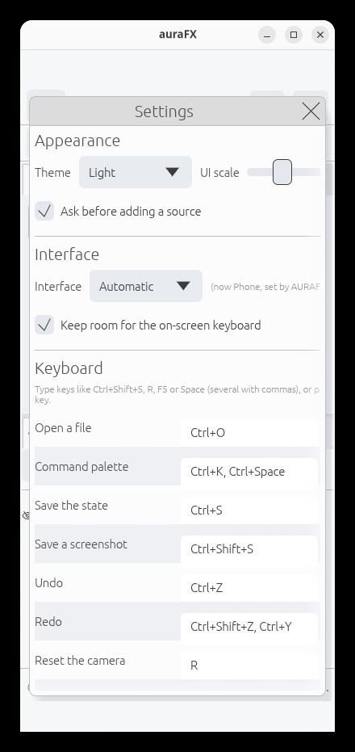

# Tablets and phones

On an iPad, an iPhone or an Android device auraFX shows a touch interface: the same program,
with controls sized for a finger and a layout that fits the screen. There are three interfaces:

| Interface | For | What changes |
|---|---|---|
| **Desktop** | a mouse and a keyboard | nothing: the interface of the other chapters |
| **Tablet** | a screen whose shorter side is 600 points or more | larger controls, tabs and menu rows; windows that stay on the screen; layouts that follow how the tablet is held |
| **Phone** | smaller screens | the Tablet's controls, one menu button in place of the menu bar, and the 3D view with one group of tabs |

The interface is chosen by itself (Desktop on a computer; Tablet or Phone on a tablet or a
phone, by its screen), and **Settings › Interface › Interface** sets it by hand: *Automatic*,
*Desktop*, *Tablet* or *Phone*. A small laptop with a touch screen can use Tablet; an iPad with
a keyboard and a trackpad can use Desktop.

## Tablet



Held wide, a tablet shows the workbench: Pipeline and Properties on the left, the 3D view with
Charts, Spreadsheet and Log below it, the Assistant on the right. Buttons, sliders, tick boxes,
tabs and menu rows are tall enough to tap, the scroll bars are wider, and the text is a little
larger. The tool row scrolls sideways when it is longer than the screen.



Held tall, the 3D view takes the upper half and the panels sit below it in two groups of tabs.
The menus that do not fit the width are in the last menu of the bar (**⋯**), so none is cut off.

## Phone



A phone shows the 3D view and one group of tabs: Pipeline, Properties, Information, Charts,
Spreadsheet, Assistant and Log. The tab bar scrolls sideways. Held wide, the view is on the
left and the tabs are on the right:



The top bar has the **menu button** (three lines) on the left and the **Ask AI** and **Search**
buttons on the right. The menu button opens every menu of the menu bar as a list over the
whole screen: tap a menu's name to see its items, tap an item to choose it, tap the button
again (now a ×) to close the list.



The **Search** button opens the command palette (see [Views, layouts and the
window](views.md#command-palette)), which is the quickest way to a filter on a small screen.

The button with four corners in the 3D view's toolbar gives the view the **whole screen** (the
tool row, the status line and the panels are put away); the same button, or the one that
appears in the top bar, brings them back. It is there on a tablet too.


### The CAD environment



On a tablet the ribbon keeps **Apply**, **Apply, keep editing** and **Discard** in view on the
right; its tabs and its row of commands scroll sideways when they are wider than the screen.
The CAD environment also opens on a phone, where both rows and the timeline scroll sideways
and the model tree and the feature panel are tabs, but it is made for a larger screen (the
app says so once): a tablet held wide has room for it.

## Fingers in the 3D view

| Gesture | Does |
|---|---|
| Drag with one finger | orbit |
| Drag with two fingers | pan |
| Pinch | zoom |
| Twist two fingers | turn the view about its axis |
| Double tap | reset the camera to the visible data |
| Press and hold | the menu a right-click opens: what can be done with the object under the finger |

The mode buttons of the view's toolbar (pick, ruler, select cells, select points) work with a
tap or a one-finger drag as they do with the mouse.

**Press and hold** stands in for the right mouse button everywhere: on an object in the
Pipeline, on a CAD feature, on a step of the timeline. Pressing and holding a button shows the
text a mouse shows when it rests on it, which is how to read why a button is faded or
disabled; lift the finger after a second and the button is not pressed.

## Windows and the keyboard



Floating windows (Settings, Save Screenshot, Animation, the file browser, the Welcome window
and the others) stay inside the screen and are placed by the app: a finger on a window or on a
text box in it does not drag the window away. A window taller than the screen scrolls; on a
phone a window is as wide as the screen.

Tapping a text box puts the cursor in it and brings up the on-screen keyboard. On Android the
app shrinks to the part of the screen above the keyboard. On an iPad or an iPhone the app
leaves the lower part of the screen free while you type (about a third of a tall screen, half
of a wide one); with a hardware keyboard turn that off with **Settings › Interface › Keep room
for the on-screen keyboard**.

The app stays clear of the strips the system keeps for itself: the status bar, a camera
cut-out, the home indicator or the gesture bar, in both ways of holding the device. The strips
are filled with the panel color.

## Layouts by shape

In the Tablet and Phone interfaces the layout follows the screen: turn the device and the
panels are rearranged, keeping which ones are open. Choosing a layout by name in the
**Windows** menu stops that until **Automatic** is chosen again. The same layouts are in the
Desktop interface (see [Layouts by window shape](views.md#layouts-by-window-shape)).

## Limits

- The tablet and phone builds have no embedded Python: the Python console, the Notebook and
  Python plugins are not there. Filters, sources, readers, the 3D view, charts, the
  spreadsheet, the CAD environment and the assistant are.
- The simulation runner starts programs on the machine or over SSH, which a tablet's or a
  phone's system does not allow; it is left out of the automatic layouts there.
- Files are opened with the app's own file browser, from the app's documents folder.
- On Android the keyboard types plain characters; word suggestions and input methods that
  compose characters (accents by long press, Chinese, Japanese, Korean) are not passed to the app.

## Trying it on a computer

The touch interfaces can be tried on a computer, which is also how the pictures of this chapter
are made:

```sh
AURAFX_INTERFACE=phone AURAFX_WINDOW=390x844 AURAFX_SAFE_AREA=47,34,0,0 aurafx
```

| Variable | Meaning |
|---|---|
| `AURAFX_INTERFACE` | `desktop`, `tablet` or `phone`: the interface, whatever the setting is |
| `AURAFX_WINDOW` | the size of the window in points, as `WIDTHxHEIGHT` |
| `AURAFX_SAFE_AREA` | strips to keep free as `top,bottom,left,right` in points, as a device's status bar and home indicator would |
| `AURAFX_KEYBOARD` | a height in points to keep free at the bottom while a text box has the focus, as an on-screen keyboard would |
