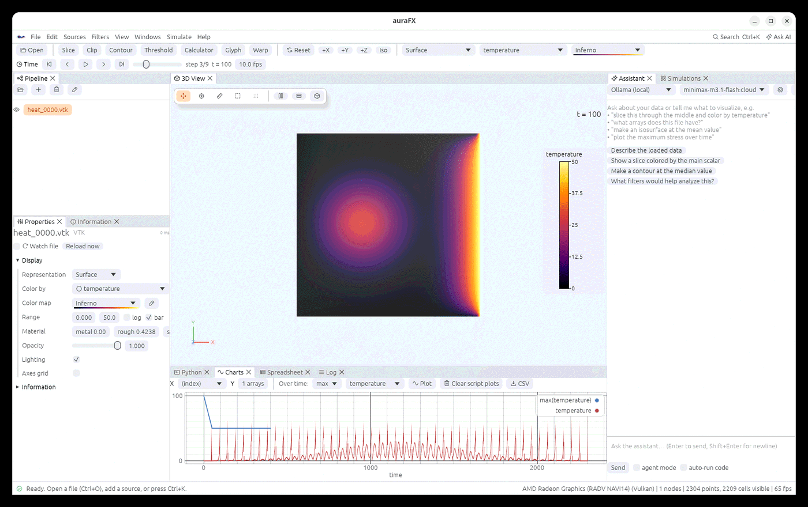

# Tutorials and examples

The `examples/` folder of the repository holds small, complete workflows. The simulations are
plain Python with NumPy that write a VTK file every few steps; run them from the Simulations
panel (template **Python pipeline**, see [Running simulations](simulations.md)) or with
`afx.submit`, and auraFX opens the files when the run ends. The tutorials are auraFX scripts:
`aurafx --script <file>`, or paste them into the Python console.

| Folder | What it shows |
|---|---|
| `examples/heat2d/` | 2-D heat diffusion: the simplest Python-pipeline run; five output files are included, so it opens without running anything |
| `examples/phase_field/` | spinodal decomposition (the Cahn-Hilliard equation, a spectral solver in NumPy): a phase-field time series in about ten seconds |
| `examples/grain_growth/` | grain growth with the Potts model on a 2-D lattice: grain ids over Monte Carlo sweeps, for the grain filters |
| `examples/polycrystal/` | geometry → hexahedral mesh → Voronoi grains → quality table → Exodus and `.tex` files → a crystal-plasticity case |
| `examples/ebsd/` | an EBSD volume → grains → sizes, shapes, average orientations, IPF colors, pole figures, a CSV table |

## A simulation that writes a time series

Open the Simulations panel, choose **Python pipeline**, set the working directory to
`examples/phase_field` and the input to `cahn_hilliard.py`, set **Result files** to
`ch_*.vtk` and press **Run**. The log shows each step; when the run ends the series opens,
colored by the concentration. Press play in the time toolbar, or

```python
afx.submit("python3 -u cahn_hilliard.py", workdir="examples/phase_field", outputs="ch_*.vtk", auto_load=True)
afx.save_animation("spinodal.mp4", fps=12)
```

The grain-growth example works the same way (`potts.py`, result files `grains_*.vtk`); color
it by `grain_id` with the Turbo color map. **Segment Features** (method Scalar, tolerance 0) on
a step gives feature ids the grain filters measure (sizes, neighbors, shapes).



## From a geometry to a solver case

`examples/polycrystal/polycrystal_case.py` builds a plate with a hole, meshes it with
hexahedra, assigns 60 grains with one element block each, writes the mesh, the orientations
and the input files of a crystal-plasticity case into `polycrystal_out/`. The chapters
[Geometry and meshing](geometry.md) and [Running simulations](simulations.md) explain every
step; with a solver installed, `afx.run_case` runs the case and opens the result.

## An EBSD volume to statistics

`examples/ebsd/ebsd_analysis.py` segments the AM Bench window shipped in `testdata/dream3d`,
cleans the grains, measures them, colors them by the inverse pole figure key, draws the
pole figures in a second view and writes the grain table as `grains.csv`
([Grains and crystals](grains.md)).
