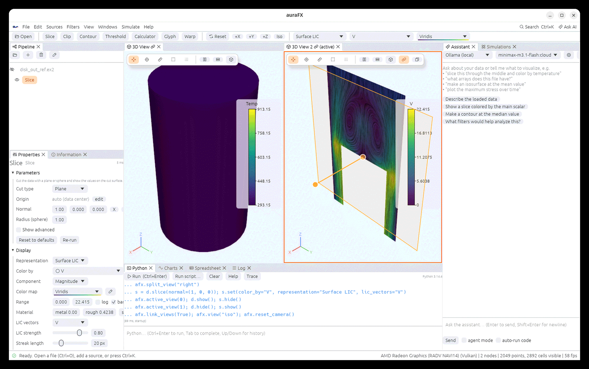

# Views, layouts and the window

## The 3D view

| Action | Mouse / key |
|---|---|
| rotate | drag |
| pan | middle-drag, or Shift+drag |
| zoom | wheel, right-drag, or Ctrl+drag; pinch on a trackpad |
| fit the data | double-click, **R**, or the **Reset** button |
| look along an axis | **+X**, **+Y**, **+Z**, **Iso** in the toolbar, or **View › Look from…** |
| orthographic projection | **View › Orthographic projection** |
| orientation axes (bottom left) | **View › Orientation axes** |

The small toolbar inside the view switches the mouse mode: navigate (**Esc**), pick (**P**),
ruler (**M**), select cells (**S**) and select points (**D**); see
[Selection, picking and widgets](selection-widgets.md).

```python
afx.view("iso"); afx.view("+x"); afx.view([1, 0.5, 0.3])   # a direction from the data to the camera
afx.reset_camera()
```

## Several views



The split buttons in the view toolbar (or **Windows › Split view right / down**,
`afx.split_view("right")`) add a 3D view next to the active one. Each view has its own camera
and its own list of visible objects; click a view to make it active (orange frame), then the
eye icons in the Pipeline and `node.show()`/`hide()` apply to it. From Python,
`afx.active_view(1)` makes a view active (0 is the first one) and returns once it is, so the
lines after it act on that view:

```python
afx.split_view("right")
afx.active_view(0); d.show(); s.hide()   # left: the data
afx.active_view(1); d.hide(); s.show()   # right: the slice
```

- **Link** (the chain button, `afx.link_views(True)`) keeps the cameras of the linked views
  together; **Match** (`afx.match_views()`) copies the active camera to the others once.
- Right-click an object › **Send to view** moves it to another view or into a new one
  (`node.send_to_view(1)` or `"right"`, `keep=True` to keep it in the current view too).
- Close a view with the × on its tab; its objects stay in the pipeline.

## Panels and layouts

The **Windows** menu lists every panel (Pipeline, Properties, Information, 3D views, Python,
Charts, Spreadsheet, Log, Assistant, Simulations) with a tick to show or hide it, and four
layout presets:

| Preset | Shows |
|---|---|
| **Visualize** | pipeline, properties and a large 3D view |
| **Analyze** | the view with charts and the spreadsheet |
| **Script** | the view with a tall Python console |
| **Simulate** | the simulations panel, the log and the view |

**Reset layout** returns to the default. Panels can be dragged by their tabs into new
positions or into tabs of each other; the arrangement is remembered between sessions.

```python
afx.layout("analyze")
afx.show_panel("Charts"); afx.hide_panel("Log")
```

## Theme and scale

**Settings › Theme** chooses dark, light or follow-the-system; the 3D background follows the
theme (and can be set per theme). **UI scale** enlarges the whole interface. From Python:
`afx.set_theme("light")`.

## Command palette

**Ctrl+K** (or Ctrl+Space, or the **Search** button) opens the palette: type a few letters of
a filter, a source, a panel or an action (open, save screenshot, reset camera, undo, light
theme, ask the AI…) and press Enter. It is the fastest way to reach anything in the app.

## Undo, redo and state

**Edit › Undo / Redo** (Ctrl+Z, Ctrl+Y) cover opening files, adding and deleting filters,
parameter and display changes. **File › Save State** writes everything to an `.afx` file (see
[Getting started](getting-started.md)); `afx.save_state("work.afx")` and
`afx.load_state("work.afx")` do the same from Python.
